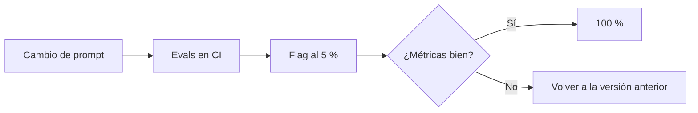

Al terminar esta lección tendrás lo que separa un agente que funciona en tu máquina de uno que atiende tráfico real: claves bien guardadas, llamadas que aguantan errores transitorios y límites de tasa, prompts con número de versión y un interruptor para activar un cambio a una parte de los usuarios o apagarlo en segundos.

## La idea

Desplegar un agente tiene dos mitades. La primera es la de cualquier servicio: secretos, reintentos, tiempos de espera, límites. La segunda es propia de los sistemas con modelos: **el comportamiento cambia con el texto del prompt y la versión del modelo**, sin tocar una línea de lógica. Esos cambios tienen que pasar por el mismo control que el código: revisión, evals, despliegue gradual y vuelta atrás.



## Secretos

- La clave de API se lee del entorno (`ANTHROPIC_API_KEY`) o de un gestor de secretos. Nunca en el repositorio, ni en el código, ni en los logs.
- Una clave distinta por entorno (desarrollo, CI, producción). Así sabes de dónde viene cada consumo y puedes revocar una sin afectar a las demás.
- Configura en la consola del proveedor un límite de gasto por clave o por espacio de trabajo cuando esté disponible.
- Rota las claves de forma periódica y en cuanto sospeches una fuga. Si una clave aparece en un commit, revócala: borrarla del historial no basta.
- Las credenciales de tus herramientas (base de datos, API de pagos) siguen las mismas reglas y, además, el [[glosario/minimo-privilegio]] de [[roadmap/100-produccion/04-seguridad-y-prompt-injection]].

## Límites de tasa y reintentos

El proveedor limita cuántas peticiones y tokens puedes usar por minuto. Al superarlo responde con un error 429. También verás errores transitorios del servidor (5xx, incluida la sobrecarga) y cortes de red. Todos merecen un reintento; los errores de validación (400) o de autenticación (401), no: repetir la misma petición dará el mismo error.

El SDK ya reintenta algunos de estos errores con espera creciente. Ajusta cuántas veces con `max_retries` y el tiempo máximo con `timeout` al crear el cliente. Si necesitas más control, por ejemplo un presupuesto total de tiempo por petición del usuario, desactiva los reintentos del SDK y escribe los tuyos:

```python tab="Python" title="reintentos.py"
import random, time
import anthropic

MODEL = "claude-sonnet-5-5"
client = anthropic.Anthropic(max_retries=0, timeout=60.0)

REINTENTABLES = (anthropic.RateLimitError, anthropic.APIConnectionError,
                 anthropic.InternalServerError)

def crear_con_reintentos(max_intentos: int = 5, base: float = 1.0, tope: float = 30.0, **kwargs):
    for intento in range(max_intentos):
        try:
            return client.messages.create(model=MODEL, **kwargs)
        except REINTENTABLES as e:
            if intento == max_intentos - 1:
                raise
            espera = min(tope, base * 2 ** intento) * random.uniform(0.5, 1.0)  # backoff con jitter
            respuesta = getattr(e, "response", None)
            if respuesta is not None and respuesta.headers.get("retry-after"):
                espera = max(espera, float(respuesta.headers["retry-after"]))
            time.sleep(espera)
```

```ts tab="TypeScript" title="reintentos.ts"
import Anthropic from "@anthropic-ai/sdk";

const MODEL = "claude-sonnet-5-5";
const client = new Anthropic({ maxRetries: 0, timeout: 60_000 });

const reintentable = (e: unknown) =>
  e instanceof Anthropic.RateLimitError ||
  e instanceof Anthropic.APIConnectionError ||
  e instanceof Anthropic.InternalServerError;

export async function crearConReintentos(
  params: Omit<Anthropic.MessageCreateParamsNonStreaming, "model">,
  maxIntentos = 5,
) {
  for (let intento = 0; ; intento++) {
    try {
      return await client.messages.create({ model: MODEL, ...params });
    } catch (e) {
      if (!reintentable(e) || intento === maxIntentos - 1) throw e;
      const espera = Math.min(30_000, 1000 * 2 ** intento) * (0.5 + Math.random() / 2);
      await new Promise((r) => setTimeout(r, espera));
    }
  }
}
```

El *jitter* (la parte aleatoria de la espera) evita que cien peticiones que fallaron a la vez vuelvan a la vez. La cabecera `retry-after`, si viene, indica cuánto esperar como mínimo.

Reintentar una llamada al modelo es seguro: no tiene efectos fuera. **Reintentar una herramienta con efectos no lo es.** Si el reembolso dio un error de red, puede que se ejecutara. Usa claves de idempotencia ([[roadmap/100-produccion/05-humano-en-el-bucle]]) o comprueba el estado antes de repetir.

Los reintentos no arreglan un tráfico mayor que tu límite. Para eso: limita la concurrencia con un semáforo ([[roadmap/60-multiagente/04-paralelismo]]), pon el trabajo que no es interactivo en una cola, reduce tokens por petición con [[glosario/prompt-caching]] y pide al proveedor un límite mayor si tu uso lo justifica. Más detalle en [[recetas/reintentos-y-limites-de-tasa]].

## Versionar prompts y configuración

Trata el prompt como código. Vive en archivos del repositorio, junto con la configuración que cambia el comportamiento: modelo, `max_tokens`, [[glosario/esfuerzo]], definiciones de herramientas.

```text title="prompts/"
prompts/
├── soporte/
│   ├── v14.md
│   ├── v15.md
│   └── config.yaml      # modelo, max_tokens, herramientas por versión
```

```python title="config_prompt.py"
import hashlib, pathlib, yaml

def cargar(nombre: str, version: str) -> dict:
    base = pathlib.Path("prompts") / nombre
    texto = (base / f"{version}.md").read_text(encoding="utf-8")
    config = yaml.safe_load((base / "config.yaml").read_text(encoding="utf-8"))[version]
    huella = hashlib.sha256(texto.encode()).hexdigest()[:8]
    return {"version": f"{nombre}-{version}-{huella}", "system": texto, **config}
```

La huella del contenido evita un error clásico: editar `v14.md` sin cambiar el número y tener dos comportamientos con el mismo nombre. Registra `version` en cada traza ([[roadmap/100-produccion/01-observabilidad-y-trazas]]) para poder comparar coste, latencia y calidad por versión.

Fija también la versión del modelo. Si usas un alias que apunta siempre al modelo más reciente, el comportamiento puede cambiar sin que despliegues nada. Consulta en la [documentación oficial](https://platform.claude.com/docs) qué identificadores son fijos y cuándo se retiran los modelos antiguos, y planifica las migraciones como cualquier otro cambio: con evals.

## Feature flags: desplegar poco a poco

Un *feature flag* decide en tiempo de ejecución qué versión usa cada petición. Te permite activar `v15` para un 5 % de los usuarios, mirar las métricas y subir el porcentaje, o volver a `v14` al instante si algo va mal, sin desplegar.

```python title="flags.py"
import hashlib

FLAGS = {"prompt_soporte": {"nueva": "v15", "estable": "v14", "porcentaje": 5}}
# en producción, léelo de tu servicio de flags o de una tabla para cambiarlo sin desplegar

def version_para(flag: str, usuario_id: str) -> str:
    f = FLAGS[flag]
    cubo = int(hashlib.sha256(f"{flag}:{usuario_id}".encode()).hexdigest(), 16) % 100
    return f["nueva"] if cubo < f["porcentaje"] else f["estable"]
```

El hash del usuario hace que cada persona vea siempre la misma versión: su experiencia es coherente y las métricas por versión no se mezclan. Poner `porcentaje` a 0 es el interruptor de emergencia.

Úsalo también como *kill switch* para capacidades enteras: una herramienta de escritura que puedes desactivar en segundos si detectas un abuso o un error.

> [!consejo] Decide antes qué significa «va bien»
> Antes de subir el porcentaje, apunta qué métricas miras y con qué umbral: tasa de errores de herramienta, `stop_reason` inesperados, coste y latencia por petición, quejas o escaladas a humanos. Si lo decides después de ver los datos, cualquier resultado parecerá aceptable.

## Lista para el día del despliegue

1. Evals en verde en CI para la versión nueva ([[roadmap/80-evals/05-regresiones-en-ci]]).
2. Clave de producción en el gestor de secretos y límite de gasto configurado.
3. Reintentos con backoff, timeouts y límite de concurrencia activos.
4. Versión de prompt y modelo registrada en las trazas.
5. Flag al porcentaje inicial y métricas de comparación preparadas.
6. Herramientas irreversibles detrás de aprobación humana.
7. Procedimiento de vuelta atrás probado al menos una vez.

Antes de cada lanzamiento, repasa también [[modelos/09-checklist-produccion]].

## Errores frecuentes

- La misma clave de API en desarrollo, CI y producción.
- Reintentar errores 400 o reintentar sin espera ni jitter.
- Reintentar herramientas con efectos sin idempotencia.
- Editar prompts en producción a mano, sin versión ni evals.
- Usar alias de modelo que cambian solos.
- Desplegar al 100 % de golpe sin forma rápida de volver atrás.

## Ejercicio

> [!ejercicio] Despliegue gradual de un prompt
> Pasa tu prompt a `prompts/` con dos versiones y `config.yaml`. Implementa `crear_con_reintentos` y comprueba que reintenta simulando un error de conexión (por ejemplo, con un `base_url` que no responde). Implementa `version_para` y envía 200 peticiones simuladas con usuarios distintos al 10 %. Después pon el porcentaje a 0 y repite.
>
> Está bien si cada traza registra la versión con su huella, si alrededor del 10 % de los usuarios recibe la versión nueva y siempre los mismos, si con porcentaje 0 nadie la recibe, si un 400 no se reintenta y si un error de conexión se reintenta con esperas crecientes que puedes ver en los registros.

> [!ejercicio]- Pistas
> Para simular el error, crea un cliente con `base_url="http://127.0.0.1:9"` y un `timeout` corto. Para comprobar que el reparto es estable, llama a `version_para` dos veces con el mismo usuario y compara.

## Resumen

- Claves en el entorno o en un gestor de secretos, una por entorno, con límite de gasto y rotación.
- Reintenta 429, 5xx y errores de red con backoff exponencial y jitter; respeta `retry-after`; no reintentes 400.
- Reintentar el modelo es seguro; reintentar herramientas con efectos exige idempotencia.
- Prompts y configuración versionados en el repositorio, con huella, y versión registrada en cada traza.
- Feature flags por hash de usuario para desplegar poco a poco y volver atrás sin desplegar.

## Para seguir

- [[recetas/reintentos-y-limites-de-tasa]]
- [[modelos/09-checklist-produccion]]
- [[cursos/seguridad-y-prompt-injection/index]]
