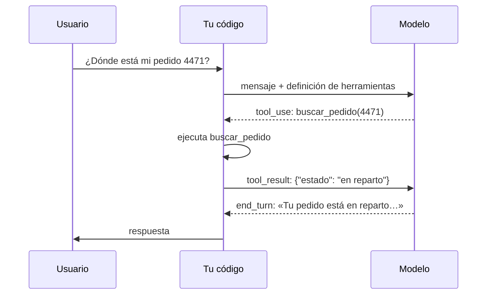

Al terminar esta lección tendrás un programa en el que el modelo decide que necesita un dato, te pide que ejecutes una función para obtenerlo y responde al usuario con el resultado. Entenderás el protocolo exacto que hay detrás, y podrás escribir el bucle sin los errores que hacen que la API rechace la petición.

## La idea

Un modelo no puede ejecutar nada. No tiene acceso a tu base de datos, ni a internet, ni a tu sistema de archivos. Lo que sí puede hacer es **pedir** que ejecutes algo. A esta técnica se le llama [[glosario/tool-use|tool use]] o [[glosario/function-calling|function calling]].

Funciona así: le describes al modelo qué herramientas existen (nombre, para qué sirven y qué argumentos aceptan). Cuando el modelo decide que necesita una, en vez de responder con texto responde con un bloque `tool_use` que dice qué herramienta quiere y con qué argumentos. **Tu código** la ejecuta y le devuelve el resultado en un bloque `tool_result`. El modelo lo lee y continúa: o responde, o pide otra herramienta.



La decisión de qué herramienta usar es del modelo. La ejecución es siempre tuya. Esa separación es lo que te permite validar, limitar y registrar todo lo que pasa.

## Paso 1: describe la herramienta

Una herramienta se define con tres campos: `name`, `description` e `input_schema`, que es un JSON Schema con los argumentos. En [[roadmap/20-herramientas/02-definir-herramientas]] verás cómo escribirlos bien; de momento, uno sencillo:

```python title="herramientas.py"
PEDIDOS = {
    "4471": {"estado": "en reparto", "entrega_estimada": "2026-09-25"},
    "4480": {"estado": "entregado", "entrega_estimada": "2026-09-20"},
}

def buscar_pedido(id_pedido: str) -> dict:
    return PEDIDOS.get(id_pedido, {"error": f"No existe el pedido {id_pedido}"})

TOOLS = [{
    "name": "buscar_pedido",
    "description": "Devuelve el estado y la fecha estimada de entrega de un pedido. "
                   "Úsala cuando el usuario pregunte por un pedido concreto y dé su número.",
    "input_schema": {
        "type": "object",
        "properties": {"id_pedido": {"type": "string", "description": "Número del pedido, p. ej. 4471"}},
        "required": ["id_pedido"],
    },
}]

FUNCIONES = {"buscar_pedido": buscar_pedido}
```

## Paso 2: lee la respuesta con `tool_use`

Si envías una pregunta con `tools=TOOLS`, la respuesta puede traer `stop_reason: "tool_use"` y un `content` como este:

```text
# salida de ejemplo
[
  {"type": "text", "text": "Voy a consultar el pedido."},
  {"type": "tool_use", "id": "toolu_01A...", "name": "buscar_pedido", "input": {"id_pedido": "4471"}}
]
```

Puede venir un texto antes de la llamada, o no. Puede haber **varios** bloques `tool_use` en la misma respuesta, si el modelo decide que necesita varias cosas a la vez. Cada uno tiene un `id` único que tendrás que citar al devolver su resultado.

## Paso 3: devuelve el resultado

Para continuar, añades a la conversación dos mensajes:

1. Un mensaje `assistant` con **el `content` completo** que te devolvió el modelo, sin quitar nada (tampoco los bloques `thinking`: dentro de un turno con herramientas la API los necesita tal cual).
2. Un mensaje `user` con un bloque `tool_result` **por cada** `tool_use`, todos juntos y antes de cualquier texto.

```python
messages.append({"role": "assistant", "content": resp.content})
messages.append({"role": "user", "content": [
    {"type": "tool_result", "tool_use_id": "toolu_01A...", "content": '{"estado": "en reparto"}'},
]})
```

> [!aviso] Las tres reglas que rompen la petición
> Si falta un `tool_result` para algún `tool_use`, si el `tool_use_id` no coincide o si pones texto antes de los resultados, la API devuelve un error. Un resultado por cada llamada, todos en el mismo mensaje y al principio.

## El bucle completo

Junta los tres pasos en un bucle que se repite mientras el modelo pida herramientas:

```python tab="Python" title="asistente.py"
import json
import anthropic
from herramientas import TOOLS, FUNCIONES

MODEL = "claude-sonnet-5-5"
MAX_PASOS = 10
client = anthropic.Anthropic()

def responder(pregunta: str) -> str:
    messages = [{"role": "user", "content": pregunta}]
    for _ in range(MAX_PASOS):
        resp = client.messages.create(
            model=MODEL, max_tokens=1024, tools=TOOLS, messages=messages,
        )
        if resp.stop_reason != "tool_use":
            if resp.stop_reason == "max_tokens":
                print("[aviso] respuesta cortada")
            return "".join(b.text for b in resp.content if b.type == "text")

        messages.append({"role": "assistant", "content": resp.content})
        resultados = []
        for bloque in resp.content:
            if bloque.type == "tool_use":
                print(f"  -> {bloque.name}({bloque.input})")
                salida = FUNCIONES[bloque.name](**bloque.input)
                resultados.append({
                    "type": "tool_result",
                    "tool_use_id": bloque.id,
                    "content": json.dumps(salida, ensure_ascii=False),
                })
        messages.append({"role": "user", "content": resultados})
    return "No he podido terminar en el número máximo de pasos."

print(responder("Hola, ¿cuándo me llega el pedido 4471?"))
```

```ts tab="TypeScript" title="asistente.ts"
import Anthropic from "@anthropic-ai/sdk";

const MODEL = "claude-sonnet-5-5";
const MAX_PASOS = 10;
const client = new Anthropic();

const PEDIDOS: Record<string, object> = {
  "4471": { estado: "en reparto", entrega_estimada: "2026-09-25" },
  "4480": { estado: "entregado", entrega_estimada: "2026-09-20" },
};
const FUNCIONES: Record<string, (input: any) => object> = {
  buscar_pedido: ({ id_pedido }) => PEDIDOS[id_pedido] ?? { error: `No existe el pedido ${id_pedido}` },
};
const TOOLS: Anthropic.Tool[] = [{
  name: "buscar_pedido",
  description: "Devuelve el estado y la fecha estimada de entrega de un pedido. Úsala cuando el usuario pregunte por un pedido concreto y dé su número.",
  input_schema: {
    type: "object",
    properties: { id_pedido: { type: "string", description: "Número del pedido, p. ej. 4471" } },
    required: ["id_pedido"],
  },
}];

async function responder(pregunta: string): Promise<string> {
  const messages: Anthropic.MessageParam[] = [{ role: "user", content: pregunta }];
  for (let paso = 0; paso < MAX_PASOS; paso++) {
    const resp = await client.messages.create({ model: MODEL, max_tokens: 1024, tools: TOOLS, messages });
    if (resp.stop_reason !== "tool_use") {
      return resp.content.map((b) => (b.type === "text" ? b.text : "")).join("");
    }
    messages.push({ role: "assistant", content: resp.content });
    const resultados: Anthropic.ToolResultBlockParam[] = [];
    for (const b of resp.content) {
      if (b.type === "tool_use") {
        const salida = FUNCIONES[b.name](b.input);
        resultados.push({ type: "tool_result", tool_use_id: b.id, content: JSON.stringify(salida) });
      }
    }
    messages.push({ role: "user", content: resultados });
  }
  return "No he podido terminar en el número máximo de pasos.";
}

console.log(await responder("Hola, ¿cuándo me llega el pedido 4471?"));
```

Detalles que importan:

- **La condición del bucle es `stop_reason`**, no la presencia de texto. Con `tool_use` se sigue; con cualquier otro valor se termina. En un bucle de producción conviene tratar aparte `max_tokens`, `refusal` y `model_context_window_exceeded` (ver [[docs/fundamentos/06-motivos-de-parada-y-rechazos]]).
- **`MAX_PASOS`** impide que un error de diseño te deje en un bucle que gasta sin parar.
- **Las herramientas se envían en cada llamada**, porque la API no recuerda nada entre peticiones.
- **El contenido del resultado** es texto. Serializar a JSON es lo más habitual; también puedes devolver texto plano si es más claro.

## Varias herramientas en una respuesta

Si el usuario pregunta por dos pedidos, el modelo puede pedir `buscar_pedido` dos veces en la misma respuesta. El bucle de arriba ya lo maneja: recorre todos los bloques `tool_use` y devuelve todos los resultados juntos. Si tus herramientas son lentas y no dependen unas de otras, puedes ejecutarlas en paralelo; el orden de los `tool_result` en el mensaje no tiene que coincidir, porque cada uno lleva su `tool_use_id`.

## El mismo ciclo con LangChain

Los *frameworks* abiertos esconden este protocolo detrás de sus propios tipos, pero es el mismo. En [[herramientas/langchain|LangChain]] (MIT), `bind_tools` hace el papel de `tools=`, la respuesta es un `AIMessage` cuyas peticiones están en `tool_calls`, y cada resultado vuelve como un `ToolMessage` con el `tool_call_id` de su llamada:

```python tab="LangChain" title="asistente_langchain.py"
import json
from langchain.chat_models import init_chat_model
from langchain.messages import HumanMessage, ToolMessage
from langchain.tools import tool

MODEL = "anthropic:claude-sonnet-5-5"
MAX_PASOS = 10

PEDIDOS = {
    "4471": {"estado": "en reparto", "entrega_estimada": "2026-09-25"},
    "4480": {"estado": "entregado", "entrega_estimada": "2026-09-20"},
}

@tool
def buscar_pedido(id_pedido: str) -> str:
    """Devuelve el estado y la fecha estimada de entrega de un pedido. Úsala cuando el usuario pregunte por un pedido concreto y dé su número."""
    return json.dumps(PEDIDOS.get(id_pedido, {"error": f"No existe el pedido {id_pedido}"}), ensure_ascii=False)

HERRAMIENTAS = {"buscar_pedido": buscar_pedido}
llm = init_chat_model(MODEL, max_tokens=1024).bind_tools(list(HERRAMIENTAS.values()))

def responder(pregunta: str) -> str:
    messages = [HumanMessage(pregunta)]
    for _ in range(MAX_PASOS):
        ai = llm.invoke(messages)                 # AIMessage
        messages.append(ai)                       # el turno completo, como antes
        if not ai.tool_calls:                     # equivale a stop_reason != "tool_use"
            return ai.text
        for llamada in ai.tool_calls:             # [{"name", "args", "id"}, ...]
            salida = HERRAMIENTAS[llamada["name"]].invoke(llamada["args"])
            messages.append(ToolMessage(salida, tool_call_id=llamada["id"]))
    return "No he podido terminar en el número máximo de pasos."

print(responder("Hola, ¿cuándo me llega el pedido 4471?"))
```

| SDK de Anthropic | LangChain |
|---|---|
| `tools=TOOLS` en cada llamada | `llm.bind_tools([...])` una vez |
| `stop_reason == "tool_use"` | `ai.tool_calls` no está vacío |
| bloque `tool_use` (`id`, `name`, `input`) | elemento de `tool_calls` (`id`, `name`, `args`) |
| bloque `tool_result` con `tool_use_id` | `ToolMessage(contenido, tool_call_id=…)` |

LangChain junta los `ToolMessage` seguidos en un único mensaje `user` con todos los `tool_result` al enviarlos a Claude, así que las reglas del protocolo se cumplen solas. Lo que no hace por ti es el bucle: aquí lo sigues escribiendo tú. `create_agent` lo escribe por ti, y lo verás en [[roadmap/40-primer-agente/02-el-bucle-agentico]] y en [[cursos/langchain-y-langgraph/03-tu-primer-agente-con-create-agent]]. Con un modelo local basta con cambiar `llm` por `ChatOllama(model=…).bind_tools(...)`, siempre que el modelo admita *tool calling*.

## Errores frecuentes

- Quitar el bloque de texto del `content` del asistente antes de reenviarlo, o reenviar solo el texto.
- Devolver un resultado por mensaje en vez de todos en uno.
- Comprobar `if resp.content[0].type == "tool_use"` en vez de mirar `stop_reason`.
- No poner límite de pasos.
- Ejecutar lo que pide el modelo sin comprobar que la herramienta existe; lo resolverás en [[roadmap/20-herramientas/03-errores-e-is-error]].

## Ejercicio

> [!ejercicio] Dos herramientas, una conversación
> Añade a `herramientas.py` una segunda herramienta, `pedidos_de_cliente(email)`, que devuelva la lista de números de pedido de un cliente. Pregunta: «Soy ana@ejemplo.com, ¿cómo van mis pedidos?». Imprime cada llamada a herramienta y su resultado.
>
> Está bien si el modelo primero obtiene los pedidos del cliente y después consulta el estado de cada uno, si cada `tool_use` recibe exactamente un `tool_result` con su `id`, si la respuesta final menciona el estado de todos los pedidos y si el programa nunca supera `MAX_PASOS`.

> [!ejercicio]- Pistas
> El modelo puede pedir el estado de varios pedidos en una sola respuesta. Imprime `len(resultados)` en cada paso para comprobar que coincide con el número de bloques `tool_use`.

## Resumen

- El modelo pide herramientas con bloques `tool_use`; tu código las ejecuta.
- Reenvía el `content` completo del asistente y responde con un `tool_result` por cada `tool_use`.
- Todos los resultados van en un único mensaje `user`, antes de cualquier texto.
- Repite mientras `stop_reason` sea `tool_use` y pon siempre un límite de pasos.
- Una respuesta puede traer varias llamadas; devuélvelas todas juntas.

## Para seguir

- [[roadmap/20-herramientas/02-definir-herramientas]]: definiciones que el modelo entiende bien.
- [[docs/herramientas/01-uso-de-herramientas]] como referencia del protocolo.
- [[roadmap/40-primer-agente/02-el-bucle-agentico]]: este mismo bucle convertido en agente.
- [[cursos/langchain-y-langgraph/02-modelos-mensajes-y-herramientas]]: mensajes y herramientas en LangChain, a fondo.
- [[problemas/tool-result-sin-tool-use]]: el error 400 más común del ciclo y cómo arreglarlo.
