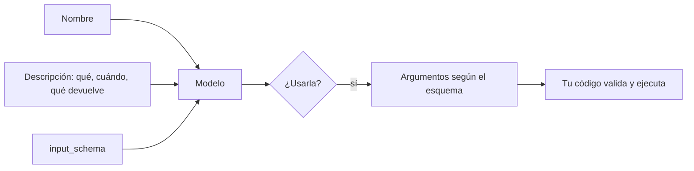

Al terminar esta lección sabrás definir herramientas que el modelo usa bien: las elige en el momento adecuado, no las confunde entre sí y les pasa argumentos con el formato correcto. La definición de una herramienta es un prompt más, y casi todos los fallos de uso de herramientas se arreglan aquí.

## La idea

El modelo no ve tu código. Para decidir si usa una herramienta y con qué argumentos, solo tiene tres cosas: el **nombre**, la **descripción** y el **esquema de entrada**. Si la descripción es vaga, la usará cuando no toca o no la usará cuando sí. Si el esquema es laxo, recibirás argumentos que tu función no sabe tratar.



Escribe cada definición pensando en un desarrollador nuevo que tiene que usar tu función sin poder leer su código. Anthropic recoge esta idea y otras buenas prácticas en [Writing effective tools for agents — with agents](https://www.anthropic.com/engineering/writing-tools-for-agents) (septiembre de 2025).

## El nombre

- Usa `snake_case` con verbo y objeto: `buscar_pedido`, `crear_ticket`, `listar_facturas`.
- Que se distingan a primera vista: `buscar_pedido` y `pedidos_de_cliente` se confunden menos que `pedido` y `pedidos`.
- Si tienes muchas herramientas de sistemas distintos, un prefijo común ayuda: `crm_buscar_cliente`, `crm_actualizar_cliente`.

## La descripción

Es la parte más importante. Una buena descripción responde a cuatro preguntas: qué hace, cuándo usarla, cuándo no y qué devuelve.

```text title="Antes"
Busca pedidos.
```

```text title="Después"
Devuelve el estado, la fecha de compra, el importe y la fecha estimada de
entrega de un pedido a partir de su número. Úsala cuando el usuario pregunte
por un pedido concreto y dé el número (formato: 4 a 6 dígitos). Si solo da su
email, usa antes pedidos_de_cliente. No sirve para pedidos de más de dos años:
en ese caso devuelve un error indicándolo.
```

Varias frases es lo normal. Las descripciones se pagan como tokens de entrada en cada llamada, pero ahorran muchos más tokens en llamadas equivocadas y reintentos.

## El esquema de entrada

`input_schema` es un objeto JSON Schema, el estándar habitual para describir la forma de un JSON. Con un subconjunto pequeño cubres casi todo:

```python title="tools.py"
BUSCAR_PEDIDOS = {
    "name": "buscar_pedidos",
    "description": (
        "Busca pedidos de un cliente con filtros opcionales y devuelve como máximo 20, "
        "del más reciente al más antiguo. Úsala cuando el usuario pregunte por sus "
        "pedidos sin dar un número concreto."
    ),
    "input_schema": {
        "type": "object",
        "properties": {
            "email": {
                "type": "string",
                "description": "Email del cliente tal como lo escribió.",
            },
            "estado": {
                "type": "string",
                "enum": ["pendiente", "enviado", "entregado", "devuelto"],
                "description": "Filtra por estado. Omítelo para ver todos.",
            },
            "desde": {
                "type": "string",
                "description": "Fecha mínima de compra en formato AAAA-MM-DD. Omítela si el usuario no habla de fechas.",
            },
        },
        "required": ["email"],
    },
}
```

Qué hace cada pieza:

- **`type` en cada propiedad**: `string`, `integer`, `number`, `boolean`, `array`, `object`.
- **`description` en cada campo**: formato, unidades, ejemplos y qué hacer si el usuario no lo menciona.
- **`enum`**: para conjuntos cerrados. Evita que llegue «Enviado», «enviada» o «en camino».
- **`required`**: solo lo que la herramienta necesita sí o sí. Lo opcional, explica en su descripción cuándo omitirlo.
- **Formatos**: dilo en la descripción («AAAA-MM-DD», «céntimos de euro»). El modelo lo respeta mucho mejor si se lo explicas.

Para listas, `{"type": "array", "items": {"type": "string"}}`. Para objetos anidados, otra vez `type: object` con sus `properties`. Mantén la estructura tan plana como puedas: los esquemas profundos son más difíciles de rellenar bien.

## Genera el esquema desde tu código

Si ya validas con Pydantic, no escribas el esquema dos veces. Define el modelo de argumentos y genera el JSON Schema desde él. Las pestañas muestran la misma herramienta con el SDK de Anthropic (Python y TypeScript), con el decorador `@tool` de LangChain y en el formato de la API compatible con OpenAI que usan los servidores de modelos abiertos:

```python tab="Python" title="tools_pydantic.py"
from typing import Literal, Optional
from pydantic import BaseModel, Field

class BuscarPedidos(BaseModel):
    """Busca pedidos de un cliente con filtros opcionales (máximo 20)."""
    email: str = Field(description="Email del cliente tal como lo escribió.")
    estado: Optional[Literal["pendiente", "enviado", "entregado", "devuelto"]] = Field(
        default=None, description="Filtra por estado. Omítelo para ver todos.")
    desde: Optional[str] = Field(
        default=None, description="Fecha mínima de compra, AAAA-MM-DD.")

TOOL = {
    "name": "buscar_pedidos",
    "description": "Busca pedidos de un cliente con filtros opcionales y devuelve como máximo 20. "
                   "Úsala cuando el usuario pregunte por sus pedidos sin dar un número concreto.",
    "input_schema": BuscarPedidos.model_json_schema(),
}

# al ejecutar: valida antes de tocar tu sistema
def ejecutar(entrada: dict) -> dict:
    args = BuscarPedidos.model_validate(entrada)
    return {"pedidos": []}  # aquí iría la consulta real con args.email, args.estado…
```

```ts tab="TypeScript" title="tools_zod.ts"
import Anthropic from "@anthropic-ai/sdk";
import { z } from "zod";

const BuscarPedidos = z.object({
  email: z.string().describe("Email del cliente tal como lo escribió."),
  estado: z.enum(["pendiente", "enviado", "entregado", "devuelto"]).optional()
    .describe("Filtra por estado. Omítelo para ver todos."),
  desde: z.string().optional().describe("Fecha mínima de compra, AAAA-MM-DD."),
});

export const TOOL: Anthropic.Tool = {
  name: "buscar_pedidos",
  description: "Busca pedidos de un cliente con filtros opcionales y devuelve como máximo 20. Úsala cuando el usuario pregunte por sus pedidos sin dar un número concreto.",
  input_schema: {
    type: "object",
    properties: {
      email: { type: "string", description: "Email del cliente tal como lo escribió." },
      estado: { type: "string", enum: ["pendiente", "enviado", "entregado", "devuelto"] },
      desde: { type: "string", description: "Fecha mínima de compra, AAAA-MM-DD." },
    },
    required: ["email"],
  },
};

export function ejecutar(entrada: unknown) {
  const args = BuscarPedidos.parse(entrada); // valida antes de tocar tu sistema
  return { pedidos: [], filtro: args };
}
```

```python tab="LangChain" title="tools_langchain.py"
from typing import Literal, Optional
from langchain.tools import tool

@tool(parse_docstring=True)   # sin parse_docstring, las descripciones de "Args:" no llegan al esquema
def buscar_pedidos(
    email: str,
    estado: Optional[Literal["pendiente", "enviado", "entregado", "devuelto"]] = None,
    desde: Optional[str] = None,
) -> dict:
    """Busca pedidos de un cliente con filtros opcionales y devuelve como máximo 20. Úsala cuando el usuario pregunte por sus pedidos sin dar un número concreto.

    Args:
        email: Email del cliente tal como lo escribió.
        estado: Filtra por estado. Omítelo para ver todos.
        desde: Fecha mínima de compra, AAAA-MM-DD.
    """
    return {"pedidos": []}  # LangChain valida los argumentos con el esquema antes de llamar

print(buscar_pedidos.args_schema.model_json_schema())  # el esquema que verá el modelo
```

```python tab="Ollama" title="tools_openai.py"
# Formato de la API compatible con OpenAI (Ollama, vLLM, llama.cpp, LM Studio…)
TOOL = {
    "type": "function",
    "function": {
        "name": "buscar_pedidos",
        "description": "Busca pedidos de un cliente con filtros opcionales y devuelve como máximo 20. "
                       "Úsala cuando el usuario pregunte por sus pedidos sin dar un número concreto.",
        "parameters": {                                   # el mismo JSON Schema que input_schema
            "type": "object",
            "properties": {
                "email": {"type": "string", "description": "Email del cliente tal como lo escribió."},
                "estado": {"type": "string", "enum": ["pendiente", "enviado", "entregado", "devuelto"],
                           "description": "Filtra por estado. Omítelo para ver todos."},
                "desde": {"type": "string", "description": "Fecha mínima de compra, AAAA-MM-DD."},
            },
            "required": ["email"],
        },
    },
}

# uso: client.chat.completions.create(model=MODEL, messages=..., tools=[TOOL])
# los argumentos llegan como texto JSON en call.function.arguments: json.loads y valida
```

Las tres formas describen lo mismo: nombre, descripción y JSON Schema. Cambia el envoltorio. En LangChain, `@tool` construye el esquema a partir de la firma y del docstring (con `parse_docstring=True` para que las descripciones de `Args:` lleguen a cada campo) y valida los argumentos antes de ejecutar la función; `bind_tools` lo convierte después al formato de Anthropic o de OpenAI según el modelo. En la API compatible con OpenAI, el esquema va en `parameters` dentro de `function`, y los argumentos llegan como una cadena JSON que tienes que parsear y validar tú. Con modelos abiertos, el *tool calling* depende del modelo y de la configuración del servidor: lo verás en [[cursos/agentes-con-modelos-abiertos/04-herramientas-con-modelos-abiertos]].

Revisa el esquema que genera tu librería antes de enviarlo: a veces incluye campos como `title` o construcciones (`anyOf` con `null`) que son válidas pero más verbosas de lo necesario.

## Argumentos garantizados con `strict`

Por defecto, el modelo intenta cumplir el esquema y casi siempre lo consigue, pero no hay garantía. Si añades `"strict": True` a la definición de la herramienta, la API garantiza que los argumentos del `tool_use` cumplen el `input_schema`.

```python title="strict.py"
TOOL_ESTRICTA = {
    "name": "crear_ticket",
    "description": "Crea un ticket de soporte con categoría y prioridad.",
    "strict": True,
    "input_schema": {
        "type": "object",
        "properties": {
            "categoria": {"type": "string", "enum": ["facturacion", "envio", "cuenta", "producto"]},
            "prioridad": {"type": "string", "enum": ["baja", "media", "alta"]},
            "resumen": {"type": "string"},
        },
        "required": ["categoria", "prioridad", "resumen"],
        "additionalProperties": False,
    },
}
```

En LangChain, el equivalente es `bind_tools(..., strict=True)`. Tiene las mismas limitaciones que las salidas estructuradas que viste en [[roadmap/10-prompting/03-formato-de-salida]]: sin esquemas recursivos, sin restricciones numéricas ni de longitud, y con `additionalProperties: false`. Consulta los detalles actuales en la [documentación oficial](https://platform.claude.com/docs).

> [!aviso] Valida siempre en tu código
> `strict` garantiza la forma, no la validez del dato: un email con forma de texto puede no existir, y un id de pedido puede ser de otro cliente. Comprueba permisos y reglas de negocio antes de ejecutar, sobre todo en herramientas que modifican algo.

## Diseña el conjunto, no solo cada herramienta

- **Pocas y con propósito claro.** Una herramienta por tarea que tenga sentido para el usuario, no una por endpoint de tu API. `programar_reunion` es mejor que `listar_disponibilidad` + `crear_evento` + `enviar_invitacion` si casi siempre se usan juntas.
- **Sin solapamientos.** Si dos herramientas pueden responder a la misma pregunta, el modelo dudará. Di en cada descripción cuándo usar la otra.
- **Devuelve lo útil.** Un resultado con 40 campos internos llena el contexto. Devuelve los campos que sirven para responder, con nombres legibles.

Este diseño es una disciplina en sí misma: [[disciplinas/diseno-de-herramientas]]. Y cuando el conjunto crece a decenas de herramientas, sus definiciones llenan el contexto en cada llamada: la solución es cargarlas bajo demanda ([[docs/herramientas/05-busqueda-y-carga-diferida]]).

## Errores frecuentes

- Descripciones de una línea que no dicen cuándo usar la herramienta.
- Campos sin `description`, sobre todo los de fecha, moneda o identificadores.
- Valores cerrados como `string` libre en vez de `enum`.
- Marcar como `required` campos que el usuario casi nunca da, lo que empuja al modelo a inventarlos.
- Confiar en `strict` y no validar permisos.

## Ejercicio

> [!ejercicio] Arregla un conjunto de herramientas
> Tienes tres herramientas mal definidas: `pedido` (descripción «Info de pedido», argumento `id` sin tipo), `pedidos` (descripción «Pedidos», argumento `cliente`) y `devolver` (descripción «Devoluciones», argumentos `id` y `razon`). Reescríbelas con nombres, descripciones y esquemas completos. Prepara ocho preguntas de usuario y comprueba con tu bucle de la lección anterior qué herramienta elige el modelo y con qué argumentos.
>
> Está bien si en las ocho preguntas el modelo elige la herramienta que esperabas, si los motivos de devolución llegan siempre como uno de los valores del `enum` que definiste, si ninguna pregunta sin número de pedido produce un número inventado y si los argumentos se validan con Pydantic o Zod antes de ejecutar.

> [!ejercicio]- Pistas
> Incluye preguntas trampa: una con email pero sin número, una que pide devolver un pedido sin dar motivo y una que no necesita ninguna herramienta («¿Cuál es vuestro horario?»). Para el motivo, decide si es obligatorio o si el modelo debe preguntarlo antes.

## Resumen

- El modelo decide solo con nombre, descripción y esquema: escríbelos como documentación.
- La descripción dice qué hace, cuándo usarla, cuándo no y qué devuelve.
- En el esquema, `description` por campo, `enum` para valores cerrados y `required` mínimo.
- Genera el esquema desde Pydantic o Zod y valida con el mismo modelo.
- `strict` garantiza la forma de los argumentos; los permisos y reglas los compruebas tú.

## Para seguir

- [[roadmap/20-herramientas/03-errores-e-is-error]]: qué pasa cuando la herramienta falla.
- [[disciplinas/diseno-de-herramientas]]: criterios para diseñar conjuntos de herramientas.
- [[recetas/extraer-facturas-a-json]]: una herramienta estricta usada para extraer datos.
- [[problemas/modelo-local-no-llama-herramientas]]: qué revisar cuando un modelo abierto ignora tus herramientas.
