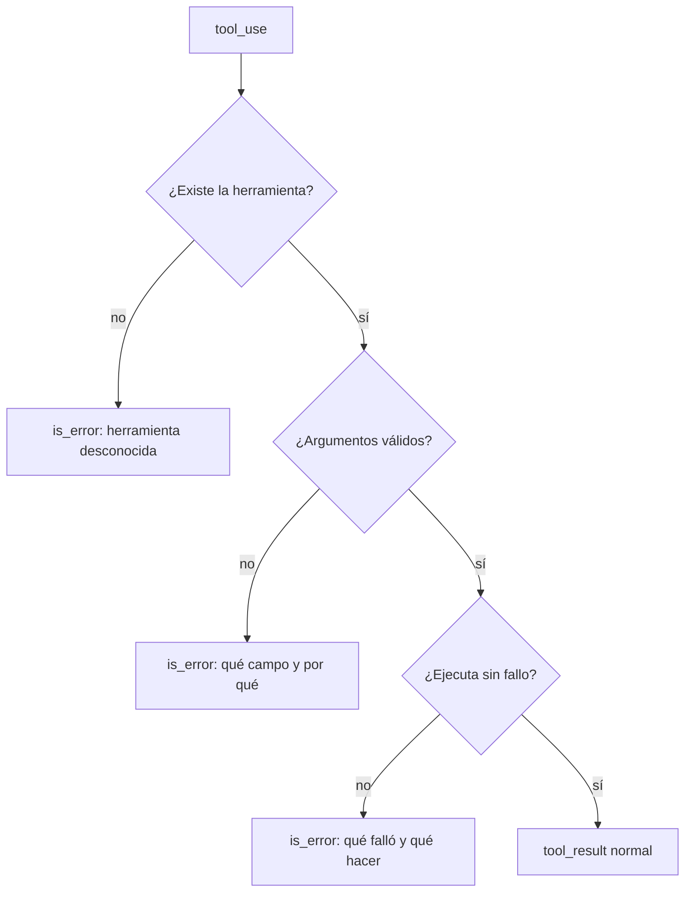

Al terminar esta lección tu bucle de herramientas sobrevivirá a argumentos inválidos, servicios caídos y herramientas que el modelo se inventa, y en la mayoría de los casos el modelo se recuperará solo. La clave es una regla simple: un fallo de herramienta se le cuenta al modelo, no se esconde ni tumba el programa.

## La idea

En el bucle de [[roadmap/20-herramientas/01-ciclo-tool-use]], si `buscar_pedido` lanza una excepción, el programa se detiene. Y si la capturas y no devuelves nada, la siguiente llamada a la API falla, porque cada `tool_use` necesita su `tool_result`.

La solución es devolver un `tool_result` **siempre**, también cuando algo falla, marcándolo con `"is_error": True` y explicando qué ha pasado. El modelo lee el error y decide: corregir los argumentos y volver a intentarlo, probar otra herramienta, pedirle un dato al usuario o explicarle que no ha podido.



## Tres tipos de problema, tres respuestas

Conviene separar tres situaciones que se suelen mezclar:

| Situación | Ejemplo | Qué devolver |
|---|---|---|
| Resultado vacío | El cliente no tiene pedidos. | Resultado normal: `{"pedidos": []}`. No es un error. |
| Error de herramienta | Pedido inexistente, argumento inválido, servicio caído. | `tool_result` con `is_error: True` y un mensaje útil. |
| Error de la API | Límite de uso, sobrecarga, clave inválida. | Excepción del SDK en tu código; reintentar o abortar. El modelo no se entera. |

La diferencia entre las dos primeras importa. Si marcas como error un resultado vacío, el modelo puede insistir pensando que algo ha ido mal. Si devuelves un error como si fuera un dato, el modelo puede responder al usuario con información falsa.

## El ejecutor que nunca rompe el protocolo

Mete toda la ejecución en una función que recibe un bloque `tool_use` y **siempre** devuelve un `tool_result`:

```python tab="Python" title="ejecutor.py"
import json
import logging
from pydantic import BaseModel, ValidationError

class ErrorHerramienta(Exception):
    """Error esperado, con un mensaje pensado para el modelo."""

class ArgsDevolucion(BaseModel):
    id_pedido: str
    motivo: str

PEDIDOS = {"4471": {"estado": "entregado", "dias_desde_entrega": 12}}

def solicitar_devolucion(id_pedido: str, motivo: str) -> dict:
    pedido = PEDIDOS.get(id_pedido)
    if pedido is None:
        raise ErrorHerramienta(f"No existe el pedido {id_pedido}. Pide al usuario que revise el número.")
    if pedido["dias_desde_entrega"] > 30:
        raise ErrorHerramienta("El plazo de devolución (30 días) ha terminado. No reintentes: explícaselo al usuario.")
    return {"devolucion": "creada", "id_pedido": id_pedido}

HERRAMIENTAS = {"solicitar_devolucion": (solicitar_devolucion, ArgsDevolucion)}

def ejecutar(bloque) -> dict:
    def resultado(contenido: str, error: bool = False) -> dict:
        return {"type": "tool_result", "tool_use_id": bloque.id, "content": contenido, "is_error": error}

    if bloque.name not in HERRAMIENTAS:
        return resultado(f"La herramienta {bloque.name} no existe. Disponibles: {', '.join(HERRAMIENTAS)}.", True)
    funcion, Args = HERRAMIENTAS[bloque.name]
    try:
        args = Args.model_validate(bloque.input)
    except ValidationError as e:
        return resultado(f"Argumentos inválidos: {e.errors(include_url=False)}", True)
    try:
        return resultado(json.dumps(funcion(**args.model_dump()), ensure_ascii=False))
    except ErrorHerramienta as e:
        return resultado(str(e), True)
    except Exception:
        logging.exception("Fallo en %s", bloque.name)  # el detalle va a tus logs, no al modelo
        return resultado("Error interno al ejecutar la herramienta. Inténtalo más tarde o informa al usuario.", True)
```

```ts tab="TypeScript" title="ejecutor.ts"
import Anthropic from "@anthropic-ai/sdk";
import { z } from "zod";

class ErrorHerramienta extends Error {}

const ArgsDevolucion = z.object({ id_pedido: z.string(), motivo: z.string() });
const PEDIDOS: Record<string, { estado: string; dias_desde_entrega: number }> = {
  "4471": { estado: "entregado", dias_desde_entrega: 12 },
};

function solicitarDevolucion({ id_pedido }: z.infer<typeof ArgsDevolucion>) {
  const pedido = PEDIDOS[id_pedido];
  if (!pedido) throw new ErrorHerramienta(`No existe el pedido ${id_pedido}. Pide al usuario que revise el número.`);
  if (pedido.dias_desde_entrega > 30)
    throw new ErrorHerramienta("El plazo de devolución (30 días) ha terminado. No reintentes: explícaselo al usuario.");
  return { devolucion: "creada", id_pedido };
}

const HERRAMIENTAS: Record<string, { fn: (a: any) => object; args: z.ZodTypeAny }> = {
  solicitar_devolucion: { fn: solicitarDevolucion, args: ArgsDevolucion },
};

export function ejecutar(b: Anthropic.ToolUseBlock): Anthropic.ToolResultBlockParam {
  const res = (content: string, is_error = false) => ({ type: "tool_result" as const, tool_use_id: b.id, content, is_error });
  const h = HERRAMIENTAS[b.name];
  if (!h) return res(`La herramienta ${b.name} no existe. Disponibles: ${Object.keys(HERRAMIENTAS).join(", ")}.`, true);
  const args = h.args.safeParse(b.input);
  if (!args.success) return res(`Argumentos inválidos: ${args.error.message}`, true);
  try {
    return res(JSON.stringify(h.fn(args.data)));
  } catch (e) {
    if (e instanceof ErrorHerramienta) return res(e.message, true);
    return res("Error interno al ejecutar la herramienta. Inténtalo más tarde o informa al usuario.", true);
  }
}
```

En el bucle, sustituye la ejecución directa por `resultados.append(ejecutar(bloque))`. A partir de aquí, ninguna herramienta puede romper la conversación.

## Mensajes de error para un modelo

El mensaje de error es lo único que el modelo tiene para decidir el siguiente paso. Escríbelo como si fuera para una persona que va a reintentar:

- **Qué ha fallado**, con el dato concreto: «No existe el pedido 4417».
- **Qué puede hacer**: «Pide al usuario que revise el número», «Usa el formato AAAA-MM-DD».
- **Si tiene sentido reintentar**: «No reintentes: el plazo ha terminado».

Compara `"Error 404"` con `"No existe el pedido 4417. Pide al usuario que revise el número."`. Con el primero, el modelo puede reintentar lo mismo o inventarse una explicación. Con el segundo, hace lo correcto.

> [!peligro] No filtres detalles internos
> Las trazas de excepción, rutas de archivos, consultas SQL o mensajes del proveedor pueden contener datos sensibles, y lo que entra en el contexto puede acabar en la respuesta al usuario. Registra el detalle en tus logs y al modelo dale un mensaje genérico.

## Cortar los bucles

Un modelo que recibe errores puede reintentar la misma llamada una y otra vez. Pon dos límites:

1. **Pasos totales** (`MAX_PASOS`), que ya tienes. Cuando se agotan, el programa termina con un mensaje claro.
2. **Errores consecutivos**: si una herramienta falla varias veces seguidas con los mismos argumentos, deja de ejecutarla y devuelve un error que lo diga.

```python title="limite_errores.py"
import json
from collections import Counter
from ejecutor import ejecutar

fallos = Counter()

def ejecutar_con_limite(bloque, max_fallos: int = 2) -> dict:
    clave = (bloque.name, json.dumps(bloque.input, sort_keys=True))
    if fallos[clave] >= max_fallos:
        return {"type": "tool_result", "tool_use_id": bloque.id, "is_error": True,
                "content": "Esta llamada ya ha fallado varias veces. No la repitas; informa al usuario."}
    r = ejecutar(bloque)
    if r["is_error"]:
        fallos[clave] += 1
    return r
```

Los reintentos por fallos transitorios (un servicio que tarda o da un error puntual) es mejor hacerlos **dentro** de la herramienta, con espera entre intentos, antes de devolver nada al modelo. Así no gastas un paso entero de conversación en algo que tu código puede resolver. La receta [[recetas/reintentos-y-limites-de-tasa]] lo cubre, junto con los reintentos de la propia API.

## Con LangChain: la excepción no vuelve sola

Aquí los *frameworks* esconden menos de lo que parece. En [[herramientas/langchain|LangChain]] 1.x, si una herramienta lanza una excepción dentro de `create_agent`, **el agente se detiene** y la excepción llega a tu código; el modelo no se entera. Solo los argumentos que no cumplen el esquema vuelven solos al modelo como error. Para tener el equivalente a `is_error: true` hay que añadir `ToolErrorMiddleware`, que convierte la excepción en un `ToolMessage` con `status="error"` (y LangChain lo envía a Claude como `tool_result` con `is_error: true`):

```python tab="LangChain" title="agente_errores_langchain.py"
from langchain.agents import create_agent
from langchain.agents.middleware import ModelCallLimitMiddleware, ToolErrorMiddleware
from langchain.chat_models import init_chat_model
from langchain.tools import tool

MODEL = "anthropic:claude-sonnet-5-5"
PEDIDOS = {"4471": {"estado": "entregado", "dias_desde_entrega": 12}}

class ErrorHerramienta(Exception):
    """Error esperado, con un mensaje pensado para el modelo."""

@tool
def solicitar_devolucion(id_pedido: str, motivo: str) -> str:
    """Solicita la devolución de un pedido entregado hace 30 días o menos."""
    pedido = PEDIDOS.get(id_pedido)
    if pedido is None:
        raise ErrorHerramienta(f"No existe el pedido {id_pedido}. Pide al usuario que revise el número.")
    if pedido["dias_desde_entrega"] > 30:
        raise ErrorHerramienta("El plazo de devolución (30 días) ha terminado. No reintentes: explícaselo al usuario.")
    return f"Devolución creada para {id_pedido}."

def error_para_el_modelo(exc: Exception, request) -> str:
    if isinstance(exc, ErrorHerramienta):
        return str(exc)                        # llega como ToolMessage(status="error")
    return "Error interno al ejecutar la herramienta. Inténtalo más tarde o informa al usuario."

agente = create_agent(
    model=init_chat_model(MODEL, max_tokens=1024),
    tools=[solicitar_devolucion],
    middleware=[
        ToolErrorMiddleware(on_error=error_para_el_modelo),          # sin esto, la excepción corta el agente
        ModelCallLimitMiddleware(run_limit=10, exit_behavior="end"),  # el equivalente a MAX_PASOS
    ],
)

if __name__ == "__main__":
    salida = agente.invoke({"messages": [{"role": "user", "content": "Quiero devolver el pedido 4417, llegó roto."}]})
    for m in salida["messages"]:
        m.pretty_print()
```

La función `error_para_el_modelo` cumple el mismo papel que tu ejecutor: decide qué texto ve el modelo y oculta los detalles internos. `ModelCallLimitMiddleware` es el límite de pasos. En otros frameworks el mecanismo tiene otro nombre (`failure_error_function` en el OpenAI Agents SDK, `ModelRetry` en Pydantic AI); lo tienes comparado en [[docs/frameworks/02-equivalencias]]. Y en un servidor MCP, el error que el modelo debe leer se lanza con `ToolError`, como verás en [[roadmap/20-herramientas/05-mcp-conectar-un-servidor]].

## Errores frecuentes

- Dejar que una excepción de la herramienta tumbe el bucle.
- Capturar el error y no devolver `tool_result`, lo que rompe la siguiente petición.
- Marcar como error un resultado vacío legítimo.
- Mensajes de error crípticos («Error», «400») que no dicen qué hacer.
- Pasar trazas completas o datos internos al modelo.
- Reintentar sin límite.
- Dar por hecho que un framework devuelve las excepciones al modelo sin comprobarlo.

## Ejercicio

> [!ejercicio] Rompe tu asistente a propósito
> Integra el ejecutor en tu asistente de pedidos. Provoca cuatro fallos: un pedido inexistente, una devolución fuera de plazo, un argumento con tipo incorrecto (cambia temporalmente el esquema para permitirlo) y una excepción no controlada dentro de una herramienta. Guarda la conversación de cada caso.
>
> Está bien si ninguno de los cuatro casos detiene el programa, si cada `tool_use` recibe su `tool_result`, si en el pedido inexistente el modelo pide al usuario que revise el número, si en la devolución fuera de plazo no reintenta y si la excepción no controlada no muestra la traza al modelo.

> [!ejercicio]- Pistas
> Para provocar la excepción, añade un `raise RuntimeError("conexión rechazada a db-interna:5432")` en una herramienta y comprueba que ese texto aparece en tu log y no en la conversación.

## Resumen

- Devuelve siempre un `tool_result`; si algo falla, con `is_error: True`.
- Distingue resultado vacío, error de herramienta y error de la API.
- Escribe errores que digan qué falló, qué hacer y si reintentar.
- No pases trazas ni datos internos al modelo.
- Limita pasos totales y fallos repetidos; reintenta lo transitorio dentro de la herramienta.

## Para seguir

- [[roadmap/20-herramientas/04-tool-choice]]: controlar cuándo y qué herramienta usa.
- [[roadmap/40-primer-agente/03-condiciones-de-parada]]: límites y presupuesto en agentes.
- [[glosario/tool-result]] como referencia rápida.
- [[problemas/el-agente-repite-la-misma-herramienta]]: qué hacer cuando el modelo reintenta en bucle.
