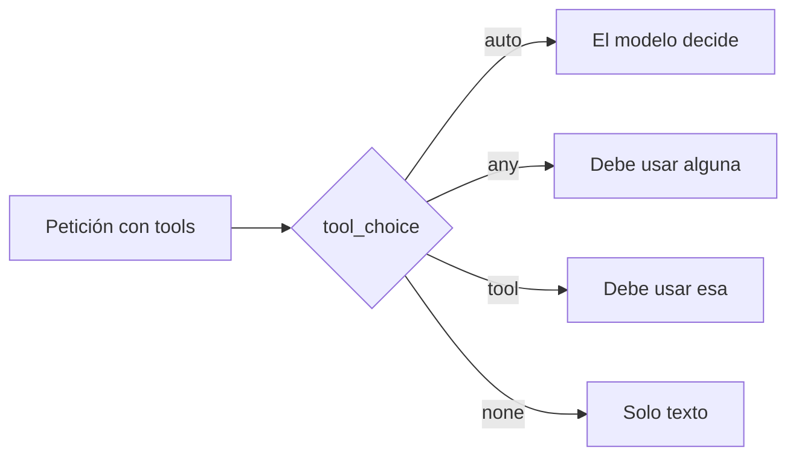

Al terminar esta lección sabrás cuándo dejar que el modelo decida si usa una herramienta, cuándo obligarle y cuándo prohibírselo, y cómo hacerlo sin caer en los dos errores típicos: el bucle infinito y las llamadas en paralelo que no querías. Con esto controlas el comportamiento de las herramientas sin tocar el prompt.

## La idea

Por defecto, el modelo decide en cada respuesta si usa alguna de las herramientas que le has dado o si responde con texto. Casi siempre es lo que quieres. Pero hay casos en los que tú sabes mejor que él lo que toca: si estás extrayendo datos, quieres que llame a la herramienta de extracción sí o sí; si estás pidiendo un resumen final, no quieres que se ponga a consultar más cosas.

El parámetro [[glosario/tool-choice|tool_choice]] fija esa decisión en la petición:



| Valor | Efecto | Úsalo para |
|---|---|---|
| `{"type": "auto"}` | El modelo decide si usa herramientas y cuáles. Es el valor por defecto. | Asistentes y agentes en general. |
| `{"type": "any"}` | Debe usar al menos una herramienta, la que elija. | Enrutadores donde toda entrada termina en una acción. |
| `{"type": "tool", "name": "…"}` | Debe usar esa herramienta concreta. | Extracción estructurada; un primer paso fijo. |
| `{"type": "none"}` | No puede usar herramientas, aunque estén definidas. | Un turno final de solo texto sin cambiar la lista de herramientas. |

## `auto`: dejar decidir

Es lo que has usado hasta ahora sin escribirlo. El modelo puede responder con texto, con una herramienta o con varias. Para que decida bien, las descripciones tienen que decir cuándo usar cada herramienta y cuándo no ([[roadmap/20-herramientas/02-definir-herramientas]]). Si ves que usa herramientas de más o de menos, arregla primero las descripciones o el [[glosario/prompt-de-sistema|prompt de sistema]] antes de forzar nada.

## `tool`: forzar una herramienta concreta

El uso más práctico es la **extracción de datos**. Defines una herramienta cuyo esquema es exactamente el JSON que quieres, la fuerzas, y lees los argumentos del `tool_use`. No hace falta ejecutar nada: el dato que buscabas son los propios argumentos.

```python tab="Python" title="extraer_contacto.py"
import anthropic

MODEL = "claude-sonnet-5-5"
client = anthropic.Anthropic()

GUARDAR_CONTACTO = {
    "name": "guardar_contacto",
    "description": "Guarda los datos de contacto extraídos de un correo.",
    "strict": True,
    "input_schema": {
        "type": "object",
        "properties": {
            "nombre": {"type": "string"},
            "empresa": {"type": "string", "description": "Cadena vacía si no aparece."},
            "telefono": {"type": "string", "description": "Solo dígitos y +. Cadena vacía si no aparece."},
        },
        "required": ["nombre", "empresa", "telefono"],
        "additionalProperties": False,
    },
}

correo = "Hola, soy Marta Ruiz, de Transportes Ebro. Llamadme al +34 976 000 000."

resp = client.messages.create(
    model=MODEL,
    max_tokens=512,
    tools=[GUARDAR_CONTACTO],
    tool_choice={"type": "tool", "name": "guardar_contacto"},
    messages=[{"role": "user", "content": f"<correo>{correo}</correo>"}],
)
llamada = next(b for b in resp.content if b.type == "tool_use")
print(llamada.input)  # {'nombre': 'Marta Ruiz', 'empresa': 'Transportes Ebro', ...}
```

```ts tab="TypeScript" title="extraer_contacto.ts"
import Anthropic from "@anthropic-ai/sdk";

const MODEL = "claude-sonnet-5-5";
const client = new Anthropic();

const GUARDAR_CONTACTO: Anthropic.Tool = {
  name: "guardar_contacto",
  description: "Guarda los datos de contacto extraídos de un correo.",
  input_schema: {
    type: "object",
    properties: {
      nombre: { type: "string" },
      empresa: { type: "string", description: "Cadena vacía si no aparece." },
      telefono: { type: "string", description: "Solo dígitos y +. Cadena vacía si no aparece." },
    },
    required: ["nombre", "empresa", "telefono"],
    additionalProperties: false,
  },
};

const correo = "Hola, soy Marta Ruiz, de Transportes Ebro. Llamadme al +34 976 000 000.";
const resp = await client.messages.create({
  model: MODEL,
  max_tokens: 512,
  tools: [GUARDAR_CONTACTO],
  tool_choice: { type: "tool", name: "guardar_contacto" },
  messages: [{ role: "user", content: `<correo>${correo}</correo>` }],
});
const llamada = resp.content.find((b): b is Anthropic.ToolUseBlock => b.type === "tool_use");
console.log(llamada?.input);
```

Como no continúas la conversación, no necesitas enviar un `tool_result`: la regla de un resultado por llamada aplica cuando vuelves a mandar ese historial a la API. Esta técnica es una alternativa a las salidas estructuradas de [[roadmap/10-prompting/03-formato-de-salida]]; las dos sirven, y la herramienta forzada es cómoda cuando ya trabajas con herramientas.

Ten en cuenta que, con `any` o `tool`, la respuesta empieza directamente por el `tool_use`, sin texto previo. Si querías que el modelo razonara antes de rellenar los campos, eso cambia el resultado. Y si activas el razonamiento del modelo, no todos los valores de `tool_choice` son compatibles: compruébalo en la [documentación oficial](https://platform.claude.com/docs).

> [!aviso] Forzar dentro de un bucle no termina nunca
> Si usas `any` o `tool` en todas las llamadas de un bucle, el modelo está obligado a pedir una herramienta cada vez y nunca llega a `end_turn`. Fuerza solo la primera llamada y vuelve a `auto` en las siguientes.

```python title="forzar_primero.py"
for paso in range(MAX_PASOS):
    eleccion = {"type": "tool", "name": "buscar_cliente"} if paso == 0 else {"type": "auto"}
    resp = client.messages.create(
        model=MODEL, max_tokens=1024, tools=TOOLS, tool_choice=eleccion, messages=messages,
    )
    # … resto del bucle igual que en la lección 20.1
```

## `any`: alguna, la que sea

Útil para enrutar. Si cada mensaje de un usuario debe acabar en una de varias acciones (`crear_ticket`, `buscar_faq`, `escalar_a_humano`), `any` garantiza que el modelo elige una en vez de responder con texto libre. Es una forma sencilla del [[patrones/04-enrutado|patrón de enrutado]]. Incluye siempre una herramienta «de escape» como `escalar_a_humano` para los casos que no encajan, o el modelo forzará la entrada en la opción menos mala.

## `none`: herramientas definidas pero prohibidas

Parece raro definir herramientas para no dejar usarlas, pero tiene dos usos claros. El primero, un turno final en el que quieres solo la respuesta en texto, por ejemplo cuando se ha agotado el presupuesto de pasos y pides al modelo que resuma lo que ha conseguido. El segundo, más sutil: quitar la lista de herramientas cambia el prefijo de la petición e invalida el [[glosario/prompt-caching|prompt caching]]; con `none` la lista se queda igual y el caché se aprovecha.

## Llamadas en paralelo

El modelo puede pedir varias herramientas en una misma respuesta. Suele ser bueno: consulta dos pedidos a la vez y ahorra un paso. Pero si una acción depende de otra (primero `buscar_cliente`, después `crear_pedido` con su id), las llamadas en paralelo pueden traer argumentos inventados para la segunda.

Para limitarlo, añade `disable_parallel_tool_use` dentro de `tool_choice`:

```python
tool_choice={"type": "auto", "disable_parallel_tool_use": True}
```

Con `auto`, el modelo usará como máximo una herramienta por respuesta. Con `any` o `tool`, exactamente una. Tu bucle no cambia: sigue devolviendo un `tool_result` por cada `tool_use`, solo que ahora habrá uno por paso.

## Errores frecuentes

- Forzar `any` o `tool` en todas las vueltas de un bucle.
- Usar `tool_choice` para tapar descripciones malas en vez de arreglarlas.
- Enrutar con `any` sin una herramienta de escape.
- Quitar las herramientas de la petición para un turno final, invalidando el caché, cuando bastaba `none`.
- Dejar el paralelismo activo en flujos con dependencias entre llamadas.

## Ejercicio

> [!ejercicio] Un enrutador con escape
> Crea un enrutador para mensajes de clientes con tres herramientas: `consultar_pedido(id_pedido)`, `abrir_incidencia(categoria, descripcion)` y `escalar_a_humano(motivo)`. Usa `tool_choice` `any` y `disable_parallel_tool_use`. Pruébalo con diez mensajes, incluidos dos que no encajen en nada («¿Hacéis descuentos para colegios?») y uno que mezcle dos peticiones.
>
> Está bien si los diez mensajes producen exactamente un `tool_use` cada uno, si los dos que no encajan van a `escalar_a_humano`, si el mensaje mixto elige la petición principal y si puedes explicar qué pasaría con esos mismos mensajes usando `auto`.

> [!ejercicio]- Pistas
> Ejecuta los diez mensajes una vez con `any` y otra con `auto` y compara cuántas respuestas son texto libre. En la descripción de `escalar_a_humano`, di explícitamente que es para todo lo que no cubren las otras dos.

## Resumen

- `auto` deja decidir al modelo y es el punto de partida.
- `tool` fuerza una herramienta concreta; ideal para extraer datos estructurados.
- `any` obliga a elegir alguna; útil para enrutar, siempre con una opción de escape.
- `none` prohíbe usarlas sin quitarlas de la petición, lo que respeta el caché.
- Fuerza solo la primera vuelta de un bucle y limita el paralelismo cuando hay dependencias.

## Para seguir

- [[roadmap/20-herramientas/05-mcp-conectar-un-servidor]]: tus herramientas como servidor reutilizable.
- [[patrones/04-enrutado]]: el patrón completo de enrutado.
- [[recetas/extraer-facturas-a-json]]: extracción con herramienta forzada aplicada a facturas.
