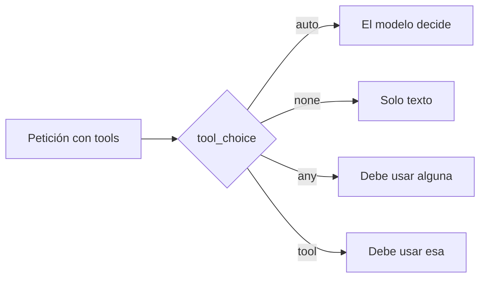

Al terminar esta lección sabrás cuándo dejar que el modelo decida si usa una herramienta, cuándo prohibírselo y qué hacer cuando lo que quieres es obligarle, que con los modelos actuales de Claude ya no se hace con `tool_choice`. También sabrás limitar las llamadas en paralelo que no querías. Con esto controlas el comportamiento de las herramientas sin tocar el prompt.

## La idea

Por defecto, el modelo decide en cada respuesta si usa alguna de las herramientas que le has dado o si responde con texto. Casi siempre es lo que quieres. Pero hay casos en los que tú sabes mejor que él lo que toca: si estás extrayendo datos, quieres un JSON con una forma fija sí o sí; si estás pidiendo un resumen final, no quieres que se ponga a consultar más cosas.

El parámetro [[glosario/tool-choice|tool_choice]] fija esa decisión en la petición:



| Valor | Efecto | En los modelos 5.5 de Claude |
|---|---|---|
| `{"type": "auto"}` | El modelo decide si usa herramientas y cuáles. Es el valor por defecto. | Funciona. |
| `{"type": "none"}` | No puede usar herramientas, aunque estén definidas. | Funciona. |
| `{"type": "any"}` | Debe usar al menos una herramienta, la que elija. | **Error 400.** |
| `{"type": "tool", "name": "…"}` | Debe usar esa herramienta concreta. | **Error 400.** |

Desde septiembre de 2026, `claude-opus-5-5`, `claude-sonnet-5-5`, `claude-fable-5-1` y `claude-mythos-5-1` rechazan cualquier petición que fuerce una herramienta. La restricción va unida al razonamiento: cuando el modelo razona, la API solo admite `auto` y `none`, y en estos modelos el razonamiento no se puede apagar del todo. Los modelos anteriores (Opus 5 y previos) todavía aceptan forzar, y en otros ecosistemas la opción sigue existiendo con otro nombre (`tool_choice="required"` en la API de OpenAI y en muchos servidores compatibles), aunque no en todos: Ollama, por ejemplo, no implementa `tool_choice`. Tienes la lista vigente en la [documentación de razonamiento](https://platform.claude.com/docs/en/build-with-claude/thinking) y la historia en [[radar/2026-10-23-no-se-puede-forzar-herramienta]].

La consecuencia práctica es que los dos usos clásicos de forzar (extraer datos y enrutar) se resuelven hoy con [[glosario/salida-estructurada|salidas estructuradas]], que garantizan la forma sin obligar a llamar a nada.

## `auto`: dejar decidir

Es lo que has usado hasta ahora sin escribirlo. El modelo puede responder con texto, con una herramienta o con varias. Para que decida bien, las descripciones tienen que decir cuándo usar cada herramienta y cuándo no ([[roadmap/20-herramientas/02-definir-herramientas]]). Si ves que usa herramientas de más o de menos, arregla primero las descripciones o el [[glosario/prompt-de-sistema|prompt de sistema]]: es la palanca que tienes.

## `tool`: forzar una herramienta concreta

El uso más habitual era la **extracción de datos**: definir una herramienta cuyo esquema es el JSON que quieres, forzarla y leer los argumentos del `tool_use`. Con los modelos actuales esa petición devuelve un 400, y además no hace falta: `output_config.format` obliga a que la respuesta cumpla el esquema y te devuelve el JSON en el bloque de texto.

```python tab="Python" title="extraer_contacto.py"
import json
import anthropic

MODEL = "claude-sonnet-5-5"
client = anthropic.Anthropic()

CONTACTO = {
    "type": "object",
    "properties": {
        "nombre": {"type": "string"},
        "empresa": {"type": "string", "description": "Cadena vacía si no aparece."},
        "telefono": {"type": "string", "description": "Solo dígitos y +. Cadena vacía si no aparece."},
    },
    "required": ["nombre", "empresa", "telefono"],
    "additionalProperties": False,
}

correo = "Hola, soy Marta Ruiz, de Transportes Ebro. Llamadme al +34 976 000 000."

resp = client.messages.create(
    model=MODEL,
    max_tokens=1024,
    output_config={"format": {"type": "json_schema", "schema": CONTACTO}},
    messages=[{"role": "user", "content": f"Extrae los datos de contacto del correo.\n<correo>{correo}</correo>"}],
)
if resp.stop_reason != "end_turn":
    raise RuntimeError(f"Extracción incompleta: {resp.stop_reason}")
contacto = json.loads("".join(b.text for b in resp.content if b.type == "text"))
print(contacto)  # {'nombre': 'Marta Ruiz', 'empresa': 'Transportes Ebro', ...}
```

```ts tab="TypeScript" title="extraer_contacto.ts"
import Anthropic from "@anthropic-ai/sdk";

const MODEL = "claude-sonnet-5-5";
const client = new Anthropic();

const correo = "Hola, soy Marta Ruiz, de Transportes Ebro. Llamadme al +34 976 000 000.";
const resp = await client.messages.create({
  model: MODEL,
  max_tokens: 1024,
  output_config: {
    format: {
      type: "json_schema",
      schema: {
        type: "object",
        properties: {
          nombre: { type: "string" },
          empresa: { type: "string", description: "Cadena vacía si no aparece." },
          telefono: { type: "string", description: "Solo dígitos y +. Cadena vacía si no aparece." },
        },
        required: ["nombre", "empresa", "telefono"],
        additionalProperties: false,
      },
    },
  },
  messages: [{ role: "user", content: `Extrae los datos de contacto del correo.\n<correo>${correo}</correo>` }],
});
if (resp.stop_reason !== "end_turn") throw new Error(`Extracción incompleta: ${resp.stop_reason}`);
const contacto = JSON.parse(resp.content.map((b) => (b.type === "text" ? b.text : "")).join(""));
console.log(contacto);
```

El esquema es el mismo que pondrías en `input_schema`; solo cambia dónde va. Como no hay `tool_use`, tampoco hay `tool_result` que devolver. Y el modelo puede razonar antes de rellenar los campos, algo que la herramienta forzada impedía.

Si lo que necesitabas era un **primer paso fijo** en un bucle (por ejemplo, buscar siempre al cliente antes de nada), no se lo pidas al modelo: ejecuta tú esa función antes de la primera llamada y pon su resultado en el mensaje. Lo que siempre pasa no necesita que nadie lo decida. Y si un agente debe **entregar** su resultado con una herramienta al final, la receta [[recetas/entregar-resultado-sin-forzar-herramienta]] muestra cómo hacerlo sin forzar.

> [!aviso] Código antiguo que forzaba herramientas
> Si heredas código con `tool_choice={"type": "tool", …}` o `{"type": "any"}`, fallará al cambiar a un modelo 5.5. No lo arregles bajando de modelo sin pensarlo: sustituye la extracción por `output_config.format` y el enrutado por una clasificación estructurada, como en esta lección.

## `any`: alguna, la que sea

Se usaba para enrutar: cada mensaje debía acabar en una de varias acciones (`consultar_pedido`, `abrir_incidencia`, `escalar_a_humano`) y `any` impedía la respuesta en texto libre. Hoy se consigue lo mismo, con más control, clasificando con un esquema cerrado y dejando que **tu código** ejecute la acción elegida. Es el [[patrones/04-enrutado|patrón de enrutado]] en su forma más simple:

```python title="enrutar.py"
import json
import anthropic

MODEL = "claude-sonnet-5-5"
client = anthropic.Anthropic()

RUTAS = ["consultar_pedido", "abrir_incidencia", "escalar_a_humano"]  # la última es la de escape
RUTA = {
    "type": "object",
    "properties": {
        "ruta": {"type": "string", "enum": RUTAS},
        "motivo": {"type": "string", "description": "Una frase: por qué esta ruta."},
    },
    "required": ["ruta", "motivo"],
    "additionalProperties": False,
}
SISTEMA = """Clasificas mensajes de clientes de una tienda online en una ruta.
- consultar_pedido: preguntan por el estado de un pedido concreto.
- abrir_incidencia: algo ha ido mal con un pedido o un producto.
- escalar_a_humano: todo lo demás, o si dudas."""

def enrutar(mensaje: str) -> dict:
    resp = client.messages.create(
        model=MODEL, max_tokens=1024, system=SISTEMA,
        output_config={"format": {"type": "json_schema", "schema": RUTA}, "effort": "low"},
        messages=[{"role": "user", "content": mensaje}],
    )
    if resp.stop_reason != "end_turn":
        return {"ruta": "escalar_a_humano", "motivo": f"sin clasificar ({resp.stop_reason})"}
    return json.loads("".join(b.text for b in resp.content if b.type == "text"))

decision = enrutar("¿Hacéis descuentos para colegios?")
print(decision)  # después, tu código ejecuta la acción de esa ruta
```

Dos detalles que valían también con `any`. Incluye siempre una ruta «de escape» como `escalar_a_humano` para lo que no encaja, o el modelo meterá la entrada en la opción menos mala. Y decide qué pasa si la clasificación no termina bien (un rechazo, un corte): aquí, escalar.

## `none`: herramientas definidas pero prohibidas

Parece raro definir herramientas para no dejar usarlas, pero tiene dos usos claros. El primero, un turno final en el que quieres solo la respuesta en texto, por ejemplo cuando se ha agotado el presupuesto de pasos y pides al modelo que resuma lo que ha conseguido. El segundo, más sutil: quitar la lista de herramientas cambia el principio de la petición e invalida todo el [[glosario/prompt-caching|prompt caching]]; con `none` la lista se queda igual y la caché de herramientas y sistema se aprovecha.

```python title="turno_final.py"
resp = client.messages.create(
    model=MODEL, max_tokens=2048, tools=TOOLS, messages=messages,
    tool_choice={"type": "none"},   # mismas herramientas, ninguna llamada: solo texto
)
```

## Llamadas en paralelo

El modelo puede pedir varias herramientas en una misma respuesta. Suele ser bueno: consulta dos pedidos a la vez y ahorra un paso. Pero si una acción depende de otra (primero `buscar_cliente`, después `crear_pedido` con su id), las llamadas en paralelo pueden traer argumentos inventados para la segunda.

Para limitarlo, añade `disable_parallel_tool_use` dentro de `tool_choice`, que funciona con `auto` en todos los modelos:

```python
tool_choice={"type": "auto", "disable_parallel_tool_use": True}
```

El modelo usará como máximo una herramienta por respuesta. Tu bucle no cambia: sigue devolviendo un `tool_result` por cada `tool_use`, solo que ahora habrá uno por paso. En LangChain el equivalente es `bind_tools(tools, parallel_tool_calls=False)`.

## Errores frecuentes

- Forzar `any` o `tool` con un modelo 5.5 y recibir un 400.
- Usar `tool_choice` para tapar descripciones malas en vez de arreglarlas.
- Enrutar sin una ruta de escape.
- Quitar las herramientas de la petición para un turno final, invalidando la caché, cuando bastaba `none`.
- Dejar el paralelismo activo en flujos con dependencias entre llamadas.

## Ejercicio

> [!ejercicio] Un enrutador con escape
> Parte de `enrutar.py` y pruébalo con diez mensajes de clientes, incluidos dos que no encajen en nada («¿Hacéis descuentos para colegios?») y uno que mezcle dos peticiones. Después escribe la versión «agente»: las tres rutas como herramientas reales, `tool_choice` `auto` con `disable_parallel_tool_use` y tu bucle de la lección 20.1.
>
> Está bien si la versión estructurada devuelve una ruta válida en los diez mensajes, si los dos que no encajan van a `escalar_a_humano`, si el mensaje mixto elige la petición principal y si puedes explicar, con los resultados delante, en qué casos la versión con `auto` respondió con texto en lugar de elegir una herramienta.

> [!ejercicio]- Pistas
> En la descripción de `escalar_a_humano`, di explícitamente que es para todo lo que no cubren las otras dos. Para el mensaje mixto, decide antes cuál es «la principal» y escribe esa regla en el sistema.

## Resumen

- `auto` deja decidir al modelo y es el punto de partida.
- `any` y `tool` devuelven 400 en los modelos 5.5 de Claude; en otros modelos y proveedores siguen existiendo.
- Para extraer datos o enrutar, usa `output_config.format`: garantiza la forma sin forzar una llamada.
- `none` prohíbe usarlas sin quitarlas de la petición, lo que respeta la caché.
- Limita el paralelismo con `disable_parallel_tool_use` cuando hay dependencias.

## Para seguir

- [[roadmap/20-herramientas/05-mcp-conectar-un-servidor]]: tus herramientas como servidor reutilizable.
- [[patrones/04-enrutado]]: el patrón completo de enrutado.
- [[recetas/entregar-resultado-sin-forzar-herramienta]]: la entrega final de un agente sin `tool_choice` forzado.
