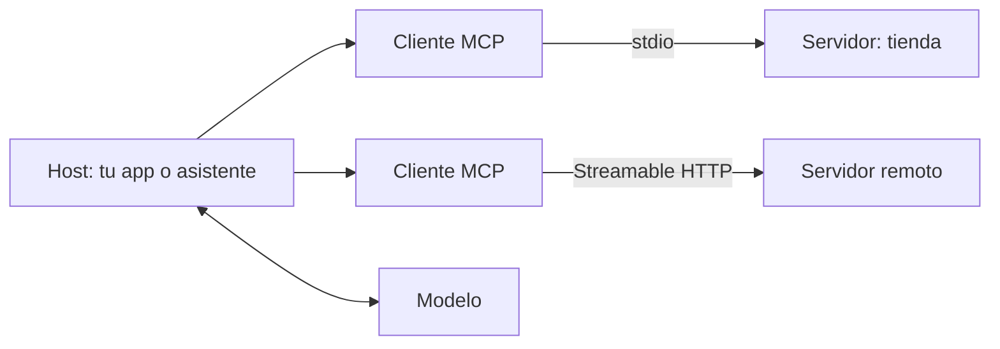

Al terminar esta lección tendrás tus herramientas de pedidos empaquetadas en un servidor MCP: un programa independiente que cualquier aplicación compatible puede lanzar y usar, incluido tu propio cliente con el bucle de herramientas. Con esto completas el proyecto del nivel.

## La idea

Hasta ahora, las herramientas vivían dentro de tu script: la definición en una lista `TOOLS`, la ejecución en un diccionario de funciones. Funciona, pero si quieres usar las mismas herramientas desde otro programa, desde un asistente de escritorio y desde un agente de código, acabas copiando y adaptando el código en cada sitio.

[[glosario/mcp|MCP]] (*Model Context Protocol*) es un estándar abierto que resuelve eso. Defines las herramientas una vez, en un **servidor**, y cualquier aplicación que hable MCP puede descubrirlas y usarlas. La especificación completa está en [modelcontextprotocol.io](https://modelcontextprotocol.io).



Tres papeles:

- **Host**: la aplicación que usa el modelo (tu `cliente.py`, Claude Desktop, un IDE).
- **Cliente**: el componente del host que mantiene la conexión con un servidor. Uno por servidor.
- **[[glosario/servidor-mcp|Servidor]]**: el programa que expone capacidades.

Un servidor puede exponer tres tipos de cosas: **tools** (funciones que el modelo puede pedir que se ejecuten, lo que has visto en este nivel), **resources** (datos que la aplicación puede leer, como archivos o registros) y **prompts** (plantillas reutilizables). Aquí te centras en tools.

Y dos transportes: **stdio**, en el que el host lanza el servidor como proceso local y se comunican por entrada y salida estándar, y **Streamable HTTP**, para servidores remotos. Empieza por stdio: no necesitas red, puertos ni autenticación.

MCP no sustituye el ciclo `tool_use` → `tool_result`: lo envuelve. El modelo sigue pidiendo herramientas igual; lo que cambia es dónde viven y cómo las descubre tu código.

## Paso 1: el servidor con MCPServer

Instala el SDK de Python con sus utilidades de línea de comandos:

```bash title="terminal"
pip install "mcp[cli]"
```

`MCPServer`, la clase del SDK de Python para servidores, convierte funciones normales en herramientas: el nombre de la función es el nombre de la herramienta, el docstring es la descripción y las anotaciones de tipo generan el `input_schema`.

```python title="servidor_tienda.py"
import logging
from mcp.server.mcpserver import MCPServer
from mcp.server.mcpserver.exceptions import ToolError

logging.basicConfig(level=logging.INFO)  # va a stderr: stdout es del protocolo
mcp = MCPServer("tienda")

PEDIDOS = {
    "4471": {"email": "ana@ejemplo.com", "estado": "en reparto", "dias_desde_entrega": None},
    "4480": {"email": "ana@ejemplo.com", "estado": "entregado", "dias_desde_entrega": 12},
    "4502": {"email": "luis@ejemplo.com", "estado": "entregado", "dias_desde_entrega": 45},
}

@mcp.tool()
def buscar_pedido(id_pedido: str) -> dict:
    """Devuelve el estado de un pedido a partir de su número (4 a 6 dígitos).
    Úsala cuando el usuario dé un número de pedido concreto."""
    pedido = PEDIDOS.get(id_pedido)
    if pedido is None:
        raise ToolError(f"No existe el pedido {id_pedido}. Pide al usuario que revise el número.")
    return {"id_pedido": id_pedido, "estado": pedido["estado"]}

@mcp.tool()
def pedidos_de_cliente(email: str) -> list[str]:
    """Devuelve los números de pedido de un cliente a partir de su email.
    Úsala cuando el usuario pregunte por sus pedidos sin dar un número. Lista vacía si no tiene."""
    return [i for i, p in PEDIDOS.items() if p["email"] == email.lower()]

@mcp.tool()
def solicitar_devolucion(id_pedido: str, motivo: str) -> dict:
    """Abre una devolución de un pedido entregado hace 30 días o menos.
    Úsala solo cuando el usuario pida devolver un pedido y haya dado el motivo."""
    pedido = PEDIDOS.get(id_pedido)
    if pedido is None:
        raise ToolError(f"No existe el pedido {id_pedido}.")
    if pedido["estado"] != "entregado":
        raise ToolError("Solo se pueden devolver pedidos ya entregados.")
    if pedido["dias_desde_entrega"] > 30:
        raise ToolError("El plazo de devolución (30 días) ha terminado. No reintentes.")
    logging.info("devolución %s: %s", id_pedido, motivo)
    return {"devolucion": "creada", "id_pedido": id_pedido}

if __name__ == "__main__":
    mcp.run()  # stdio por defecto
```

Si una herramienta lanza `ToolError`, el servidor devuelve al cliente un resultado con error que incluye tu mensaje. Cualquier otra excepción también llega como error, pero con un texto genérico («Error executing tool …») que no ayuda al modelo; resérvalas para fallos inesperados. Los mensajes de `ToolError` están escritos para el modelo, como viste en [[roadmap/20-herramientas/03-errores-e-is-error]]. Por la misma razón, no pongas en esos mensajes nada que no quieras que el modelo lea.

Un detalle que hace perder horas: **no escribas en stdout**. Con el transporte stdio, la salida estándar transporta los mensajes del protocolo. Un `print()` en el servidor corrompe la comunicación y el cliente falla con errores difíciles de entender. Usa `logging` (que escribe en stderr) o imprime en `sys.stderr`.

## Paso 2: pruébalo con el inspector

Antes de conectarlo a nada, comprueba que el servidor arranca y expone lo que esperas. El inspector oficial de MCP es una interfaz web que lanza tu servidor, lista sus herramientas y te deja llamarlas a mano:

```bash title="terminal"
npx @modelcontextprotocol/inspector python servidor_tienda.py
```

Revisa que aparecen las tres herramientas, que la descripción es el docstring, que el esquema tiene los tipos correctos y que `buscar_pedido` con un número inexistente devuelve un error con tu mensaje.

## Paso 3: conéctalo a tu propio cliente

Tu `cliente.py` hace de host. Lanza el servidor por stdio, le pide la lista de herramientas, la convierte al formato de la API de Mensajes y ejecuta el bucle de siempre, pero delegando cada `tool_use` en el servidor:

```python title="cliente.py"
import asyncio, sys
import anthropic
from mcp import ClientSession, StdioServerParameters
from mcp.client.stdio import stdio_client

MODEL = "claude-sonnet-5-5"
MAX_PASOS = 10
client = anthropic.AsyncAnthropic()
servidor = StdioServerParameters(command=sys.executable, args=["servidor_tienda.py"])

async def responder(session: ClientSession, tools: list, pregunta: str) -> str:
    messages = [{"role": "user", "content": pregunta}]
    for _ in range(MAX_PASOS):
        resp = await client.messages.create(model=MODEL, max_tokens=1024, tools=tools, messages=messages)
        if resp.stop_reason != "tool_use":
            return "".join(b.text for b in resp.content if b.type == "text")
        messages.append({"role": "assistant", "content": resp.content})
        resultados = []
        for b in resp.content:
            if b.type == "tool_use":
                r = await session.call_tool(b.name, b.input)
                texto = "\n".join(c.text for c in r.content if c.type == "text")
                print(f"  -> {b.name}({b.input}) = {texto[:80]}")
                resultados.append({"type": "tool_result", "tool_use_id": b.id,
                                   "content": texto, "is_error": bool(r.is_error)})
        messages.append({"role": "user", "content": resultados})
    return "No he podido terminar en el número máximo de pasos."

async def main():
    async with stdio_client(servidor) as (read, write):
        async with ClientSession(read, write) as session:
            await session.initialize()
            lista = await session.list_tools()
            tools = [{"name": t.name, "description": t.description or "", "input_schema": t.input_schema}
                     for t in lista.tools]
            print(await responder(session, tools, "Soy ana@ejemplo.com, ¿cómo van mis pedidos?"))

asyncio.run(main())
```

Fíjate en las tres conversiones que hace el cliente: el esquema de cada herramienta (`inputSchema` en el protocolo, `t.input_schema` en el SDK de Python) pasa a `input_schema` de la API, el contenido del resultado se junta en texto y `r.is_error` se copia en el `is_error` del `tool_result`. Todo lo demás es el bucle de [[roadmap/20-herramientas/01-ciclo-tool-use]].

Si trabajas en TypeScript, el SDK equivalente es `@modelcontextprotocol/sdk`, con las mismas piezas: servidor, cliente y transportes.

## Paso 4: conéctalo a una aplicación compatible

La ventaja de MCP es que el mismo servidor, sin cambiar una línea, funciona en otros hosts. Dos ejemplos:

- **Claude Desktop**: desde los ajustes de la aplicación, en la sección para desarrolladores, abres el archivo de configuración y añades el servidor. Tras reiniciar la aplicación, sus herramientas aparecen disponibles en la conversación.

```json title="claude_desktop_config.json"
{
  "mcpServers": {
    "tienda": {
      "command": "python",
      "args": ["/ruta/absoluta/a/servidor_tienda.py"]
    }
  }
}
```

- **Claude Code**: desde la terminal, `claude mcp add tienda -- python /ruta/absoluta/a/servidor_tienda.py`.

Usa rutas absolutas y, si el servidor necesita un entorno virtual, apunta `command` al Python de ese entorno. Los detalles de cada aplicación cambian con sus versiones: consulta su documentación. El curso [[cursos/mcp-de-cero-a-servidor/02-usar-servidores-existentes]] cubre más hosts y servidores ya hechos.

> [!peligro] Un servidor MCP ejecuta código con tus permisos
> Un servidor local puede leer tus archivos y usar tus credenciales. Instala solo servidores de fuentes en las que confíes, revisa qué herramientas exponen y, en los tuyos, da el mínimo acceso necesario: por ejemplo, conexiones de solo lectura a la base de datos. Lo trabajas a fondo en [[cursos/mcp-de-cero-a-servidor/04-seguridad-y-despliegue]].

## Errores frecuentes

- Usar `print()` en un servidor stdio.
- Rutas relativas en la configuración del host, que se resuelven desde un directorio que no es el tuyo.
- Docstrings vacíos: el modelo recibe herramientas sin descripción.
- Olvidar copiar `r.is_error` en el `tool_result` del cliente propio.
- Exponer herramientas de escritura o borrado sin pensar en quién podrá usarlas.

## Ejercicio

> [!ejercicio] Cierra el proyecto del nivel
> Monta `servidor_tienda.py` y `cliente.py` como en la lección. Pruébalo primero con el inspector. Después ejecuta tres conversaciones y guárdalas en `trazas.txt`: «¿Cómo va el pedido 4471?», «Soy ana@ejemplo.com, ¿cómo van mis pedidos?» y «Quiero devolver el pedido 4502 porque no me vale la talla». Por último, registra el servidor en Claude Desktop o en Claude Code y repite una de las preguntas allí.
>
> Está bien si el inspector muestra las tres herramientas con su descripción y esquema, si la segunda conversación encadena `pedidos_de_cliente` y `buscar_pedido`, si en la tercera la herramienta devuelve un error por plazo y el modelo lo explica sin reintentar, si `trazas.txt` muestra cada llamada con su resultado y si la pregunta funciona igual en la aplicación externa sin tocar el servidor.

> [!ejercicio]- Pistas
> Si el cliente se queda colgado al arrancar, busca un `print()` en el servidor. Si la aplicación externa no ve el servidor, revisa la ruta absoluta y mira los logs del servidor en la propia aplicación.

## Resumen

- MCP estandariza cómo una aplicación descubre y usa herramientas de un servidor.
- Arquitectura: host, un cliente por servidor y servidores que exponen tools, resources y prompts.
- `MCPServer` convierte funciones tipadas con docstring en herramientas; los errores lanzados con `ToolError` llegan al modelo con su mensaje.
- En stdio, stdout es del protocolo: registra en stderr.
- El mismo servidor sirve para tu cliente propio y para cualquier host compatible.

## Para seguir

- [[cursos/mcp-de-cero-a-servidor/index]]: el curso completo, de cero a un servidor desplegado.
- [[sistemas/asistente-de-datos-con-mcp]]: un servidor MCP de solo lectura sobre una base de datos.
- [[roadmap/40-primer-agente/index]]: convierte este bucle en un agente con planificación y límites.
