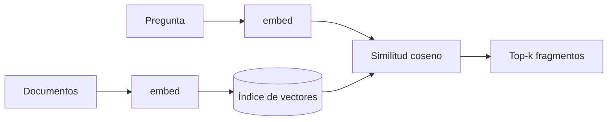

Al terminar esta lección sabrás convertir textos en vectores, compararlos y devolver los más parecidos a una pregunta. Es la primera pieza de cualquier sistema de [[glosario/rag|RAG]]: antes de responder sobre tus documentos, hay que encontrar los fragmentos que hablan del tema.

## La idea

Un [[glosario/embeddings|embedding]] es una lista de números (un vector) que representa el significado de un texto. Lo produce un modelo entrenado para que textos con significado parecido den vectores que apuntan en direcciones parecidas. «¿Cómo cambio mi contraseña?» y «Quiero restablecer la clave de acceso» no comparten casi palabras, pero sus vectores quedan cerca.

Los vectores tienen cientos o miles de dimensiones. No interpretas cada número por separado: solo te interesa **qué cerca están dos vectores entre sí**. Esa cercanía se mide casi siempre con la [[glosario/similitud-coseno|similitud coseno]].

El flujo de una búsqueda semántica tiene dos fases:



La indexación se hace una vez (o cuando cambian los documentos). La consulta se hace en cada pregunta: vectorizas la pregunta y la comparas con todos los vectores guardados.

## La función embed()

Anthropic no ofrece un modelo de embeddings propio, y hay muchos proveedores (comerciales y de código abierto). Para que tu código no dependa de uno, escóndelo detrás de una función:

```python title="embed.py"
def embed(textos: list[str]) -> list[list[float]]:
    """Devuelve un vector por cada texto, en el mismo orden."""
    # usa el proveedor de embeddings que prefieras
    raise NotImplementedError
```

Tres reglas que conviene respetar sea cual sea el proveedor:

- **Usa el mismo modelo para documentos y consultas.** Vectores de modelos distintos no son comparables, aunque tengan la misma dimensión.
- **Envía por lotes.** Vectorizar textos de uno en uno es lento y suele costar más por las llamadas de red. La mayoría de proveedores aceptan listas.
- **Guarda qué modelo generó cada índice.** Si cambias de modelo, tienes que volver a vectorizar todo. Algunos proveedores además piden indicar si el texto es una consulta o un documento: consulta su documentación.

## Similitud coseno

La similitud coseno mide el ángulo entre dos vectores. Vale 1 si apuntan en la misma dirección, 0 si son perpendiculares y −1 si son opuestos. Se calcula como el producto escalar dividido entre el producto de las longitudes:

```text
coseno(a, b) = (a · b) / (|a| · |b|)
```

```python tab="Python" title="coseno.py"
import math

def coseno(a: list[float], b: list[float]) -> float:
    if len(a) != len(b):
        raise ValueError("los vectores deben tener la misma dimensión")
    producto = sum(x * y for x, y in zip(a, b))
    norma_a = math.sqrt(sum(x * x for x in a))
    norma_b = math.sqrt(sum(y * y for y in b))
    if norma_a == 0 or norma_b == 0:
        return 0.0
    return producto / (norma_a * norma_b)
```

```ts tab="TypeScript" title="coseno.ts"
export function coseno(a: number[], b: number[]): number {
  if (a.length !== b.length) throw new Error("los vectores deben tener la misma dimensión");
  let producto = 0, normaA = 0, normaB = 0;
  for (let i = 0; i < a.length; i++) {
    producto += a[i] * b[i];
    normaA += a[i] * a[i];
    normaB += b[i] * b[i];
  }
  if (normaA === 0 || normaB === 0) return 0;
  return producto / (Math.sqrt(normaA) * Math.sqrt(normaB));
}
```

Un truco habitual: **normaliza los vectores al guardarlos** (divide cada uno por su longitud). Con vectores de longitud 1, el coseno es simplemente el producto escalar, que es más rápido. Muchos proveedores ya devuelven vectores normalizados; compruébalo calculando la norma de uno.

## Una búsqueda semántica mínima

Con `embed()` y `coseno()` ya puedes buscar. Para unos miles de textos, comparar contra todos en memoria es perfectamente válido. Con NumPy cabe en pocas líneas:

```python title="buscar.py"
import numpy as np
from embed import embed

class IndiceSemantico:
    def __init__(self, textos: list[str]):
        self.textos = textos
        m = np.array(embed(textos), dtype=np.float32)
        self.matriz = m / np.linalg.norm(m, axis=1, keepdims=True)  # normaliza cada fila

    def buscar(self, consulta: str, k: int = 3) -> list[tuple[float, str]]:
        q = np.array(embed([consulta])[0], dtype=np.float32)
        q = q / np.linalg.norm(q)
        puntos = self.matriz @ q                 # coseno contra todas las filas a la vez
        mejores = np.argsort(-puntos)[:k]
        return [(float(puntos[i]), self.textos[i]) for i in mejores]

indice = IndiceSemantico([
    "Para restablecer tu contraseña, pulsa «He olvidado mi clave» en la pantalla de acceso.",
    "Los pedidos se envían en 24–48 horas laborables.",
    "Puedes devolver un producto en los 30 días siguientes a la entrega.",
])
for puntos, texto in indice.buscar("no me acuerdo de la clave para entrar"):
    print(f"{puntos:.3f}  {texto}")
```

```text
# salida de ejemplo
0.712  Para restablecer tu contraseña, pulsa «He olvidado mi clave» en la pantalla de acceso.
0.284  Puedes devolver un producto en los 30 días siguientes a la entrega.
0.251  Los pedidos se envían en 24–48 horas laborables.
```

Fíjate en dos cosas. Primero, la búsqueda acierta aunque la consulta no repita las palabras del texto. Segundo, **los valores absolutos dependen del modelo**: con uno, 0,7 es muy alto; con otro, todo cae entre 0,75 y 0,9. No fijes umbrales copiados de otro sitio; míralos con tus datos.

Cuando pases de decenas de miles de vectores, o necesites filtrar por metadatos, usarás un [[glosario/vector-store|vector store]]: una base de datos que guarda vectores y busca vecinos cercanos de forma aproximada y rápida. La idea es la misma.

## Dónde fallan los embeddings

Los embeddings capturan el tema general. Eso los hace buenos para paráfrasis y malos para lo literal:

- **Códigos e identificadores**: `ERR-4012`, un número de pedido o una versión de librería. El vector apenas distingue `ERR-4012` de `ERR-4021`.
- **Nombres propios poco frecuentes** y términos internos de tu empresa que el modelo no vio al entrenarse.
- **Negaciones y matices**: «productos que *no* admiten devolución» puede quedar muy cerca de «productos que admiten devolución».
- **Textos largos con varios temas**: el vector promedia y se diluye. Por eso se trocea, que es la siguiente lección.

> [!aviso] Similar no significa relevante
> El fragmento más parecido a la pregunta puede no contener la respuesta. Una pregunta sobre plazos de devolución recupera con facilidad un texto que habla de devoluciones en general. Por eso existen la [[roadmap/30-contexto-y-rag/03-busqueda-hibrida|búsqueda híbrida]] y el [[roadmap/30-contexto-y-rag/04-reranking|reranking]].

## Errores frecuentes

- Vectorizar la consulta con un modelo y los documentos con otro.
- Vectorizar documentos enteros en lugar de fragmentos.
- Recalcular los embeddings de todo el corpus en cada arranque. Guárdalos en disco junto al texto y al nombre del modelo.
- Mezclar idiomas sin comprobar que el modelo de embeddings es multilingüe.

## Ejercicio

> [!ejercicio] Buscador de preguntas frecuentes
> Toma 20 preguntas frecuentes reales (de tu empresa o de la página de ayuda de un servicio que uses) con su respuesta. Indexa las respuestas con `IndiceSemantico` y escribe 10 consultas formuladas con otras palabras, anotando cuál es la respuesta correcta de cada una. Añade 2 consultas que contengan un código o un número exacto.
>
> **Está bien si**: un script imprime, para cada consulta, el top-3 con sus puntuaciones y marca si la respuesta correcta aparece; al menos 8 de las 10 consultas parafraseadas la tienen en el top-3; y has anotado qué pasa con las 2 consultas de códigos.

> [!ejercicio]- Pistas
> Guarda la matriz con `np.save` y los textos en un JSON para no vectorizar en cada ejecución. Si fallan más de 2 paráfrasis, mira si las respuestas son demasiado largas o tratan varios temas a la vez.

## Resumen

- Un embedding es un vector que representa el significado de un texto; textos parecidos dan vectores cercanos.
- La similitud coseno compara dos vectores; con vectores normalizados es un producto escalar.
- Esconde el proveedor detrás de `embed()` y usa el mismo modelo para documentos y consultas.
- Los embeddings fallan con códigos, nombres raros y negaciones: no basta con ellos.

## Para seguir

- [[roadmap/30-contexto-y-rag/02-chunking]]
- [[glosario/similitud-coseno]]
- [[docs/contexto/03-rag]]
- [[cursos/rag-a-fondo/01-anatomia-de-un-rag]]
