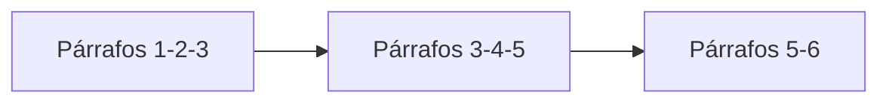

Al terminar esta lección sabrás convertir documentos largos en fragmentos que se recuperan bien: del tamaño adecuado, sin cortar ideas por la mitad y con la información necesaria para citarlos después. Es la decisión que más influye en la calidad de un RAG y la que más se descuida.

## La idea

El [[glosario/chunking|chunking]] (troceado) consiste en dividir cada documento en fragmentos y vectorizar cada fragmento por separado. Se hace por tres motivos:

1. **Precisión**: un vector de un documento de 30 páginas promedia todos sus temas y no se parece mucho a ninguna pregunta concreta.
2. **Contexto**: aunque el modelo admita mucho texto en su [[glosario/ventana-de-contexto|ventana de contexto]], meter documentos enteros encarece cada llamada y diluye la atención. Lo estudia *Lost in the Middle* ([Liu et al., 2023](https://arxiv.org/abs/2307.03172)): la información en mitad de un contexto largo se aprovecha peor.
3. **Citas**: para decir «esto sale de aquí» necesitas una unidad pequeña y localizable.

El problema es el corte. Si partes «El plazo de devolución es de 30 días» de «salvo en productos personalizados», el primer fragmento afirma algo falso por omisión.

## Cuánto debe medir un fragmento

No hay un número correcto. Depende del tipo de documento y del tipo de pregunta.

| Fragmentos pequeños (una o dos frases) | Fragmentos grandes (varias páginas) |
|---|---|
| Vector muy específico, búsqueda precisa | Vector difuso, búsqueda imprecisa |
| Pierden el contexto que los rodea | Conservan el contexto |
| Muchos fragmentos por respuesta | Pocos fragmentos, pero mucho texto irrelevante |

Un punto de partida razonable para documentación y políticas internas es entre uno y tres párrafos, del orden de unos cientos de [[glosario/token|tokens]]. Después lo ajustas midiendo, como en el ejercicio. Si tus documentos son preguntas frecuentes, un fragmento por pregunta suele ser lo natural.

## Respeta la estructura

El peor troceador corta cada N caracteres. Parte palabras, frases y tablas. Mejor seguir la estructura que el autor ya puso:

- **Secciones** (encabezados `##` en Markdown, títulos en HTML).
- **Párrafos** dentro de cada sección.
- **Frases**, solo cuando un párrafo es demasiado largo.

Esta estrategia de «del corte grande al pequeño» se suele llamar troceado recursivo. La aplicas así: intentas cortar por el separador más grande y, si un trozo sigue siendo demasiado largo, bajas al siguiente separador.

## Solapamiento

El **solapamiento** repite el final de un fragmento al principio del siguiente. Si una idea cae justo en la frontera, aparece completa en al menos uno de los dos. El precio es que indexas algo más de texto y que dos fragmentos contiguos pueden salir juntos en los resultados. Solapar por párrafos completos evita cortar frases.



## Un troceador por párrafos

Este código agrupa párrafos hasta un tamaño máximo, repite el último párrafo como solapamiento y parte por frases los párrafos que no caben solos:

```python tab="Python" title="trocear.py"
import re

def partir_largos(parrafos: list[str], max_chars: int) -> list[str]:
    """Parte por frases los párrafos que superan max_chars."""
    salida = []
    for p in parrafos:
        if len(p) <= max_chars:
            salida.append(p)
            continue
        trozo = ""
        for frase in re.split(r"(?<=[.!?])\s+", p):
            if trozo and len(trozo) + len(frase) + 1 > max_chars:
                salida.append(trozo)
                trozo = ""
            trozo = f"{trozo} {frase}".strip()
        if trozo:
            salida.append(trozo)
    return salida

def trocear(texto: str, max_chars: int = 1500, solape: int = 1) -> list[str]:
    """Agrupa párrafos hasta max_chars y repite los últimos `solape` párrafos en el siguiente trozo."""
    parrafos = [p.strip() for p in re.split(r"\n\s*\n", texto) if p.strip()]
    parrafos = partir_largos(parrafos, max_chars)
    trozos, actual = [], []
    for p in parrafos:
        if actual and len("\n\n".join(actual + [p])) > max_chars:
            trozos.append("\n\n".join(actual))
            actual = actual[-solape:] if solape else []
            while actual and len("\n\n".join(actual + [p])) > max_chars:
                actual.pop(0)                    # el solape nunca puede pasar del límite
        actual.append(p)
    if actual:
        trozos.append("\n\n".join(actual))
    return trozos
```

```ts tab="TypeScript" title="trocear.ts"
function partirLargos(parrafos: string[], maxChars: number): string[] {
  const salida: string[] = [];
  for (const p of parrafos) {
    if (p.length <= maxChars) { salida.push(p); continue; }
    let trozo = "";
    for (const frase of p.split(/(?<=[.!?])\s+/)) {
      if (trozo && trozo.length + frase.length + 1 > maxChars) { salida.push(trozo); trozo = ""; }
      trozo = `${trozo} ${frase}`.trim();
    }
    if (trozo) salida.push(trozo);
  }
  return salida;
}

export function trocear(texto: string, maxChars = 1500, solape = 1): string[] {
  const parrafos = partirLargos(
    texto.split(/\n\s*\n/).map((p) => p.trim()).filter(Boolean), maxChars);
  const trozos: string[] = [];
  let actual: string[] = [];
  for (const p of parrafos) {
    if (actual.length && [...actual, p].join("\n\n").length > maxChars) {
      trozos.push(actual.join("\n\n"));
      actual = solape ? actual.slice(-solape) : [];
      while (actual.length && [...actual, p].join("\n\n").length > maxChars) actual.shift();
    }
    actual.push(p);
  }
  if (actual.length) trozos.push(actual.join("\n\n"));
  return trozos;
}
```

Usa caracteres como aproximación porque es rápido. Si necesitas precisión, mide en tokens con el [[glosario/tokenizador|tokenizador]] de tu modelo de embeddings, que es quien tiene el límite de entrada.

## Metadatos: el fragmento debe saber de dónde viene

Un fragmento suelto («El plazo es de 15 días») no sirve de mucho si no sabes de qué documento y de qué sección sale. Guarda con cada fragmento:

```python title="indexar.py"
import re
from pathlib import Path
from trocear import trocear

def fragmentos_de(ruta: Path) -> list[dict]:
    texto = ruta.read_text(encoding="utf-8")
    secciones = re.split(r"(?m)^## ", texto)        # corta por encabezados de segundo nivel
    salida = []
    for s in secciones:
        titulo_seccion, _, cuerpo = s.partition("\n")
        for i, trozo in enumerate(trocear(cuerpo)):
            salida.append({
                "id": f"{ruta.stem}#{len(salida)}",
                "fuente": str(ruta),
                "seccion": titulo_seccion.strip(),
                "posicion": i,
                "texto": trozo,
            })
    return salida
```

En el primer bloque (lo que va antes del primer `##`) la primera línea hace de título de sección: si el documento empieza con `# Título`, es justo lo que quieres. El `id` estable te permite citar; `fuente` y `seccion` se muestran al usuario; `posicion` sirve para recuperar los fragmentos vecinos si necesitas más contexto.

Hay una mejora sencilla y eficaz: **vectoriza el fragmento con su contexto**. En lugar de vectorizar solo `trozo`, vectoriza `f"{titulo_documento} > {seccion}\n\n{trozo}"`. Anthropic llevó la idea más lejos con la [[glosario/recuperacion-contextual|recuperación contextual]]: usar un modelo para escribir una o dos frases que sitúan cada fragmento dentro del documento y anteponerlas antes de indexar ([*Introducing Contextual Retrieval*](https://www.anthropic.com/news/contextual-retrieval)).

> [!aviso] Limpia antes de trocear
> Menús de navegación, pies de página, avisos legales repetidos y tablas convertidas a texto sin formato ensucian los vectores y aparecen en los resultados. Quítalos antes de trocear.

## Errores frecuentes

- Cortar por número fijo de caracteres sin mirar frases ni párrafos.
- Perder los títulos de sección, que suelen ser la mejor pista del tema del fragmento.
- Trocear tablas fila a fila sin repetir la cabecera: cada fila pierde el significado de sus columnas.
- Cambiar el troceado sin volver a medir con las mismas preguntas.

## Ejercicio

> [!ejercicio] Dos troceados, una comparación
> Elige 5 a 10 documentos Markdown reales (la documentación de un proyecto de código abierto vale). Indexa dos veces: una con `max_chars=600, solape=0` y otra con `max_chars=1500, solape=1`, añadiendo título y sección al texto que vectorizas. Escribe 10 preguntas y anota para cada una el `id` del fragmento que contiene la respuesta en cada configuración.
>
> **Está bien si**: cada fragmento guarda `id`, `fuente`, `seccion` y `posicion`; ningún fragmento supera `max_chars` salvo frases sueltas más largas que el límite; y tienes una tabla con cuántas preguntas encuentran su fragmento en el top-3 con cada configuración, más una frase explicando la diferencia.

> [!ejercicio]- Pistas
> Para anotar el fragmento correcto, busca una frase literal de la respuesta con `in` sobre los textos de los fragmentos. Si un fragmento correcto sale siempre en cuarta o quinta posición, mira si su sección tiene un título poco descriptivo.

## Resumen

- Se trocea para que cada vector sea específico, el contexto no se llene y se pueda citar.
- Corta siguiendo la estructura: secciones, párrafos y, solo si hace falta, frases.
- El solapamiento evita perder ideas que caen en la frontera entre fragmentos.
- Cada fragmento necesita metadatos: id estable, fuente, sección y posición.
- El tamaño correcto se encuentra midiendo con tus preguntas.

## Para seguir

- [[roadmap/30-contexto-y-rag/03-busqueda-hibrida]]
- [[recetas/trocear-documentos]]
- [[cursos/rag-a-fondo/02-indexar-bien]]
- [[modelos/07-documentos-largos]]
