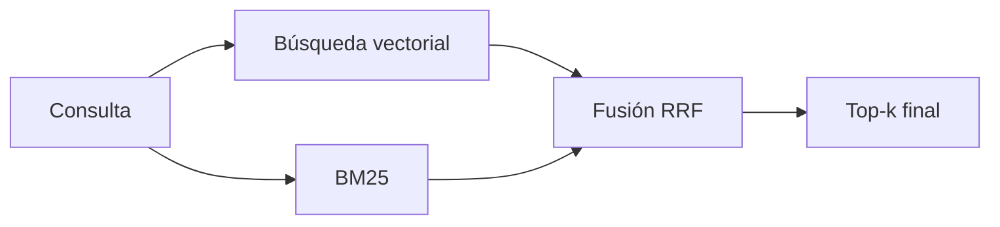

Al terminar esta lección tendrás un recuperador que encuentra tanto «¿cómo devuelvo un pedido?» como «error ERR-4012». Combinarás dos métodos que fallan en sitios distintos y aprenderás a fusionar sus resultados sin calibrar puntuaciones.

## La idea

En la [[roadmap/30-contexto-y-rag/01-embeddings|lección de embeddings]] viste que los vectores captan el significado pero confunden códigos, nombres propios y términos raros. La búsqueda por palabras clave tiene el defecto contrario: encuentra `ERR-4012` a la primera y no sabe que «clave» y «contraseña» son lo mismo.

La [[glosario/busqueda-hibrida|búsqueda híbrida]] lanza las dos búsquedas y fusiona los resultados. Un fragmento que aparece arriba en cualquiera de las dos listas tiene opciones de llegar al resultado final.



## BM25 en cinco minutos

[[glosario/bm25|BM25]] es la función de puntuación clásica de los buscadores por palabras clave ([Robertson y Zaragoza, 2009](#para-seguir)). Para cada término de la consulta suma una puntuación que crece con tres cosas:

- **Frecuencia en el fragmento**: si el término aparece más veces, más puntos. Pero con saturación: la décima aparición aporta mucho menos que la primera. El parámetro `k1` controla esa saturación.
- **Rareza en el corpus** (IDF): un término que aparece en pocos fragmentos vale mucho; «el» o «de» casi nada.
- **Longitud del fragmento**: un fragmento largo tiene más palabras por azar, así que se penaliza. El parámetro `b` (entre 0 y 1) controla cuánto.

La fórmula para un término `t` en un fragmento `D`:

```text
idf(t)      = ln( (N - n_t + 0.5) / (n_t + 0.5) + 1 )
puntos(t,D) = idf(t) · f · (k1 + 1) / ( f + k1 · (1 - b + b · |D| / media) )
```

donde `N` es el número de fragmentos, `n_t` cuántos contienen `t`, `f` las veces que `t` aparece en `D`, `|D|` la longitud de `D` en palabras y `media` la longitud media. Valores de partida habituales: `k1` entre 1,2 y 2, y `b = 0.75`.

```python title="bm25.py"
import math
import re
from collections import Counter

def tokenizar(texto: str) -> list[str]:
    return re.findall(r"\w+(?:-\w+)*", texto.lower())   # conserva códigos como err-4012

class BM25:
    def __init__(self, textos: list[str], k1: float = 1.5, b: float = 0.75):
        self.k1, self.b = k1, b
        self.tf = [Counter(tokenizar(t)) for t in textos]
        self.longitud = [sum(c.values()) for c in self.tf]
        self.media = sum(self.longitud) / len(textos)
        n = Counter()
        for c in self.tf:
            n.update(c.keys())
        N = len(textos)
        self.idf = {t: math.log((N - nt + 0.5) / (nt + 0.5) + 1) for t, nt in n.items()}

    def puntuar(self, consulta: str) -> list[float]:
        terminos = tokenizar(consulta)
        puntos = []
        for c, L in zip(self.tf, self.longitud):
            s = 0.0
            for t in terminos:
                f = c.get(t, 0)
                if f:
                    s += self.idf[t] * f * (self.k1 + 1) / (f + self.k1 * (1 - self.b + self.b * L / self.media))
            puntos.append(s)
        return puntos

    def ranking(self, consulta: str, k: int = 20) -> list[int]:
        puntos = self.puntuar(consulta)
        orden = sorted(range(len(puntos)), key=lambda i: puntos[i], reverse=True)
        return [i for i in orden[:k] if puntos[i] > 0]
```

Para producción no hace falta que lo programes tú: la mayoría de motores de búsqueda y muchos [[glosario/vector-store|vector stores]] traen BM25 o algo equivalente. Escribirlo una vez te sirve para entender por qué una consulta sale o no sale.

> [!consejo] El tokenizador importa
> En español conviene quitar tildes al indexar y al consultar (`unicodedata.normalize` y descartar las marcas diacríticas), porque los usuarios escriben «devolucion» y «devolución». Mantén igual el tratamiento en ambos lados.

## Fusionar sin comparar puntuaciones

Tienes dos listas ordenadas. El problema es que sus puntuaciones no son comparables: un coseno de 0,8 y un BM25 de 12,3 no significan nada juntos. Normalizarlas funciona mal porque sus distribuciones cambian con cada consulta.

**Reciprocal Rank Fusion** (RRF) evita el problema usando solo la posición. Cada fragmento recibe, por cada lista en la que aparece, `1 / (k + posición)`, y se suman:

```python tab="Python" title="rrf.py"
def rrf(rankings: list[list[int]], k: int = 60) -> list[int]:
    """Fusiona varias listas de ids ordenadas de mejor a peor."""
    puntos: dict[int, float] = {}
    for ranking in rankings:
        for posicion, doc_id in enumerate(ranking, start=1):
            puntos[doc_id] = puntos.get(doc_id, 0.0) + 1.0 / (k + posicion)
    return sorted(puntos, key=puntos.get, reverse=True)
```

```ts tab="TypeScript" title="rrf.ts"
export function rrf(rankings: number[][], k = 60): number[] {
  const puntos = new Map<number, number>();
  for (const ranking of rankings) {
    ranking.forEach((id, i) => puntos.set(id, (puntos.get(id) ?? 0) + 1 / (k + i + 1)));
  }
  return [...puntos.keys()].sort((a, b) => puntos.get(b)! - puntos.get(a)!);
}
```

La constante `k` suaviza la ventaja de los primeros puestos; 60 es el valor habitual y rara vez merece la pena tocarlo. Un fragmento que sale tercero en ambas listas supera a uno que sale primero en una y no aparece en la otra, que es justo lo que quieres.

## El recuperador híbrido completo

```python title="hibrido.py"
import numpy as np
from bm25 import BM25
from embed import embed
from rrf import rrf

class RecuperadorHibrido:
    def __init__(self, fragmentos: list[dict]):
        self.fragmentos = fragmentos
        textos = [f["texto"] for f in fragmentos]
        self.bm25 = BM25(textos)
        m = np.array(embed(textos), dtype=np.float32)
        self.vectores = m / np.linalg.norm(m, axis=1, keepdims=True)

    def buscar(self, consulta: str, k: int = 5, candidatos: int = 30) -> list[dict]:
        q = np.array(embed([consulta])[0], dtype=np.float32)
        q /= np.linalg.norm(q)
        por_vector = list(np.argsort(-(self.vectores @ q))[:candidatos])
        por_palabras = self.bm25.ranking(consulta, k=candidatos)
        fusion = rrf([[int(i) for i in por_vector], por_palabras])
        return [self.fragmentos[i] for i in fusion[:k]]
```

Pide a cada método bastantes más candidatos de los que vas a devolver (aquí 30 para quedarte con 5). Si cada uno trae solo 5, la fusión tiene poco donde elegir.

## Cuándo merece la pena

Casi siempre que tus documentos tengan códigos, referencias, nombres de producto o jerga interna, que en una empresa es lo normal. Si solo tienes texto narrativo y preguntas parafraseadas, la ganancia puede ser pequeña. **No lo decidas por intuición: mídelo** con las preguntas que escribiste en las lecciones anteriores, comparando las tres variantes (solo vectores, solo BM25, híbrida).

> [!aviso] Filtra antes, no después
> Si el usuario solo puede ver ciertos documentos (por departamento, por cliente), aplica el filtro de permisos dentro de cada búsqueda. Filtrar después del top-k puede dejarte sin resultados o, peor, colar un fragmento que no debía ver.

## Errores frecuentes

- Sumar puntuaciones crudas de BM25 y coseno.
- Tokenizar distinto al indexar y al consultar.
- Pedir solo k candidatos a cada método antes de fusionar.
- Partir los códigos en piezas (`err`, `4012`) y luego extrañarse de que no se encuentren.

## Ejercicio

> [!ejercicio] Tres recuperadores, una tabla
> Sobre el índice del ejercicio anterior, añade 5 preguntas que contengan un código, un nombre propio o un término interno. Para las 15 preguntas totales mide el acierto en el top-5 de: solo vectores, solo BM25 y la búsqueda híbrida con RRF.
>
> **Está bien si**: tienes una tabla con las tres columnas y el número de aciertos de cada una; la híbrida no queda por debajo de la mejor de las otras dos en más de una pregunta; y has escrito qué tipo de pregunta resuelve cada método mejor.

> [!ejercicio]- Pistas
> Si BM25 falla con un código, imprime `tokenizar()` de la consulta y del fragmento: casi siempre es el tokenizador. Si la híbrida empeora, comprueba que pasas a `rrf` listas de ids y no de puntuaciones.

## Resumen

- Vectores y BM25 fallan en sitios distintos: paráfrasis frente a términos exactos.
- BM25 premia términos raros que aparecen en el fragmento y penaliza fragmentos largos.
- RRF fusiona listas por posición, sin calibrar puntuaciones; `k = 60` es el valor habitual.
- Pide muchos candidatos a cada método y filtra por permisos dentro de cada búsqueda.

## Para seguir

- [[roadmap/30-contexto-y-rag/04-reranking]]
- [[recetas/busqueda-hibrida-con-bm25]]
- [[cursos/rag-a-fondo/03-recuperar-bien]]
- Robertson y Zaragoza, 2009. *The Probabilistic Relevance Framework: BM25 and Beyond*.
