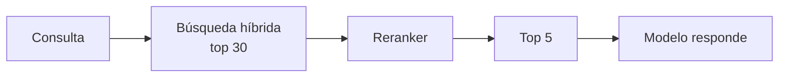

Al terminar esta lección sabrás añadir una segunda etapa a tu recuperador: de 30 candidatos razonables a los 5 que mejor responden a la pregunta. Es una de las mejoras más fáciles de medir en un RAG, y también una de las que más latencia añade, así que verás cuándo compensa.

## La idea

La búsqueda vectorial y BM25 son rápidas porque comparan la consulta con cada fragmento **por separado**: el vector del fragmento se calculó antes de que existiera la pregunta. Eso las hace buenas para descartar casi todo el corpus y flojas para decidir cuál de los 30 finalistas responde mejor.

Un [[glosario/reranking|reranker]] lee la consulta y el fragmento **juntos** y puntúa su relevancia. Es mucho más preciso y mucho más caro por fragmento, así que solo se aplica a los candidatos.



Este diseño en dos etapas se resume así: **recupera con generosidad, entrega con tacañería**. La primera etapa cuida que la respuesta esté entre los candidatos (*recall*). La segunda cuida que lo que llega al contexto sea lo mejor (*precisión*).

## Dos formas de reordenar

**Modelos de reranking dedicados** (a menudo llamados *cross-encoders*). Reciben pares consulta-texto y devuelven una puntuación. Son rápidos y baratos para esta tarea concreta. Los ofrecen varios proveedores y hay modelos abiertos. Igual que con los embeddings, escóndelos tras una función:

```python title="rerank.py"
def rerank(consulta: str, textos: list[str]) -> list[float]:
    """Devuelve una puntuación de relevancia por texto, en el mismo orden."""
    # usa el proveedor de reranking que prefieras
    raise NotImplementedError
```

**Un LLM como reranker**. Le pasas la consulta y los candidatos numerados y le pides una puntuación por cada uno. Es más lento y más caro, pero entiende instrucciones: puedes decirle qué cuenta como relevante en tu dominio («un fragmento que menciona el producto pero no el plazo no responde»). Es una buena forma de empezar y de crear un listón con el que comparar un reranker dedicado.

## Un reranker con un LLM

El modelo recibe los candidatos en etiquetas XML, cada uno con su índice, y devuelve JSON que cumple un esquema gracias a la [[glosario/salida-estructurada|salida estructurada]]:

```python tab="Python" title="rerank_llm.py"
import json
import anthropic

MODEL = "claude-sonnet-5-5"
client = anthropic.Anthropic()

ESQUEMA = {
    "type": "object",
    "properties": {
        "puntuaciones": {
            "type": "array",
            "items": {
                "type": "object",
                "properties": {
                    "indice": {"type": "integer"},
                    "relevancia": {"type": "integer"},
                },
                "required": ["indice", "relevancia"],
                "additionalProperties": False,
            },
        }
    },
    "required": ["puntuaciones"],
    "additionalProperties": False,
}

SISTEMA = """Puntúas la relevancia de fragmentos para una consulta.
Escala de relevancia:
3 = contiene la respuesta completa
2 = contiene parte de la respuesta
1 = trata el tema pero no responde
0 = no tiene relación
Puntúa todos los fragmentos, uno por índice."""

def rerank_llm(consulta: str, fragmentos: list[dict], k: int = 5) -> list[dict]:
    docs = "\n".join(
        f'<fragmento indice="{i}">\n{f["texto"]}\n</fragmento>' for i, f in enumerate(fragmentos)
    )
    resp = client.messages.create(
        model=MODEL,
        max_tokens=2048,
        system=SISTEMA,
        messages=[{"role": "user", "content": f"<fragmentos>\n{docs}\n</fragmentos>\n\n<consulta>{consulta}</consulta>"}],
        output_config={"format": {"type": "json_schema", "schema": ESQUEMA}},
    )
    if resp.stop_reason != "end_turn":
        raise RuntimeError(f"reranking incompleto: {resp.stop_reason}")
    texto = next(b.text for b in resp.content if b.type == "text")
    puntos = {p["indice"]: max(0, min(3, p["relevancia"])) for p in json.loads(texto)["puntuaciones"]}
    orden = sorted(range(len(fragmentos)), key=lambda i: puntos.get(i, 0), reverse=True)
    return [fragmentos[i] | {"relevancia": puntos.get(i, 0)} for i in orden[:k]]
```

```ts tab="TypeScript" title="rerankLlm.ts"
import Anthropic from "@anthropic-ai/sdk";

const MODEL = "claude-sonnet-5-5";
const client = new Anthropic();

// ESQUEMA y SISTEMA iguales que en la versión de Python
export async function rerankLlm(consulta: string, fragmentos: { texto: string }[], k = 5) {
  const docs = fragmentos
    .map((f, i) => `<fragmento indice="${i}">\n${f.texto}\n</fragmento>`)
    .join("\n");
  const resp = await client.messages.create({
    model: MODEL,
    max_tokens: 2048,
    system: SISTEMA,
    messages: [{ role: "user", content: `<fragmentos>\n${docs}\n</fragmentos>\n\n<consulta>${consulta}</consulta>` }],
    output_config: { format: { type: "json_schema", schema: ESQUEMA } },
  });
  if (resp.stop_reason !== "end_turn") throw new Error(`reranking incompleto: ${resp.stop_reason}`);
  const bloque = resp.content.find((b): b is Anthropic.TextBlock => b.type === "text");
  const datos = JSON.parse(bloque!.text) as { puntuaciones: { indice: number; relevancia: number }[] };
  const puntos = new Map(datos.puntuaciones.map((p) => [p.indice, Math.max(0, Math.min(3, p.relevancia))]));
  return fragmentos
    .map((f, i) => ({ ...f, relevancia: puntos.get(i) ?? 0 }))
    .sort((a, b) => b.relevancia - a.relevancia)
    .slice(0, k);
}
```

Tres detalles que importan:

- La escala 0–3 va en el prompt y el código **recorta** el valor, porque los esquemas de salida estructurada no admiten restricciones numéricas. El esquema garantiza la forma; los valores los validas tú.
- Si falta algún índice en la respuesta, cuenta como 0. Nunca supongas que el modelo puntuó todo.
- Con una escala discreta habrá empates. `sorted` es estable, así que en caso de empate se mantiene el orden de la búsqueda híbrida, que ya es una buena señal.

> [!consejo] Usa la relevancia para abstenerte
> Si ningún fragmento llega a 2, probablemente la respuesta no está en tus documentos. Es mejor decirlo que dejar que el modelo improvise. Lo usarás en [[roadmap/30-contexto-y-rag/05-respuestas-con-citas]].

## Coste y latencia

El reranking añade una etapa a cada pregunta. Con un LLM, esa etapa es una llamada completa con 30 fragmentos de entrada, que puede costar más que la propia respuesta. Formas de contenerlo:

- **Menos candidatos**: prueba 20 o 15 en lugar de 30 y mide si pierdes aciertos.
- **Un modelo más pequeño** para reordenar. Es una tarea acotada; consulta [[modelos/05-elegir-modelo-por-tarea]].
- **Un reranker dedicado**, que suele ser bastante más rápido que un LLM para esta tarea.
- **Saltarte el reranking** cuando la primera etapa ya es clara, por ejemplo cuando BM25 encuentra un código exacto en un único fragmento.

Mide la [[glosario/latencia|latencia]] de cada etapa por separado. Si el usuario espera la respuesta en directo, el reranking compite con el tiempo de generación.

## Errores frecuentes

- Reordenar los 5 primeros en lugar de los 30 primeros: si la respuesta estaba en el puesto 12, el reranker nunca la ve.
- Fiarse de puntuaciones de un LLM sin escala definida («del 1 al 10») y sin recortar.
- Comparar el reranking con la primera etapa usando preguntas distintas.
- Pasar al modelo final los fragmentos reordenados pero con los índices antiguos, lo que rompe las citas.

## Ejercicio

> [!ejercicio] ¿Compensa el reranking?
> Añade `rerank_llm` detrás de tu recuperador híbrido, con 30 candidatos y k = 3. Con tus 15 preguntas, mide el acierto en el top-3 sin reranking y con reranking, y apunta la latencia media de cada versión.
>
> **Está bien si**: tienes una tabla con acierto y latencia media de ambas versiones; el código no falla si el modelo omite algún índice; y has escrito en dos frases si en tu caso compensa, con los números delante.

> [!ejercicio]- Pistas
> Para medir latencia usa `time.perf_counter()` alrededor de cada etapa. Si el reranking no mejora nada, mira si tus preguntas ya tenían el fragmento correcto en primera posición: entonces no hay margen de mejora y necesitas preguntas más difíciles.

## Resumen

- Recuperación en dos etapas: amplia y barata para no perder la respuesta, estrecha y precisa para elegir.
- Un reranker lee consulta y fragmento juntos; por eso acierta más y cuesta más.
- Con un LLM, define la escala en el prompt, valida y recorta en el código.
- Mide acierto y latencia antes de decidir si lo dejas.

## Para seguir

- [[roadmap/30-contexto-y-rag/05-respuestas-con-citas]]
- [[cursos/rag-a-fondo/03-recuperar-bien]]
- [[cursos/rag-a-fondo/04-evaluar-un-rag]]
