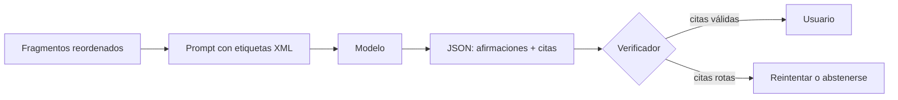

Al terminar esta lección tu asistente responderá citando de dónde saca cada dato, y tu código comprobará esas citas antes de enseñarlas. Pasas de «parece que responde bien» a «cada frase apunta a un texto que existe y que puedo enseñar».

## La idea

Un RAG sin citas pide fe. El usuario no sabe si la respuesta sale de tus documentos o del conocimiento general del modelo, y tú tampoco. Las citas sirven a dos públicos:

- **Al usuario**, que puede abrir la fuente y comprobar.
- **A tu código**, que puede verificar automáticamente que lo citado existe.

La segunda es la que más se olvida. Que el modelo escriba «[2]» no garantiza nada: puede citar un fragmento que no dice eso, o inventar un número. Una cita solo vale si se puede comprobar. A esta propiedad de basar cada afirmación en una fuente se le llama [[glosario/grounding|grounding]], y es tu mejor defensa contra las [[glosario/alucinacion|alucinaciones]] en un RAG.



## Fragmentos numerados en XML

Los modelos distinguen mejor el material de las instrucciones cuando va delimitado con etiquetas. Pon los documentos **antes** de la pregunta y dale a cada fragmento un índice corto y su fuente:

```python title="formato.py"
from html import escape

def formatear_fragmentos(fragmentos: list[dict]) -> str:
    partes = ["<documentos>"]
    for i, f in enumerate(fragmentos, start=1):
        partes.append(
            f'<documento indice="{i}" fuente="{escape(f["fuente"])}">\n{f["texto"]}\n</documento>'
        )
    partes.append("</documentos>")
    return "\n".join(partes)
```

Usa índices 1, 2, 3 en lugar de los ids internos (`politicas.md#14`). Son más cortos, el modelo los copia con menos errores y tú los traduces de vuelta al id real.

## Pedir citas literales

Una cita por índice dice «esto sale del documento 2». Una cita literal dice «esto sale de *esta frase* del documento 2», y eso se puede comprobar con código. Pide las dos cosas con [[glosario/salida-estructurada|salida estructurada]]:

```python title="responder.py"
import json
import anthropic
from formato import formatear_fragmentos

MODEL = "claude-sonnet-5-5"
client = anthropic.Anthropic()

ESQUEMA = {
    "type": "object",
    "properties": {
        "sin_informacion": {"type": "boolean"},
        "afirmaciones": {
            "type": "array",
            "items": {
                "type": "object",
                "properties": {
                    "texto": {"type": "string"},
                    "citas": {
                        "type": "array",
                        "items": {
                            "type": "object",
                            "properties": {
                                "indice": {"type": "integer"},
                                "literal": {"type": "string"},
                            },
                            "required": ["indice", "literal"],
                            "additionalProperties": False,
                        },
                    },
                },
                "required": ["texto", "citas"],
                "additionalProperties": False,
            },
        },
    },
    "required": ["sin_informacion", "afirmaciones"],
    "additionalProperties": False,
}

SISTEMA = """Respondes preguntas usando SOLO los documentos proporcionados.
Reglas:
- Divide la respuesta en afirmaciones cortas.
- Cada afirmación lleva al menos una cita: el índice del documento y un fragmento copiado
  literalmente de ese documento, sin cambiar ni una palabra.
- Si los documentos no contienen la respuesta, pon sin_informacion a true y deja
  afirmaciones vacío. No uses conocimiento propio."""

def responder(pregunta: str, fragmentos: list[dict]) -> dict:
    contenido = f"{formatear_fragmentos(fragmentos)}\n\n<pregunta>{pregunta}</pregunta>"
    resp = client.messages.create(
        model=MODEL,
        max_tokens=2048,
        system=SISTEMA,
        messages=[{"role": "user", "content": contenido}],
        output_config={"format": {"type": "json_schema", "schema": ESQUEMA}},
    )
    if resp.stop_reason != "end_turn":
        raise RuntimeError(f"respuesta incompleta: {resp.stop_reason}")
    return json.loads(next(b.text for b in resp.content if b.type == "text"))
```

La API de Claude ofrece además citas nativas: si pasas los fragmentos como bloques de documento o de resultado de búsqueda con las citas activadas, la respuesta trae el texto citado en bloques aparte, con su posición exacta. Tienen una limitación que importa aquí: **no se pueden combinar con las salidas estructuradas** de `output_config.format`, así que elige una de las dos vías. Los detalles están en la [documentación de la API de Claude](https://platform.claude.com/docs); la verificación de esta lección sirve igual en ambos casos, y es la única opción con modelos abiertos o con otros proveedores.

## El verificador

Comprueba tres cosas por cada cita: que el índice existe, que el literal aparece en ese fragmento y que no está vacío. Normaliza espacios y mayúsculas para no rechazar diferencias irrelevantes:

```python tab="Python" title="verificar.py"
import re

def normalizar(s: str) -> str:
    s = s.replace("“", '"').replace("”", '"').replace("’", "'")
    return re.sub(r"\s+", " ", s).strip().lower()

def verificar(salida: dict, fragmentos: list[dict], min_chars: int = 15) -> list[str]:
    problemas = []
    if salida["sin_informacion"]:
        return problemas
    if not salida["afirmaciones"]:
        problemas.append("no hay afirmaciones y sin_informacion es false")
    for n, af in enumerate(salida["afirmaciones"], start=1):
        if not af["citas"]:
            problemas.append(f"afirmación {n} sin citas: {af['texto']!r}")
        for c in af["citas"]:
            if not 1 <= c["indice"] <= len(fragmentos):
                problemas.append(f"afirmación {n}: índice {c['indice']} no existe")
                continue
            literal = normalizar(c["literal"])
            if len(literal) < min_chars:
                problemas.append(f"afirmación {n}: cita demasiado corta para comprobarla")
            elif literal not in normalizar(fragmentos[c["indice"] - 1]["texto"]):
                problemas.append(f"afirmación {n}: el literal no aparece en el documento {c['indice']}")
    return problemas
```

```ts tab="TypeScript" title="verificar.ts"
type Cita = { indice: number; literal: string };
type Salida = { sin_informacion: boolean; afirmaciones: { texto: string; citas: Cita[] }[] };

const normalizar = (s: string) =>
  s.replace(/[“”]/g, '"').replace(/’/g, "'").replace(/\s+/g, " ").trim().toLowerCase();

export function verificar(salida: Salida, fragmentos: { texto: string }[], minChars = 15): string[] {
  const problemas: string[] = [];
  if (salida.sin_informacion) return problemas;
  if (!salida.afirmaciones.length) problemas.push("no hay afirmaciones y sin_informacion es false");
  salida.afirmaciones.forEach((af, i) => {
    const n = i + 1;
    if (!af.citas.length) problemas.push(`afirmación ${n} sin citas: ${af.texto}`);
    for (const c of af.citas) {
      if (c.indice < 1 || c.indice > fragmentos.length) {
        problemas.push(`afirmación ${n}: índice ${c.indice} no existe`);
        continue;
      }
      const literal = normalizar(c.literal);
      if (literal.length < minChars) problemas.push(`afirmación ${n}: cita demasiado corta para comprobarla`);
      else if (!normalizar(fragmentos[c.indice - 1].texto).includes(literal))
        problemas.push(`afirmación ${n}: el literal no aparece en el documento ${c.indice}`);
    }
  });
  return problemas;
}
```

El mínimo de caracteres evita citas trampa como «30 días», que aparecen en medio corpus y no prueban nada.

> [!aviso] Lo que el verificador no comprueba
> Que el literal exista no significa que respalde la afirmación (lo que se llama [[glosario/fidelidad|fidelidad]]). El modelo puede citar «El plazo de devolución es de 30 días» para afirmar que el plazo es de 15. Para eso necesitas un segundo control: un [[glosario/modelo-juez|modelo juez]] que lea cada afirmación con su cita y diga si la cita la sostiene. Empieza por el verificador literal, que es gratis, y añade el juez cuando tengas un [[glosario/conjunto-de-evaluacion|conjunto de evaluación]] para medirlo.

## Qué hacer cuando falla

Tienes tres salidas, de menos a más estricta:

1. **Reintentar una vez** devolviendo al modelo la lista de problemas: «Estas citas no aparecen literalmente en los documentos: … Corrige la respuesta». Suele bastar.
2. **Eliminar las afirmaciones con citas rotas** y mostrar el resto, si las que quedan siguen respondiendo a la pregunta.
3. **Abstenerse**: «No he encontrado esto en la documentación». Úsalo también si el reranker no dio ningún fragmento con relevancia suficiente.

Registra cada fallo. Un aumento de citas rotas suele indicar que la recuperación ha empeorado o que los fragmentos son demasiado largos para citarlos con precisión.

## Errores frecuentes

- Poner la pregunta antes de los documentos en contextos largos.
- Mostrar los índices al usuario sin traducirlos a la fuente real.
- Aceptar citas por índice sin texto literal: no hay nada que comprobar.
- Tratar «sin información» como un fallo. Es una respuesta correcta cuando el dato no está.

## Ejercicio

> [!ejercicio] Citas que se sostienen
> Conecta `responder` y `verificar` a tu recuperador con reranking. Lanza tus 15 preguntas más 3 preguntas cuya respuesta sabes que **no** está en los documentos. Implementa un reintento con la lista de problemas cuando `verificar` devuelva algo.
>
> **Está bien si**: las 3 preguntas sin respuesta acaban con `sin_informacion: true` o con abstención; ninguna respuesta mostrada al usuario tiene problemas de verificación; y tienes un registro con cuántas respuestas necesitaron reintento y cuántas acabaron en abstención.

> [!ejercicio]- Pistas
> Para provocar un fallo y probar el reintento, corrompe a propósito un literal en una salida guardada antes de verificarla. Si el modelo cita con comillas tipográficas o puntos suspensivos, revisa `normalizar` antes de culpar al prompt.

## Resumen

- Una cita solo vale si se puede comprobar con código.
- Fragmentos en etiquetas XML con índice corto, antes de la pregunta.
- Pide afirmaciones con índice y literal; verifica índice, existencia y longitud mínima.
- El verificador literal no detecta citas que no respaldan la afirmación: para eso, un modelo juez.
- Reintenta una vez, recorta o abstente; nunca muestres citas sin verificar.

## Para seguir

- [[roadmap/30-contexto-y-rag/06-memoria-entre-sesiones]]
- [[sistemas/rag-con-citas]]
- [[cursos/rag-a-fondo/10-evaluar-un-rag]]
- [[recetas/modelo-juez-con-rubrica]]
- [[problemas/el-rag-encuentra-pero-responde-mal]]: qué revisar cuando los fragmentos son buenos y la respuesta no.
