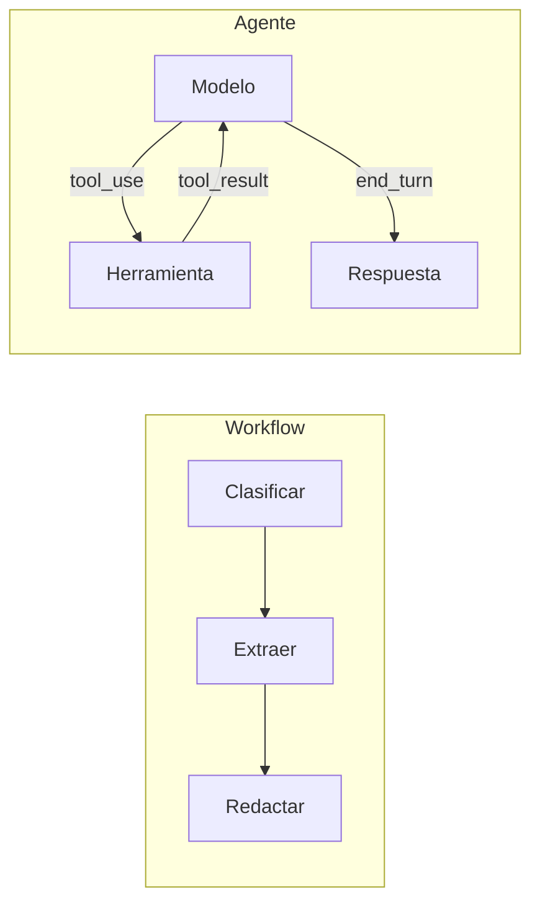

Al terminar esta lección sabrás distinguir un agente de un workflow, colocar cualquier problema en una escalera de complejidad y justificar si necesitas un agente o te basta algo más simple. Es la decisión de diseño más barata de tomar bien y la más cara de tomar mal.

## La idea

La palabra «agente» se usa para casi todo. Para construir conviene una definición que sirva para decidir. La que usamos en MoreContext viene de [*Building effective agents*](https://www.anthropic.com/engineering/building-effective-agents) (Anthropic, 2024), que distingue dos tipos de sistemas:

- Un **[[glosario/workflow|workflow]]** orquesta modelos y herramientas mediante **rutas de código predefinidas**. Tú decides los pasos; el modelo hace cada paso.
- Un **[[glosario/agente|agente]]** es un sistema en el que el modelo **dirige dinámicamente su propio proceso** y el uso de herramientas. El modelo decide los pasos, cuántos y en qué orden, mirando el resultado de cada uno.

La pregunta clave es: **¿quién decide el siguiente paso, tu código o el modelo?**



## La misma tarea, de dos formas

Tarea: responder a un cliente que pregunta por el estado de su pedido.

Como workflow, tu código fija la secuencia:

```python title="workflow.py"
def responder_estado(mensaje: str) -> str:
    datos = extraer_pedido(mensaje)          # llamada 1: saca email y número de pedido
    pedido = bd.buscar_pedido(datos["numero"], datos["email"])   # código normal
    if pedido is None:
        return plantilla_no_encontrado()
    return redactar_respuesta(mensaje, pedido)   # llamada 2: redacta con los datos
```

Como agente, das herramientas y un objetivo, y el modelo decide:

```python title="agente.py"
herramientas = [buscar_cliente, ver_pedidos, buscar_ayuda, abrir_incidencia]
respuesta = ejecutar_agente(
    objetivo=mensaje,
    herramientas=herramientas,
    max_pasos=10,
)
```

El workflow es predecible, barato y fácil de probar, pero solo resuelve el caso que previste. Si el cliente no da número de pedido, o pregunta además por una devolución, se rompe o necesita otra rama. El agente se adapta: puede buscar por email, mirar varios pedidos y consultar la política de devoluciones. A cambio, cada ejecución puede ser distinta.

## La escalera de complejidad

*Building effective agents* propone empezar por lo más simple y subir solo cuando haga falta. En la práctica, la escalera tiene estos peldaños:

1. **Una llamada** bien escrita, con buenos ejemplos y contexto. Resuelve más de lo que parece.
2. **Una [[patrones/02-llamada-aumentada|llamada aumentada]]**: con recuperación ([[glosario/rag|RAG]]), herramientas o memoria.
3. **Workflows**: [[patrones/03-encadenado|encadenado]], [[patrones/04-enrutado|enrutado]], [[patrones/05-paralelizacion|paralelización]], [[patrones/06-orquestador-trabajadores|orquestador y trabajadores]] o [[patrones/07-evaluador-optimizador|evaluador-optimizador]].
4. **Un [[patrones/08-agente-autonomo|agente autónomo]]**: el modelo en un bucle con herramientas y feedback del entorno.

Cada peldaño añade flexibilidad y también coste, latencia y formas nuevas de fallar. **Sube un peldaño solo cuando puedas demostrar con casos de prueba que el anterior no basta.**

## Tres preguntas para decidir

Antes de construir un agente, responde:

1. **¿Puedes escribir los pasos de antemano?** Si los pasos son siempre los mismos o se reducen a unas pocas ramas, es un workflow. Un agente tiene sentido cuando el número y el orden de los pasos dependen de lo que se va encontrando.
2. **¿Hay feedback del entorno que guíe el siguiente paso?** Los agentes funcionan cuando cada acción devuelve información útil: el resultado de un test, una búsqueda, un error de la API. Sin ese feedback, el modelo decide a ciegas.
3. **¿Puedes tolerar y contener sus errores?** Un agente se equivocará a veces y los errores se acumulan entre pasos. Necesitas límites, permisos acotados, un entorno donde equivocarse no sea grave y forma de revisar lo que hizo.

Si las tres respuestas son «sí», un agente es candidato. Si alguna es «no», empieza por un workflow.

> [!ejemplo] Casos típicos
> **Workflow**: clasificar correos y enviarlos a una cola; extraer datos de facturas; traducir y revisar. **Agente**: resolver una incidencia que requiere mirar varios sistemas; arreglar un test que falla en un repositorio desconocido; investigar una pregunta abierta en varias fuentes.

## Lo que cuesta un agente

- **Coste variable**: cada paso reenvía todo el historial, así que el gasto crece con el número de pasos. Lo controlarás en [[roadmap/40-primer-agente/03-condiciones-de-parada]].
- **Latencia**: varios pasos en serie tardan más que una llamada.
- **Errores compuestos**: un dato mal leído en el paso 2 contamina todos los siguientes.
- **Más difícil de probar**: no basta con mirar la respuesta final; importa la [[glosario/trayectoria|trayectoria]] completa. Lo verás en [[roadmap/80-evals/04-evals-de-trayectoria]].
- **Más superficie de ataque**: un agente que lee contenido externo y además actúa es el objetivo natural de la [[glosario/inyeccion-de-prompt|inyección de prompt]].

## Errores frecuentes

- Construir un agente porque «es lo moderno» sin probar antes una llamada o un workflow.
- Usar un framework que esconde el bucle antes de entender el bucle. Escríbelo a mano una vez, en la próxima lección.
- Darle al agente herramientas de escritura cuando la tarea solo necesita leer.

## Ejercicio

> [!ejercicio] Clasifica seis casos
> Para cada caso, decide si es una llamada, una llamada aumentada, un workflow (di cuál) o un agente, y justifícalo con las tres preguntas:
> 1. Resumir cada acta de reunión en cinco viñetas.
> 2. Responder preguntas sobre el manual interno de vacaciones.
> 3. Revisar un contrato y marcar cláusulas de riesgo según una lista fija de 12 criterios.
> 4. Diagnosticar por qué falla la integración continua de un repositorio y proponer un arreglo.
> 5. Enviar a cada ticket de soporte al equipo correcto según su contenido.
> 6. Preparar un informe comparando tres proveedores con datos de sus webs públicas.
>
> **Está bien si**: cada caso tiene un peldaño y una justificación de una o dos frases que menciona al menos una de las tres preguntas; como máximo dos casos acaban en «agente»; y para cada agente has escrito qué límite pondrías para contener sus errores.

> [!ejercicio]- Pistas
> El caso 3 parece complejo, pero sus pasos son fijos. El caso 6 puede ser un workflow de paralelización si las fuentes están claras de antemano.

## Resumen

- Workflow: tu código decide los pasos. Agente: el modelo decide los pasos en un bucle.
- Sube por la escalera (llamada, llamada aumentada, workflow, agente) solo con pruebas de que hace falta.
- Un agente encaja cuando los pasos no se pueden prever, hay feedback del entorno y sus errores se pueden contener.
- Un agente cuesta más, tarda más, acumula errores y es más difícil de probar y de proteger.

## Para seguir

- [[roadmap/40-primer-agente/02-el-bucle-agentico]]
- [[patrones/01-workflows-vs-agentes]]
- [[patrones/09-elegir-patron]]
- [[blog/2026-10-12-tu-primer-agente-deberia-ser-un-workflow]]
