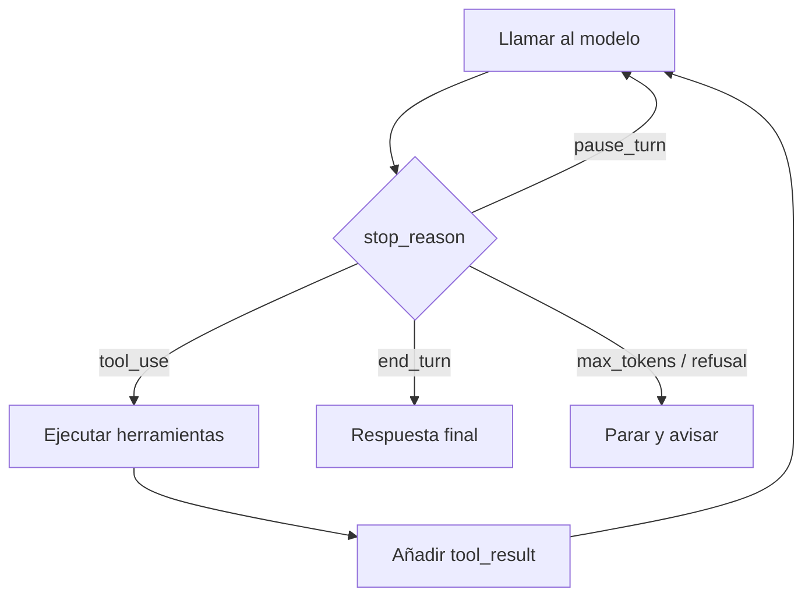

Al terminar esta lección tendrás un agente funcional escrito sin frameworks, en Python y en TypeScript, que trata todos los finales posibles de una llamada. Es el código que hay debajo de cualquier agente, y conviene entenderlo línea a línea antes de usar una librería que lo esconda.

## La idea

El [[glosario/bucle-agentico|bucle agéntico]] repite tres cosas hasta que el modelo termina:

1. **Llamar al modelo** con el historial completo y las herramientas.
2. **Mirar por qué paró** (`stop_reason`).
3. Si pidió herramientas, **ejecutarlas** y añadir sus resultados al historial. Volver al paso 1.



Todo el estado vive en la lista `messages`. La API no recuerda nada entre llamadas: cada vuelta reenvía la conversación entera, incluidas las peticiones de herramienta del modelo y tus resultados.

## Las reglas del historial

Tres reglas que, si se rompen, la API rechaza la petición o el modelo se confunde:

- **Añade la respuesta del asistente completa**, tal cual: todos sus bloques (`text`, `tool_use` y, si usas razonamiento, `thinking`). No te quedes solo con el texto.
- **Un [[glosario/tool-result|tool_result]] por cada `tool_use`**, con el mismo `tool_use_id`. Si el modelo pide tres herramientas en un turno, devuelves tres resultados.
- **Todos los resultados en un único mensaje `user`**, y antes de cualquier texto que quieras añadir en ese mensaje.

## Cada stop_reason, qué hacer

| `stop_reason` | Qué significa | Qué haces |
|---|---|---|
| `end_turn` | El modelo ha terminado | Devuelves el texto final |
| `tool_use` | Pide una o varias herramientas | Las ejecutas y sigues |
| `max_tokens` | Se cortó por tu límite de salida | Paras con error o reintentas con más margen; un `tool_use` cortado no se puede ejecutar |
| `pause_turn` | Una herramienta del servidor pausó el turno | Reenvías el historial tal cual para que continúe |
| `refusal` | El modelo se niega a seguir | Paras y lo comunicas |
| `stop_sequence` | Encontró una secuencia de parada tuya | Lo tratas como final; aquí no usamos ninguna |

Más detalle sobre cada valor en [[glosario/stop-reason]].

## El código completo

Dos herramientas sobre datos simulados: ver pedidos de un cliente y buscar en la ayuda. Suficiente para que el modelo tenga que encadenar pasos.

```python tab="Python" title="agente.py"
import json
import anthropic

MODEL = "claude-sonnet-5-5"
client = anthropic.Anthropic()

PEDIDOS = {"ana@example.com": [{"id": "P-1001", "estado": "enviado", "fecha": "2026-09-10"}]}
AYUDA = {"devoluciones": "Tienes 30 días desde la entrega para devolver un producto sin usar."}

TOOLS = [
    {
        "name": "ver_pedidos",
        "description": "Lista los pedidos de un cliente por su email. Devuelve id, estado y fecha de cada pedido.",
        "input_schema": {
            "type": "object",
            "properties": {"email": {"type": "string", "description": "Email del cliente"}},
            "required": ["email"],
        },
    },
    {
        "name": "buscar_ayuda",
        "description": "Busca en el centro de ayuda por tema. Úsala para políticas: devoluciones, envíos, pagos.",
        "input_schema": {
            "type": "object",
            "properties": {"tema": {"type": "string"}},
            "required": ["tema"],
        },
    },
]

def ejecutar(nombre: str, args: dict) -> str:
    if nombre == "ver_pedidos":
        pedidos = PEDIDOS.get(args["email"].lower())
        if pedidos is None:
            raise ValueError(f"No hay ningún cliente con email {args['email']}")
        return json.dumps(pedidos, ensure_ascii=False)
    if nombre == "buscar_ayuda":
        tema = args["tema"].lower()
        return next((t for k, t in AYUDA.items() if k in tema or tema in k), "Sin resultados.")
    raise ValueError(f"Herramienta desconocida: {nombre}")

SYSTEM = "Eres el asistente de soporte de una tienda online. Usa las herramientas para consultar datos; no los inventes."

def agente(pregunta: str, max_pasos: int = 10) -> str:
    messages = [{"role": "user", "content": pregunta}]
    for _ in range(max_pasos):
        resp = client.messages.create(
            model=MODEL, max_tokens=2048, system=SYSTEM, tools=TOOLS, messages=messages,
        )
        messages.append({"role": "assistant", "content": resp.content})   # la respuesta entera

        if resp.stop_reason == "end_turn":
            return "".join(b.text for b in resp.content if b.type == "text")

        if resp.stop_reason == "tool_use":
            resultados = []
            for bloque in resp.content:
                if bloque.type != "tool_use":
                    continue
                try:
                    salida, error = ejecutar(bloque.name, bloque.input), False
                except Exception as e:                                   # el error vuelve al modelo
                    salida, error = f"Error: {e}", True
                resultados.append({
                    "type": "tool_result",
                    "tool_use_id": bloque.id,
                    "content": salida,
                    "is_error": error,
                })
            messages.append({"role": "user", "content": resultados})     # todos en un mensaje
            continue

        if resp.stop_reason == "pause_turn":
            continue                                                     # reenviar para que siga

        if resp.stop_reason == "max_tokens":
            raise RuntimeError("Respuesta cortada por max_tokens")
        raise RuntimeError(f"El agente paró: {resp.stop_reason}")      # refusal, stop_sequence

    raise RuntimeError(f"Sin respuesta tras {max_pasos} pasos")

if __name__ == "__main__":
    print(agente("Soy ana@example.com. ¿Dónde está mi pedido y hasta cuándo puedo devolverlo?"))
```

```ts tab="TypeScript" title="agente.ts"
import Anthropic from "@anthropic-ai/sdk";

const MODEL = "claude-sonnet-5-5";
const client = new Anthropic();

const PEDIDOS: Record<string, object[]> = {
  "ana@example.com": [{ id: "P-1001", estado: "enviado", fecha: "2026-09-10" }],
};
const AYUDA: Record<string, string> = {
  devoluciones: "Tienes 30 días desde la entrega para devolver un producto sin usar.",
};

const tools: Anthropic.Tool[] = [
  {
    name: "ver_pedidos",
    description: "Lista los pedidos de un cliente por su email. Devuelve id, estado y fecha de cada pedido.",
    input_schema: {
      type: "object",
      properties: { email: { type: "string", description: "Email del cliente" } },
      required: ["email"],
    },
  },
  {
    name: "buscar_ayuda",
    description: "Busca en el centro de ayuda por tema. Úsala para políticas: devoluciones, envíos, pagos.",
    input_schema: { type: "object", properties: { tema: { type: "string" } }, required: ["tema"] },
  },
];

function ejecutar(nombre: string, args: Record<string, string>): string {
  if (nombre === "ver_pedidos") {
    const pedidos = PEDIDOS[args.email.toLowerCase()];
    if (!pedidos) throw new Error(`No hay ningún cliente con email ${args.email}`);
    return JSON.stringify(pedidos);
  }
  if (nombre === "buscar_ayuda") {
    const tema = args.tema.toLowerCase();
    const hit = Object.entries(AYUDA).find(([k]) => k.includes(tema) || tema.includes(k));
    return hit ? hit[1] : "Sin resultados.";
  }
  throw new Error(`Herramienta desconocida: ${nombre}`);
}

const SYSTEM = "Eres el asistente de soporte de una tienda online. Usa las herramientas para consultar datos; no los inventes.";

export async function agente(pregunta: string, maxPasos = 10): Promise<string> {
  const messages: Anthropic.MessageParam[] = [{ role: "user", content: pregunta }];
  for (let paso = 0; paso < maxPasos; paso++) {
    const resp = await client.messages.create({ model: MODEL, max_tokens: 2048, system: SYSTEM, tools, messages });
    messages.push({ role: "assistant", content: resp.content });

    if (resp.stop_reason === "end_turn") {
      return resp.content.filter((b): b is Anthropic.TextBlock => b.type === "text").map((b) => b.text).join("");
    }
    if (resp.stop_reason === "tool_use") {
      const resultados: Anthropic.ToolResultBlockParam[] = [];
      for (const bloque of resp.content) {
        if (bloque.type !== "tool_use") continue;
        try {
          const salida = ejecutar(bloque.name, bloque.input as Record<string, string>);
          resultados.push({ type: "tool_result", tool_use_id: bloque.id, content: salida, is_error: false });
        } catch (e) {
          resultados.push({ type: "tool_result", tool_use_id: bloque.id, content: `Error: ${(e as Error).message}`, is_error: true });
        }
      }
      messages.push({ role: "user", content: resultados });
      continue;
    }
    if (resp.stop_reason === "pause_turn") continue;
    if (resp.stop_reason === "max_tokens") throw new Error("Respuesta cortada por max_tokens");
    throw new Error(`El agente paró: ${resp.stop_reason}`);
  }
  throw new Error(`Sin respuesta tras ${maxPasos} pasos`);
}
```

## Qué pasa en una ejecución

Con la pregunta del ejemplo, una ejecución típica tiene dos llamadas:

```text
# salida de ejemplo
paso 1  stop_reason=tool_use   ver_pedidos({"email": "ana@example.com"})  +  buscar_ayuda({"tema": "devoluciones"})
paso 2  stop_reason=end_turn   «Tu pedido P-1001 se envió el 10 de septiembre…»
```

Fíjate en el paso 1: el modelo pidió **dos herramientas a la vez**. Por eso el bucle recorre todos los bloques `tool_use` y no solo el primero. Si devolvieras un único `tool_result`, la siguiente llamada fallaría.

> [!aviso] Un error de herramienta no es un error del bucle
> Si `ver_pedidos` recibe un email que no existe, el modelo necesita saberlo para pedir otro dato o disculparse. Captura la excepción y devuélvela con `is_error: true`. Solo deberías romper el bucle por fallos de tu infraestructura (la API caída, credenciales inválidas), nunca por un fallo esperable de una herramienta.

## Errores frecuentes

- Guardar en el historial solo el texto del asistente y perder los bloques `tool_use`: la siguiente petición no tiene a qué asociar los `tool_result`.
- Ejecutar solo el primer `tool_use` de la respuesta.
- Enviar cada `tool_result` en un mensaje `user` distinto.
- Bucle `while True` sin límite de pasos.
- Ejecutar el `input` de una herramienta sin validarlo. El modelo puede pedir lo que no debe; tu código decide.

## Ejercicio

> [!ejercicio] Rómpelo a propósito
> Copia el agente en el lenguaje que prefieras y añade un `print` por paso con el `stop_reason` y las herramientas pedidas. Después prueba tres casos: la pregunta del ejemplo, un email que no existe y una pregunta que no necesita herramientas («¿Qué horario tenéis?»).
>
> **Está bien si**: los tres casos terminan sin excepción; en el caso del email inexistente ves un `tool_result` con `is_error: true` y el modelo responde pidiendo otro dato o explicando el problema; y si cambias `max_pasos` a 1 en la pregunta del ejemplo, el agente lanza el error de límite de pasos en lugar de colgarse.

> [!ejercicio]- Pistas
> Para ver el historial completo al final, imprime `json.dumps` de `messages` convirtiendo los bloques con `b.model_dump()`. Te servirá en la [[roadmap/40-primer-agente/06-depurar-con-trazas|lección de trazas]].

## Resumen

- El bucle llama, mira `stop_reason`, ejecuta herramientas y repite.
- El historial lleva la respuesta completa del asistente y un `tool_result` por cada `tool_use`, todos en un mensaje.
- Trata todos los `stop_reason`: cada uno tiene una acción distinta.
- Los errores de herramienta vuelven al modelo con `is_error`; el bucle sigue.
- Siempre con límite de pasos.

## Para seguir

- [[roadmap/40-primer-agente/03-condiciones-de-parada]]
- [[docs/agentes/01-el-bucle-agentico]]
- [[docs/herramientas/01-uso-de-herramientas]]
- [[glosario/react]]
