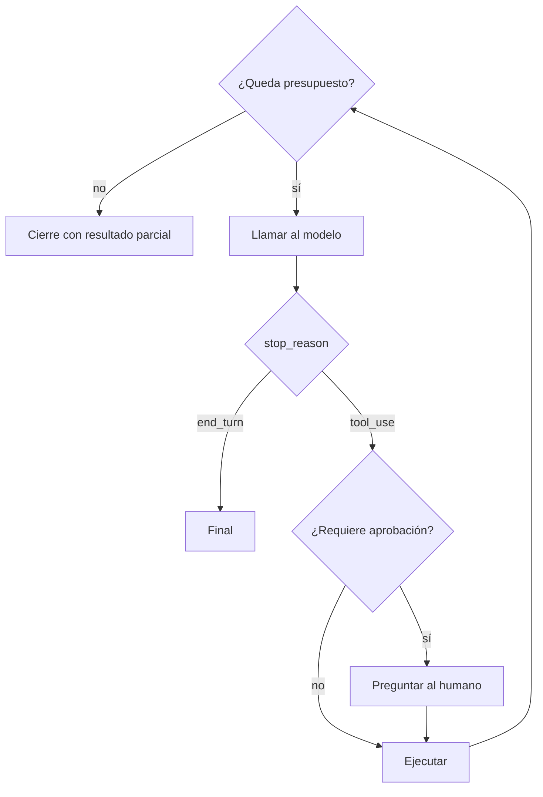

Al terminar esta lección tu agente sabrá parar por sí mismo antes de gastar demasiado, tardar demasiado o hacer algo que no debe. Añadirás un presupuesto que se comprueba en cada vuelta del bucle y una puerta de aprobación para las acciones con consecuencias.

## La idea

En la lección anterior el único freno era `max_pasos`. En producción no basta. Un agente puede gastar muchos tokens en pocos pasos si una herramienta devuelve mucho texto, quedarse atascado repitiendo la misma búsqueda o intentar una acción irreversible. Un agente bien hecho tiene **varias condiciones de parada, cada una para un riesgo distinto**:

| Límite | Protege contra | Dónde se comprueba |
|---|---|---|
| Final natural (`end_turn`) | Nada: es el caso bueno | Tras cada llamada |
| Pasos máximos | Bucles infinitos, divagación | Antes de cada llamada |
| Tokens acumulados | Coste descontrolado | Tras cada llamada, con `usage` |
| `max_tokens` por llamada | Una respuesta desmesurada | En la propia petición |
| Tiempo máximo | Usuarios esperando, procesos colgados | Antes de cada llamada |
| Repeticiones | El agente atascado en lo mismo | Antes de ejecutar herramientas |
| Aprobación humana | Acciones irreversibles | Antes de ejecutar ciertas herramientas |



## Por qué los tokens crecen tan rápido

Cada llamada reenvía todo el historial. Si el paso 1 envía 2.000 tokens y cada herramienta añade 1.500, el paso 10 envía más de 15.000 tokens solo de entrada, y la suma de todos los pasos es mucho mayor que la última llamada. **El coste de un agente crece más deprisa que su número de pasos.** Por eso conviene limitar tokens acumulados, no solo pasos, y recortar las salidas de las herramientas. El [[glosario/prompt-caching|prompt caching]] abarata la parte repetida del historial; lo verás en [[roadmap/100-produccion/02-costes-y-prompt-caching]].

`resp.usage` trae lo que ha costado cada llamada. Ojo: `input_tokens` no incluye los tokens leídos o escritos en caché, que vienen aparte en `cache_read_input_tokens` y `cache_creation_input_tokens`. Para saber cuánto contexto procesaste, súmalos.

## Un presupuesto en código

```python title="presupuesto.py"
import json
import time
from dataclasses import dataclass, field

@dataclass
class Presupuesto:
    max_pasos: int = 15
    max_tokens_totales: int = 150_000
    max_segundos: float = 120.0
    max_repeticiones: int = 2
    pasos: int = 0
    tokens: int = 0
    inicio: float = field(default_factory=time.monotonic)
    vistas: dict = field(default_factory=dict)

    def registrar(self, usage) -> None:
        self.pasos += 1
        self.tokens += (
            usage.input_tokens + usage.output_tokens
            + (getattr(usage, "cache_read_input_tokens", 0) or 0)
            + (getattr(usage, "cache_creation_input_tokens", 0) or 0)
        )

    def repetida(self, nombre: str, args: dict) -> bool:
        clave = (nombre, json.dumps(args, sort_keys=True))
        self.vistas[clave] = self.vistas.get(clave, 0) + 1
        return self.vistas[clave] > self.max_repeticiones

    def agotado(self) -> str | None:
        if self.pasos >= self.max_pasos:
            return f"límite de pasos ({self.max_pasos})"
        if self.tokens >= self.max_tokens_totales:
            return f"límite de tokens ({self.tokens} de {self.max_tokens_totales})"
        if time.monotonic() - self.inicio >= self.max_segundos:
            return f"límite de tiempo ({self.max_segundos:.0f} s)"
        return None
```

El tiempo se comprueba entre pasos, así que una llamada lenta puede pasarse del límite. Configura además el tiempo de espera de red de tu cliente HTTP; el SDK tiene opciones para ello, consúltalas en su documentación.

## Aprobación humana sin romper el historial

Algunas herramientas no deberían ejecutarse sin que alguien lo confirme: enviar un correo, emitir un reembolso, borrar datos. La clave es que **si el humano dice que no, el modelo igualmente recibe un `tool_result`**. Si no, el historial queda con un `tool_use` huérfano y la siguiente llamada falla.

```python title="aprobacion.py"
REQUIERE_APROBACION = {"abrir_incidencia", "emitir_reembolso"}

def ejecutar_con_control(bloque, presupuesto) -> dict:
    base = {"type": "tool_result", "tool_use_id": bloque.id}
    if presupuesto.repetida(bloque.name, bloque.input):
        return base | {"is_error": True, "content":
            "Ya has hecho esta misma llamada varias veces con los mismos argumentos. "
            "Cambia de enfoque o responde con lo que tienes."}
    if bloque.name in REQUIERE_APROBACION:
        print(f"El agente quiere ejecutar {bloque.name} con {bloque.input}")
        if input("¿Apruebas? [s/N] ").strip().lower() != "s":
            return base | {"is_error": True, "content":
                "El usuario ha rechazado esta acción. No la repitas; explica qué harías en su lugar."}
    try:
        return base | {"content": ejecutar(bloque.name, bloque.input), "is_error": False}
    except Exception as e:
        return base | {"content": f"Error: {e}", "is_error": True}
```

En una aplicación real, la pregunta no será un `input()`: guardarás el estado, notificarás a alguien y reanudarás cuando conteste. Lo desarrolla [[recetas/aprobacion-humana-antes-de-actuar]].

> [!peligro] La aprobación va en el código, no en el prompt
> Escribir «pide permiso antes de reembolsar» en el prompt de sistema no es un control: el modelo puede saltárselo, y una [[glosario/inyeccion-de-prompt|inyección de prompt]] puede convencerle de que ya lo tiene. La comprobación tiene que estar en tu código, antes de ejecutar.

## El bucle con presupuesto

```python title="agente.py"
def agente(pregunta: str, presupuesto: Presupuesto) -> dict:
    messages = [{"role": "user", "content": pregunta}]
    while True:
        motivo = presupuesto.agotado()
        if motivo:
            return {"estado": "incompleto", "motivo": motivo, "messages": messages}
        resp = client.messages.create(model=MODEL, max_tokens=2048, system=SYSTEM,
                                      tools=TOOLS, messages=messages)
        presupuesto.registrar(resp.usage)
        messages.append({"role": "assistant", "content": resp.content})
        if resp.stop_reason == "end_turn":
            texto = "".join(b.text for b in resp.content if b.type == "text")
            return {"estado": "completo", "respuesta": texto, "messages": messages}
        if resp.stop_reason == "tool_use":
            resultados = [ejecutar_con_control(b, presupuesto) for b in resp.content if b.type == "tool_use"]
            messages.append({"role": "user", "content": resultados})
            continue
        if resp.stop_reason == "pause_turn":
            continue
        return {"estado": "error", "motivo": resp.stop_reason, "messages": messages}
```

Fíjate en que el agente **devuelve un estado en lugar de lanzar excepciones**. Quien lo llama decide qué hacer con un resultado incompleto: mostrarlo, reintentar con más presupuesto o escalar a una persona.

## Qué hacer con max_tokens

`max_tokens` es un límite duro por llamada. Si se alcanza, el `stop_reason` es `"max_tokens"` y la respuesta está cortada. Si lo último era un bloque `tool_use`, sus argumentos pueden estar incompletos: **no lo ejecutes**. Las opciones razonables son repetir la llamada con un `max_tokens` mayor o parar con error. Si usas razonamiento, recuerda que el [[glosario/esfuerzo|esfuerzo]] (`output_config={"effort": …}`) y el [[glosario/presupuesto-de-tarea|presupuesto de tarea]] (`output_config.task_budget`, en beta) son orientativos: `max_tokens` es lo que de verdad limita la salida.

Hay otro final parecido: `model_context_window_exceeded`. Este límite lo pone el modelo, no tú: el historial ya no cabe en la ventana de contexto. Trátalo como un presupuesto agotado (devuelve `incompleto` con lo que tengas) y, si pasa a menudo, recorta las salidas de las herramientas o [[glosario/compactacion|compacta]] el historial.

## Cerrar con un resumen

Cuando el presupuesto se agota, a veces quieres que el modelo resuma lo que encontró. Puedes hacer una última llamada con `tool_choice={"type": "none"}` y un mensaje pidiendo el resumen. Antes, asegúrate de que el último mensaje del asistente no tiene `tool_use` sin responder: si lo tiene, añade sus `tool_result` (por ejemplo, con `is_error: true` y «Presupuesto agotado, no se ha ejecutado») y el texto de la petición de resumen **después** de ellos, en el mismo mensaje.

## El mismo freno en cada framework

Si mañana usas un framework, los límites existen con otro nombre. Conviene saber cuáles, porque **no todos vienen puestos por defecto**:

| Dónde | Límite de pasos o llamadas | Qué pasa al agotarlo |
|---|---|---|
| Tu bucle con el SDK | `max_pasos`, `Presupuesto` | Lo que tú decidas (aquí, estado `incompleto`) |
| [[herramientas/claude-agent-sdk|Claude Agent SDK]] | `max_turns` y `max_budget_usd` en `ClaudeAgentOptions` | Un `ResultMessage` con `subtype` `error_max_turns` o `error_max_budget_usd` (y `ResultError`) |
| [[herramientas/langchain|LangChain]] | `ModelCallLimitMiddleware(run_limit=…)`, `ToolCallLimitMiddleware` | Termina o lanza excepción, según `exit_behavior` |
| [[herramientas/langgraph|LangGraph]] | `config={"recursion_limit": N}` | `GraphRecursionError`. El valor por defecto es tan alto que no frena nada: ponlo tú |
| [[herramientas/openai-agents-sdk|OpenAI Agents SDK]] | `max_turns` en `Runner.run` | `MaxTurnsExceeded` |
| [[herramientas/pydantic-ai|Pydantic AI]] | `UsageLimits(request_limit=…, total_tokens_limit=…)` | `UsageLimitExceeded` |

Ninguno sustituye a la aprobación humana en código ni a la detección de repeticiones: esas las sigues escribiendo tú (o con el middleware de aprobación de cada framework, que verás en [[roadmap/100-produccion/05-humano-en-el-bucle]]).

## Errores frecuentes

- Contar solo pasos y descubrir el coste en la factura.
- Lanzar una excepción al agotar el presupuesto y perder todo lo que el agente encontró.
- Dejar un `tool_use` sin `tool_result` cuando el humano rechaza la acción.
- Poner límites tan bajos que el agente nunca termina tareas normales. Ajusta con datos de ejecuciones reales.
- Fiarte del límite por defecto de un framework. Si tu agente no para, empieza por [[problemas/el-agente-no-para]]; si repite la misma llamada, por [[problemas/el-agente-repite-la-misma-herramienta]].

## Ejercicio

> [!ejercicio] Un agente con frenos
> Añade `Presupuesto` y `ejecutar_con_control` a tu agente de la lección anterior, con una herramienta simulada `abrir_incidencia` que requiere aprobación. Prueba cuatro escenarios: una tarea normal, una tarea con `max_pasos=2`, una herramienta trucada que siempre devuelve «Sin resultados» (para provocar repeticiones) y una incidencia que rechazas.
>
> **Está bien si**: ningún escenario lanza una excepción; cada uno devuelve un estado (`completo`, `incompleto` o `error`) con su motivo; al rechazar la incidencia el modelo recibe el `tool_result` de rechazo y responde sin repetirla; y al final de cada ejecución imprimes pasos, tokens y segundos consumidos.

> [!ejercicio]- Pistas
> Para el escenario de repeticiones, baja `max_repeticiones` a 1 y comprueba que el mensaje de error hace que el modelo cambie de estrategia. Si no cambia, el límite de pasos debe acabar cortando.

## Resumen

- Un agente necesita varias condiciones de parada: pasos, tokens, tiempo, repeticiones y aprobación.
- Los tokens acumulados crecen más deprisa que los pasos porque cada llamada reenvía el historial.
- La aprobación humana va en el código y siempre devuelve un `tool_result`, también si se rechaza.
- Un `tool_use` cortado por `max_tokens` no se ejecuta.
- Devuelve un estado con motivo en lugar de lanzar excepciones.

## Para seguir

- [[roadmap/40-primer-agente/04-planificar-antes-de-actuar]]
- [[docs/agentes/03-humano-en-el-bucle]]
- [[docs/produccion/02-costes-y-limites]]
- [[roadmap/100-produccion/05-humano-en-el-bucle]]
