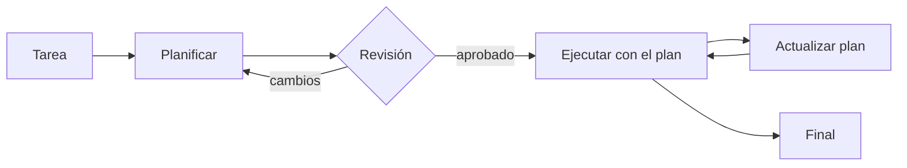

Al terminar esta lección tu agente empezará cada tarea compleja escribiendo un plan que puedes leer y aprobar, y lo irá marcando mientras trabaja. Así ves sus intenciones antes de que actúe y detectas pronto cuándo se desvía.

## La idea

El agente de la lección anterior decide un paso cada vez. Para tareas cortas está bien. En tareas de muchos pasos tiende a dos fallos: **se lanza a actuar sin entender la tarea** (busca lo primero que se le ocurre) y **pierde el hilo** (tras diez resultados de herramienta ya no recuerda qué faltaba).

Un plan explícito ataca los dos. Antes de actuar, el modelo escribe qué va a hacer, con qué herramienta y cómo sabrá que cada paso está hecho. Durante la ejecución, el plan está en el contexto y el modelo lo actualiza. Es la misma idea que [[disciplinas/explorar-planificar-implementar-verificar]] aplica a tu propio trabajo con agentes.



## Pensar, planificar y actuar no son lo mismo

Hay tres mecanismos que se confunden:

- **Razonamiento interno**: con `thinking={"type": "adaptive"}` el modelo razona antes de responder en cada llamada. Mejora decisiones locales, pero ese razonamiento no es un artefacto que tú revises y apruebes. Más en [[docs/prompting/04-razonamiento]].
- **Intercalar razonamiento y acción**: el patrón [[glosario/react|ReAct]] ([Yao et al., 2022](https://arxiv.org/abs/2210.03629)) alterna «pienso, actúo, observo» en cada paso. Es lo que ya hace tu bucle.
- **Plan explícito**: un documento estructurado, generado antes de empezar, que vive en el contexto y en tu código. Se puede validar, enseñar al usuario y comparar con lo que pasó.

Se combinan bien. Esta lección añade el tercero.

## Fase 1: generar el plan

Pide el plan como JSON con [[glosario/salida-estructurada|salida estructurada]]. Al modelo le das las herramientas **descritas en texto**, no como `tools`, porque en esta fase no debe usarlas:

```python title="planificar.py"
import json
import anthropic

MODEL = "claude-sonnet-5-5"
client = anthropic.Anthropic()

ESQUEMA_PLAN = {
    "type": "object",
    "properties": {
        "objetivo": {"type": "string"},
        "pasos": {
            "type": "array",
            "items": {
                "type": "object",
                "properties": {
                    "descripcion": {"type": "string"},
                    "herramienta": {"type": "string"},
                    "hecho_cuando": {"type": "string"},
                },
                "required": ["descripcion", "herramienta", "hecho_cuando"],
                "additionalProperties": False,
            },
        },
        "dudas": {"type": "array", "items": {"type": "string"}},
    },
    "required": ["objetivo", "pasos", "dudas"],
    "additionalProperties": False,
}

def planificar(tarea: str, tools: list[dict]) -> dict:
    catalogo = "\n".join(f"- {t['name']}: {t['description']}" for t in tools)
    resp = client.messages.create(
        model=MODEL,
        max_tokens=2048,
        system=(
            "Planificas tareas para un agente. No ejecutas nada.\n"
            "Escribe entre 2 y 8 pasos concretos. Cada paso usa una herramienta del catálogo "
            "o 'ninguna' si es solo redactar. 'hecho_cuando' describe un resultado observable.\n"
            "Si falta información para empezar, ponla en 'dudas'.\n\n"
            f"<herramientas>\n{catalogo}\n</herramientas>"
        ),
        messages=[{"role": "user", "content": f"<tarea>{tarea}</tarea>"}],
        output_config={"format": {"type": "json_schema", "schema": ESQUEMA_PLAN}},
    )
    if resp.stop_reason != "end_turn":
        raise RuntimeError(f"plan incompleto: {resp.stop_reason}")
    plan = json.loads(next(b.text for b in resp.content if b.type == "text"))
    nombres = {t["name"] for t in tools} | {"ninguna"}
    for p in plan["pasos"]:
        if p["herramienta"] not in nombres:
            raise ValueError(f"el plan usa una herramienta que no existe: {p['herramienta']}")
        p["estado"] = "pendiente"
    return plan
```

La validación del final importa: el esquema garantiza la forma del JSON, pero no que las herramientas existan ni que haya entre 2 y 8 pasos. Eso lo compruebas tú.

```text
# salida de ejemplo
objetivo: Saber por qué no ha llegado el pedido de ana@example.com y ofrecer una solución
1. Buscar los pedidos del cliente          [ver_pedidos]   hecho cuando: tengo el id y el estado
2. Consultar la política de retrasos        [buscar_ayuda]  hecho cuando: sé el plazo máximo de entrega
3. Redactar la respuesta con opciones       [ninguna]       hecho cuando: incluye estado, plazo y siguiente paso
dudas: ninguna
```

## Revisión: el momento barato para corregir

Con el plan delante puedes hacer tres cosas que luego son caras: **pararlo** si va en la dirección equivocada, **responder sus dudas** antes de que adivine y **aprobarlo** si toca acciones con consecuencias. Un error detectado aquí cuesta una llamada; detectado en el paso 7, cuesta siete. Para tareas internas automáticas, la revisión puede ser otra validación en código: que no aparezcan herramientas de escritura si la tarea solo pedía consultar.

## Fase 2: ejecutar con el plan

El plan entra en el prompt de sistema y el agente recibe una herramienta más, `actualizar_plan`, para marcar pasos. Así el estado del plan lo guarda tu código, no la memoria del modelo:

```python title="ejecutar_plan.py"
TOOL_PLAN = {
    "name": "actualizar_plan",
    "description": (
        "Marca un paso del plan como hecho, fallido o descartado. Llámala justo después de "
        "completar o abandonar un paso. Si un paso falla, explica por qué en 'nota'."
    ),
    "input_schema": {
        "type": "object",
        "properties": {
            "paso": {"type": "integer", "description": "Número de paso, empezando en 1"},
            "estado": {"type": "string", "enum": ["hecho", "fallido", "descartado"]},
            "nota": {"type": "string"},
        },
        "required": ["paso", "estado", "nota"],
    },
}

def actualizar_plan(plan: dict, args: dict) -> str:
    n = args["paso"]
    if not 1 <= n <= len(plan["pasos"]):
        raise ValueError(f"El plan tiene {len(plan['pasos'])} pasos; no existe el {n}")
    plan["pasos"][n - 1] |= {"estado": args["estado"], "nota": args["nota"]}
    pendientes = [i + 1 for i, p in enumerate(plan["pasos"]) if p["estado"] == "pendiente"]
    return f"Paso {n} marcado como {args['estado']}. Pendientes: {pendientes or 'ninguno'}"

def sistema_con_plan(base: str, plan: dict) -> str:
    lineas = [f"{i}. [{p['estado']}] {p['descripcion']} (hecho cuando: {p['hecho_cuando']})"
              for i, p in enumerate(plan["pasos"], start=1)]
    return (f"{base}\n\n<plan>\nObjetivo: {plan['objetivo']}\n" + "\n".join(lineas) + "\n</plan>\n"
            "Sigue el plan. Si un paso falla o descubres que sobra, márcalo y adapta los siguientes.")
```

En tu bucle, `ejecutar()` despacha `actualizar_plan` a esta función, y en cada vuelta reconstruyes el sistema con `sistema_con_plan` para que el modelo vea siempre el estado actual. Ten en cuenta que cambiar el prompt de sistema en cada paso invalida la [[glosario/prompt-caching|caché]] del prefijo. Si te importa el coste, deja el sistema fijo y devuelve el estado del plan en el propio `tool_result`, como ya hace `actualizar_plan`, o añade el plan actualizado como un [[glosario/mensaje-de-sistema-intermedio|mensaje de sistema intermedio]] al final del historial, que no rompe el prefijo cacheado.

Los frameworks traen esta misma herramienta hecha. En LangChain, `TodoListMiddleware` da al agente `write_todos` para escribir y marcar su lista de tareas; Claude Code tiene su propia lista de tareas, y [[herramientas/deepagents|Deep Agents]] la tiene si añades ese middleware (desde la 0.7 no viene por defecto). Por dentro es tu `actualizar_plan`: una herramienta que escribe en un estado que guarda el código.

> [!consejo] El plan es una hipótesis
> No obligues al agente a cumplir el plan a toda costa. Si en el paso 2 descubre que el pedido ya fue entregado, el paso 3 sobra. Lo que quieres es que **los cambios queden registrados**, con su nota, para poder entenderlos después.

## Cuándo no planificar

- **Tareas de uno o dos pasos**: el plan cuesta una llamada extra y no aporta.
- **Tareas muy exploratorias**, donde no sabes nada hasta ver el primer resultado. Ahí funciona mejor un plan corto («explorar primero, planificar después») o replanificar tras el primer paso.
- **Cuando la latencia manda**, como en una conversación en directo. Mide si el plan mejora el resultado lo bastante para pagar la espera.

## Errores frecuentes

- Pasar las herramientas como `tools` en la fase de plan: el modelo empezará a usarlas.
- Planes con pasos vagos («investigar el problema») sin criterio de hecho.
- Guardar el estado del plan solo en el historial: tu código no sabe qué falta.
- Tratar una desviación del plan como un error en lugar de como información.

## Ejercicio

> [!ejercicio] Plan, revisión y ejecución
> Añade `planificar` y `actualizar_plan` a tu agente de soporte. Muestra el plan por pantalla y pide confirmación antes de ejecutar. Prueba con tres tareas: una de un solo paso, una de tres o cuatro pasos y una donde falte un dato (por ejemplo, sin email del cliente).
>
> **Está bien si**: la tarea sin email produce al menos una entrada en `dudas`; todas las herramientas del plan existen; al terminar, cada paso tiene estado distinto de `pendiente` o una explicación de por qué quedó así; y has anotado si en la tarea de un paso el plan aportó algo o fue gasto.

> [!ejercicio]- Pistas
> Si el modelo nunca llama a `actualizar_plan`, revisa la descripción: debe decir exactamente cuándo llamarla. Si la llama demasiado, pide que la use solo al cambiar de paso.

## Resumen

- Un plan explícito evita lanzarse a actuar y perder el hilo en tareas largas.
- Genera el plan con salida estructurada, sin herramientas activas, y valida en código.
- Revisar el plan es el momento más barato para corregir al agente.
- Durante la ejecución, el estado del plan lo guarda tu código y el modelo lo actualiza con una herramienta.
- En tareas cortas o muy exploratorias, planificar puede no compensar.

## Para seguir

- [[roadmap/40-primer-agente/05-agente-con-varias-herramientas]]
- [[disciplinas/explorar-planificar-implementar-verificar]]
- [[patrones/06-orquestador-trabajadores]]
- [[roadmap/70-flujos-con-especificacion/03-plan-y-tareas]], donde el plan deja de vivir en una ejecución y pasa a un archivo revisable
