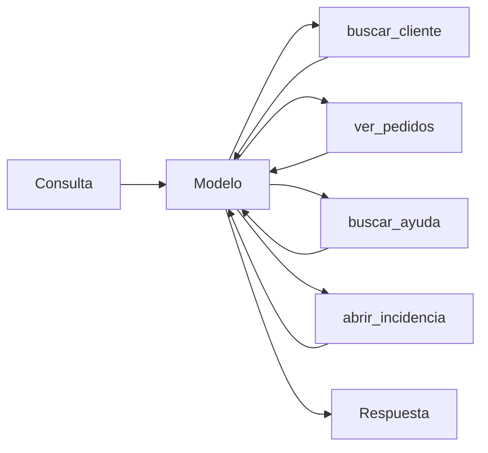

Al terminar esta lección sabrás montar un agente con cuatro herramientas que no se pisan entre sí, con descripciones que el modelo entiende a la primera y salidas que no le llenan el contexto. También tendrás una forma de comprobar, con casos, que elige bien.

## La idea

Con una herramienta, el modelo solo decide si la usa. Con cuatro, además decide **cuál**, y ahí aparecen los fallos típicos: usa `buscar_ayuda` para algo que estaba en `ver_pedidos`, inventa un parámetro o llama tres veces a la herramienta equivocada. Casi siempre la causa está en el diseño de las herramientas, no en el modelo.

La regla de [*Writing effective tools for agents*](https://www.anthropic.com/engineering/writing-tools-for-agents) (Anthropic, 2025) se resume así: **diseña las herramientas pensando en quien las va a usar**, un modelo que solo ve el nombre, la descripción y el esquema. Si un compañero nuevo no sabría qué herramienta usar leyendo solo eso, el modelo tampoco.



## Diseñar el conjunto

Antes de escribir una línea, lista las tareas que el agente debe resolver y las herramientas que necesita cada una. Busca tres problemas:

- **Solapamientos**: dos herramientas que podrían servir para lo mismo (`buscar_pedido` y `consultar_pedidos`). El modelo dudará. Fusiónalas o separa su alcance con claridad.
- **Herramientas demasiado finas**: si para cada consulta el modelo tiene que llamar a `obtener_cliente`, luego a `obtener_ids_pedidos` y luego a `obtener_pedido` por cada id, crea una herramienta que haga el recorrido. Menos pasos, menos tokens, menos errores.
- **Herramientas demasiado amplias**: una `ejecutar_sql` sirve para todo y obliga al modelo a conocer tu esquema. Además rompe el [[glosario/minimo-privilegio|mínimo privilegio]].

Para el agente de soporte de este nivel salen cuatro:

| Herramienta | Para qué | Efecto |
|---|---|---|
| `buscar_cliente` | Encontrar al cliente por email o teléfono | Lectura |
| `ver_pedidos` | Pedidos de un cliente, con estado y fechas | Lectura |
| `buscar_ayuda` | Políticas y procedimientos del centro de ayuda | Lectura |
| `abrir_incidencia` | Registrar un problema para el equipo humano | Escritura, con aprobación |

## Describir cada herramienta

Una buena descripción responde a cuatro preguntas: **qué hace, cuándo usarla, cuándo no y qué devuelve**. Compara:

```text title="Antes"
ver_pedidos: Obtiene pedidos.
```

```text title="Después"
ver_pedidos: Lista los pedidos de un cliente ya identificado, del más reciente al más
antiguo, con id, estado (pendiente, enviado, entregado, devuelto), fecha y total.
Úsala cuando necesites el estado o el historial de compras. Requiere el id de cliente
que devuelve buscar_cliente; no acepta emails. Devuelve como máximo 10 pedidos.
```

Y en el esquema, describe también los parámetros y usa `enum` cuando los valores son cerrados:

```python title="herramientas.py"
TOOLS = [
    {
        "name": "buscar_cliente",
        "description": (
            "Busca un cliente por email o por teléfono y devuelve su id, nombre y fecha de alta. "
            "Úsala siempre antes de ver_pedidos o abrir_incidencia. Si no hay coincidencia, devuelve un error."
        ),
        "input_schema": {
            "type": "object",
            "properties": {
                "email": {"type": "string", "description": "Email exacto, por ejemplo ana@example.com"},
                "telefono": {"type": "string", "description": "Teléfono con prefijo, por ejemplo +34600111222"},
            },
        },
    },
    {
        "name": "ver_pedidos",
        "description": (
            "Lista los pedidos de un cliente ya identificado, del más reciente al más antiguo, con id, "
            "estado, fecha y total. Requiere el id de cliente de buscar_cliente; no acepta emails. "
            "Devuelve como máximo 10 pedidos."
        ),
        "input_schema": {
            "type": "object",
            "properties": {
                "cliente_id": {"type": "string", "description": "Id con formato C-1234"},
                "estado": {"type": "string", "enum": ["pendiente", "enviado", "entregado", "devuelto"],
                           "description": "Opcional: filtra por estado"},
            },
            "required": ["cliente_id"],
        },
    },
    {
        "name": "buscar_ayuda",
        "description": (
            "Busca en el centro de ayuda y devuelve hasta 3 fragmentos con su título. Úsala para "
            "políticas generales (devoluciones, plazos de envío, pagos). No contiene datos de clientes ni pedidos."
        ),
        "input_schema": {
            "type": "object",
            "properties": {"consulta": {"type": "string", "description": "Pregunta en lenguaje natural"}},
            "required": ["consulta"],
        },
    },
    {
        "name": "abrir_incidencia",
        "description": (
            "Abre una incidencia para el equipo humano. Úsala solo si el problema no se resuelve con "
            "información (pedido perdido, cobro duplicado, producto dañado). Requiere aprobación del usuario."
        ),
        "input_schema": {
            "type": "object",
            "properties": {
                "cliente_id": {"type": "string"},
                "pedido_id": {"type": "string", "description": "Id con formato P-1234"},
                "tipo": {"type": "string", "enum": ["perdido", "cobro_duplicado", "danado", "otro"]},
                "resumen": {"type": "string", "description": "Una o dos frases para el equipo"},
            },
            "required": ["cliente_id", "tipo", "resumen"],
        },
    },
]
```

Si tienes muchas herramientas de dominios distintos, un prefijo común ayuda a agruparlas: `pedidos_ver`, `pedidos_cancelar`, `ayuda_buscar`.

## Salidas que ayudan al modelo

Lo que devuelve una herramienta entra en el contexto y se reenvía en cada paso siguiente. Tres reglas:

- **Devuelve lo que el modelo necesita para decidir**, no el registro entero de la base de datos. Ids, estados, fechas y nombres legibles; nada de campos internos ni identificadores técnicos que no vaya a usar.
- **Limita el tamaño** y dilo: «Mostrando 10 de 37 pedidos. Usa el filtro estado para acotar».
- **Errores que enseñan**. Compara `"Error 400"` con `"cliente_id debe tener formato C-1234; has enviado 'ana@example.com'. Usa primero buscar_cliente."`. El segundo hace que el modelo corrija la llamada en el siguiente paso.

```python title="despacho.py"
import json

def ver_pedidos(cliente_id: str, estado: str | None = None) -> str:
    if not cliente_id.startswith("C-"):
        raise ValueError(f"cliente_id debe tener formato C-1234; has enviado {cliente_id!r}. "
                         "Usa primero buscar_cliente.")
    pedidos = [p for p in BD_PEDIDOS.get(cliente_id, []) if estado in (None, p["estado"])]
    visibles = [{k: p[k] for k in ("id", "estado", "fecha", "total")} for p in pedidos[:10]]
    nota = f"Mostrando {len(visibles)} de {len(pedidos)} pedidos."
    return json.dumps({"pedidos": visibles, "nota": nota}, ensure_ascii=False)

DESPACHO = {
    "buscar_cliente": buscar_cliente,
    "ver_pedidos": ver_pedidos,
    "buscar_ayuda": buscar_ayuda,
    "abrir_incidencia": abrir_incidencia,
}

def ejecutar(nombre: str, args: dict) -> str:
    funcion = DESPACHO.get(nombre)
    if funcion is None:
        raise ValueError(f"No existe la herramienta {nombre}. Disponibles: {', '.join(DESPACHO)}")
    return funcion(**args)
```

`ejecutar` encaja tal cual en el bucle de [[roadmap/40-primer-agente/02-el-bucle-agentico]]: las excepciones se convierten en `tool_result` con `is_error: true`. Si el modelo envía un argumento que la función no espera, `funcion(**args)` lanza un `TypeError` con el nombre del argumento, que también llega al modelo.

> [!aviso] Varias herramientas en un mismo turno
> Con varias herramientas, el modelo pedirá a menudo dos o tres en la misma respuesta, por ejemplo `buscar_cliente` y `buscar_ayuda` a la vez. Tu bucle ya devuelve un `tool_result` por cada `tool_use` en un único mensaje. Si necesitas que vayan de una en una, usa `disable_parallel_tool_use` en [[glosario/tool-choice|tool_choice]].

## Probar la elección de herramienta

No esperes a ver fallos en producción. Escribe casos con la herramienta que debería usarse **primero** y compruébalo con una sola llamada por caso:

```python title="probar_eleccion.py"
CASOS = [
    ("Soy ana@example.com, ¿dónde está mi pedido?", "buscar_cliente"),
    ("¿Cuántos días tengo para devolver algo?", "buscar_ayuda"),
    ("Mi teléfono es +34600111222 y me habéis cobrado dos veces", "buscar_cliente"),
    ("¿Aceptáis pago con transferencia?", "buscar_ayuda"),
]

aciertos = 0
for consulta, esperada in CASOS:
    resp = client.messages.create(model=MODEL, max_tokens=1024, system=SYSTEM, tools=TOOLS,
                                  messages=[{"role": "user", "content": consulta}])
    usadas = [b.name for b in resp.content if b.type == "tool_use"]
    ok = esperada in usadas
    aciertos += ok
    print(f"{'OK ' if ok else 'MAL'}  {consulta!r} → {usadas or resp.stop_reason}")
print(f"{aciertos}/{len(CASOS)}")
```

Cuando un caso falle, **cambia primero la descripción**, no el prompt de sistema. Es el lugar donde el modelo mira al elegir. Esto es una versión mínima de las evals que verás en [[roadmap/80-evals/02-conjunto-de-prueba]].

## Errores frecuentes

- Descripciones de una línea que solo repiten el nombre.
- Parámetros sin descripción ni formato de ejemplo.
- Herramientas que devuelven miles de tokens de JSON crudo.
- Errores genéricos que no dicen cómo arreglar la llamada.
- Añadir herramientas «por si acaso»: cada una es una opción más para equivocarse.

## Ejercicio

> [!ejercicio] Cuatro herramientas, veinte casos
> Implementa las cuatro herramientas con datos simulados (3 clientes, 8 pedidos, 5 artículos de ayuda) e intégralas en tu agente con presupuesto y aprobación. Escribe 20 casos de elección de herramienta, incluidos 4 donde lo correcto es no usar ninguna (un saludo, una pregunta fuera de tema).
>
> **Está bien si**: al menos 18 de los 20 casos eligen la herramienta esperada; ninguna salida de herramienta supera los 2.000 caracteres; un `cliente_id` mal formado produce un error que el modelo corrige en el paso siguiente; y has anotado qué descripciones cambiaste y por qué.

> [!ejercicio]- Pistas
> Para los casos sin herramienta, comprueba que `usadas` está vacío y `stop_reason` es `end_turn`. Si el modelo llama a `buscar_ayuda` ante cualquier duda, añade a su descripción cuándo no usarla.

## Resumen

- Diseña el conjunto evitando solapamientos y herramientas demasiado finas o demasiado amplias.
- Cada descripción dice qué hace, cuándo usarla, cuándo no y qué devuelve.
- Las salidas deben ser concisas y limitadas; los errores, instrucciones para corregir.
- Prueba la elección de herramienta con casos y corrige primero las descripciones.

## Para seguir

- [[roadmap/40-primer-agente/06-depurar-con-trazas]]
- [[disciplinas/diseno-de-herramientas]]
- [[recetas/servidor-mcp-de-solo-lectura]]
- [[roadmap/20-herramientas/04-tool-choice]]
