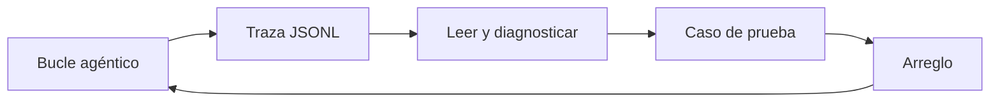

Al terminar esta lección cada ejecución de tu agente dejará una traza que puedes leer en dos minutos, y sabrás qué buscar en ella cuando algo sale mal. Con un agente, la respuesta final casi nunca explica el fallo: la explicación está en los pasos.

## La idea

Un agente que falla rara vez lanza una excepción. Responde algo plausible pero incorrecto, tarda mucho más de lo normal o gasta muchos más tokens. Para saber por qué necesitas su [[glosario/trayectoria|trayectoria]]: qué vio en cada paso, qué decidió y qué le devolvieron las herramientas.

Una **traza** es el registro ordenado de esa trayectoria. No hace falta una plataforma de [[glosario/observabilidad|observabilidad]] para empezar: un archivo JSONL (un objeto JSON por línea) por ejecución basta para depurar en local, y es fácil de llevar después a la herramienta que uses en producción.



## Qué guardar

Dos tipos de evento cubren casi todo:

| Campo | En `modelo` | En `herramienta` |
|---|---|---|
| `ejecucion`, `paso`, `tipo`, `t` | Sí | Sí |
| `stop_reason` | Sí | |
| `tokens_entrada`, `tokens_salida` | Sí, de `usage` | |
| `ms` | Duración de la llamada | Duración de la herramienta |
| `texto` | Texto del asistente (recortado) | |
| `nombre`, `entrada` | | Herramienta y argumentos |
| `salida`, `es_error`, `chars` | | Resultado recortado, si fue error y su tamaño real |

Guarda también, al principio, un evento `inicio` con la tarea, el modelo y la versión de tu prompt y tus herramientas. Sin eso no podrás comparar trazas de antes y después de un cambio.

> [!peligro] Las trazas contienen datos
> Lo que el usuario escribe y lo que devuelven las herramientas acaba en la traza: emails, pedidos, quizá datos personales. Recorta, enmascara lo sensible y decide cuánto tiempo las guardas antes de llevarlas a producción.

## Un registrador mínimo

```python title="traza.py"
import json
import time
import uuid
from pathlib import Path

class Traza:
    def __init__(self, carpeta: str = "trazas", recorte: int = 500):
        self.id = uuid.uuid4().hex[:8]
        self.recorte = recorte
        Path(carpeta).mkdir(exist_ok=True)
        self.archivo = open(Path(carpeta) / f"{self.id}.jsonl", "a", encoding="utf-8")

    def evento(self, tipo: str, paso: int, **datos) -> None:
        linea = {"ejecucion": self.id, "paso": paso, "tipo": tipo, "t": round(time.time(), 3), **datos}
        self.archivo.write(json.dumps(linea, ensure_ascii=False, default=str) + "\n")
        self.archivo.flush()            # si el proceso muere, la traza llega hasta el último paso

    def corto(self, texto: str) -> str:
        return texto if len(texto) <= self.recorte else texto[: self.recorte] + f"… [+{len(texto) - self.recorte}]"
```

Y en el bucle, sin tocar su lógica, registras alrededor de cada llamada y cada herramienta:

```python title="agente.py"
def agente(pregunta: str, presupuesto: Presupuesto, traza: Traza) -> dict:
    traza.evento("inicio", 0, tarea=pregunta, modelo=MODEL, version_prompt="soporte-v3")
    messages = [{"role": "user", "content": pregunta}]
    paso = 0
    while (motivo := presupuesto.agotado()) is None:
        paso += 1
        t0 = time.perf_counter()
        resp = client.messages.create(model=MODEL, max_tokens=2048, system=SYSTEM,
                                      tools=TOOLS, messages=messages)
        presupuesto.registrar(resp.usage)
        traza.evento("modelo", paso, stop_reason=resp.stop_reason,
                     tokens_entrada=resp.usage.input_tokens, tokens_salida=resp.usage.output_tokens,
                     ms=round((time.perf_counter() - t0) * 1000),
                     texto=traza.corto("".join(b.text for b in resp.content if b.type == "text")))
        messages.append({"role": "assistant", "content": resp.content})
        if resp.stop_reason == "end_turn":
            traza.evento("fin", paso, estado="completo")
            texto = "".join(b.text for b in resp.content if b.type == "text")
            return {"estado": "completo", "respuesta": texto}
        if resp.stop_reason != "tool_use":
            traza.evento("fin", paso, estado="error", motivo=resp.stop_reason)
            return {"estado": "error", "motivo": resp.stop_reason}
        resultados = []
        for b in (b for b in resp.content if b.type == "tool_use"):
            t0 = time.perf_counter()
            r = ejecutar_con_control(b, presupuesto)
            traza.evento("herramienta", paso, nombre=b.name, entrada=b.input,
                         salida=traza.corto(str(r["content"])), es_error=r["is_error"],
                         chars=len(str(r["content"])), ms=round((time.perf_counter() - t0) * 1000))
            resultados.append(r)
        messages.append({"role": "user", "content": resultados})
    traza.evento("fin", paso, estado="incompleto", motivo=motivo)
    return {"estado": "incompleto", "motivo": motivo}
```

Para simplificar, aquí `pause_turn` se trata como error; si usas herramientas del servidor, añade su rama como en [[roadmap/40-primer-agente/02-el-bucle-agentico]].

## Qué buscar

Abre la traza y léela de arriba abajo con estas preguntas. Cada síntoma suele apuntar a una causa concreta:

| Síntoma en la traza | Causa probable | Dónde arreglarlo |
|---|---|---|
| Primera herramienta equivocada | Descripciones ambiguas o solapadas | Descripción de la herramienta |
| La misma llamada con los mismos argumentos varias veces | La salida no le sirve o no entiende el error | Salida o mensaje de error de la herramienta |
| `es_error: true` y el modelo sigue como si nada | El error no dice qué hacer | Texto del error |
| `tokens_entrada` da un salto grande en un paso | Una herramienta devolvió demasiado (`chars` alto) | Limitar y resumir la salida |
| `stop_reason: max_tokens` | `max_tokens` bajo o respuesta desmesurada | Parámetro o instrucciones de longitud |
| Termina con `end_turn` en el paso 1 sin herramientas | No sabe que debe consultar datos | Prompt de sistema o descripciones |
| Argumentos inventados (ids que nunca aparecieron) | Falta un paso previo de búsqueda | Descripción: «requiere el id de…» |
| Muchos pasos para una tarea sencilla | Herramientas demasiado finas | Diseño del conjunto de herramientas |

La regla práctica: **busca el primer paso donde la ejecución se tuerce**. Lo que pasa después suele ser consecuencia.

## Un ejemplo leído

```text
# salida de ejemplo
{"paso": 0, "tipo": "inicio", "tarea": "Soy ana@example.com, me habéis cobrado dos veces el pedido"}
{"paso": 1, "tipo": "modelo", "stop_reason": "tool_use", "tokens_entrada": 1840, "tokens_salida": 61}
{"paso": 1, "tipo": "herramienta", "nombre": "ver_pedidos", "entrada": {"cliente_id": "ana@example.com"}, "es_error": true, "salida": "Error: cliente_id inválido"}
{"paso": 2, "tipo": "modelo", "stop_reason": "tool_use", "tokens_entrada": 1950, "tokens_salida": 58}
{"paso": 2, "tipo": "herramienta", "nombre": "ver_pedidos", "entrada": {"cliente_id": "ana"}, "es_error": true, "salida": "Error: cliente_id inválido"}
{"paso": 3, "tipo": "modelo", "stop_reason": "tool_use", "tokens_entrada": 2060, "tokens_salida": 55}
{"paso": 3, "tipo": "herramienta", "nombre": "buscar_ayuda", "entrada": {"consulta": "cobro duplicado"}, "es_error": false, "chars": 14210}
{"paso": 4, "tipo": "modelo", "stop_reason": "end_turn", "tokens_entrada": 5720, "tokens_salida": 240}
```

Lectura: el primer fallo está en el paso 1. El modelo pasó un email a `ver_pedidos` sin llamar antes a `buscar_cliente`, y el error «cliente_id inválido» no le dijo qué hacer, así que probó otra cosa al azar. Luego `buscar_ayuda` devolvió más de 14.000 caracteres, y eso explica el salto de tokens del paso 4. Dos arreglos: un error que diga «usa primero buscar_cliente» y un límite en la salida de `buscar_ayuda`. Exactamente los principios de [[roadmap/40-primer-agente/05-agente-con-varias-herramientas]].

## De la traza al caso de prueba

Cada fallo que encuentres en una traza es un caso de prueba gratis. Guarda la tarea, lo que esperabas («primera herramienta: buscar_cliente») y la versión que fallaba. Cuando lo arregles, el caso se queda en tu conjunto para que no vuelva a pasar. Así nacen las [[roadmap/80-evals/04-evals-de-trayectoria|evals de trayectoria]].

## La misma traza en herramientas abiertas

Tu JSONL ya tiene la forma que usan las herramientas de observabilidad. Las [[glosario/convenciones-genai-otel|convenciones GenAI de OpenTelemetry]] describen un agente como un árbol de *spans*: uno `invoke_agent` por ejecución, y dentro uno `chat` por llamada al modelo y uno `execute_tool` por herramienta. Cada evento tuyo tiene su equivalente:

| Tu traza | Span de OpenTelemetry | Atributos `gen_ai.*` |
|---|---|---|
| `inicio` … `fin` | `invoke_agent` | `gen_ai.agent.name`, `gen_ai.conversation.id` |
| `modelo` | `chat` | `gen_ai.provider.name`, `gen_ai.request.model`, `gen_ai.usage.input_tokens`, `gen_ai.usage.output_tokens`, `gen_ai.response.finish_reasons` |
| `herramienta` | `execute_tool` | `gen_ai.tool.name`, `gen_ai.tool.call.id`; el error en `error.type` |

Dos detalles antes de copiar nombres. Las convenciones están en estado *Development* y desde junio de 2026 viven en su propio repositorio ([open-telemetry/semantic-conventions-genai](https://github.com/open-telemetry/semantic-conventions-genai)); cambian entre versiones (`gen_ai.system` pasó a ser `gen_ai.provider.name`), así que fija la versión de tu instrumentación. Y el contenido de los mensajes es *opt-in*: por defecto se registran metadatos, no lo que dijo el usuario, por la misma razón que el aviso de arriba.

Si emites esos spans y los exportas por OTLP, los ves como un árbol navegable en [[herramientas/langfuse|Langfuse]] (SDK open source con licencia MIT, plataforma autoalojable o en la nube) o en [[herramientas/arize-phoenix|Phoenix]] (autoalojable, con licencia Elastic 2.0: código disponible, no open source según la OSI). El bucle instrumentado a mano, con el span que ya emite el SDK de Anthropic, está en [[docs/produccion/04-opentelemetry-genai]], y el montaje con Langfuse en [[recetas/trazas-con-langfuse]]. Si tu agente está hecho con LangGraph, `grafo.stream(..., stream_mode="updates")` te da un evento por nodo y `get_state_history(config)` la secuencia de estados guardados, que es otra forma de leer la misma trayectoria.

## Errores frecuentes

- Registrar solo la respuesta final.
- Guardar salidas de herramientas completas: las trazas se vuelven ilegibles y caras de almacenar. Recorta y guarda el tamaño real aparte.
- No registrar la versión del prompt y de las herramientas.
- Leer la traza desde el final y arreglar el síntoma en lugar de la causa.

## Ejercicio

> [!ejercicio] Diagnostica tres fallos
> Añade `Traza` a tu agente y ejecuta tus 10 tareas del proyecto del nivel. Después provoca tres fallos a propósito: empeora la descripción de una herramienta, quita la pista de corrección de un mensaje de error y haz que `buscar_ayuda` devuelva todos los artículos sin recortar.
>
> **Está bien si**: cada ejecución genera un archivo JSONL con eventos `inicio`, `modelo`, `herramienta` y `fin`; para cada fallo provocado has señalado el paso exacto donde se tuerce la ejecución y la fila de la tabla de síntomas que le corresponde; y has añadido los tres como casos a tu `tareas.jsonl`.

> [!ejercicio]- Pistas
> Un resumen rápido ayuda: un script que, por traza, imprima pasos, tokens totales, herramientas usadas en orden y número de errores. Con `jq` también puedes filtrar: `jq -c 'select(.tipo=="herramienta")' trazas/*.jsonl`.

## Resumen

- La respuesta final no explica por qué falló un agente; la trayectoria sí.
- Un JSONL por ejecución con eventos de modelo y de herramienta basta para empezar.
- Registra `stop_reason`, tokens, duración, argumentos, errores y tamaño de las salidas.
- Busca el primer paso donde la ejecución se tuerce y usa la tabla de síntomas.
- Cada fallo encontrado se convierte en un caso de prueba.

## Para seguir

- [[roadmap/100-produccion/01-observabilidad-y-trazas]]
- [[roadmap/80-evals/04-evals-de-trayectoria]]
- [[docs/produccion/01-observabilidad]]
- [[recetas/analisis-de-errores-de-trazas]]
- [[blog/2026-07-15-como-leer-una-traza]]
