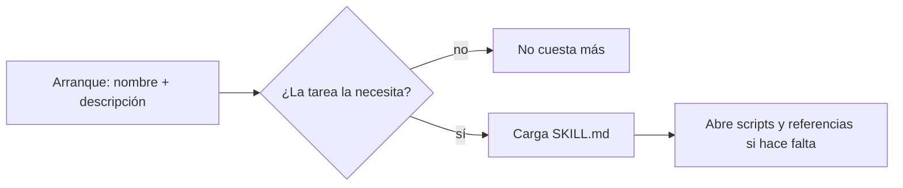

Al terminar esta lección sabrás qué es una skill, por qué existe y, sobre todo, cuándo **no** usarla. Tendrás una tabla para decidir entre skill, prompt de sistema, herramienta, servidor MCP, subagente y comando, que es la pregunta que de verdad te vas a hacer.

## La idea

Una [[glosario/skill|skill]] es una carpeta con un archivo `SKILL.md` que enseña al agente **cómo hacer una tarea concreta**: los pasos, los criterios, el formato del resultado y, si hace falta, scripts y documentos de apoyo. El formato es un estándar abierto, *Agent Skills* (agentskills.io), que nació en Anthropic en 2025 y que Anthropic donó a la Agentic AI Foundation el 22 de octubre de 2026.

Lo que la distingue de «un prompt guardado en un archivo» es **cómo se carga**. El agente no lee la skill entera al arrancar. Lee solo su nombre y su descripción, unas decenas de tokens, y decide por sí mismo si la tarea actual la necesita. Si la necesita, carga las instrucciones; si las instrucciones remiten a un script o a un documento, lo abre en ese momento. A esto se le llama [[glosario/divulgacion-progresiva|divulgación progresiva]] y es el tema de la lección 3.



En la clasificación de memoria de CoALA, una skill es **memoria procedimental**: saber hacer, no saber qué. Las preferencias del usuario o los hechos de tu dominio son otra cosa ([[glosario/tipos-de-memoria]]).

## Qué contiene una skill

```text
notas-de-version/
├── SKILL.md            # frontmatter (name, description…) + procedimiento en Markdown
├── scripts/            # código que el agente ejecuta en lugar de razonarlo
├── references/         # documentación que lee solo si la necesita
└── assets/             # plantillas, ficheros de ejemplo
```

Solo `SKILL.md` es obligatorio, y en su frontmatter solo `name` y `description`. Lo verás campo a campo en [[roadmap/50-skills/02-anatomia-de-una-skill]].

## Qué no es una skill

La confusión habitual es usar una skill para algo que ya resuelve otro mecanismo. Cada uno contesta una pregunta distinta.

**Prompt de sistema.** Lo que el agente debe saber **siempre**: su rol, las reglas que nunca se relajan, el tono. Se carga en cada llamada y paga tokens en cada una. En un agente de código, este papel lo cumple el archivo de memoria del proyecto, `CLAUDE.md` o `AGENTS.md` ([[docs/claude-code/01-memoria-claude-md-y-agents-md]]). Si una instrucción hace falta en el 90 % de las tareas, va aquí; si hace falta en el 5 %, es una skill.

**Herramienta.** Una **capacidad**: algo que el agente puede hacer y que sin ella no puede (consultar una base de datos, enviar un correo). La herramienta dice *qué* puede hacer; la skill dice *cómo* se hace bien un trabajo, y a menudo usa varias herramientas. Una skill no da capacidades nuevas: si su script necesita red y el agente no la tiene, la skill no la consigue.

**Servidor MCP.** Un paquete de herramientas, recursos y prompts servido por otro proceso con el [[glosario/mcp|protocolo MCP]]. Conecta el agente con sistemas externos. La regla práctica: **MCP para conectar, skill para enseñar**. Lo normal es combinarlos: el servidor MCP de tu gestor de incidencias da las herramientas y una skill explica el procedimiento de triaje del equipo.

**[[glosario/subagente|Subagente]].** Otro agente con su propio contexto, que trabaja y devuelve un resumen. Sirve para **aislar contexto**: una exploración ruidosa que no quieres en la conversación principal. Una skill, en cambio, se carga **en el contexto de quien la usa**. Se combinan: un subagente puede llevar skills precargadas, y en Claude Code una skill puede ejecutarse en un subagente aparte (`context: fork`).

**Comando.** Un atajo que lanza **el humano** escribiendo `/nombre`. En Claude Code los comandos personalizados (`.claude/commands/*.md`) se han fusionado con las skills: un archivo de comando y una skill con el mismo nombre crean el mismo `/nombre`, y los comandos antiguos siguen funcionando. La diferencia que importa ya no es el archivo sino **quién puede invocarlo**: una skill con `disable-model-invocation: true` solo la lanza el humano, como un comando.

## Cómo elegir

| Necesitas que el agente… | Usa | Por qué |
|---|---|---|
| Siga siempre una regla («no hagas commits») | Prompt de sistema o `CLAUDE.md`/`AGENTS.md` | Se aplica en cada tarea; cargarlo bajo demanda sería arriesgado |
| Pueda hacer algo nuevo (leer Jira, consultar Postgres) | Herramienta o servidor MCP | Es una capacidad, no un procedimiento |
| Haga bien una tarea que aparece a veces (notas de versión, revisión de seguridad) | **Skill** | Solo paga contexto cuando hace falta |
| Explore mucho sin ensuciar la conversación | Subagente | Contexto propio; devuelve un resumen |
| Ejecute un procedimiento solo cuando tú lo decidas (aprobar, desplegar) | Skill o comando solo para humanos | El modelo no puede lanzarlo por su cuenta |
| No pueda saltarse un control pase lo que pase | Permisos o un hook | Las instrucciones las interpreta el modelo; los controles deterministas, no |

La última fila es la que más se olvida. Una skill es texto que el modelo lee y, con mucha probabilidad, sigue. Si algo **debe** cumplirse siempre (no leer secretos, no hacer `git push`), no lo escribas en una skill: ponlo en los permisos o en un [[glosario/hook|hook]] ([[roadmap/90-harness/03-permisos-y-hooks]]).

## Un ejemplo real

El harness del autor, un sistema de cuatro subagentes para Claude Code, tiene dieciséis skills en `.claude/skills/`. Tres casos muestran el reparto de papeles:

- `feature-kickoff` convierte una idea ambigua en una feature registrada. Solo hace falta cuando el humano trae algo nuevo, así que es una skill y no parte del `CLAUDE.md`.
- `verification-before-completion` («nada de hecho sin evidencia») no espera a que el modelo la descubra: los agentes que la necesitan, el builder y el reviewer, la llevan **precargada** en su frontmatter.
- `/approve` y `/reject` deciden la puerta humana del flujo. Son comandos que el modelo no puede invocar, porque una aprobación inferida no es una aprobación.

Y las reglas que no admiten excepción («el estado solo cambia con el motor», «no leas `.env`») no están en ninguna skill: están en el `CLAUDE.md`, en `settings.json` y en un hook de seguridad.

## Quién más lee el formato

Según Anthropic, más de 70 plataformas usan el formato, entre ellas ChatGPT, Cursor, GitHub Copilot y VS Code, y hay cargadores de la comunidad para Codex, Cursor y OpenCode. La lista completa de clientes y el grado de soporte de cada uno no los hemos podido verificar: compruébalo en agentskills.io antes de dar por hecho que tu herramienta lee un campo concreto. Un estudio del código fuente de once arneses de agentes de código (Barbaste et al., julio de 2026) encontró `SKILL.md` en nueve de ellos. Más en [[docs/estandares/04-agent-skills-y-agents-md]].

## Errores frecuentes

- Meter en una skill reglas que deben aplicarse siempre. Se cargan solo a veces.
- Crear una skill por cada pregunta frecuente. Si no hay procedimiento (pasos, criterio, formato), es documentación.
- Esperar que una skill dé permisos. No los da: el agente sigue limitado por sus herramientas y su configuración.
- Escribir una skill de 2.000 líneas «por si acaso». Se carga entera cada vez que se activa.

## Ejercicio

> [!ejercicio] Clasifica tus instrucciones
> Toma el prompt de sistema o el `CLAUDE.md` de un proyecto tuyo y clasifica cada instrucción en una de las seis filas de la tabla. Marca las que deberían salir a una skill y las que deberían convertirse en un permiso o un hook.
>
> **Está bien si** cada instrucción tiene una fila asignada con su motivo, identificas al menos un candidato a skill (un procedimiento con pasos que no hace falta en todas las tareas) y al menos una regla que hoy está en texto y debería ser un control determinista.

> [!ejercicio]- Pistas
> Pregúntate por cada línea: ¿cuántas de mis últimas diez tareas la necesitaban? Si son menos de dos, probablemente es una skill. ¿Qué pasa si el modelo la ignora? Si la respuesta es «algo grave», no es texto: es un control.

## Resumen

- Una skill es una carpeta con `SKILL.md` que enseña un procedimiento; el formato es el estándar abierto Agent Skills.
- Se carga por capas: primero nombre y descripción, después las instrucciones y por último los recursos.
- Prompt de sistema para lo que vale siempre, herramienta o MCP para capacidades, subagente para aislar contexto, skill para procedimientos ocasionales.
- Lo que no puede fallar va en permisos o hooks, no en una skill.

## Para seguir

- [[roadmap/50-skills/02-anatomia-de-una-skill]]
- [[docs/claude-code/03-skills]]
- [[docs/estandares/04-agent-skills-y-agents-md]]
- [[roadmap/20-herramientas/05-mcp-conectar-un-servidor]]
