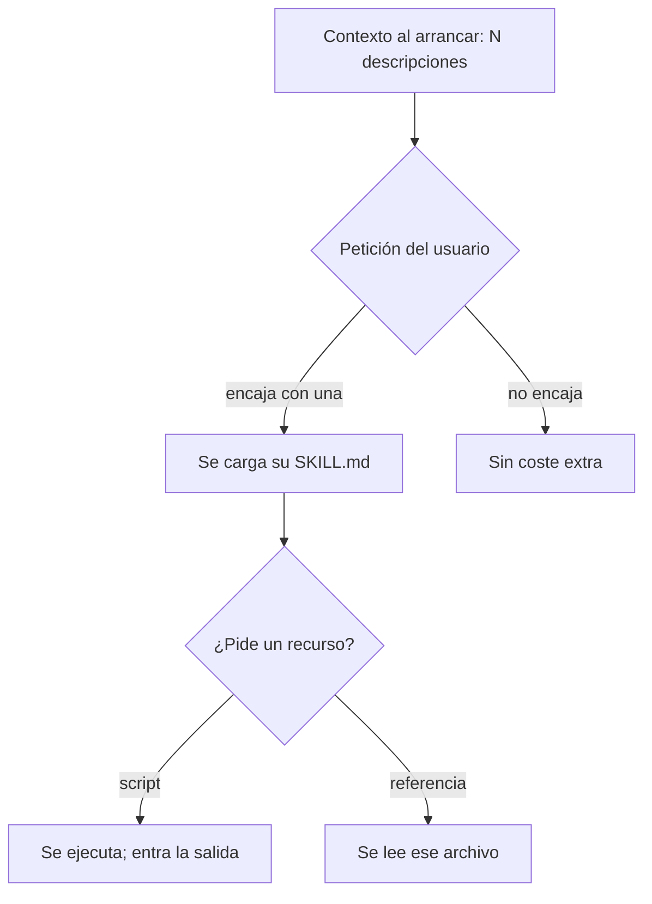

Al terminar esta lección sabrás qué paga tu agente por tener veinte skills instaladas, por qué es mucho menos que meterlas en el prompt de sistema y cómo escribir la única parte que se lee siempre, la `description`, para que decida bien.

## La idea

Una [[glosario/ventana-de-contexto|ventana de contexto]] grande no es una ventana gratis. Cada token cuesta dinero y latencia, y llenarla de instrucciones que no vienen al caso empeora las respuestas (lo que Chroma llamó [[glosario/context-rot|context rot]] en 2025). Las skills resuelven esto con **divulgación progresiva**, que Anthropic describió al presentar el formato en octubre de 2025 y que hoy recoge el estándar:

1. **Nivel 1, metadatos.** El nombre y la descripción de cada skill entran en el contexto al arrancar. La especificación los estima en unos 100 tokens por skill.
2. **Nivel 2, instrucciones.** Cuando el modelo decide que la tarea encaja, carga el cuerpo de `SKILL.md`. Se recomienda que no pase de 5.000 tokens ni de 500 líneas.
3. **Nivel 3 y siguientes, recursos.** Scripts, referencias y plantillas se leen o se ejecutan solo si las instrucciones lo piden. Un script que se ejecuta no ocupa contexto: solo su salida.



Es la misma idea que la [[glosario/carga-diferida-de-herramientas|carga diferida de herramientas]] (`defer_loading`) en la API: tener mucho disponible sin cargarlo todo.

## Qué ve el modelo exactamente

Cada cliente formatea el nivel 1 a su manera. La biblioteca de referencia del estándar genera el bloque que Anthropic recomienda para sus modelos. Esta es su salida real (`agentskills to-prompt`, con la ruta acortada) para la skill de notas de versión de la lección siguiente:

```text
<available_skills>
<skill>
<name>
notas-de-version
</name>
<description>
Redacta las notas de versión de un repositorio git a partir de los commits desde la última etiqueta, agrupadas en Cambios incompatibles, Añadido, Corregido y Rendimiento. Úsala cuando pidan notas de versión, changelog, release notes o «qué ha cambiado desde la última versión». No la uses para explicar un commit suelto ni para escribir mensajes de commit.
</description>
<location>
./.claude/skills/notas-de-version/SKILL.md
</location>
</skill>
</available_skills>
```

Eso es todo lo que el modelo sabe de la skill hasta que la usa. **La decisión de cargarla se toma solo con esas líneas.** Si la descripción no contiene lo que haría falta para reconocer la tarea, la skill no se activará, por bueno que sea su cuerpo.

En Claude Code el listado está acotado: `description` más `when_to_use` se cortan a 1.536 caracteres por skill. Y las skills con `disable-model-invocation: true` no aparecen: su coste fijo es cero.

## Cuánto cuesta en tokens

Este script estima, para una carpeta de skills, el coste fijo (lo que se paga en **cada** petición) y el coste de cada una al activarse:

```python title="coste_skills.py"
"""Estima cuánto contexto ocupan siempre tus skills y cuánto cada una al activarse."""
import re
import sys
from pathlib import Path

import yaml


def partes(skill_md: Path) -> tuple[dict, str]:
    m = re.match(r"^---\n(.*?)\n---\n(.*)$", skill_md.read_text(encoding="utf-8"), re.S)
    return (yaml.safe_load(m.group(1)) or {}, m.group(2)) if m else ({}, "")


def tokens_aprox(texto: str) -> int:
    return round(len(texto) / 4)          # aproximación; para la cifra exacta usa count_tokens


carpeta = Path(sys.argv[1] if len(sys.argv) > 1 else ".claude/skills")
siempre = 0
for skill_md in sorted(carpeta.glob("*/SKILL.md")):
    fm, cuerpo = partes(skill_md)
    listado = "" if fm.get("disable-model-invocation") else f"{fm.get('name', '')}: {fm.get('description', '')}"
    siempre += tokens_aprox(listado)
    print(f"{skill_md.parent.name:32} siempre ≈{tokens_aprox(listado):4}  al usarla ≈{tokens_aprox(cuerpo):5}")
print(f"{'TOTAL en cada petición':32} ≈{siempre}")
```

Ejecutado sobre las dieciséis skills del harness del autor (extracto):

```text
acceptance-criteria              siempre ≈  88  al usarla ≈  928
caveman                          siempre ≈   0  al usarla ≈ 1670
feature-cost                     siempre ≈ 114  al usarla ≈ 1194
feature-kickoff                  siempre ≈  92  al usarla ≈  347
new-session                      siempre ≈   0  al usarla ≈  564
ponytail                         siempre ≈   0  al usarla ≈ 1420
verification-before-completion   siempre ≈  70  al usarla ≈  284
TOTAL en cada petición           ≈1161
```

Unos 1.200 tokens fijos frente a unos 10.400 si los dieciséis cuerpos estuvieran en el prompt de sistema. Tres skills (`caveman`, `ponytail`, `new-session`) cuestan cero porque solo las lanza el humano. La división entre cuatro es una aproximación grosera, y en español suele quedarse corta. Para la cifra exacta, mide con el endpoint de conteo de tokens del proveedor: `client.messages.count_tokens(model=MODEL, messages=[...])` devuelve `.input_tokens` para el texto que le pases.

Dos consecuencias prácticas:

- **El coste fijo crece con el número de skills, no con su tamaño.** Veinte skills con descripciones largas pesan más que cinco skills con cuerpos enormes que casi nunca se usan.
- **El coste de una skill activa se paga en cada petición siguiente de esa conversación.** Una vez cargado, el cuerpo queda en el historial. Una skill de 5.000 tokens activada al principio de una sesión larga se reenvía muchas veces (el [[glosario/prompt-caching|prompt caching]] abarata esa repetición, pero no la elimina).

## Escribir una description que active bien

La description tiene que contestar tres preguntas en este orden:

1. **Qué hace**, con el resultado concreto: «Redacta las notas de versión… agrupadas en…».
2. **Cuándo usarla**, con las palabras que diría un usuario real, incluidas las de otro idioma si tu equipo las mezcla: «notas de versión, changelog, release notes, qué ha cambiado desde la última versión».
3. **Cuándo no**, sobre todo si hay una skill vecina: «No la uses para explicar un commit suelto ni para escribir mensajes de commit».

| Descripción | Problema |
|---|---|
| «Ayuda con el changelog» | No dice qué produce ni cuándo; se activará al azar |
| «Skill muy completa para todo lo relacionado con git» | Demasiado amplia: se cargará en tareas que no son suyas |
| «Genera RELEASE.md siguiendo Keep a Changelog 1.1.0 con secciones…» (800 caracteres de formato) | Gasta el presupuesto fijo en detalles que van en el cuerpo |
| La de `notas-de-version` | Qué, cuándo y cuándo no en tres frases |

Las dos formas de fallar tienen costes distintos. Un **falso negativo** (no se activa cuando debía) produce un trabajo peor sin que nadie lo note. Un **falso positivo** (se activa cuando no debía) gasta contexto y puede imponer un procedimiento equivocado. Por eso la lección siguiente prueba la skill con casos de los dos tipos.

## Patrones que reducen el contexto

- **Deriva a scripts todo lo determinista.** El código de `agrupar_commits.py` no entra nunca en el contexto; solo su JSON de salida.
- **Divide referencias por tema.** `references/api.md` y `references/errores.md` en lugar de un `references/todo.md`: el agente abre solo el que necesita.
- **Dile en el cuerpo cuándo leer cada recurso.** «Si el JSON trae `Sin formato`, consulta `references/convenciones.md`». Sin esa frase, el agente puede leerlo todo por si acaso.
- **Reserva al humano lo que no necesita descubrirse.** Un procedimiento que solo se lanza a mano no tiene por qué ocupar el listado.

## Errores frecuentes

- Pensar que las skills son gratis porque «solo se cargan si hacen falta». El listado se paga en cada petición.
- Descripciones genéricas que compiten entre sí: dos skills que dicen «para tareas de git» se pisan.
- Cuerpos que repiten lo que ya está en `CLAUDE.md` o `AGENTS.md`: pagas dos veces lo mismo.
- No medir. Sin el coste fijo calculado, no sabes si tu agente arranca con 1.000 o con 15.000 tokens de skills.

## Ejercicio

> [!ejercicio] Mide y recorta
> Ejecuta `coste_skills.py` sobre las skills que uses (las tuyas o las de un repositorio público). Elige las tres con más coste fijo y reescribe sus descripciones con el patrón qué, cuándo y cuándo no.
>
> **Está bien si** tienes el coste fijo antes y después, cada descripción nueva contiene al menos dos frases que diría un usuario real y una frase de exclusión, y ninguna supera 1.024 caracteres.

> [!ejercicio]- Pistas
> Mira el historial de tus conversaciones con el agente: las palabras exactas que usaste para pedir esa tarea son las mejores candidatas para la descripción.

## Resumen

- Divulgación progresiva: metadatos siempre, cuerpo al activarse, recursos bajo demanda.
- El modelo decide solo con el nombre y la descripción: lo que no esté ahí no existe para él.
- El coste fijo crece con el número de skills; el de una skill activa se arrastra el resto de la conversación.
- Una buena description dice qué hace, cuándo usarla con palabras reales y cuándo no.

## Para seguir

- [[roadmap/50-skills/04-escribir-tu-primera-skill]]
- [[cursos/context-engineering/02-que-meter-y-que-no]]
- [[docs/herramientas/05-busqueda-y-carga-diferida]]
