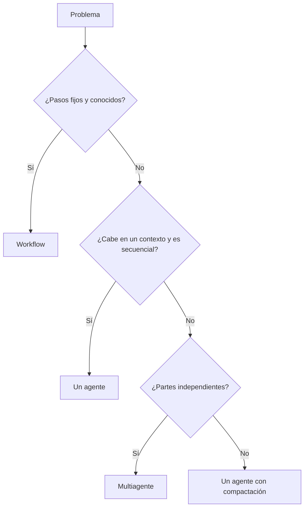

Al terminar esta lección podrás mirar un problema y decir, con argumentos, si necesita varios agentes o si basta con uno (o con un [[glosario/workflow]] sin agente). Sabrás qué pagas al multiplicar agentes y qué señales indican que el pago compensa.

## La idea

Un sistema multiagente es un programa donde un modelo, el [[glosario/orquestador]], delega partes del trabajo en otros agentes, los [[glosario/subagente|subagentes]], que tienen su propio contexto, sus propias herramientas y su propio bucle. Suena a dividir y vencer. En la práctica es una forma cara de comprar dos cosas concretas: **contextos separados y trabajo en paralelo**. Si tu problema no necesita ninguna de las dos, solo compras complejidad.

La recomendación de Anthropic en [Building effective agents](https://www.anthropic.com/engineering/building-effective-agents) va en la misma línea: empieza por la solución más simple que funcione y añade complejidad solo cuando demuestre que mejora el resultado. Esa escalera la tienes en [[patrones/01-workflows-vs-agentes]]. Multiagente es el último peldaño.

## Lo que pagas

### Tokens

Cada subagente arranca con su propio [[glosario/prompt-de-sistema]], sus definiciones de herramientas y la tarea. Luego hace sus búsquedas, lee resultados y razona. Todo eso son [[glosario/token|tokens]] de entrada y salida que no existirían con un solo agente. Además, el orquestador lee después lo que devuelven todos. Anthropic contó en [How we built our multi-agent research system](https://www.anthropic.com/engineering/multi-agent-research-system) (13 jun. 2025) que un agente gasta unas 4 veces los tokens de un chat y su sistema multiagente unas 15 veces, y que solo compensa en tareas cuyo valor justifica ese gasto. Lo verás con números propios en [[roadmap/60-multiagente/05-coste-de-multiplicar-agentes]].

### Coordinación

El orquestador tiene que dividir bien la tarea. Si la divide mal, dos subagentes buscan lo mismo, o ninguno busca lo importante, o cada uno asume algo distinto sobre el formato. Con un agente esos errores no existen porque todo el razonamiento ocurre en un mismo contexto.

### Pérdida de información

El subagente no ve la conversación del orquestador. Solo sabe lo que le escribes en la tarea. Y el orquestador solo ve lo que el subagente devuelve, no lo que descubrió por el camino. Cada frontera entre agentes es un punto donde se pierde contexto. Lo tratamos en [[roadmap/60-multiagente/03-pasar-contexto-entre-agentes]].

### Depuración

Una traza de un agente es una secuencia. Una traza multiagente es un árbol con ramas que corren a la vez. Cuando la respuesta final está mal, tienes que averiguar si falló la división, un subagente concreto o la síntesis. Necesitas IDs que relacionen cada llamada con su padre, algo que verás en [[roadmap/100-produccion/01-observabilidad-y-trazas]].

### Latencia, en ambos sentidos

El paralelismo reduce el tiempo de pared si las partes son independientes. Pero añades al menos dos pasos secuenciales (planificar y sintetizar), y el conjunto tarda lo que tarde el subagente más lento. Para tareas cortas, un agente solo suele terminar antes.

## Cuándo sí compensa

Las señales que justifican varios agentes son pocas y concretas:

- **La tarea se divide en partes independientes.** Investigar cinco competidores, revisar diez archivos que no dependen entre sí, buscar en tres fuentes distintas. Si la parte B necesita el resultado de la A, no hay paralelismo real.
- **El contexto no cabe junto o se ensucia.** Cada parte genera mucho material intermedio (páginas leídas, resultados de búsqueda) que el resto no necesita. Un subagente lo procesa en su [[glosario/ventana-de-contexto]] y devuelve un resumen corto. Así el orquestador trabaja con contexto limpio.
- **Las partes piden herramientas o instrucciones distintas.** Un subagente que solo consulta la base de datos y otro que solo busca en la web, cada uno con su prompt y sus herramientas, son más fáciles de afinar que un agente con todas.
- **El valor de la respuesta justifica el gasto.** Un informe que alguien va a usar para decidir algo caro aguanta multiplicar el coste. Una respuesta de soporte de nivel uno, no.

Si tu caso no cumple al menos las dos primeras, casi seguro que un solo agente bien hecho gana.

## Lo que funciona en 2026: escrituras en un solo hilo

El debate tiene historia. En junio de 2025, Cognition (los autores de Devin) publicó [*Don't Build Multi-Agents*](https://cognition.com/blog/dont-build-multi-agents): cada acción de un agente lleva decisiones implícitas, y dos agentes que actúan en paralelo sin ver lo que decide el otro toman decisiones que chocan. Su consejo era compartir el contexto completo, la traza entera y no solo mensajes sueltos.

En abril de 2026, el mismo autor revisó la postura en [*Multi-Agents: What's Actually Working*](https://cognition.com/blog/multi-agents-working). La conclusión cabe en una frase suya: **las escrituras se quedan en un solo hilo, y los agentes adicionales aportan inteligencia, no acciones**. Lo que funciona:

- **Un revisor con contexto limpio.** Un agente genera; otro, que no ha visto cómo se llegó al resultado, lo revisa. Precisamente porque no comparte el contexto del autor, no hereda sus suposiciones.
- **Un «amigo listo».** El agente principal consulta a un modelo más capaz como si fuera una herramienta, para decisiones difíciles. Encaja con el [[patrones/13-ejecutor-y-asesor|patrón ejecutor y asesor]].
- **Un gestor con hijos** que reparte trabajo, recoge y decide (*map-reduce-and-manage*), con mucho cuidado en qué contexto recibe cada hijo.
- **Subagentes de solo lectura**: buscan, leen y resumen, pero no cambian nada.

Lo que no funciona: enjambres de agentes que escriben en paralelo sobre lo mismo y redes de agentes sin estructura que se pasan mensajes. LangChain llegó a la misma conclusión: las tareas de lectura se paralelizan bien y las de escritura sufren al juntar los resultados. Y casi todo lo que falla son problemas de comunicación entre agentes, que es el tema de [[roadmap/60-multiagente/03-pasar-contexto-entre-agentes]].

Para tu diseño, esto se traduce en dos reglas: **un único agente escribe**, y los demás leen, buscan o revisan. Si necesitas varios escritores a la vez (por ejemplo, agentes de código en distintas *features*), aíslalos en copias separadas del repositorio y junta su trabajo con un proceso explícito, como verás en [[roadmap/60-multiagente/04-paralelismo]].

## Alternativas antes de multiplicar agentes

Muchos problemas que parecen pedir multiagente se resuelven con algo más simple:

| Síntoma | Antes de multiagente, prueba |
|---|---|
| El contexto crece demasiado en tareas largas | [[glosario/compactacion]] o resumir resultados de herramientas antes de añadirlos |
| Hay que hacer varias llamadas independientes | Paralelizar llamadas en un workflow ([[patrones/05-paralelizacion]]), sin bucle agéntico |
| Tipos de petición muy distintos | [[patrones/04-enrutado]] a prompts especializados |
| El agente se equivoca a menudo | Mejores herramientas y descripciones ([[disciplinas/diseno-de-herramientas]]) y evals |
| Necesitas revisar la calidad | [[patrones/07-evaluador-optimizador]] con un criterio claro, o un revisor con contexto limpio |

Fíjate en la cuarta fila. Si un agente falla, repartir su trabajo entre varios agentes suele repartir también el fallo. Arregla primero la causa.

> [!aviso] El síntoma más común
> «Hagamos un agente para cada departamento» reparte el trabajo según el organigrama y deja de lado la pregunta clave: si las tareas son independientes. Suele acabar con agentes que se pasan mensajes para hacer lo que uno haría solo.

## Lista de decisión

Responde por escrito antes de construir:

1. ¿Puedo enumerar las subtareas y son independientes entre sí?
2. ¿Cada subtarea genera material intermedio que el resto no necesita?
3. ¿Tengo una versión con un agente que funciona y una medida de su calidad?
4. ¿Cuánto vale una respuesta buena y cuánto estoy dispuesto a pagar por ella?
5. ¿Sé cómo depuraré un fallo en un subagente concreto?

Sin un «sí» en la 3, no tienes con qué comparar. Construye primero el agente único y mídelo con lo que verás en [[roadmap/80-evals/index]].

## Errores frecuentes

- Empezar por la arquitectura multiagente porque parece más completa.
- Dividir la tarea en partes que dependen unas de otras y luego coordinarlas con mensajes.
- Poner a varios agentes a escribir a la vez sobre el mismo resultado.
- Comparar el sistema multiagente con un agente único mal configurado.
- No contar los tokens del orquestador y de la síntesis al estimar el coste.

## Ejercicio

> [!ejercicio] Decide con argumentos
> Elige tres problemas: uno tuyo y dos de esta lista (responder preguntas sobre un manual de 40 páginas; comparar precios y condiciones de 6 proveedores en sus webs; clasificar tickets de soporte). Para cada uno, responde la lista de decisión y elige entre workflow, un agente o multiagente.
>
> Está bien si cada elección cita al menos dos de los costes o señales de esta lección, si al menos uno de los tres casos acaba en «no multiagente» y si, para el caso multiagente, escribes las subtareas concretas y explicas por qué son independientes.

> [!ejercicio]- Pistas
> El manual cabe en el contexto y la tarea es secuencial. Los proveedores son independientes y cada web genera mucho texto que la comparación final no necesita. Clasificar tickets tiene pasos fijos: piensa en enrutado.

## Resumen

- Multiagente compra contextos separados y trabajo en paralelo. Si no necesitas eso, solo compras complejidad.
- Pagas en tokens, coordinación, pérdida de información entre agentes y depuración más difícil.
- Compensa cuando las subtareas son independientes, generan mucho material intermedio y el valor de la respuesta justifica el gasto.
- Antes de multiplicar agentes, prueba compactación, paralelización simple o enrutado.
- Sin un agente único medido, no tienes con qué comparar.
- Lo que funciona hoy: un solo agente escribe; los demás leen, buscan o revisan con contexto limpio.

## Para seguir

- [[roadmap/60-multiagente/02-orquestador-y-subagentes]]
- [[patrones/09-elegir-patron]]
- [[cursos/sistemas-multiagente/01-arquitecturas]]
- [[biblioteca/multi-agent-research-system]]
