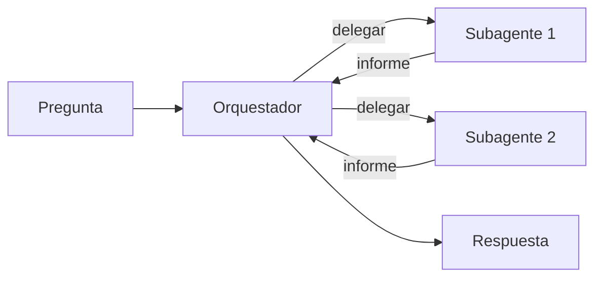

Al terminar esta lección tendrás un [[glosario/orquestador]] funcionando que delega en [[glosario/subagente|subagentes]]. Lo harás de dos maneras: dejando que el modelo decida cuándo delegar mediante una herramienta, y dejando que tu código reparta el trabajo con un plan fijo. Sabrás elegir entre ambas.

## La idea

Un subagente es, en código, una función. Recibe una tarea en texto, ejecuta su propio [[glosario/bucle-agentico]] con su propio historial de mensajes y sus propias herramientas, y devuelve un texto. **No comparte memoria con el orquestador**: todo lo que sabe viene en la tarea y todo lo que el orquestador sabrá de su trabajo viene en el valor de retorno.

Con esa función en la mano tienes dos formas de conectarla:

- **Subagente como herramienta.** El orquestador es un agente normal con una herramienta `delegar`. Cuando el modelo la invoca, tu aplicación ejecuta el subagente y devuelve su informe como [[glosario/tool-result]]. El modelo decide cuántas veces delegar y qué pedir.
- **Subagente como tarea.** Tu código pide al modelo un plan (una lista de subtareas en JSON), lanza un subagente por subtarea y hace una última llamada para sintetizar. El flujo es fijo y lo controlas tú.



## El subagente: un bucle con su propio contexto

El subagente de este ejemplo busca en una documentación interna. La herramienta `buscar_docs` es un stub: sustitúyela por tu buscador real.

```python tab="Python" title="subagente.py"
import anthropic

MODEL = "claude-sonnet-5-5"
client = anthropic.Anthropic()

SISTEMA_SUB = (
    "Eres un investigador. Resuelve solo la tarea que se te encarga usando buscar_docs. "
    "Cuando termines, responde con un informe breve: hallazgos, fuentes (URL) y lo que no encontraste."
)

HERRAMIENTAS_SUB = [{
    "name": "buscar_docs",
    "description": "Busca en la documentación interna. Devuelve fragmentos relevantes con su URL.",
    "input_schema": {
        "type": "object",
        "properties": {"consulta": {"type": "string", "description": "Términos de búsqueda"}},
        "required": ["consulta"],
    },
}]

def buscar_docs(consulta: str) -> str:
    return f"[https://docs.ejemplo.com/buscar?q={consulta}] (sustituye por tu buscador)"

def ejecutar_subagente(tarea: str, max_pasos: int = 8) -> str:
    mensajes = [{"role": "user", "content": tarea}]
    for _ in range(max_pasos):
        resp = client.messages.create(
            model=MODEL, max_tokens=2048, system=SISTEMA_SUB,
            tools=HERRAMIENTAS_SUB, messages=mensajes,
        )
        mensajes.append({"role": "assistant", "content": resp.content})
        if resp.stop_reason == "end_turn":
            return "".join(b.text for b in resp.content if b.type == "text")
        if resp.stop_reason != "tool_use":
            return f"ERROR: el subagente se detuvo con stop_reason={resp.stop_reason}"
        resultados = [
            {"type": "tool_result", "tool_use_id": b.id, "content": buscar_docs(**b.input)}
            for b in resp.content if b.type == "tool_use"
        ]
        mensajes.append({"role": "user", "content": resultados})
    return "ERROR: el subagente agotó sus pasos sin terminar"
```

```ts tab="TypeScript" title="subagente.ts"
import Anthropic from "@anthropic-ai/sdk";

const MODEL = "claude-sonnet-5-5";
const client = new Anthropic();

const SISTEMA_SUB =
  "Eres un investigador. Resuelve solo la tarea que se te encarga usando buscar_docs. " +
  "Cuando termines, responde con un informe breve: hallazgos, fuentes (URL) y lo que no encontraste.";

const HERRAMIENTAS_SUB: Anthropic.Tool[] = [{
  name: "buscar_docs",
  description: "Busca en la documentación interna. Devuelve fragmentos relevantes con su URL.",
  input_schema: {
    type: "object",
    properties: { consulta: { type: "string", description: "Términos de búsqueda" } },
    required: ["consulta"],
  },
}];

function buscarDocs(consulta: string): string {
  return `[https://docs.ejemplo.com/buscar?q=${consulta}] (sustituye por tu buscador)`;
}

export async function ejecutarSubagente(tarea: string, maxPasos = 8): Promise<string> {
  const mensajes: Anthropic.MessageParam[] = [{ role: "user", content: tarea }];
  for (let i = 0; i < maxPasos; i++) {
    const resp = await client.messages.create({
      model: MODEL, max_tokens: 2048, system: SISTEMA_SUB,
      tools: HERRAMIENTAS_SUB, messages: mensajes,
    });
    mensajes.push({ role: "assistant", content: resp.content });
    if (resp.stop_reason === "end_turn") {
      return resp.content
        .filter((b): b is Anthropic.TextBlock => b.type === "text")
        .map((b) => b.text).join("");
    }
    if (resp.stop_reason !== "tool_use") return `ERROR: stop_reason=${resp.stop_reason}`;
    const resultados: Anthropic.ToolResultBlockParam[] = [];
    for (const b of resp.content) {
      if (b.type === "tool_use") {
        const { consulta } = b.input as { consulta: string };
        resultados.push({ type: "tool_result", tool_use_id: b.id, content: buscarDocs(consulta) });
      }
    }
    mensajes.push({ role: "user", content: resultados });
  }
  return "ERROR: el subagente agotó sus pasos sin terminar";
}
```

Tres detalles importan. El subagente tiene límite de pasos, como cualquier agente ([[roadmap/40-primer-agente/03-condiciones-de-parada]]). Cualquier [[glosario/stop-reason]] inesperado se convierte en un informe de error en lugar de una excepción, para que el orquestador pueda decidir qué hacer. Y el subagente no recibe la herramienta de delegar: así evitas que un subagente lance otros subagentes sin control.

## Forma 1: el subagente como herramienta

El orquestador es otro bucle. Su única herramienta es `delegar`, y su descripción le explica cómo escribir una buena tarea.

```python title="orquestador_herramienta.py"
from subagente import client, MODEL, ejecutar_subagente

SISTEMA_ORQ = (
    "Coordinas una investigación. Divide la pregunta en subtareas independientes y encarga cada una "
    "con la herramienta delegar. Puedes delegar varias a la vez. Con los informes, escribe la respuesta "
    "final citando las fuentes que te devuelvan."
)

DELEGAR = {
    "name": "delegar",
    "description": (
        "Encarga una subtarea a un investigador que NO ve esta conversación. Escribe la tarea completa: "
        "objetivo, alcance, qué no hace falta buscar y formato del informe. Devuelve su informe."
    ),
    "input_schema": {
        "type": "object",
        "properties": {"tarea": {"type": "string", "description": "Tarea autocontenida"}},
        "required": ["tarea"],
    },
}

def orquestar(pregunta: str, max_pasos: int = 6) -> str:
    mensajes = [{"role": "user", "content": pregunta}]
    for _ in range(max_pasos):
        resp = client.messages.create(
            model=MODEL, max_tokens=4096, system=SISTEMA_ORQ,
            tools=[DELEGAR], messages=mensajes,
        )
        mensajes.append({"role": "assistant", "content": resp.content})
        if resp.stop_reason == "end_turn":
            return "".join(b.text for b in resp.content if b.type == "text")
        if resp.stop_reason != "tool_use":
            raise RuntimeError(f"Orquestador detenido: {resp.stop_reason}")
        resultados = []
        for b in resp.content:
            if b.type == "tool_use":
                informe = ejecutar_subagente(b.input["tarea"])
                resultados.append({
                    "type": "tool_result", "tool_use_id": b.id,
                    "content": informe, "is_error": informe.startswith("ERROR"),
                })
        mensajes.append({"role": "user", "content": resultados})
    raise RuntimeError("El orquestador agotó sus pasos")
```

Si el modelo pide tres delegaciones en la misma respuesta, recibe tres bloques `tool_use`. Devuelves tres `tool_result` en un solo mensaje, uno por cada `tool_use`, como en cualquier [[docs/herramientas/01-uso-de-herramientas|uso de herramientas]]. Aquí se ejecutan una tras otra. En [[roadmap/60-multiagente/04-paralelismo]] las lanzarás a la vez.

## Forma 2: el subagente como tarea

En la variante programática el modelo no decide cuándo delegar. Tu código sigue tres pasos fijos: planificar, ejecutar, sintetizar. Para el plan pides [[glosario/salida-estructurada]] y así recibes una lista válida.

```python title="orquestador_tareas.py"
import json
from subagente import client, MODEL, ejecutar_subagente

ESQUEMA_PLAN = {
    "type": "object",
    "properties": {"subtareas": {"type": "array", "items": {"type": "string"}}},
    "required": ["subtareas"],
    "additionalProperties": False,
}

def planificar(pregunta: str) -> list[str]:
    resp = client.messages.create(
        model=MODEL, max_tokens=1024,
        system="Divide la pregunta en 2 a 5 subtareas de búsqueda independientes y autocontenidas.",
        messages=[{"role": "user", "content": pregunta}],
        output_config={"format": {"type": "json_schema", "schema": ESQUEMA_PLAN}},
    )
    texto = next(b.text for b in resp.content if b.type == "text")
    subtareas = json.loads(texto)["subtareas"]
    return subtareas[:5]  # valida también en tu código

def sintetizar(pregunta: str, informes: list[str]) -> str:
    bloques = "\n\n".join(f"<informe n={i}>\n{t}\n</informe>" for i, t in enumerate(informes, 1))
    resp = client.messages.create(
        model=MODEL, max_tokens=2048,
        system="Responde a la pregunta usando solo los informes. Cita sus fuentes. Di qué falta.",
        messages=[{"role": "user", "content": f"{bloques}\n\nPregunta: {pregunta}"}],
    )
    return "".join(b.text for b in resp.content if b.type == "text")

def investigar(pregunta: str) -> str:
    subtareas = planificar(pregunta)
    informes = [ejecutar_subagente(t) for t in subtareas]
    return sintetizar(pregunta, informes)
```

Fíjate en que los informes van dentro de etiquetas y la pregunta al final, como recomienda [[modelos/02-ingenieria-de-contexto]].

## Las dos formas con LangChain y LangGraph

Las dos formas tienen equivalente directo en frameworks abiertos. La forma 1 es el patrón **supervisor con herramientas**: el subagente es otro `create_agent` envuelto en una herramienta (el propio paquete `langgraph-supervisor` recomienda ya este patrón en lugar de su API). La forma 2 es un grafo de **map-reduce con `Send`**: un nodo planifica y `Send` lanza un nodo trabajador por subtarea.

```python tab="LangChain" title="orquestador_langchain.py"
from langchain.agents import create_agent
from langchain.agents.middleware import ToolErrorMiddleware
from langchain.chat_models import init_chat_model
from langchain.tools import tool

from orquestador_herramienta import SISTEMA_ORQ
from subagente import SISTEMA_SUB

MODEL = "anthropic:claude-sonnet-5-5"
modelo = init_chat_model(MODEL, max_tokens=2048)

@tool
def buscar_docs(consulta: str) -> str:
    """Busca en la documentación interna. Devuelve fragmentos relevantes con su URL."""
    return f"[https://docs.ejemplo.com/buscar?q={consulta}] (sustituye por tu buscador)"

investigador = create_agent(modelo, tools=[buscar_docs], system_prompt=SISTEMA_SUB)

@tool
def delegar(tarea: str) -> str:
    """Encarga una subtarea a un investigador que NO ve esta conversación. Escribe la tarea completa:
    objetivo, alcance, qué no hace falta buscar y formato del informe. Devuelve su informe."""
    r = investigador.invoke({"messages": [("user", tarea)]}, {"recursion_limit": 17})  # ~8 pasos
    return r["messages"][-1].text            # solo el informe, nunca su historial

orquestador = create_agent(
    modelo, tools=[delegar], system_prompt=SISTEMA_ORQ,
    middleware=[ToolErrorMiddleware(on_error=lambda exc, request: f"ERROR: {exc}")],  # un fallo no tumba todo
)

if __name__ == "__main__":
    r = orquestador.invoke({"messages": [("user", "¿Qué opciones hay para desplegar colas de trabajo?")]},
                           {"recursion_limit": 13})
    print(r["messages"][-1].text)
```

```python tab="LangGraph" title="orquestador_langgraph.py"
import operator
from typing import Annotated, TypedDict

from langgraph.graph import END, START, StateGraph
from langgraph.types import Send
from pydantic import BaseModel, Field

from orquestador_langchain import investigador, modelo

class Plan(BaseModel):
    subtareas: list[str] = Field(description="De 2 a 5 subtareas de búsqueda independientes y autocontenidas")

class Estado(TypedDict):
    pregunta: str
    subtareas: list[str]
    informes: Annotated[list[str], operator.add]   # cada trabajador añade el suyo; no se pisan
    respuesta: str

class Encargo(TypedDict):                           # lo que recibe cada trabajador vía Send
    tarea: str

def planificar(state: Estado):
    plan = modelo.with_structured_output(Plan, method="json_schema").invoke(state["pregunta"])
    return {"subtareas": plan.subtareas[:5]}        # json_schema: output_config.format, sin forzar herramienta

def repartir(state: Estado):
    return [Send("investigar", {"tarea": t}) for t in state["subtareas"]]

def investigar(state: Encargo):
    r = investigador.invoke({"messages": [("user", state["tarea"])]}, {"recursion_limit": 17})
    return {"informes": [r["messages"][-1].text]}

def sintetizar(state: Estado):
    bloques = "\n\n".join(f"<informe n={i}>\n{t}\n</informe>" for i, t in enumerate(state["informes"], 1))
    r = modelo.invoke(f"{bloques}\n\nResponde usando solo los informes y cita sus fuentes. "
                      f"Di qué falta.\n\nPregunta: {state['pregunta']}")
    return {"respuesta": r.text}

g = StateGraph(Estado)
g.add_node("planificar", planificar)
g.add_node("investigar", investigar)
g.add_node("sintetizar", sintetizar)
g.add_edge(START, "planificar")
g.add_conditional_edges("planificar", repartir, ["investigar"])
g.add_edge("investigar", "sintetizar")             # espera a que terminen todos los trabajadores
g.add_edge("sintetizar", END)
grafo = g.compile()

if __name__ == "__main__":
    out = grafo.invoke({"pregunta": "¿Qué opciones hay para desplegar colas de trabajo?"},
                       {"max_concurrency": 4})     # tope de investigadores a la vez
    print(out["respuesta"])
```

Fíjate en `method="json_schema"`: sin él, `with_structured_output` fuerza una herramienta, que los modelos 5.5 rechazan (`langchain-anthropic` lanza `OutputParserException`). Con él, la petición va por `output_config.format`, igual que en la forma 2 con el SDK.

Qué esconde cada uno. En LangChain, el bucle del orquestador y el del subagente son el mismo `create_agent`, y el aislamiento de contexto lo das tú: la herramienta solo devuelve el último mensaje. Si devolvieras `r["messages"]` entero, el orquestador cargaría con todo lo que leyó el investigador. En LangGraph, `Send` hace el reparto y el reductor `operator.add` junta los informes; además los trabajadores ya corren en paralelo (con `max_concurrency` como tope), que en el SDK escribirás a mano en [[roadmap/60-multiagente/04-paralelismo]]. A fondo, en [[cursos/langchain-y-langgraph/08-multiagente-con-langgraph]] y [[recetas/map-reduce-con-send]].

## Cuál elegir

| Criterio | Como herramienta | Como tarea |
|---|---|---|
| Quién decide cuántos subagentes | El modelo | Tu código (con el plan del modelo) |
| Puede delegar otra vez tras leer informes | Sí | No, salvo que lo programes |
| Coste y número de llamadas | Variable | Acotado y predecible |
| Facilidad para depurar y evaluar | Menor | Mayor |
| Encaja con | Preguntas abiertas que piden iterar | Tareas cuya división es clara de antemano |

Empieza por la forma 2. Es un [[glosario/workflow]] con agentes dentro, y sus pasos fijos se prueban por separado. Pasa a la forma 1 cuando veas en las trazas que hace falta una segunda ronda de delegación.

> [!consejo] Un modelo distinto por rol
> Nada obliga a que orquestador y subagentes usen el mismo modelo. Es habitual dejar el más capaz para planificar y sintetizar y probar uno más rápido en los subagentes. Decídelo midiendo, como explica [[modelos/05-elegir-modelo-por-tarea]].

## Errores frecuentes

- Dar al subagente la herramienta `delegar` y acabar con delegaciones recursivas.
- Lanzar una excepción dentro del subagente y tumbar todo el orquestador por un fallo parcial.
- Devolver al orquestador el historial completo del subagente en lugar de un informe.
- No poner límite de pasos ni a los subagentes ni al orquestador.

## Ejercicio

> [!ejercicio] Dos orquestadores, una pregunta
> Implementa las dos formas con un buscador real o con un stub que devuelva textos fijos distintos por consulta. Ejecuta ambas sobre la misma pregunta abierta («¿Qué opciones tengo para desplegar un servicio Python con colas de trabajo?» o una de tu dominio) y guarda, para cada una, cuántos subagentes se lanzaron y cuántas llamadas al modelo hubo en total.
>
> Está bien si ambas terminan sin excepción, si un subagente que devuelve error no impide la respuesta final y si puedes explicar con tus números qué forma fue más predecible.

> [!ejercicio]- Pistas
> Cuenta las llamadas con un contador global que incrementes justo después de cada `messages.create`. Para forzar un error, haz que `buscar_docs` lance una excepción con cierta consulta y conviértela en `tool_result` con `is_error: True`.

## Resumen

- Un subagente es una función con su propio bucle, contexto y herramientas que devuelve un informe en texto.
- Como herramienta, el modelo decide cuándo y cuánto delegar; como tarea, lo decide tu código.
- Un `tool_result` por cada `tool_use`, también cuando la herramienta es otro agente.
- Convierte los fallos del subagente en informes de error y no le des capacidad de delegar.
- Empieza por la forma programática: es más barata de predecir, depurar y evaluar.

## Para seguir

- [[roadmap/60-multiagente/03-pasar-contexto-entre-agentes]]
- [[docs/agentes/02-subagentes]]
- [[patrones/06-orquestador-trabajadores]]
- [[docs/frameworks/10-deep-agents]], si quieres subagentes ya hechos con su propio arnés
