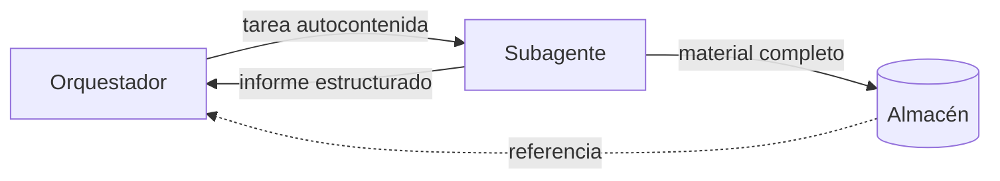

Al terminar esta lección sabrás escribir la tarea de un [[glosario/subagente]] para que la resuelva sin preguntar nada, y sabrás definir qué te devuelve para que el [[glosario/orquestador]] pueda combinar varios informes sin perder información ni llenarse el contexto.

## La idea

Entre dos agentes solo viaja texto. En la ida, la tarea. En la vuelta, el informe. El subagente no ha leído la pregunta original del usuario, no sabe qué han encontrado sus compañeros y no conoce las preferencias que se dijeron tres turnos atrás. Si algo no está en la tarea, no existe para él.

La analogía útil es delegar en una persona competente que acaba de llegar al proyecto. No le dirías «mira lo del cliente». Le dirías qué necesitas, para qué, dónde buscar, dónde no, cuándo parar y cómo quieres el resultado. Anthropic describe este mismo problema en [How we built our multi-agent research system](https://www.anthropic.com/engineering/multi-agent-research-system): con instrucciones vagas, los subagentes duplicaban trabajo o interpretaban mal la tarea.



## La ida: anatomía de una tarea autocontenida

Una buena tarea tiene seis partes. Puedes pedir al orquestador que las rellene describiéndolas en la herramienta `delegar`, o construirlas en tu código si usas la forma programática.

| Parte | Pregunta que responde | Ejemplo |
|---|---|---|
| Objetivo | ¿Qué necesito y para qué? | «Encontrar las opciones de despliegue con colas de trabajo para un servicio Python, para elegir una esta semana.» |
| Contexto | ¿Qué sé ya que cambie la búsqueda? | «El equipo usa PostgreSQL y no quiere gestionar Kubernetes.» |
| Alcance | ¿Qué entra y qué no? | «Solo servicios gestionados. No compares lenguajes.» |
| Fuentes | ¿Dónde buscar? | «Documentación oficial de cada servicio; ignora foros.» |
| Terminado | ¿Cuándo paro? | «Cuando tengas 3 opciones con precio y límites, o tras 6 búsquedas.» |
| Retorno | ¿Qué devuelvo y en qué forma? | «Usa entregar_informe. Cada hallazgo con su URL.» |

El criterio de terminado evita dos fallos opuestos: el subagente que para tras una búsqueda superficial y el que sigue buscando hasta agotar su límite de pasos. El contexto evita que repita trabajo o proponga cosas que el usuario ya descartó.

Cuando el orquestador lanza varios subagentes a la vez, añade una línea de **frontera**: qué cubren los demás. «Otro investigador cubre los precios; tú céntrate en límites técnicos.» Es la forma más barata de evitar duplicados.

## La vuelta: un informe que se pueda combinar

El orquestador va a leer varios informes seguidos. Si cada uno llega en un formato distinto, con distinto nivel de detalle, la síntesis se complica y empeora. Define el formato de vuelta y haz que se cumpla.

Una forma fiable es darle al subagente una herramienta de entrega con `strict: True`. Así sus argumentos cumplen siempre el `input_schema` y el bucle sabe exactamente cuándo ha terminado: cuando el modelo la invoca.

```python title="informe.py"
import anthropic

MODEL = "claude-sonnet-5-5"
client = anthropic.Anthropic()

ENTREGAR = {
    "name": "entregar_informe",
    "description": "Entrega tu informe final. Llámala una sola vez, cuando hayas terminado.",
    "strict": True,
    "input_schema": {
        "type": "object",
        "properties": {
            "hallazgos": {
                "type": "array",
                "items": {
                    "type": "object",
                    "properties": {
                        "afirmacion": {"type": "string"},
                        "fuente": {"type": "string", "description": "URL o identificador"},
                    },
                    "required": ["afirmacion", "fuente"],
                    "additionalProperties": False,
                },
            },
            "no_encontrado": {"type": "array", "items": {"type": "string"}},
            "confianza": {"type": "string", "enum": ["alta", "media", "baja"]},
        },
        "required": ["hallazgos", "no_encontrado", "confianza"],
        "additionalProperties": False,
    },
}

def ejecutar_subagente(tarea: str, herramientas: list, ejecutar, max_pasos: int = 8) -> dict:
    mensajes = [{"role": "user", "content": tarea}]
    for paso in range(max_pasos):
        ultimo = paso == max_pasos - 1
        resp = client.messages.create(
            model=MODEL, max_tokens=2048, tools=herramientas + [ENTREGAR], messages=mensajes,
            # en el último paso obligamos a entregar lo que tenga
            tool_choice={"type": "tool", "name": "entregar_informe"} if ultimo else {"type": "auto"},
        )
        mensajes.append({"role": "assistant", "content": resp.content})
        usos = [b for b in resp.content if b.type == "tool_use"]
        entrega = next((b for b in usos if b.name == "entregar_informe"), None)
        if entrega:
            return entrega.input  # fin: no hace falta responder con tool_result
        if resp.stop_reason != "tool_use":
            return {"hallazgos": [], "no_encontrado": [tarea], "confianza": "baja",
                    "error": f"stop_reason={resp.stop_reason}"}
        mensajes.append({"role": "user", "content": [
            {"type": "tool_result", "tool_use_id": b.id, "content": ejecutar(b.name, b.input)}
            for b in usos
        ]})
    raise AssertionError("inalcanzable: el último paso fuerza la entrega")
```

Tres decisiones de este código merecen explicación. La entrega cierra el bucle: como no vuelves a llamar al modelo, no necesitas responder a ese `tool_use`. En el último paso se usa [[glosario/tool-choice]] para forzar la entrega, de modo que el subagente devuelve algo útil en lugar de cortarse a medias. Y si el modelo se detiene por otro motivo, el resultado sigue la misma forma, con `confianza: "baja"` y la tarea en `no_encontrado`, para que el orquestador lo trate igual que un informe pobre.

> [!aviso] strict no valida el contenido
> El esquema garantiza la forma, no la verdad. Una URL inventada cumple `"type": "string"`. Si las fuentes importan, comprueba en tu código que existen o que salieron de un `tool_result` real del subagente.

## Qué viaja y qué no

El informe tiene que ser corto. El motivo de usar subagentes era que el material intermedio (páginas, resultados largos) se quedara fuera del contexto del orquestador. Si el subagente devuelve todo lo que leyó, pierdes esa ventaja y pagas los tokens dos veces.

Una regla práctica:

- **En el informe**: conclusiones, cada una con su fuente; lo que no encontró; dudas; nivel de confianza.
- **Fuera, por referencia**: documentos completos, tablas grandes, código generado. El subagente los guarda en un almacén (un archivo, un bucket, una tabla) y devuelve el identificador. El orquestador o la síntesis los cargan solo si los necesitan.

Este patrón de pasar referencias en lugar de contenidos es el mismo que propone [Effective context engineering for AI agents](https://www.anthropic.com/engineering/effective-context-engineering-for-ai-agents): mantener en el contexto identificadores ligeros y cargar los datos justo cuando hacen falta.

## Del orquestador a la síntesis

Si los informes son objetos con la misma forma, la síntesis se simplifica. Puedes unir los hallazgos en código, quitar duplicados por fuente y pasar al modelo una lista limpia. También puedes calcular cosas sin modelo: cuántos subagentes devolvieron confianza baja, qué subtareas quedaron en `no_encontrado` y si conviene una segunda ronda.

```python title="sintesis.py"
def combinar(informes: list[dict]) -> tuple[list[dict], list[str]]:
    vistos, hallazgos, huecos = set(), [], []
    for inf in informes:
        for h in inf["hallazgos"]:
            clave = (h["fuente"], h["afirmacion"])
            if clave not in vistos:
                vistos.add(clave)
                hallazgos.append(h)
        huecos += inf["no_encontrado"]
    return hallazgos, huecos
```

## Errores frecuentes

- Escribir tareas de una línea que dependen de la conversación del orquestador («investiga lo que dijo el usuario»).
- Omitir el criterio de terminado y encontrarse subagentes que agotan siempre sus pasos.
- Dejar que cada subagente devuelva texto libre con un formato distinto.
- Devolver el material completo en el informe y llenar el contexto del orquestador.
- Fiarse de las fuentes del informe sin comprobar que salieron de una herramienta.

## Ejercicio

> [!ejercicio] Reescribe tres tareas
> Toma tu orquestador de la lección anterior y registra las tareas que genera para tres preguntas distintas. Reescribe en el prompt del orquestador (o en la descripción de `delegar`) lo necesario para que cada tarea tenga las seis partes. Cambia el subagente para que entregue con `entregar_informe`.
>
> Está bien si las tres tareas nuevas se entienden sin leer la pregunta original, si cada informe llega con la forma del esquema y si al menos una subtarea con poca información devuelve algo en `no_encontrado` en lugar de inventar.

> [!ejercicio]- Pistas
> Una prueba rápida: pega la tarea sola en un chat nuevo y pregúntate si alguien sabría qué hacer. Para provocar `no_encontrado`, haz que el stub de búsqueda devuelva resultados vacíos para una consulta concreta.

## Resumen

- El subagente solo sabe lo que dice la tarea; el orquestador solo sabe lo que dice el informe.
- Una tarea autocontenida tiene objetivo, contexto, alcance, fuentes, criterio de terminado y formato de retorno.
- Una herramienta de entrega con `strict: True` da informes con forma fija y un final claro del bucle.
- El informe lleva conclusiones con fuente; el material grande se guarda aparte y viaja por referencia.
- El esquema garantiza la forma; comprueba tú las fuentes.

## Para seguir

- [[roadmap/60-multiagente/04-paralelismo]]
- [[disciplinas/context-engineering]]
- [[cursos/sistemas-multiagente/03-coordinacion-y-estado]]
