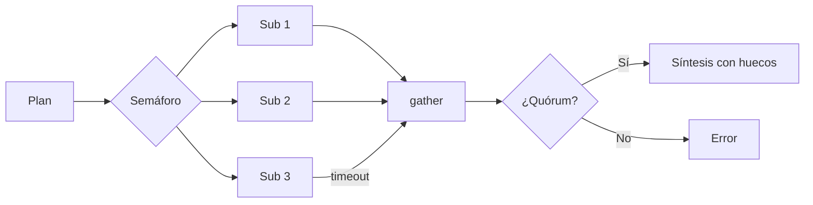

Al terminar esta lección podrás lanzar varios [[glosario/subagente|subagentes]] a la vez, controlar cuántos corren al mismo tiempo y recoger sus resultados aunque alguno falle o se cuelgue. Es lo que convierte un orquestador lento en uno cuyo tiempo de respuesta depende del subagente más lento, no de la suma de todos.

## La idea

Una llamada al modelo pasa casi todo su tiempo esperando la respuesta de red. Mientras espera, tu programa puede lanzar otras llamadas. Con `asyncio` escribes cada subagente como una corrutina y las ejecutas a la vez. El tiempo total pasa de la suma de duraciones al máximo, más lo que añadan planificar y sintetizar.

Lanzar a la vez trae tres problemas nuevos que tienes que resolver en código:

1. **Demasiadas llamadas simultáneas** chocan con los límites de tasa del proveedor o con los de tus propias herramientas.
2. **Un subagente colgado** retiene la respuesta entera.
3. **Un fallo parcial** te obliga a decidir: ¿respondo con cuatro de cinco o no respondo?



## Subagentes asíncronos

El SDK tiene un cliente asíncrono con la misma interfaz. El bucle del subagente es idéntico al de [[roadmap/60-multiagente/02-orquestador-y-subagentes]], con `await` delante de la llamada.

```python tab="Python" title="paralelo.py"
import asyncio
import anthropic

MODEL = "claude-sonnet-5-5"
client = anthropic.AsyncAnthropic()

async def subagente(tarea: str, max_pasos: int = 8) -> str:
    mensajes = [{"role": "user", "content": tarea}]
    for _ in range(max_pasos):
        resp = await client.messages.create(
            model=MODEL, max_tokens=2048, tools=HERRAMIENTAS_SUB, messages=mensajes,
        )
        mensajes.append({"role": "assistant", "content": resp.content})
        if resp.stop_reason == "end_turn":
            return "".join(b.text for b in resp.content if b.type == "text")
        if resp.stop_reason != "tool_use":
            raise RuntimeError(f"stop_reason={resp.stop_reason}")
        resultados = [
            {"type": "tool_result", "tool_use_id": b.id, "content": await ejecutar(b.name, b.input)}
            for b in resp.content if b.type == "tool_use"
        ]
        mensajes.append({"role": "user", "content": resultados})
    raise RuntimeError("agotó sus pasos")

async def acotado(sem: asyncio.Semaphore, tarea: str, timeout_s: float = 120) -> str:
    async with sem:  # como mucho N subagentes a la vez
        return await asyncio.wait_for(subagente(tarea), timeout=timeout_s)

async def lanzar(tareas: list[str], concurrencia: int = 3) -> list[str | BaseException]:
    sem = asyncio.Semaphore(concurrencia)
    return await asyncio.gather(*(acotado(sem, t) for t in tareas), return_exceptions=True)
```

```ts tab="TypeScript" title="paralelo.ts"
// Ejecuta funciones asíncronas con un máximo de `limite` a la vez y no se rompe si alguna falla.
export async function conLimite<T>(
  tareas: (() => Promise<T>)[],
  limite: number,
): Promise<PromiseSettledResult<T>[]> {
  const resultados: PromiseSettledResult<T>[] = new Array(tareas.length);
  let siguiente = 0;
  async function trabajador() {
    while (siguiente < tareas.length) {
      const i = siguiente++;
      try {
        resultados[i] = { status: "fulfilled", value: await tareas[i]() };
      } catch (reason) {
        resultados[i] = { status: "rejected", reason };
      }
    }
  }
  await Promise.all(Array.from({ length: Math.min(limite, tareas.length) }, trabajador));
  return resultados;
}

// uso: await conLimite(tareas.map((t) => () => ejecutarSubagente(t)), 3);
```

`HERRAMIENTAS_SUB` y `ejecutar` son las herramientas del subagente y su despachador, como en lecciones anteriores. Si tus herramientas son síncronas y lentas (una consulta a base de datos con un driver bloqueante), envuélvelas con `await asyncio.to_thread(funcion, ...)` para no bloquear el bucle de eventos.

### Por qué `return_exceptions=True`

Sin esa opción, `gather` propaga la primera excepción y pierdes el acceso directo a los demás resultados. Con ella, recibes una lista en el mismo orden que las tareas, donde cada posición es un resultado o la excepción que lanzó. Es lo que quieres cuando los fallos parciales son aceptables.

Si en tu caso un fallo invalida todo, usa `asyncio.TaskGroup` (Python 3.11 o superior): cancela las demás tareas en cuanto una falla y así no sigues pagando tokens por un resultado que vas a tirar.

### El semáforo y los límites de tasa

El semáforo deja pasar como mucho N subagentes a la vez. Los demás esperan su turno. Elige N según tres cosas: el límite de tasa de tu cuenta (consúltalo en la consola o en la [documentación oficial](https://platform.claude.com/docs)), lo que aguantan tus herramientas y cuántas peticiones de usuarios atiendes a la vez, porque todas comparten esos límites.

El SDK ya reintenta por defecto algunos errores transitorios, como los de límite de tasa, con espera creciente. Puedes ajustarlo con `max_retries` al crear el cliente. Los detalles de reintentos y *backoff* los tienes en [[recetas/reintentos-y-limites-de-tasa]] y en [[roadmap/100-produccion/06-despliegue]].

## Recoger: política de fallos parciales

Decide la política antes de escribir el código. Tres opciones habituales:

| Política | Cuándo | Qué haces |
|---|---|---|
| Todo o nada | El resultado no tiene sentido incompleto (una comparación que exige todos los proveedores) | `TaskGroup`; si falla uno, error al usuario |
| Quórum | Unas partes pueden faltar | Sigues si tienes al menos K de N y declaras los huecos en la respuesta |
| Reintento selectivo | Los fallos suelen ser transitorios | Repites solo las tareas fallidas, una vez, y luego aplicas quórum |

```python title="recoger.py"
async def investigar(pregunta: str, tareas: list[str], quorum: int) -> str:
    salidas = await lanzar(tareas)
    informes = [s for s in salidas if not isinstance(s, BaseException)]
    fallidas = [t for t, s in zip(tareas, salidas) if isinstance(s, BaseException)]
    for t, s in zip(tareas, salidas):
        if isinstance(s, BaseException):
            print(f"subagente falló: {t[:60]!r}: {s!r}")  # en producción, a tu traza
    if len(informes) < quorum:
        raise RuntimeError(f"Solo {len(informes)} de {len(tareas)} subagentes respondieron")
    return await sintetizar(pregunta, informes, huecos=fallidas)
```

La síntesis recibe la lista de subtareas fallidas para decirlo en la respuesta. Una respuesta que admite «no pude consultar la fuente C» es más útil que una que la omite en silencio.

> [!aviso] Un timeout no detiene el gasto anterior
> `wait_for` cancela la corrutina y deja de esperar, pero los tokens de las llamadas que ya terminaron dentro de ese subagente están pagados. Pon también un límite de pasos y un `max_tokens` razonable en cada subagente.

## Varios tool_use en una respuesta

Si usas el subagente como herramienta, el orquestador puede pedir varias delegaciones en la misma respuesta. Ejecútalas a la vez y devuelve un `tool_result` por cada `tool_use`, todos en el mismo mensaje. El orden de `gather` coincide con el de entrada, así que emparejar con `zip` es seguro.

```python title="orquestador_paralelo.py"
usos = [b for b in resp.content if b.type == "tool_use"]
sem = asyncio.Semaphore(3)
salidas = await asyncio.gather(
    *(acotado(sem, b.input["tarea"]) for b in usos), return_exceptions=True
)
mensajes.append({"role": "user", "content": [
    {
        "type": "tool_result",
        "tool_use_id": b.id,
        "content": f"ERROR: {s!r}" if isinstance(s, BaseException) else s,
        "is_error": isinstance(s, BaseException),
    }
    for b, s in zip(usos, salidas)
]})
```

Con `is_error: True` el orquestador sabe que esa delegación falló y puede reintentarla con otra formulación o seguir sin ella. Si prefieres que el modelo pida una sola herramienta por turno, existe la opción `disable_parallel_tool_use` dentro de [[glosario/tool-choice]].

## Con LangGraph: `Send`

En [[roadmap/60-multiagente/02-orquestador-y-subagentes]] viste el orquestador con `Send` de [[herramientas/langgraph|LangGraph]]. Allí el paralelismo ya venía hecho: todos los nodos lanzados con `Send` en el mismo paso corren a la vez, y `{"max_concurrency": N}` en la configuración hace de semáforo. Lo que no viene hecho es la política de fallos. **Si un trabajador lanza una excepción, falla la ejecución entera del grafo**, como un `TaskGroup`. Para un quórum, captura el error dentro del nodo y devuélvelo como dato:

```python tab="LangGraph" title="quorum_langgraph.py"
import operator
from typing import Annotated, TypedDict

from langgraph.graph import END, START, StateGraph
from langgraph.types import Send

from orquestador_langchain import investigador

class Estado(TypedDict):
    tareas: list[str]
    informes: Annotated[list[str], operator.add]
    fallidas: Annotated[list[str], operator.add]    # los huecos también se acumulan

def repartir(state: Estado):
    return [Send("investigar", {"tarea": t}) for t in state["tareas"]]

def investigar(state: dict):
    try:
        r = investigador.invoke({"messages": [("user", state["tarea"])]}, {"recursion_limit": 17})
        return {"informes": [r["messages"][-1].text]}
    except Exception as e:                           # sin esto, un fallo tumba a todos
        return {"fallidas": [f"{state['tarea']}: {e!r}"]}

g = StateGraph(Estado)
g.add_node("investigar", investigar)
g.add_conditional_edges(START, repartir, ["investigar"])
g.add_edge("investigar", END)
grafo = g.compile()

# out = grafo.invoke({"tareas": tareas}, {"max_concurrency": 3})
# if len(out["informes"]) < quorum: ...
```

Para el reintento selectivo, LangGraph tiene `add_node(..., retry_policy=RetryPolicy(max_attempts=2))`, pero solo actúa sobre excepciones que salen del nodo: relanza las transitorias (un error de red) y captura solo las definitivas. El tiempo máximo por trabajador sigue siendo cosa tuya, con el tiempo de espera del cliente del modelo. La receta completa está en [[recetas/map-reduce-con-send]].

## Agentes de código en paralelo: *worktrees*

Todo lo anterior paraleliza **lecturas**: los subagentes buscan y resumen, y uno solo escribe la respuesta. Con agentes de código el reto es otro, porque cada uno **escribe** archivos. Dos agentes editando la misma carpeta se pisan: uno cambia un archivo mientras el otro ejecuta los tests sobre una versión a medias.

La solución habitual es darle a cada agente su propia copia de trabajo con un [[glosario/worktree|worktree]] de git: varias carpetas que comparten el mismo repositorio, cada una en su rama.

```bash title="worktrees.sh"
git worktree add ../tienda-feat-cupones -b feat/cupones     # una carpeta y una rama por agente
git worktree add ../tienda-feat-envios -b feat/envios
# en cada carpeta, una sesión de agente distinta; al terminar, integras rama a rama
git worktree remove ../tienda-feat-cupones
```

Es el mismo patrón de lanzar y recoger, con la escritura aislada: el semáforo es cuántas sesiones abres a la vez, el timeout es el presupuesto de cada sesión y la política de fallos parciales es qué ramas integras. Claude Code lo trae para subagentes con `isolation: worktree` en su definición ([[docs/claude-code/02-subagentes]]). La parte difícil es la integración: tareas que tocan los mismos archivos acaban en conflictos, así que reparte por zonas del código que no se solapan. Las prácticas están en [[disciplinas/trabajo-en-paralelo-con-agentes]] y el paso a paso en [[recetas/features-en-paralelo-con-worktrees]]; Simon Willison describe cómo trabaja así en [*Embracing the parallel coding agent lifestyle*](https://simonwillison.net/2025/Oct/5/parallel-coding-agents/) (oct. 2025).

## Errores frecuentes

- Usar el cliente síncrono dentro de corrutinas: el código parece paralelo pero se ejecuta en serie.
- Lanzar `gather` sin semáforo con cincuenta tareas y recibir una cascada de errores de límite de tasa.
- No poner timeout y dejar que un subagente colgado bloquee la respuesta.
- Olvidar un `tool_result` cuando una de las delegaciones falla.
- Ocultar los huecos en la síntesis.
- Dejar que una excepción en un trabajador de `Send` tumbe todo el grafo.
- Poner a dos agentes de código a escribir en la misma carpeta.

## Ejercicio

> [!ejercicio] Cinco subagentes, uno falla
> Lanza cinco subagentes sobre cinco subtareas con concurrencia 2. Haz que uno lance una excepción y que otro tarde más que el timeout (un `await asyncio.sleep` en su herramienta basta). Aplica una política de quórum 3 de 5 y mide el tiempo total con `time.perf_counter()` comparado con ejecutarlos en serie.
>
> Está bien si la respuesta final llega con 3 informes y menciona las dos subtareas que faltan, si nunca hay más de 2 subagentes a la vez (regístralo con un contador) y si el tiempo en paralelo es claramente menor que en serie.

> [!ejercicio]- Pistas
> Incrementa un contador al entrar en `async with sem` y decreméntalo al salir; registra el máximo. Para la versión en serie, recorre las tareas con un `for` y `await` dentro.

## Resumen

- Con `AsyncAnthropic` y `asyncio.gather` el tiempo total se acerca al del subagente más lento.
- Un semáforo limita la concurrencia; elige el límite según tu límite de tasa, tus herramientas y tu tráfico.
- `return_exceptions=True` te permite recoger éxitos y fallos; `TaskGroup` sirve cuando un fallo invalida todo.
- Decide antes la política de fallos parciales y declara los huecos en la respuesta.
- Varios `tool_use` en una respuesta se ejecutan a la vez y se responden en un solo mensaje, uno por cada uno.
- En LangGraph, `Send` paraleliza y `max_concurrency` limita, pero la política de fallos la escribes tú; los agentes que escriben código, cada uno en su *worktree*.

## Para seguir

- [[roadmap/60-multiagente/05-coste-de-multiplicar-agentes]]
- [[patrones/05-paralelizacion]]
- [[recetas/reintentos-y-limites-de-tasa]]
- [[disciplinas/trabajo-en-paralelo-con-agentes]]
