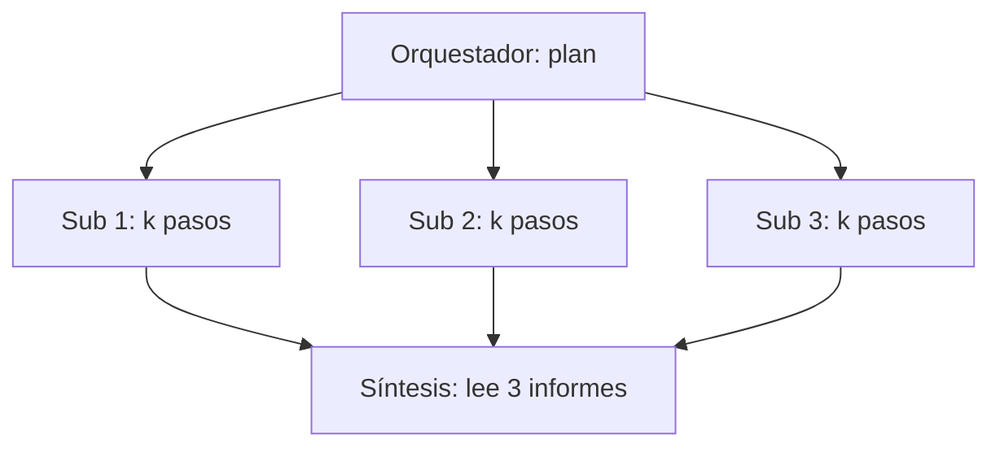

Al terminar esta lección sabrás de dónde sale el gasto de un sistema multiagente, lo medirás llamada a llamada con `usage` y podrás decidir con números si la versión multiagente compensa frente a un agente único.

## La idea

El coste de un modelo se mide en [[glosario/token|tokens]] de entrada y de salida. En un chat, cada turno manda el historial y recibe una respuesta. En un agente, cada paso del [[glosario/bucle-agentico]] vuelve a mandar todo: el [[glosario/prompt-de-sistema]], las definiciones de herramientas, la tarea y todos los resultados de herramientas acumulados. **La entrada de un agente crece con cada paso**, y lo que pagas es la suma de todas esas entradas.

En un sistema multiagente esto se repite en cada subagente y se añaden dos capas: el orquestador, que lee los informes, y la síntesis. Por eso el gasto se multiplica. Anthropic lo dice sin rodeos en [How we built our multi-agent research system](https://www.anthropic.com/engineering/multi-agent-research-system): un agente gasta unas 4 veces los tokens de un chat, su sistema multiagente unas 15 veces, y solo tiene sentido en tareas de valor suficiente. En su análisis sobre BrowseComp, el uso de tokens explicaba por sí solo el 80 % de la varianza del rendimiento: gastar más era, en buena medida, la razón de que respondiera mejor.



## Hacer la cuenta antes de medir

Llama P al prefijo fijo de un subagente (sistema, herramientas y tarea), R a los tokens medios que añade cada paso (la respuesta del modelo más el resultado de la herramienta) y k al número de pasos. El paso i manda aproximadamente P + (i − 1)·R tokens. Sumando los k pasos, la entrada de un subagente es del orden de:

```text
entrada ≈ k·P + R·k·(k − 1)/2
```

Dos conclusiones salen de esa fórmula. El prefijo se paga una vez por paso, así que un prompt de sistema largo pesa mucho en agentes con muchos pasos. Y el término de los resultados crece con el cuadrado de los pasos: un subagente que hace el doble de búsquedas puede costar bastante más del doble si cada resultado es largo.

Multiplica por N subagentes y suma el orquestador y la síntesis. Con un ejemplo hipotético (P = 3.000, R = 1.500, k = 6, N = 4), cada subagente lee unos 18.000 + 22.500 = 40.500 tokens de entrada, y los cuatro unos 162.000, antes de contar orquestador y síntesis. Un agente único que resolviera la pregunta en 10 pasos con el mismo P y R leería unos 30.000 + 67.500 = 97.500. Son números inventados para la cuenta: los tuyos salen de medir.

Fíjate en que el agente único tampoco es gratis. Su historial crece sin parar porque acumula los resultados de todas las búsquedas. Esa es la razón por la que, en algunos casos, repartir contextos puede salir más barato o, sobre todo, dar mejor calidad con el mismo gasto. Solo lo sabrás midiendo.

## Medir con `usage`

Cada respuesta trae `usage` con `input_tokens`, `output_tokens`, `cache_creation_input_tokens` y `cache_read_input_tokens`. Regístralo por rol en cada llamada.

```python title="gasto.py"
from collections import defaultdict
from dataclasses import dataclass

# Precios por millón de tokens de tu modelo. Cópialos de la página de precios oficial:
# cambian con el tiempo y dependen del modelo.
PRECIOS = {"entrada": 0.0, "salida": 0.0, "cache_escritura": 0.0, "cache_lectura": 0.0}

@dataclass
class Gasto:
    llamadas: int = 0
    entrada: int = 0
    salida: int = 0
    cache_escritura: int = 0
    cache_lectura: int = 0

    def coste(self) -> float:
        return (self.entrada * PRECIOS["entrada"] + self.salida * PRECIOS["salida"]
                + self.cache_escritura * PRECIOS["cache_escritura"]
                + self.cache_lectura * PRECIOS["cache_lectura"]) / 1_000_000

GASTOS: dict[str, Gasto] = defaultdict(Gasto)

def registrar(rol: str, resp) -> None:
    u, g = resp.usage, GASTOS[rol]
    g.llamadas += 1
    g.entrada += u.input_tokens
    g.salida += u.output_tokens
    g.cache_escritura += u.cache_creation_input_tokens or 0
    g.cache_lectura += u.cache_read_input_tokens or 0

def informe() -> None:
    total = 0.0
    for rol, g in GASTOS.items():
        total += g.coste()
        print(f"{rol:12} {g.llamadas:3} llamadas  in={g.entrada:>8}  out={g.salida:>7}  "
              f"cache_r={g.cache_lectura:>8}  ${g.coste():.4f}")
    print(f"{'TOTAL':12} ${total:.4f}")
```

Llama a `registrar("orquestador", resp)`, `registrar("subagente", resp)` o `registrar("sintesis", resp)` justo después de cada `messages.create`. Si quieres el detalle por subagente concreto (cuál de los cinco se disparó), usa como rol `f"subagente:{tarea_id}"`; la receta [[recetas/coste-por-subagente]] lo lleva a una tabla y a las trazas. Con subagentes en paralelo no hay problema de concurrencia: `asyncio` ejecuta un solo hilo y las sumas no se pisan.

`input_tokens` cuenta la entrada que no se leyó de caché ni se escribió en ella. Y en los modelos 5.x el razonamiento adaptativo está activo por defecto: sus tokens se cobran como salida y van dentro de `output_tokens` (el desglose, en `usage.output_tokens_details`), así que un subagente que «piensa» mucho cuesta más aunque su informe sea corto. Las otras dos columnas cubren esa parte, y por eso hay que sumar las tres para saber cuánta entrada procesó el modelo en total.

```text
# salida de ejemplo
orquestador    3 llamadas  in=    9120  out=   1840  cache_r=       0  $0.0000
subagente     22 llamadas  in=  141300  out=   9650  cache_r=   48200  $0.0000
sintesis       1 llamadas  in=    6400  out=    910  cache_r=       0  $0.0000
TOTAL          $0.0000
```

El coste sale a cero hasta que rellenes `PRECIOS`. Hazlo con los valores oficiales del modelo que uses.

Para estimar antes de ejecutar, `client.messages.count_tokens(model=MODEL, messages=…)` devuelve `.input_tokens` de una petición sin ejecutarla. Sirve para saber cuánto pesa tu prefijo P.

## Palancas para reducir el gasto

Ordenadas de más a menos fáciles de aplicar:

1. **Menos subagentes.** Limita el plan a las subtareas que de verdad son independientes. Dos buenas suelen valer más que cinco solapadas.
2. **Resultados de herramienta más cortos.** Si `buscar` devuelve páginas enteras, R se dispara. Devuelve fragmentos y URLs. Es la palanca con más efecto según la fórmula.
3. **Menos pasos por subagente.** Un criterio de terminado claro en la tarea ([[roadmap/60-multiagente/03-pasar-contexto-entre-agentes]]) y un `max_pasos` bajo.
4. **[[glosario/prompt-caching]] del prefijo.** Todos los subagentes comparten sistema y herramientas. Cachearlo hace que las lecturas posteriores cuesten mucho menos. Lo verás con código en [[roadmap/100-produccion/02-costes-y-prompt-caching]].
5. **Un modelo más rápido y barato en los subagentes.** Mide si la calidad aguanta con [[roadmap/80-evals/index|evals]] antes de cambiar.
6. **`max_tokens` y [[glosario/esfuerzo]] ajustados** a lo que cada rol necesita. El informe de un subagente no necesita tanto margen de salida como la síntesis, y un subagente que solo busca puede ir con `output_config={"effort": "low"}`.
7. **Un tope de gasto por ejecución.** Además de medir, corta: suma el coste en `registrar` y para cuando pase de un umbral, como el presupuesto de [[roadmap/40-primer-agente/03-condiciones-de-parada]]. Si usas el [[herramientas/claude-agent-sdk|Claude Agent SDK]], `max_budget_usd` hace eso por ti.

> [!consejo] Compara con la misma vara
> La pregunta que importa es cuánto cuesta una respuesta buena. Si la versión multiagente cuesta el triple y acierta lo mismo que el agente único, pierdes. Si acierta claramente más en preguntas de valor alto, puede compensar. Necesitas las dos medidas: gasto y calidad.

## Errores frecuentes

- Contar solo los tokens de los subagentes y olvidar orquestador y síntesis.
- Mirar solo `input_tokens` y no sumar las columnas de caché.
- Copiar precios en el código sin fecha ni fuente y olvidar actualizarlos.
- Comparar una sola pregunta. La variación entre ejecuciones es grande: usa varias.
- Optimizar el gasto sin medir antes la calidad.

## Ejercicio

> [!ejercicio] Tabla de gasto real
> Instrumenta con `registrar` tu orquestador de la lección anterior y un agente único con las mismas herramientas. Ejecuta ambos sobre las mismas 5 preguntas. Rellena `PRECIOS` con los valores oficiales actuales de tu modelo, anotando la fecha. Construye una tabla con, por pregunta y sistema: llamadas, tokens de entrada totales (incluida caché), tokens de salida, coste y segundos.
>
> Está bien si la tabla tiene las 10 filas, si los totales cuadran con la suma por rol y si escribes en dos frases qué sistema elegirías para tus preguntas y por qué, citando los números.

> [!ejercicio]- Pistas
> Reinicia `GASTOS` entre preguntas (`GASTOS.clear()`). Para los segundos, `time.perf_counter()` antes y después de cada ejecución. Si no tienes evals todavía, puntúa la calidad de 1 a 3 a mano con un criterio escrito antes de mirar las respuestas.

## Resumen

- En un agente, cada paso vuelve a enviar todo el historial: la entrada crece con los pasos.
- En multiagente eso se repite por subagente y se suman orquestador y síntesis.
- Registra `usage` por rol en cada llamada y suma entrada, caché y salida.
- Las palancas principales: menos subagentes, resultados cortos, menos pasos, caché del prefijo y modelo adecuado por rol.
- La decisión final compara coste y calidad sobre las mismas preguntas.

## Para seguir

- [[roadmap/80-evals/index]]
- [[roadmap/100-produccion/02-costes-y-prompt-caching]]
- [[docs/produccion/02-costes-y-limites]]
- [[recetas/coste-por-subagente]]
