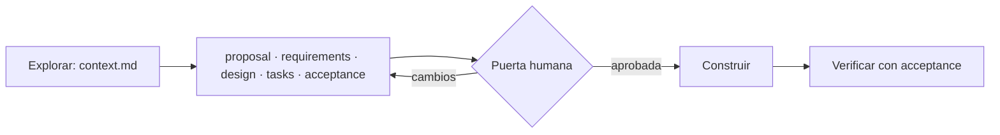

Al terminar esta lección sabrás por qué un encargo improvisado a un agente de código sale caro, qué documentos sustituyen a ese encargo y quién es responsable de cada uno. También sabrás cuándo todo esto sobra, que es la mitad de la habilidad.

## La idea

*Vibe coding* es pedirle código al agente con una frase, mirar si «parece que funciona» y volver a pedir. Para un prototipo de una tarde va bien. Para algo que vas a mantener falla de tres maneras previsibles:

1. **El agente rellena los huecos con suposiciones.** «Añade slugs a los artículos» no dice qué pasa con las tildes, con dos títulos iguales ni con un artículo ya publicado. Cada suposición equivocada es trabajo tirado o, peor, un cambio que parece bueno y no lo es.
2. **No hay criterio objetivo de terminado.** Si no está escrito cómo se demuestra, «hecho» significa «el agente dice que está hecho».
3. **El alcance se desliza.** Sin un documento que diga qué queda fuera, el agente refactoriza lo que no le pediste.

*Spec-driven development* ([[glosario/sdd|SDD]]) invierte el orden: se escribe qué hay que construir y cómo se comprobará, una persona lo aprueba y el agente trabaja contra eso. La revisión también cambia: ya no juzgas si el diff «te gusta», compruebas si cumple lo aprobado.

## Los cinco artefactos

Una especificación útil se reparte en archivos pequeños, cada uno con una pregunta. Así se pueden revisar por separado y cada agente lee solo el que necesita.

| Artefacto | Pregunta que responde | Contenido mínimo |
|---|---|---|
| `proposal.md` | ¿Por qué y para quién? | Problema, alcance (dentro y fuera), supuestos |
| `requirements.md` | ¿Qué debe hacer? | Requisitos con ID (`FR-01`, `NFR-01`), escritos en [[glosario/ears|EARS]] |
| `design.md` | ¿Cómo se hará? | Archivos y módulos, interfaces, datos, decisiones y riesgos |
| `tasks.md` | ¿En qué pasos? | Tareas `T-01…` con el requisito que cubren y cómo se verifican |
| `acceptance.yaml` | ¿Cómo se demuestra? | Comprobaciones ejecutables (comandos, archivos) trazadas a los requisitos |

Antes de todo eso suele haber un `context.md`: lo que el agente averiguó explorando el código (dónde vive lo relacionado, qué tests hay, qué convenciones sigue el repo). No es parte de la spec, pero sin él el diseño se inventa.

## Quién escribe cada uno

La regla que más ayuda es **un solo escritor por artefacto**. En el harness del autor está repartido entre agentes con contexto limpio: un *explorer* escribe `context.md`; un *designer* escribe los cinco de la spec; un *builder* implementa y no puede tocar la spec; un *reviewer* verifica y no puede tocar el código. La persona aprueba la spec en un único punto, la [[glosario/puerta-humana|puerta humana]] (lección 5).

Con un solo agente funciona igual si separas las fases en conversaciones distintas:

| Fase | Quién | Qué no puede hacer |
|---|---|---|
| Explorar | El agente, solo lectura | Editar nada |
| Especificar | El agente redacta, tú corriges | Escribir código |
| Aprobar | Tú | Delegarlo en un «ok» ambiguo |
| Construir | El agente | Cambiar la spec o la aceptación |
| Verificar | Otro agente o una sesión nueva | Arreglar el código que revisa |

Tú también puedes escribir la spec entera. Lo importante es que exista **antes** del código y que quien construye no sea quien decide cuándo está terminado.

## Lo que hay ahí fuera

SDD se volvió un movimiento entre 2025 y 2026, con herramientas que proponen la misma secuencia con nombres distintos:

- **GitHub Spec Kit** (anunciado el 2 de septiembre de 2025): una CLI que prepara el repositorio con una «constitución» del proyecto y fases para especificar el qué y el porqué, planificar el cómo, partir en tareas e implementar. Consulta en su web los nombres actuales de los comandos.
- **Kiro** (AWS): un IDE que guarda cada spec en `requirements.md` (con criterios en EARS), `design.md` y `tasks.md`.
- **Tessl**: apunta a que la spec sea la fuente y el código se genere a partir de ella.

Birgitta Böckeler, en [*Understanding Spec-Driven-Development*](https://martinfowler.com/articles/exploring-gen-ai/sdd-3-tools.html) (octubre de 2025), distingue tres niveles que te sirven para situarte:

- **Spec-first**: escribes la spec antes de la tarea y luego la dejas.
- **Spec-anchored**: la spec se guarda y evoluciona con la funcionalidad.
- **Spec-as-source**: solo editas la spec y el código se regenera.

Este nivel trabaja en *spec-first* con un pie en *spec-anchored*: la spec se queda en el repositorio como contexto para el siguiente cambio.

## Cuándo merece la pena y cuándo no

Böckeler documenta los riesgos con casos reales: montones de Markdown repetitivo que cuesta más revisar que el código, un fallo pequeño convertido en cuatro historias con dieciséis criterios, y una falsa sensación de control cuando el agente ignora la spec o la sigue en exceso. La respuesta es **escalar la ceremonia al tamaño y al riesgo del cambio**:

| Cambio | Qué escribir |
|---|---|
| Errata, renombrado, ajuste de estilo | Nada. Encargo directo y revisión del diff |
| Fallo con reproducción clara | Un test que falla hoy y dos líneas de contexto |
| Funcionalidad en un módulo | Spec corta: requisitos EARS, tareas y aceptación en una página |
| Varios módulos, datos del usuario, seguridad, migraciones | Los cinco artefactos y la puerta humana con calma |

Si dudas, pregúntate qué pasa si el agente se equivoca sin que lo notes. Si la respuesta es «nada grave», sobra la spec.

## Errores frecuentes

- Escribir la spec después del código, para justificar el PR.
- Mezclar el qué con el cómo: requisitos que ya dicen qué clase crear.
- Una spec tan larga que nadie la lee entera, ni tú.
- Dejar que el agente que construye edite la aceptación «porque estaba mal».

## Ejercicio

> [!ejercicio] Del encargo de una línea a una spec
> Toma el último encargo que le hiciste a tu agente en una sola frase. Escribe para él una `proposal.md` de diez líneas como máximo, con tres apartados: problema, dentro del alcance y fuera del alcance. Después lista cinco suposiciones que el agente tuvo que hacer porque tu frase no las resolvía.
>
> **Está bien si**: el apartado «fuera» tiene al menos dos puntos, cada suposición podría haber salido distinta sin que el agente se equivocara de forma evidente, y con la tabla de arriba puedes justificar si ese cambio necesitaba una spec completa o no.

> [!ejercicio]- Pistas
> Las suposiciones suelen esconderse en los bordes: entradas vacías, duplicados, permisos, qué pasa con los datos que ya existen y qué hacer cuando algo falla.

## Resumen

- El *vibe coding* falla por suposiciones, por falta de criterio de terminado y por deriva de alcance.
- Una spec son cinco artefactos pequeños: propuesta, requisitos, diseño, tareas y aceptación.
- Un solo escritor por artefacto; quien construye no decide cuándo está terminado.
- Spec Kit, Kiro y Tessl aplican la misma idea con distintos grados de spec-as-source.
- La ceremonia se ajusta al tamaño y al riesgo del cambio.

## Para seguir

- [[roadmap/70-flujos-con-especificacion/02-requisitos-en-ears]]
- [[disciplinas/spec-primero]]
- [[plantillas/spec-con-ears]]
- [[cursos/harness-engineering/07-spec-congelada-y-aceptacion]]
