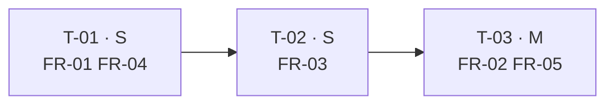

Al terminar esta lección tendrás un `design.md` y un `tasks.md` que un agente puede seguir paso a paso sin inventar nada, y un script corto, sin dependencias, que rechaza las tareas vagas antes de que el agente las lea. Seguimos con la funcionalidad de slugs de la lección anterior.

## La idea

Los requisitos dicen **qué**. El diseño dice **cómo**, y las tareas dicen **en qué orden y cómo se comprueba cada paso**. Un agente de código ejecuta bien una tarea cuando cumple tres condiciones:

1. **Sabe dónde tocar**: archivos concretos, no «la capa de servicios».
2. **Sabe cuándo ha terminado**: un comando que hoy falla y pasará al acabar.
3. **No depende de algo que aún no existe**: sus dependencias ya están hechas.

Si falta cualquiera de las tres, el agente rellena el hueco y vuelves al *vibe coding*.

## El diseño, en una página

`design.md` no es un documento de arquitectura. Es la lista de decisiones que el agente no debe tomar por su cuenta:

```markdown title="design.md"
## Decisiones
- El slug se calcula en un único sitio, `src/slug.py`; `src/articulos.py` lo importa y no normaliza por su cuenta.
- Normalización con `unicodedata` de la biblioteca estándar: sin dependencias nuevas.
- `slug_libre` recibe el conjunto de slugs existentes en lugar de consultar la base de datos: se prueba sin infraestructura.

## Interfaces
- `slugificar(titulo: str) -> str`; lanza `TituloVacio("TITULO_VACIO")`.
- `slug_libre(titulo: str, existentes: set[str]) -> str`.
- `publicar(articulo: dict, existentes: set[str]) -> dict`.

## Archivos
- Nuevos: `src/slug.py`, `src/articulos.py`, `tests/test_slug.py`, `tests/test_articulos.py`.
- No se tocan: plantillas, rutas web, esquema de base de datos.

## Riesgos
- Artículos antiguos con slugs en otro formato: no se migran (fuera de alcance en `proposal.md`).
```

Las secciones «No se tocan» y «Riesgos» son las que más trabajo ahorran: dicen al agente dónde parar.

## Tareas que se pueden ejecutar

Cada tarea de `tasks.md` lleva siempre los mismos campos:

```markdown title="tasks.md"
## T-01 · Normalizar títulos a slug
- Cubre: FR-01, FR-04
- Archivos: src/slug.py, tests/test_slug.py
- Tamaño: S
- Depende de: —
- Verifica: pytest -q tests/test_slug.py -k "fr01 or fr04"

## T-02 · Resolver colisiones con sufijo
- Cubre: FR-03
- Archivos: src/slug.py, tests/test_slug.py
- Tamaño: S
- Depende de: T-01
- Verifica: pytest -q tests/test_slug.py -k fr03

## T-03 · Generar el slug al publicar y conservarlo después
- Cubre: FR-02, FR-05
- Archivos: src/articulos.py, tests/test_articulos.py
- Tamaño: M
- Depende de: T-02
- Verifica: pytest -q tests/test_articulos.py
```

Los tamaños siguen la escala que usa el autor en sus planes:

| Tamaño | Qué es |
|---|---|
| **S** | Un módulo, cambio acotado |
| **M** | Un módulo con una interfaz o una API nueva |
| **L** | Varios módulos o un núcleo delicado |

No hay XL: si una tarea no cabe en L, **pártela**. Una tarea bien partida termina en un cambio que podrías revisar y aceptar por separado ([[disciplinas/cambios-pequenos-y-revisables]]).



## Prohibido el «etc.»

En el prompt con el que el autor genera planes de implementación hay una regla sin excepciones: rutas, módulos, firmas, comandos exactos y casos de prueba con valores; **prohibido «etc.», «según convenga», «manejar errores adecuadamente» o cualquier frase que un agente no pueda comprobar**. Cada una de esas expresiones es una decisión que delegas sin darte cuenta.

| Vago | Concreto |
|---|---|
| Manejar errores adecuadamente | Si el título queda vacío, lanzar `TituloVacio("TITULO_VACIO")` (FR-04) |
| Tocar los archivos necesarios | `src/articulos.py`, `tests/test_articulos.py` |
| Añadir tests, etc. | `test_fr02_…` y `test_fr05_…` en `tests/test_articulos.py` |
| Verificar que funciona | `pytest -q tests/test_articulos.py` |

## Una sola fuente de verdad por dato

El segundo principio del mismo prompt: **cada dato vive en un único sitio y lo demás se genera o lo referencia**. En sus planes grandes, el orden y las dependencias de todas las features están en un único `backlog.yaml` del que se generan catálogos, tablas y la cola de trabajo; las reglas del proyecto, en `AGENTS.md`; el vocabulario, en un documento propio. Nada se copia a mano entre documentos si se puede generar.

Aplicado a una spec pequeña:

- **Los requisitos** viven en `requirements.md`. Las tareas y la aceptación los citan por ID (`Cubre: FR-03`), nunca copian el texto. Si copias la frase, mañana habrá dos versiones distintas.
- **Las dependencias** viven en cada tarea (`Depende de`). El orden de ejecución **se calcula**, no se escribe aparte.
- **Los comandos del proyecto** (tests, lint, build) viven en `AGENTS.md`; las tareas eligen qué subconjunto ejecutar.

## Un validador para el plan

Este script comprueba lo que un humano olvida al revisar: campos completos, tamaños válidos, IDs que existen, requisitos sin tarea, palabras vagas y ciclos. Además calcula el orden.

```python title="validar_tareas.py"
"""Comprueba que tasks.md es ejecutable por un agente: trazado, concreto y sin ciclos."""
import re
import sys
from pathlib import Path

VAGAS = re.compile(r"\betc\b\.?|según convenga|adecuadamente|lo necesario|y demás", re.I)
CAMPOS = ("Cubre", "Archivos", "Tamaño", "Depende de", "Verifica")

def leer_tareas(texto: str) -> dict[str, dict]:
    tareas = {}
    for bloque in re.split(r"^## ", texto, flags=re.M)[1:]:
        cabecera, *lineas = bloque.strip().splitlines()
        campos = dict(re.findall(r"^- ([^:]+): (.*)$", "\n".join(lineas), re.M))
        tareas[cabecera.split("·")[0].strip()] = {"Título": cabecera, **campos}
    return tareas

def orden(tareas: dict) -> list[str]:
    """Orden topológico de las tareas; ValueError si hay un ciclo."""
    hechas, en_curso, salida = set(), set(), []
    def visitar(t: str) -> None:
        if t in hechas:
            return
        if t in en_curso:
            raise ValueError(f"ciclo de dependencias en {t}")
        en_curso.add(t)
        for d in re.findall(r"T-\d+", tareas[t].get("Depende de", "")):
            if d in tareas:
                visitar(d)
        en_curso.discard(t)
        hechas.add(t)
        salida.append(t)
    for t in tareas:
        visitar(t)
    return salida

def problemas(requisitos: str, texto_tareas: str) -> tuple[list[str], list[str]]:
    reqs = set(re.findall(r"\*\*(N?FR-\d+)\*\*", requisitos))
    tareas = leer_tareas(texto_tareas)
    errores, cubiertos = [], set()
    for tid, t in tareas.items():
        errores += [f"{tid}: falta «{c}»" for c in CAMPOS if not t.get(c)]
        if t.get("Tamaño") and t["Tamaño"] not in ("S", "M", "L"):
            errores.append(f"{tid}: tamaño {t['Tamaño']!r}: si no es S, M o L, pártela")
        for fr in re.findall(r"N?FR-\d+", t.get("Cubre", "")):
            if fr in reqs:
                cubiertos.add(fr)
            else:
                errores.append(f"{tid}: cubre {fr}, que no existe")
        errores += [f"{tid}: depende de {d}, que no existe"
                    for d in re.findall(r"T-\d+", t.get("Depende de", "")) if d not in tareas]
        vagas = VAGAS.findall(" ".join(t.values()))
        if vagas:
            errores.append(f"{tid}: texto que un agente no puede comprobar: {vagas}")
    errores += [f"{fr}: ninguna tarea lo cubre" for fr in sorted(reqs - cubiertos) if fr.startswith("FR")]
    try:
        return errores, orden(tareas)
    except ValueError as e:
        return errores + [str(e)], []

if __name__ == "__main__":
    carpeta = Path(sys.argv[1] if len(sys.argv) > 1 else "spec")
    errores, secuencia = problemas((carpeta / "requirements.md").read_text(encoding="utf-8"),
                                   (carpeta / "tasks.md").read_text(encoding="utf-8"))
    for e in errores:
        print("✗", e)
    if secuencia:
        print("Orden:", " → ".join(secuencia))
    print(f"{len(errores)} problemas" if errores else "tasks.md listo para el agente")
    sys.exit(1 if errores else 0)
```

Con un primer borrador en el que la tarea T-03 decía «Generar el slug al publicar y manejar errores adecuadamente», listaba `src/articulos.py, etc.`, dependía de una T-05 inexistente y no tenía comando de verificación:

```text
$ python3 validar_tareas.py spec
✗ T-03: falta «Verifica»
✗ T-03: depende de T-05, que no existe
✗ T-03: texto que un agente no puede comprobar: ['adecuadamente', 'etc.']
✗ FR-05: ninguna tarea lo cubre
Orden: T-01 → T-02 → T-03
4 problemas
```

Con el `tasks.md` de arriba:

```text
$ python3 validar_tareas.py spec
Orden: T-01 → T-02 → T-03
tasks.md listo para el agente
```

Si una dependencia apunta hacia atrás (T-01 depende de T-03), el script responde `✗ ciclo de dependencias en T-01` y sale con código 1. Puedes ejecutarlo en CI o pedir al agente que lo pase antes de presentarte el plan.

## Cómo lo usa el agente

Con el plan validado, el encargo de construcción cabe en tres líneas: «Ejecuta las tareas de `tasks.md` en el orden calculado. Antes de pasar a la siguiente, ejecuta su `Verifica` y pega la salida. No cambies `requirements.md`, `design.md` ni `tasks.md`; si algo no encaja, para y dímelo». La última frase es la importante: el plan aprobado no se reescribe durante la construcción (lo verás en la lección 5).

## Errores frecuentes

- Tareas por capa («hacer el modelo», «hacer la API») en lugar de por comportamiento comprobable.
- Una tarea L que en realidad son tres: si su `Verifica` necesita tres comandos, pártela.
- Copiar el texto de los requisitos en las tareas y que luego diverjan.
- Dejar el orden escrito a mano en otro documento que nadie actualiza.

## Ejercicio

> [!ejercicio] Un plan que pase el validador
> Para la funcionalidad de tu proyecto, escribe `design.md` (una página como máximo) y `tasks.md` con entre tres y siete tareas. Pasa `validar_tareas.py` hasta que salga en verde.
>
> **Está bien si**: el validador termina con `tasks.md listo para el agente`, cada tarea toca como mucho dos módulos, ningún requisito `FR` se queda sin tarea, cada `Verifica` es un comando que hoy falla y `design.md` tiene una sección «No se tocan» con al menos un elemento.

> [!ejercicio]- Pistas
> Si te salen más de siete tareas, la funcionalidad es grande: pártela en dos specs. Si un `Verifica` no puedes escribirlo, probablemente la tarea mezcla dos comportamientos.

## Resumen

- El diseño fija las decisiones que el agente no debe tomar: archivos, interfaces, qué no se toca y riesgos.
- Cada tarea tiene requisito, archivos, tamaño (S, M o L), dependencias y un comando que la verifica.
- Prohibido «etc.» y cualquier frase que un agente no pueda comprobar.
- Una sola fuente de verdad por dato: se cita por ID y el orden se calcula.
- Un validador pequeño convierte esas reglas en un error visible.

## Para seguir

- [[roadmap/70-flujos-con-especificacion/04-aceptacion-ejecutable]]
- [[plantillas/prompt-plan-de-implementacion]]
- [[disciplinas/cambios-pequenos-y-revisables]]
- [[recetas/maquina-de-estados-con-guards]]
