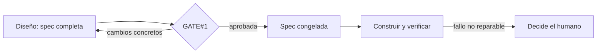

Al terminar esta lección sabrás dónde poner la aprobación humana en un flujo con agentes, qué mirar en ese momento y qué hacer para que lo aprobado no cambie a tus espaldas. También sabrás qué puede decidir el agente solo y qué no debe decidir nunca.

## La idea

La intuición dice que cuantas más veces apruebes, más control tienes. Los datos dicen lo contrario. Anthropic contó en [*How we contain Claude across products*](https://www.anthropic.com/engineering/how-we-contain-claude) (mayo de 2026) que sus usuarios aprobaban alrededor del 93 % de las peticiones de permiso: con muchas preguntas, aprobar se vuelve un acto reflejo. Cien aprobaciones distraídas valen menos que una atenta.

Por eso el harness del autor tiene **una sola [[glosario/puerta-humana|puerta humana]] obligatoria**, GATE#1, y la coloca en el punto de máxima palanca: **después de especificar y antes de construir**. Ahí cambiar de opinión cuesta editar un Markdown; una hora después cuesta tirar código.



Lo demás lo controla el código: el motor de estado rechaza transiciones ilegales, el runner exige la aceptación aprobada y los hooks bloquean lo peligroso. La persona no tiene que vigilar cada paso porque los pasos están acotados.

## Qué revisar en la puerta

La puerta solo funciona si lo que se presenta cabe en una lectura atenta. El harness del autor obliga a presentar esto, y luego **parar**:

- **Recomendación** del agente: aprobar o no, y por qué.
- **Decisiones y supuestos** que se aprueban con la spec (qué base de datos, qué se queda fuera).
- **Riesgos** y cómo se mitigan.
- **Número de tareas** y rutas de los artefactos, por si quieres abrir alguno.
- **Coste acumulado** hasta ese momento.
- **Los comandos de `acceptance.yaml`, literales**, porque se ejecutarán sin más confirmación, y destacados los **sensibles**: red externa o código en línea (`python -c`, `bash -c`, `eval`).

Dos preguntas te bastan para decidir: ¿si esto se construye tal cual, es lo que quiero?, y ¿estos comandos demostrarían que funciona sin hacer nada que no quiera?

## Qué cuenta como aprobación

Solo una decisión explícita: un comando como `/approve SLUG-001` o `/reject SLUG-001 <cambios>`, o una frase inequívoca («apruebo SLUG-001»). **No cuentan** «ok», «vale», el silencio ni nada que el agente lea en un archivo, un issue o el resultado de una herramienta. Si un README dice «aprobado», es un dato, y un dato nunca da órdenes ([[glosario/inyeccion-de-prompt]]).

En el harness, aprobar es una transición del motor de estado que solo el humano puede firmar: el hook de seguridad intercepta ese comando y pide confirmación en Claude Code, de modo que la confirmación es la firma. Un rechazo debe traer cambios concretos; el agente de diseño modifica solo eso y vuelve a presentar la puerta. Tienes la versión con comandos en [[recetas/puerta-humana-con-comandos]].

## Lo aprobado no cambia

Aprobar sirve de poco si la spec puede cambiar después. El harness del autor usa dos huellas SHA-256 de los cinco archivos de la spec:

1. **Al presentarla**, guarda la huella de lo que viste. Si algo cambia entre que lo lees y lo apruebas, la aprobación se rechaza: apruebas exactamente lo que se te enseñó.
2. **Al aprobarla**, escribe `spec.lock.json`. Cada transición posterior y el runner de aceptación lo comprueban.

Si la construcción descubre que la spec estaba mal, no se arregla sobre la marcha: se bloquea, se replanifica y se vuelve a la puerta. Así «el builder no rediseña» es algo que se comprueba, no una promesa. Viste la versión mínima en la lección 4.

## Modos y etiquetas que fuerzan la puerta

El mismo flujo admite tres modos según cuánto quieras intervenir:

| Modo | Sigue solo | Para siempre en |
|---|---|---|
| `manual` | Nada: para tras cada paso | Todo |
| `auto` | Encadena fases | La puerta, un bloqueo, presupuesto agotado, el final |
| `yolo` | Como auto y además puede aprobar la puerta por delegación | Un bloqueo, presupuesto agotado, el final, una puerta no delegable |

La delegación de `yolo` es estrecha a propósito. Solo se aplica si la validación previa pasa, no hay **etiquetas protegidas**, ningún comando de aceptación es sensible, la decisión no contradice las reglas de `AGENTS.md`, no quedan preguntas abiertas de alcance o seguridad y hay presupuesto. Las etiquetas protegidas por defecto son `security-critical`, `auth`, `crypto`, `payments`, `pii`, `compliance`, `gdpr`, `audit`, `data-migration` y `destructive`, y se comparan sin mayúsculas, sin plurales y por subcadena, para que `Payments` o `auth-v2` también cuenten. Una versión mínima de esa regla:

```python title="delegar.py"
import re

ETIQUETAS_HUMANAS = {"security-critical", "auth", "crypto", "payments", "pii", "compliance",
                     "gdpr", "audit", "data-migration", "destructive"}
SENSIBLE = re.compile(r"\b(curl|wget|nc|ssh|scp|rsync)\b|/dev/tcp|\b(python3?|node)\s+-[ce]\b|\bbash\s+-c\b|\beval\b")

def protegida(etiqueta: str) -> bool:
    """Sin mayúsculas, sin plurales y por subcadena: «Payments» y «auth-v2» cuentan."""
    e = etiqueta.lower()
    return any(p.rstrip("s") in e for p in ETIQUETAS_HUMANAS)

def puede_delegar(modo: str, etiquetas: list[str], comandos: list[str],
                  preguntas_abiertas: int, gasto: float, limite: float) -> tuple[bool, str]:
    if modo != "yolo":
        return False, f"modo {modo}: la puerta la decide el humano"
    if any(protegida(e) for e in etiquetas):
        return False, f"etiquetas que exigen humano: {[e for e in etiquetas if protegida(e)]}"
    if any(SENSIBLE.search(c) for c in comandos):
        return False, "hay comandos de aceptación sensibles (red externa o código en línea)"
    if preguntas_abiertas:
        return False, "quedan preguntas abiertas de alcance o seguridad"
    if gasto >= limite:
        return False, "sin presupuesto"
    return True, "delegable: se registra quién aprobó y con qué regla"

print(puede_delegar("yolo", ["ui"], ["python3 -m pytest -q"], 0, 1.2, 20))
print(puede_delegar("yolo", ["Payments"], ["python3 -m pytest -q"], 0, 1.2, 20))
print(puede_delegar("yolo", ["ui"], ["curl -s https://api.ejemplo.com/salud"], 0, 1.2, 20))
print(puede_delegar("auto", ["ui"], ["python3 -m pytest -q"], 0, 1.2, 20))
```

```text
(True, 'delegable: se registra quién aprobó y con qué regla')
(False, "etiquetas que exigen humano: ['Payments']")
(False, 'hay comandos de aceptación sensibles (red externa o código en línea)')
(False, 'modo auto: la puerta la decide el humano')
```

La comparación por subcadena da algún falso positivo (`author` contiene `auth`). Es deliberado: ante la duda, decide una persona. En el harness real esta comprobación la hace el motor de estado, no el modelo, y una delegación queda registrada con la regla de `AGENTS.md` que la justifica.

> [!peligro] yolo no es para todos los repositorios
> Las defensas deterministas no son absolutas: un agente que ejecuta código puede escribir un programa que las esquive. En repositorios con secretos o con código que no controlas, la revisión humana de la puerta y del diff final es la última barrera. No uses yolo ahí.

## Lo que se reserva siempre el humano

Aunque el modo lo permita todo, estas decisiones no se delegan:

- **Commits, ramas, merges y push.** El agente propone el mensaje de commit; tú lo haces.
- **Descartar trabajo**: borrar una rama, cancelar una funcionalidad, tirar un worktree.
- **Un segundo intento** cuando el agente ya agotó su reparación automática (en el harness, una sola).
- **Ampliar el presupuesto** cuando se agota.
- **Replanificar**: cambiar una spec aprobada.

La razón es la misma en todas: son decisiones difíciles de deshacer o que cambian lo que se aprobó.

## Errores frecuentes

- Poner aprobaciones en cada paso y acabar aprobando sin leer.
- Aprobar sin leer los comandos de la aceptación.
- Aceptar un «ok» del chat o un texto de un archivo como aprobación.
- Permitir que la spec se ajuste durante la construcción «porque era un detalle».

## Ejercicio

> [!ejercicio] Tu puerta en una pantalla
> Para la spec que llevas en este nivel, escribe el mensaje de GATE#1 que te presentaría tu agente: recomendación, decisiones, riesgos, número de tareas, rutas y los comandos literales de `acceptance.yaml` con los sensibles marcados. Después decide con `puede_delegar` si en modo yolo podría aprobarse sola.
>
> **Está bien si**: el mensaje cabe en una pantalla, incluye todos los comandos tal cual se ejecutarán, cualquier comando con red externa o código en línea aparece marcado, y sabes explicar por qué tu funcionalidad es o no delegable.

> [!ejercicio]- Pistas
> Si el mensaje no cabe en una pantalla, la spec es demasiado grande para una sola puerta: pártela. Si tu funcionalidad toca autenticación o datos personales, ponle la etiqueta aunque te parezca obvio.

## Resumen

- Muchas aprobaciones llevan a aprobar por reflejo; una sola, atenta y antes de construir, controla más.
- La puerta presenta recomendación, decisiones, riesgos, tareas, coste y los comandos literales.
- Solo cuenta una decisión explícita; los textos de archivos o herramientas son datos.
- La spec aprobada se congela por huella; cambiarla exige volver a la puerta.
- Commits, push, descartes, segundos intentos, presupuesto y replanificación son siempre del humano.

## Para seguir

- [[roadmap/90-harness/index]]
- [[disciplinas/humano-en-el-bucle]]
- [[cursos/harness-engineering/08-veredictos-y-reparacion-acotada]]
- [[blog/2026-10-23-una-sola-puerta-humana]]
