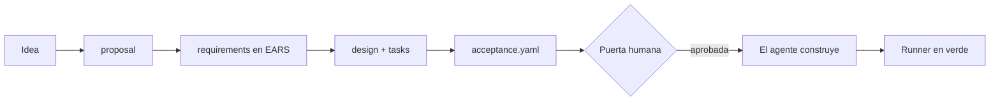

Hasta aquí has construido agentes. En este nivel cambias de papel: trabajas **con** un agente de código (Claude Code, Codex, OpenCode o uno tuyo) y aprendes a darle encargos que pueda cumplir y que tú puedas comprobar. El método se llama *spec-driven development* ([[glosario/sdd|SDD]]): primero se escribe qué hay que construir y cómo se demostrará, se aprueba una vez y solo entonces el agente toca el código.

## Para quién es

Para quien ya usa un agente de código a diario y ha vivido el problema: el encargo de una línea que vuelve con un diff de 600 líneas, tests retocados para que pasen y un «debería funcionar» al final. Conviene haber hecho [[roadmap/40-primer-agente/index]] (sabes qué hace el bucle por dentro) y [[roadmap/60-multiagente/index]] (sabes repartir trabajo entre agentes con contexto limpio).

Todo lo que verás es independiente de la herramienta. Los ejemplos salen del harness del autor, un flujo SDD para Claude Code que estudias a fondo en [[cursos/harness-engineering/index]], pero los artefactos son archivos Markdown y YAML que cualquier agente puede leer.

## Qué vas a construir

Una feature real de tu proyecto, pequeña pero no trivial, llevada de punta a punta:

Al final tendrás una carpeta con los cinco artefactos y la evidencia de que el runner de aceptación pasa **después** del último cambio. Esa carpeta es la que entregarías en una revisión de código.

## Lecciones

1. [[roadmap/70-flujos-con-especificacion/01-de-improvisar-a-especificar]]. Qué cambia frente al *vibe coding*, qué artefactos hay, quién escribe cada uno y cuándo no merece la pena.
2. [[roadmap/70-flujos-con-especificacion/02-requisitos-en-ears]]. Los cinco patrones EARS con plantilla en español e inglés, requisitos buenos y malos, y cómo cada requisito se convierte en un test.
3. [[roadmap/70-flujos-con-especificacion/03-plan-y-tareas]]. Un diseño breve y tareas con tamaño, dependencias y comando de verificación, con un validador que rechaza el «etc.».
4. [[roadmap/70-flujos-con-especificacion/04-aceptacion-ejecutable]]. El formato `acceptance.yaml`, un runner mínimo que funciona, evidencia fresca y por qué los tests no se tocan.
5. [[roadmap/70-flujos-con-especificacion/05-una-sola-puerta-humana]]. Por qué un único punto de aprobación, qué revisar en él y qué decide siempre una persona.

> [!consejo] Escala la ceremonia al cambio
> Un error tipográfico no necesita cinco archivos. Este nivel te da el flujo completo para que luego sepas qué quitar en cada caso; la lección 1 trae una tabla para decidirlo.

## Después de este nivel

Con especificación y aceptación ejecutable ya tienes dos de las piezas centrales de un harness. En [[roadmap/80-evals/index]] aprenderás a medir lo que no cabe en un test, y en [[roadmap/90-harness/index]] juntarás todo con permisos, hooks, registro y presupuesto. Si quieres ver el flujo entero funcionando con varios agentes, mira [[sistemas/harness-sdd-claude-code]].
