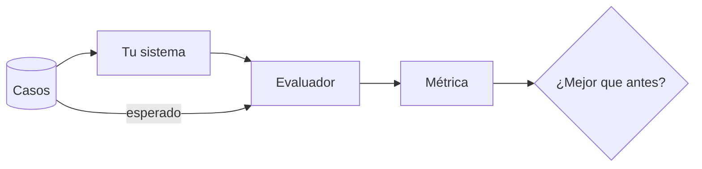

Al terminar esta lección sabrás explicar a tu equipo por qué un sistema con modelos necesita [[glosario/evals]], qué piezas tiene una eval y cómo montar la primera con un script de cincuenta líneas. Las lecciones siguientes afinan cada pieza.

## La idea

En software clásico, si no cambias el código, el comportamiento no cambia. En un sistema con modelos cambian cosas sin que toques nada visible: una frase del [[glosario/prompt-de-sistema]], la versión del modelo, la descripción de una herramienta, el contenido que devuelve tu buscador. Cada uno de esos cambios puede mejorar diez casos y empeorar otros tres. **Sin una medida, solo ves los diez que estabas mirando.**

Una eval responde a una pregunta concreta: sobre estos casos representativos, ¿qué proporción resuelve bien mi sistema? Tiene tres piezas:

1. **Casos**: entradas con lo que esperas (una respuesta de referencia, unos hechos que deben aparecer, una herramienta que debe llamarse). Es el [[glosario/conjunto-de-evaluacion]].
2. **Evaluador** (*grader*): la función que mira la salida de un caso y decide si está bien. Puede ser código, un [[glosario/modelo-juez]] o una persona.
3. **Métrica**: cómo agregas los resultados. Casi siempre una tasa de acierto, global y por categoría.



## Lo que se rompe sin evals

Estos son los fallos típicos que pasan desapercibidos al probar a mano:

- **Regresión por arreglo.** Añades «sé breve» al prompt para un caso que se alargaba y otros casos dejan de incluir un dato necesario.
- **Cambio de modelo.** Pasas a un modelo nuevo o más barato. Las respuestas parecen buenas, pero cambia la forma en que usa una herramienta o el formato de salida.
- **Herramienta modificada.** Alguien renombra un campo en la API que consulta tu agente y el agente sigue respondiendo, ahora con datos incompletos.
- **Deriva de los datos.** Los usuarios empiezan a preguntar cosas que no estaban en tus pruebas manuales.
- **Optimización ciega.** Recortas el coste ([[roadmap/100-produccion/02-costes-y-prompt-caching]]) sin saber cuánta calidad pierdes.

En todos el patrón es el mismo: cambias algo, miras tres ejemplos, parece bien, despliegas. La eval sustituye «miro tres ejemplos» por «ejecuto cincuenta y comparo con la versión anterior».

## Tipos de evaluador

| Evaluador | Qué comprueba bien | Coste | Ejemplo |
|---|---|---|---|
| Código | Formato, valores exactos, presencia de datos, herramientas llamadas | Casi nulo | El JSON valida; el total coincide; se llamó a `buscar_pedido` |
| Modelo juez | Calidad abierta: si responde a la pregunta, si es fiel a las fuentes, tono | Una llamada por caso | «¿Contiene la respuesta todos los hechos clave? Sí/No» |
| Humano | Lo que nadie más sabe juzgar; calibrar a los otros dos | Alto | Un experto revisa 30 casos al mes |

La regla práctica: **usa código siempre que puedas**, un modelo juez cuando la calidad no se pueda comprobar con código y personas para calibrar y para lo que de verdad importa. Lo verás a fondo en [[roadmap/80-evals/03-codigo-o-modelo-juez]].

En agentes hay además una dimensión que un chat no tiene: el camino. Un agente puede acertar la respuesta tras doce pasos innecesarios o con una herramienta peligrosa. Eso se mide con [[roadmap/80-evals/04-evals-de-trayectoria|evals de trayectoria]].

## Tu primera eval

Supón un agente de soporte que responde sobre el estado de pedidos. Empieza con un archivo de casos en JSONL, una línea por caso, y un evaluador por código que busca los hechos clave.

```json title="casos.jsonl"
{"id": "p-001", "categoria": "estado", "entrada": "¿Dónde está mi pedido 4512?", "debe_contener": ["4512", "enviado"]}
{"id": "p-002", "categoria": "estado", "entrada": "Pedido 9999, ¿cuándo llega?", "debe_contener": ["no encuentro"]}
{"id": "p-003", "categoria": "devolucion", "entrada": "Quiero devolver el 4512", "debe_contener": ["30 días"]}
```

```python title="eval.py"
import json
from collections import defaultdict

from agente import responder  # tu sistema: str -> str

def evaluar(caso: dict, salida: str) -> bool:
    texto = salida.lower()
    return all(frag.lower() in texto for frag in caso["debe_contener"])

def main(ruta: str = "casos.jsonl") -> None:
    casos = [json.loads(l) for l in open(ruta, encoding="utf-8") if l.strip()]
    por_cat = defaultdict(lambda: [0, 0])
    for caso in casos:
        salida = responder(caso["entrada"])
        ok = evaluar(caso, salida)
        por_cat[caso["categoria"]][0] += ok
        por_cat[caso["categoria"]][1] += 1
        if not ok:
            print(f"FALLA {caso['id']}: {salida[:120]!r}")
    total_ok = sum(v[0] for v in por_cat.values())
    print(f"\nGlobal: {total_ok}/{len(casos)}")
    for cat, (ok, n) in sorted(por_cat.items()):
        print(f"  {cat:12} {ok}/{n}")

if __name__ == "__main__":
    main()
```

Es tosco y ya es útil. Ejecútalo antes y después de cada cambio. Las líneas `FALLA` te dicen qué mirar; la tabla por categoría te dice si has empeorado algo que no estabas tocando.

> [!aviso] Una ejecución no es una medida
> Las salidas varían entre ejecuciones, y en la API de Claude ya no existe `temperature` para fijarlas. Si una diferencia de un caso te hace cambiar de decisión, ejecuta varias veces o amplía el conjunto antes de concluir. Para un agente, lo que suele importar es si acierta **siempre**, no si acierta alguna vez: es la diferencia entre [[glosario/pass-k|pass@k y pass^k]].

## Dónde encaja en tu trabajo

La eval es el bucle interno de cualquier cambio. El ciclo que propone [[disciplinas/evals]] es este: encuentras un fallo (en una traza, en una queja), lo conviertes en caso, compruebas que la eval falla, arreglas, compruebas que pasa y que el resto no empeora. El conjunto crece con cada fallo real, y los fallos ya resueltos no vuelven sin que te enteres. Es la misma lógica que el desarrollo guiado por pruebas, adaptada a salidas que no son exactas.

## Errores frecuentes

- Esperar a tener «el dataset perfecto» para empezar.
- Medir solo una cifra global y no ver que una categoría se ha hundido.
- Evaluar con un modelo juez lo que se puede comprobar con una línea de código.
- Escribir casos solo con lo que el sistema ya hace bien.
- Cambiar los casos y el sistema a la vez, y no saber cuál movió la métrica.

## Ejercicio

> [!ejercicio] Tu primera eval en una tarde
> Toma un agente o un prompt tuyo. Escribe al menos 15 casos en JSONL con `id`, `categoria`, `entrada` y un criterio comprobable por código. Implementa `eval.py` y ejecútalo. Después haz un cambio pequeño en el prompt (por ejemplo, pedir respuestas más cortas) y vuelve a ejecutar.
>
> Está bien si la eval imprime la tasa global y por categoría, si al menos 3 casos salen de uso real o de fallos que hayas visto y si puedes señalar qué casos cambiaron de resultado con tu cambio de prompt.

> [!ejercicio]- Pistas
> Si no tienes uso real, revisa trazas antiguas o pide a un compañero que escriba cinco preguntas sin ver tu prompt. Guarda la salida de cada ejecución en un archivo con fecha para comparar con `diff`.

## Resumen

- En un sistema con modelos, cambios pequeños rompen casos que no estabas mirando.
- Una eval tiene casos, evaluador y métrica; la métrica se mira global y por categoría.
- Evaluadores: código siempre que puedas, modelo juez para calidad abierta, humanos para calibrar.
- En agentes también se evalúa el camino, no solo la respuesta.
- Cada fallo real se convierte en un caso nuevo.

## Para seguir

- [[roadmap/80-evals/02-conjunto-de-prueba]]
- [[docs/evals/01-disenar-evals]]
- [[blog/2026-09-10-evals-antes-que-prompts]]
- [[biblioteca/demystifying-evals]]
