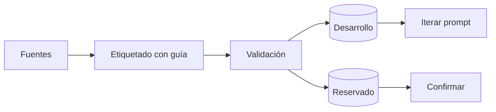

Al terminar esta lección tendrás un [[glosario/conjunto-de-evaluacion]] versionado, con casos que salen del uso real, una guía de etiquetado que otra persona puede seguir y una idea honesta de cuánto puedes fiarte de la métrica que produce.

## La idea

Tu eval nunca será mejor que sus casos. Si los casos son fáciles, la métrica sale alta y no te dice nada. Si son raros, optimizas para situaciones que nadie vive. Un buen conjunto de prueba **se parece a lo que tus usuarios hacen de verdad, incluye los bordes que más daño hacen y tiene etiquetas en las que dos personas coincidirían**.

Piensa en él como código: va en el repositorio, tiene historial, se revisa en las *pull requests* y crece con cada fallo.

## De dónde salen los casos

Ordenadas por valor:

1. **Uso real.** Conversaciones o peticiones de producción, tickets de soporte, preguntas de usuarios en pruebas. Es lo que mejor representa la distribución que importa. Anonimiza antes de copiar: quita nombres, correos, números de cliente.
2. **Fallos vistos.** Cada traza que acabó mal ([[roadmap/40-primer-agente/06-depurar-con-trazas]]) es un caso. Son los más baratos de conseguir y los que evitan que un error vuelva.
3. **Bordes.** Entradas vacías o muy largas, datos que no existen, peticiones ambiguas, idiomas mezclados, preguntas fuera de alcance que el sistema debe rechazar. Escríbelos a propósito.
4. **Adversariales.** Intentos de saltarse las reglas o de [[glosario/inyeccion-de-prompt|inyectar instrucciones]] a través de documentos o resultados de herramientas. Los verás en [[roadmap/100-produccion/04-seguridad-y-prompt-injection]].
5. **Sintéticos.** Un modelo puede generar variantes de casos reales para cubrir huecos. Úsalo con dos condiciones: una persona revisa cada caso y quedan marcados como sintéticos para poder medirlos por separado.

> [!aviso] El sesgo del autor
> Si escribes tú todos los casos, escribirás los que tu prompt ya resuelve. Pide casos a alguien que no ha visto el prompt y saca de producción todo lo que puedas.

## El formato de un caso

JSONL, una línea por caso, con los campos que necesitarás para filtrar y depurar:

```json title="casos/soporte.jsonl"
{"id": "sop-0142", "categoria": "devolucion", "origen": "produccion", "dificultad": "borde", "entrada": "Compré dos, quiero devolver uno y que me cambien el otro de talla", "esperado": {"hechos": ["devolución parcial", "cambio de talla"], "herramientas": ["buscar_pedido"], "no_debe": ["prometer reembolso sin pedido"]}, "etiquetado_por": "ana", "fecha": "2026-09-28"}
```

- `id` estable para comparar entre ejecuciones.
- `categoria` para ver métricas por tipo de petición.
- `origen` (`produccion`, `fallo`, `borde`, `adversarial`, `sintetico`) para saber de dónde vienen los aciertos.
- `esperado` con criterios comprobables. Evita una única «respuesta correcta» redactada: casi nunca hay una sola. Mejor los hechos que deben aparecer, lo que no debe pasar y, en agentes, las herramientas que se esperan.
- Quién lo etiquetó y cuándo, para revisar casos antiguos cuando cambien las reglas del negocio.

Valida el archivo antes de usarlo. Un caso mal formado que se salta en silencio es una medida falsa.

```python title="validar_casos.py"
import json, sys
from collections import Counter

CAMPOS = {"id", "categoria", "origen", "entrada", "esperado"}
ORIGENES = {"produccion", "fallo", "borde", "adversarial", "sintetico"}

def validar(ruta: str) -> None:
    ids, cats, origs = set(), Counter(), Counter()
    for n, linea in enumerate(open(ruta, encoding="utf-8"), 1):
        if not linea.strip():
            continue
        caso = json.loads(linea)
        faltan = CAMPOS - caso.keys()
        assert not faltan, f"línea {n}: faltan {faltan}"
        assert caso["id"] not in ids, f"línea {n}: id repetido {caso['id']}"
        assert caso["origen"] in ORIGENES, f"línea {n}: origen {caso['origen']!r}"
        ids.add(caso["id"]); cats[caso["categoria"]] += 1; origs[caso["origen"]] += 1
    print(f"{len(ids)} casos"); print("categorías:", dict(cats)); print("origen:", dict(origs))

if __name__ == "__main__":
    validar(sys.argv[1])
```

## Etiquetar para que dos personas coincidan

Una etiqueta es útil si otra persona, con la misma guía, pondría la misma. Escribe una **guía de etiquetado** corta: qué cuenta como respuesta correcta en cada categoría, qué es aceptable y qué no, con un ejemplo de cada.

Después haz la prueba: dos personas etiquetan los mismos 20 casos sin hablar entre ellas. Cuenta en cuántos coinciden. Cada desacuerdo señala una de dos cosas: un criterio ambiguo en la guía o un caso ambiguo de verdad. Arregla la guía en el primer caso y quita o reescribe el caso en el segundo.

Este paso parece burocrático y es el que más ahorra después. Si las personas no se ponen de acuerdo, tampoco podrás calibrar un [[glosario/modelo-juez]] contra ellas ([[roadmap/80-evals/03-codigo-o-modelo-juez]]).

## Cuántos casos

No hay un número correcto. Hay una pregunta que puedes responder: ¿qué diferencia necesito detectar? Con n casos y una tasa de acierto p, el error típico de la tasa es aproximadamente:

```text
error ≈ √(p · (1 − p) / n)
```

Para un intervalo de confianza del 95 %, multiplica por 1,96. Con p = 0,8 y n = 50, el error típico es √(0,16 / 50) ≈ 0,057: tu 80 % podría ser algo entre el 69 % y el 91 %. Con n = 200 el margen baja a unos ±5,5 puntos. Es la cuenta estándar para una proporción y es aproximada con pocos casos, pero da la intuición correcta: **para distinguir cambios pequeños necesitas muchos casos; para detectar roturas grandes bastan pocos.**

De ahí una forma de trabajar razonable:

- Empieza con los casos que puedas etiquetar bien en uno o dos días. Sirven para detectar regresiones grandes.
- Asegura varios casos por categoría importante. Una categoría con dos casos no te dice nada por separado.
- Crece donde la métrica importa: en las categorías con más tráfico o con más riesgo.
- Al comparar dos versiones, mira qué casos concretos cambian de resultado, no solo la cifra global.

## Desarrollo y reservado

Si iteras el prompt mirando los mismos casos una y otra vez, acabas ajustándolo a esos casos. Separa una parte como **reservada**: no la miras mientras iteras y la ejecutas solo para confirmar un cambio antes de darlo por bueno. Si mejora en desarrollo y no en reservado, has sobreajustado.



Haz la separación por un criterio fijo (por ejemplo, el hash del `id`), para que un caso no cambie de lado entre versiones.

## Errores frecuentes

- Usar una única respuesta de referencia redactada y penalizar respuestas correctas formuladas de otro modo.
- Mezclar casos sintéticos y reales sin marcarlos.
- No anonimizar datos de producción antes de meterlos en el repositorio.
- Iterar mirando todos los casos y no tener ninguno reservado.
- No volver a revisar etiquetas cuando cambian las reglas del negocio.

## Ejercicio

> [!ejercicio] Un conjunto de prueba con criterio
> Amplía los casos de la lección anterior hasta al menos 30, con al menos 3 categorías y 4 orígenes distintos. Escribe una guía de etiquetado de media página. Pide a otra persona que etiquete 15 casos con tu guía y calcula en cuántos coincidís. Separa un 30 % como reservado por hash del `id`.
>
> Está bien si `validar_casos.py` pasa sin errores, si el informe de coincidencia explica cada desacuerdo y qué cambiaste en la guía, y si calculas el margen aproximado de tu tasa de acierto actual con la fórmula de esta lección.

> [!ejercicio]- Pistas
> Para separar por hash: `int(hashlib.sha256(id.encode()).hexdigest(), 16) % 10 < 3` va a reservado. Si no tienes otra persona, etiqueta tú dos veces con una semana de diferencia: los desacuerdos contigo mismo también revelan ambigüedad.

## Resumen

- Los casos salen, por orden de valor, de uso real, fallos vistos, bordes, adversariales y, con revisión, sintéticos.
- Cada caso tiene `id`, categoría, origen y criterios comprobables; valida el archivo antes de usarlo.
- Una guía de etiquetado y una prueba de acuerdo entre dos personas detectan criterios ambiguos.
- El tamaño depende de la diferencia que necesites detectar; con pocos casos solo ves roturas grandes.
- Separa casos reservados para no sobreajustar.

## Para seguir

- [[roadmap/80-evals/03-codigo-o-modelo-juez]]
- [[cursos/evals-para-agentes/02-datasets-de-evaluacion]]
- [[disciplinas/evals]]
