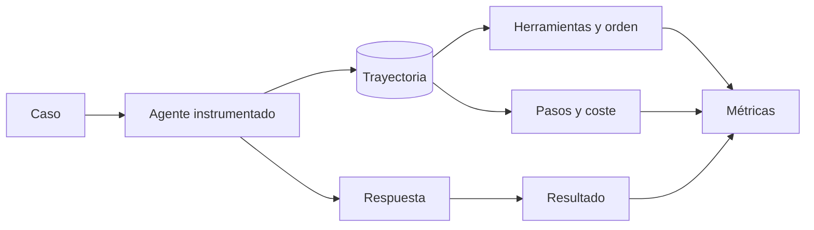

Al terminar esta lección tu eval no solo mirará la respuesta final del agente. También comprobará el camino: qué herramientas usó, en qué orden, con qué argumentos y cuántos pasos necesitó. Es lo que detecta al agente que acierta por suerte, gasta el triple o toca algo que no debía.

## La idea

La [[glosario/trayectoria]] de un agente es la secuencia de pasos que dio hasta responder: cada llamada al modelo, cada `tool_use` con sus argumentos, cada [[glosario/tool-result]] y el `stop_reason` final. Dos agentes pueden dar la misma respuesta con trayectorias muy distintas:

- Uno consulta el pedido y responde. Dos pasos.
- Otro busca en la documentación tres veces, consulta el pedido dos veces con el mismo número y responde. Siete pasos, más coste, más latencia y la misma respuesta.
- Un tercero responde sin consultar nada. Acierta porque el caso coincidía con lo que el modelo esperaba. En el siguiente caso inventará.

La evaluación de la respuesta da por buenos a los tres. **La evaluación de trayectoria distingue al que hizo lo correcto del que tuvo suerte.**



## Registrar la trayectoria

Instrumenta el bucle para que devuelva, además del texto, una lista de pasos como datos. Es el mismo bucle de [[roadmap/40-primer-agente/02-el-bucle-agentico]] con un registro.

```python tab="Python" title="agente_instrumentado.py"
from dataclasses import dataclass, field
import anthropic

MODEL = "claude-sonnet-5-5"
client = anthropic.Anthropic()

@dataclass
class Llamada:
    nombre: str
    entrada: dict
    error: bool

@dataclass
class Trayectoria:
    llamadas: list[Llamada] = field(default_factory=list)
    pasos: int = 0
    tokens: int = 0
    stop_reason: str = ""
    respuesta: str = ""

def ejecutar_agente(pregunta: str, tools: list, ejecutar, system: str, max_pasos: int = 10) -> Trayectoria:
    t = Trayectoria()
    mensajes = [{"role": "user", "content": pregunta}]
    for _ in range(max_pasos):
        resp = client.messages.create(model=MODEL, max_tokens=2048, system=system,
                                      tools=tools, messages=mensajes)
        t.pasos += 1
        t.tokens += resp.usage.input_tokens + resp.usage.output_tokens
        t.stop_reason = resp.stop_reason
        mensajes.append({"role": "assistant", "content": resp.content})
        if resp.stop_reason != "tool_use":
            t.respuesta = "".join(b.text for b in resp.content if b.type == "text")
            return t
        resultados = []
        for b in resp.content:
            if b.type == "tool_use":
                try:
                    contenido, error = ejecutar(b.name, b.input), False
                except Exception as e:
                    contenido, error = f"Error: {e}", True
                t.llamadas.append(Llamada(b.name, b.input, error))
                resultados.append({"type": "tool_result", "tool_use_id": b.id,
                                   "content": contenido, "is_error": error})
        mensajes.append({"role": "user", "content": resultados})
    t.stop_reason = "max_pasos"
    return t
```

```ts tab="TypeScript" title="trayectoria.ts"
export interface Llamada { nombre: string; entrada: unknown; error: boolean }
export interface Trayectoria {
  llamadas: Llamada[];
  pasos: number;
  tokens: number;
  stop_reason: string;
  respuesta: string;
}

// Dentro del bucle, por cada bloque tool_use:
// t.llamadas.push({ nombre: b.name, entrada: b.input, error });
```

En producción ya registras esto en tus trazas ([[roadmap/100-produccion/01-observabilidad-y-trazas]]). Aprovecha el mismo formato: así puedes convertir una traza real en un caso de eval sin reescribir nada.

## Los evaluadores de trayectoria

Casi todos se escriben con código. Añade a cada caso lo que esperas del camino:

```json title="casos/soporte.jsonl"
{"id": "sop-0007", "categoria": "estado", "entrada": "¿Dónde está el pedido 4512?", "esperado": {"debe_llamar": ["buscar_pedido"], "no_debe_llamar": ["reembolsar"], "orden": ["buscar_pedido"], "argumentos": {"buscar_pedido": {"pedido_id": "4512"}}, "max_pasos": 3}}
```

```python title="graders_trayectoria.py"
from agente_instrumentado import Trayectoria

def nombres(t: Trayectoria) -> list[str]:
    return [l.nombre for l in t.llamadas]

def llama_obligatorias(t: Trayectoria, debe: list[str]) -> bool:
    return set(debe) <= set(nombres(t))

def evita_prohibidas(t: Trayectoria, prohibidas: list[str]) -> bool:
    return not set(prohibidas) & set(nombres(t))

def respeta_orden(t: Trayectoria, orden: list[str]) -> bool:
    # el orden esperado debe aparecer como subsecuencia; se permiten pasos intermedios
    it = iter(nombres(t))
    return all(any(n == esperado for n in it) for esperado in orden)

def argumentos_correctos(t: Trayectoria, esperados: dict[str, dict]) -> bool:
    for herramienta, args in esperados.items():
        llamadas = [l for l in t.llamadas if l.nombre == herramienta]
        if not any(all(l.entrada.get(k) == v for k, v in args.items()) for l in llamadas):
            return False
    return True

def sin_repeticiones(t: Trayectoria) -> bool:
    vistas = [(l.nombre, repr(sorted(l.entrada.items()))) for l in t.llamadas]
    return len(vistas) == len(set(vistas))

def dentro_de_pasos(t: Trayectoria, maximo: int) -> bool:
    return t.pasos <= maximo and t.stop_reason == "end_turn"
```

`respeta_orden` merece una explicación. Comprueba que las herramientas esperadas aparecen en ese orden, pero deja que el agente haga otras cosas en medio. `iter` consume la secuencia: cada `any` avanza hasta encontrar la siguiente herramienta esperada y la búsqueda sigue desde ahí.

Combínalos en un informe por caso con un resultado por criterio, no en un único aprobado. Saber que el 95 % de los casos acierta la respuesta y solo el 70 % evita repeticiones te dice exactamente dónde mirar.

## Cuánto restringir el camino

El error típico al empezar es exigir la secuencia exacta: «primero `buscar_docs`, luego `buscar_pedido`, luego responder». Un agente que llega bien por otro orden válido sale suspendido y la eval pierde credibilidad. Usa la restricción mínima que capture lo que importa:

| Lo que importa | Evalúa |
|---|---|
| Que no responda sin datos | `debe_llamar` |
| Que no haga algo peligroso | `no_debe_llamar`, y además un permiso en el código ([[roadmap/100-produccion/04-seguridad-y-prompt-injection]]) |
| Una dependencia real (consultar antes de modificar) | `orden` con solo esas dos herramientas |
| Eficiencia | `max_pasos`, `sin_repeticiones`, tokens |
| Que el efecto sea el correcto | El **estado final**: el registro en la base de datos, el archivo creado |

La última fila es a menudo la mejor. Si el agente tiene que crear una incidencia, comprueba en un entorno de prueba que la incidencia existe con los campos correctos. Te da igual cómo llegó. Combina estado final y unas pocas restricciones de camino para lo que sea peligroso o caro.

> [!aviso] Ejecuta las evals de agentes contra un entorno de prueba
> Una eval de trayectoria ejecuta herramientas de verdad. Si una de ellas escribe, borra o envía algo, apúntala a una base de datos de prueba o a un doble que registre las llamadas sin efecto.

## Trayectorias y modelo juez

Algunas preguntas sobre el camino no se pueden escribir como regla: ¿las búsquedas tenían sentido para la pregunta?, ¿el agente reaccionó bien a un error de herramienta? Para eso puedes pasar la trayectoria resumida (nombres, argumentos y si hubo error) a un [[glosario/modelo-juez]] con una rúbrica binaria, como en [[roadmap/80-evals/03-codigo-o-modelo-juez]]. Úsalo con moderación: las reglas por código cubren la mayoría de los casos y no necesitan calibración.

## Errores frecuentes

- Evaluar solo la respuesta final de un agente con herramientas.
- Exigir la secuencia exacta de herramientas y suspender caminos válidos.
- Ejecutar evals con herramientas que escriben en sistemas reales.
- Mezclar todos los criterios en un aprobado único.
- No registrar los argumentos, solo los nombres de las herramientas.

## Ejercicio

> [!ejercicio] Detecta al agente con suerte
> Instrumenta tu agente para que devuelva una `Trayectoria`. Añade a al menos 10 casos criterios de camino (`debe_llamar`, `no_debe_llamar`, `max_pasos` y, donde haya dependencia real, `orden`). Después crea una versión rota del agente quitándole del prompt la instrucción de consultar antes de responder, y ejecuta la eval con ambas versiones.
>
> Está bien si la eval imprime una tasa por criterio, si la versión rota baja en `debe_llamar` aunque algunas respuestas sigan siendo correctas y si ningún caso exige una secuencia completa cuando solo importa una dependencia.

> [!ejercicio]- Pistas
> Para el entorno de prueba, `ejecutar` puede ser un diccionario de funciones que leen de datos fijos en memoria. Si un caso no tiene dependencias entre herramientas, no le pongas `orden`.

## Resumen

- La trayectoria es la secuencia de llamadas, argumentos, resultados y pasos de un agente.
- Instrumenta el bucle para devolverla como datos y reutiliza el formato de tus trazas.
- Evalúa con código herramientas obligatorias y prohibidas, orden mínimo, argumentos, repeticiones y pasos.
- Restringe el camino solo donde importa y comprueba el estado final cuando puedas.
- Ejecuta las evals de agentes contra un entorno de prueba.

## Para seguir

- [[roadmap/80-evals/05-regresiones-en-ci]]
- [[cursos/evals-para-agentes/03-graders]]
- [[blog/2026-07-15-como-leer-una-traza]]
