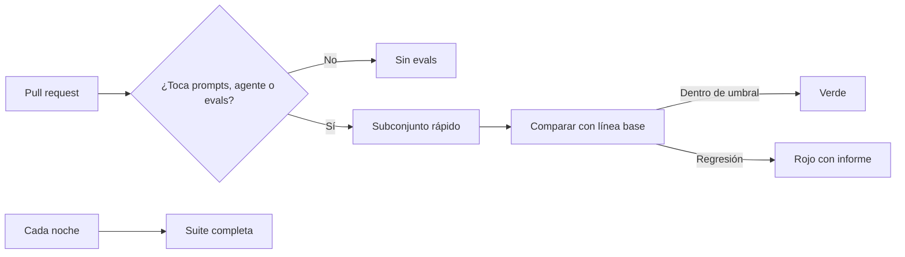

Al terminar esta lección tus [[glosario/evals]] se ejecutarán solas cada vez que alguien cambie un prompt, una herramienta o el modelo, y la *pull request* se marcará en rojo si la calidad baja. Es el último paso para que medir deje de depender de que alguien se acuerde.

## La idea

Una regresión es un caso que antes funcionaba y ahora no. En código clásico la detectas con tests en integración continua (CI). En un sistema con modelos haces lo mismo con tres diferencias:

1. **Cuesta dinero.** Cada ejecución hace llamadas al modelo. Hay que decidir qué se ejecuta y cuándo.
2. **No es determinista.** Un caso puede pasar y fallar en dos ejecuciones seguidas sin cambiar nada. La regla de decisión tiene que tolerarlo.
3. **El umbral es una decisión de producto.** «Pasa el 100 %» casi nunca es realista. Hay que pactar qué nivel es aceptable por categoría.



## Ejecutar y guardar resultados por caso

Tu script de evaluación tiene que producir un archivo con el resultado de cada caso y cada criterio, no solo una cifra. La comparación necesita saber qué casos cambiaron.

```python title="evals/run.py"
import argparse, json, sys
from agente import ejecutar_caso   # devuelve {"criterios": {nombre: bool}, "tokens": int}

def main() -> None:
    p = argparse.ArgumentParser()
    p.add_argument("--subconjunto", choices=["rapido", "completo"], default="rapido")
    p.add_argument("--salida", default="resultados.json")
    p.add_argument("--presupuesto-tokens", type=int, default=2_000_000)
    a = p.parse_args()

    casos = [json.loads(l) for l in open("evals/casos.jsonl", encoding="utf-8") if l.strip()]
    if a.subconjunto == "rapido":
        casos = [c for c in casos if c.get("rapido")]

    resultados, tokens = {}, 0
    for caso in casos:
        r = ejecutar_caso(caso)
        tokens += r["tokens"]
        resultados[caso["id"]] = {"categoria": caso["categoria"], "criterios": r["criterios"]}
        if tokens > a.presupuesto_tokens:
            print(f"Presupuesto de tokens superado ({tokens}); abortando", file=sys.stderr)
            sys.exit(2)

    json.dump({"tokens": tokens, "casos": resultados}, open(a.salida, "w"), indent=2)

if __name__ == "__main__":
    main()
```

Marca con `"rapido": true` los casos que entran en cada *pull request*: unos cuantos por categoría, priorizando los de más riesgo y los que ya fallaron alguna vez. El resto entra en la ejecución nocturna.

## Comparar con la línea base

La **línea base** es el resultado de la versión actual de la rama principal, guardado en el repositorio. Una *pull request* falla si se cumple alguna de estas condiciones:

- Una categoría baja de su umbral absoluto.
- Una categoría cae respecto a la línea base más que una tolerancia.
- Algún caso marcado como crítico deja de pasar.

```python title="evals/comparar.py"
import json, sys
from collections import defaultdict

UMBRAL = {"estado": 0.90, "devolucion": 0.85, "seguridad": 1.00}   # pactado con producto
TOLERANCIA = 0.05
CRITICOS = {"seg-001", "seg-002", "sop-0007"}

def tasas(res: dict) -> dict[str, float]:
    acc = defaultdict(lambda: [0, 0])
    for caso in res["casos"].values():
        acc[caso["categoria"]][0] += all(caso["criterios"].values())
        acc[caso["categoria"]][1] += 1
    return {k: ok / n for k, (ok, n) in acc.items()}

def main(actual_ruta: str, base_ruta: str) -> int:
    actual, base = json.load(open(actual_ruta)), json.load(open(base_ruta))
    ta, tb = tasas(actual), tasas(base)
    fallos = []
    for cat, t in sorted(ta.items()):
        print(f"{cat:12} {t:.2%}  (base {tb.get(cat, float('nan')):.2%})")
        if t < UMBRAL.get(cat, 0):
            fallos.append(f"{cat} por debajo del umbral {UMBRAL[cat]:.0%}")
        if cat in tb and tb[cat] - t > TOLERANCIA:
            fallos.append(f"{cat} cae {tb[cat] - t:.0%} respecto a la base")
    for cid, caso in actual["casos"].items():
        antes = base["casos"].get(cid)
        if antes and all(antes["criterios"].values()) and not all(caso["criterios"].values()):
            rotos = [k for k, v in caso["criterios"].items() if not v]
            print(f"  REGRESIÓN {cid}: {rotos}")
            if cid in CRITICOS:
                fallos.append(f"caso crítico {cid} roto")
    print(f"\nTokens usados: {actual['tokens']}")
    for f in fallos:
        print("✗", f)
    return 1 if fallos else 0

if __name__ == "__main__":
    sys.exit(main(sys.argv[1], sys.argv[2]))
```

Los umbrales y la tolerancia de este ejemplo son ilustrativos. Los tuyos salen de mirar tus tasas actuales y su variación entre ejecuciones, y de lo que tu equipo considere aceptable. Una categoría de seguridad suele exigir el 100 %; una de estilo admite más margen.

La línea base se actualiza a propósito: cuando un cambio mejora la métrica y se acepta, la *pull request* incluye el nuevo `linea_base.json`. Así el historial de git cuenta cómo ha evolucionado la calidad.

## El workflow de GitHub Actions

```yaml title=".github/workflows/evals.yml"
name: evals
on:
  pull_request:
    paths: ["prompts/**", "agente/**", "evals/**"]
  schedule:
    - cron: "0 3 * * *"
  workflow_dispatch:

concurrency:
  group: evals-${{ github.ref }}
  cancel-in-progress: true

jobs:
  evals:
    runs-on: ubuntu-latest
    timeout-minutes: 30
    steps:
      - uses: actions/checkout@v4
      - uses: actions/setup-python@v5
        with:
          python-version: "3.12"
      - run: pip install -r requirements.txt
      - name: Ejecutar evals
        env:
          ANTHROPIC_API_KEY: ${{ secrets.ANTHROPIC_API_KEY }}
          SUBCONJUNTO: ${{ github.event_name == 'pull_request' && 'rapido' || 'completo' }}
        run: python evals/run.py --subconjunto "$SUBCONJUNTO" --salida resultados.json
      - name: Comparar con la línea base
        run: python evals/comparar.py resultados.json evals/linea_base.json
      - uses: actions/upload-artifact@v4
        if: always()
        with:
          name: resultados-evals
          path: resultados.json
```

Cada parte tiene un motivo:

- `paths` evita gastar en *pull requests* que solo cambian la documentación.
- `concurrency` con `cancel-in-progress` cancela la ejecución anterior si haces otro *push* a la misma rama.
- `timeout-minutes` corta una ejecución colgada.
- La clave de API va en los secretos del repositorio, nunca en el código. Ten en cuenta que GitHub no pasa secretos a los workflows lanzados desde *forks*: en un repositorio abierto, esas evals tendrán que ejecutarse después de revisar el cambio.
- `upload-artifact` con `if: always()` guarda los resultados también cuando falla, que es justo cuando los quieres leer.

Si prefieres no mantener `run.py` y `comparar.py`, [[herramientas/promptfoo]] hace casi lo mismo con un archivo YAML y un comando que devuelve error cuando fallan las aserciones; la integración con CI está en [[recetas/evals-con-promptfoo]]. La lógica de línea base y casos críticos la sigues decidiendo tú.

> [!consejo] Una clave solo para CI
> Crea una clave de API dedicada a CI con su propio límite de gasto. Si algo se descontrola, el daño queda acotado y sabes de dónde viene el consumo.

## Variabilidad: cuándo un fallo es un fallo

Un caso que falla una vez puede ser ruido. Tres estrategias, de menos a más caras:

1. **Tolerancia por categoría**, como en `comparar.py`. Absorbe el ruido en la métrica agregada.
2. **Repetir solo los fallos.** Si un caso que pasaba en la base falla, ejecútalo dos veces más y considéralo roto si falla en la mayoría.
3. **Repetir todo N veces** y comparar medias. Más fiable y N veces más caro: resérvalo para la ejecución nocturna o para decisiones grandes como un cambio de modelo.

Fija también lo que puedas fijar: el ID exacto del modelo del agente y del juez, el [[glosario/esfuerzo]] de cada uno (`output_config={"effort": …}`), el esquema de salida del juez y datos de prueba estáticos para las herramientas. No busques `temperature`: en la API de Claude ya no existe, y la variación que queda se gestiona con las tres estrategias de arriba.

La tolerancia no debería ser más fina que el ruido de tu propio montaje. Anthropic midió que, en evals de agentes de código, solo los recursos asignados al entorno movían hasta 6 puntos los resultados de Terminal-Bench 2.0, y pide escepticismo ante diferencias de menos de 3 puntos entre modelos mientras no se documente y se iguale la configuración ([*Quantifying infrastructure noise in agentic coding evals*](https://www.anthropic.com/engineering/infrastructure-noise), feb. 2026). Mide la variación de tu suite ejecutándola varias veces sin cambiar nada antes de fijar la tolerancia.

## Errores frecuentes

- Ejecutar la suite completa en cada *push* y descubrir la factura a fin de mes.
- Guardar solo la cifra global y no poder decir qué casos se rompieron.
- Fijar umbrales a ojo, sin mirar la variación real entre ejecuciones.
- Cambiar el modelo o el esfuerzo del juez en la misma *pull request* que el prompt: no sabrás cuál movió la métrica.
- Actualizar la línea base automáticamente en cada ejecución, con lo que las regresiones se vuelven la nueva normalidad.
- Ejecutar herramientas con efectos reales desde CI.

## Ejercicio

> [!ejercicio] Tu agente, protegido
> Monta en un repositorio tuyo `run.py`, `comparar.py`, una `linea_base.json` generada con la versión actual y el workflow. Marca un subconjunto rápido. Abre una *pull request* que empeore el prompt a propósito (por ejemplo, quitando una regla) y otra que solo cambie el README.
>
> Está bien si la primera *pull request* sale en rojo con un informe que nombra los casos rotos, si la segunda no ejecuta evals, si la ejecución rápida queda bajo el presupuesto de tokens que fijaste y si los resultados se pueden descargar como artefacto.

> [!ejercicio]- Pistas
> Para generar la línea base: ejecuta `run.py --subconjunto completo --salida evals/linea_base.json` en la rama principal y haz commit. Mira la pestaña *Actions* del repositorio para ver los registros de cada paso.

## Resumen

- Las evals en CI convierten la medida en una comprobación automática de cada cambio.
- Guarda resultados por caso y compáralos con una línea base versionada.
- Falla por umbral por categoría, por caída respecto a la base y por casos críticos rotos.
- Controla el coste con filtros de rutas, subconjunto rápido, ejecución nocturna completa y presupuesto de tokens.
- Gestiona la variabilidad con tolerancias y repeticiones de los fallos.

## Para seguir

- [[roadmap/100-produccion/index]]
- [[recetas/evals-de-regresion-en-ci]]
- [[cursos/evals-para-agentes/04-evals-en-el-dia-a-dia]]
