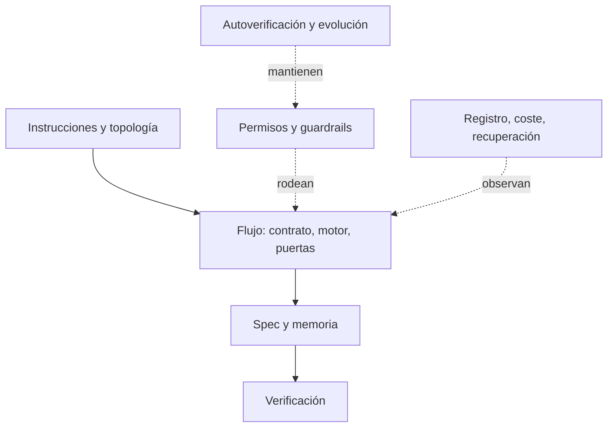

Al terminar esta lección tendrás un mapa del harness completo: quince piezas, cada una ligada a un fallo concreto del modelo. Con ese mapa podrás mirar cualquier agente (el tuyo, Claude Code, Codex) y decir qué tiene, qué le falta y qué le sobra.

## La idea

Un harness no se diseña por piezas sueltas sino por **problemas**. Un modelo de lenguaje tiene limitaciones conocidas y cada pieza existe para compensar alguna. Si no tienes el problema, no necesitas la pieza.

| Limitación del modelo | Qué pasa sin harness | Qué hace el harness |
|---|---|---|
| Contexto finito que se degrada al crecer | Olvida decisiones, vuelve a explorar, se contradice | Contexto pequeño por agente; memoria en archivos |
| No determinismo | Dos ejecuciones, dos resultados; «parece hecho» | Contratos, esquemas, validadores, comandos con código de salida |
| Tiende a declarar éxito sin pruebas | PASS falsos, tests debilitados | Evidencia fresca obligatoria; el código decide si algo es legal |
| No recuerda entre sesiones | Una interrupción obliga a empezar de cero | Estado en disco y un procedimiento para reanudar |
| Obedece lo que lee | Un README malicioso «aprueba» o borra | Instrucciones separadas de datos; hooks; mínimo privilegio |
| Se le desliza el alcance | Refactors no pedidos | Spec congelada; alcance explícito en cada reparación |
| Bucles de autocorrección abiertos | Coste sin techo, oscilación | Reintentos contados; escalado a una persona |
| Coste opaco | Sorpresas en la factura | Medición por transcript y presupuesto que bloquea |

Esta tabla resume la Parte I de la guía del harness del autor; el detalle está en [[cursos/harness-engineering/02-los-problemas-que-resuelve]].

## Las quince piezas

| # | Pieza | Qué es | Problema que resuelve | Forma mínima |
|---|---|---|---|---|
| 1 | Instrucciones | Lo que el modelo trata como órdenes | Que cada agente sepa qué hacer y con qué prioridad | `CLAUDE.md` o `AGENTS.md` corto, como índice |
| 2 | Topología de agentes | Quién hace qué, con qué modelo y esfuerzo | Contextos que se mezclan; un agente que hace de todo | Un agente; subagentes de solo lectura cuando haga falta |
| 3 | Herramientas y permisos | Qué puede tocar cada agente | Daños por accidente o por inyección | Reglas allow/ask/deny y un hook |
| 4 | Contrato de flujo | Fases, eventos, actores y condiciones | Saltarse pasos, cerrar sin verificar | Fases escritas: explorar, especificar, construir, verificar |
| 5 | Motor de estado | El único componente que cambia el estado | Estados incoherentes, transiciones ilegales | Un script que aplica el contrato |
| 6 | Memoria persistente | Lo aprendido, fuera de la ventana | Olvidos y reexploración | Archivos por tarea: contexto, progreso, decisiones |
| 7 | Especificación | Qué se construye y cómo se demuestra | Suposiciones y deriva de alcance | Requisitos EARS, tareas y `acceptance.yaml` |
| 8 | Verificación | Comprobar con evidencia, no con opinión | «Debería funcionar» | Un runner de aceptación y la regresión |
| 9 | Puertas humanas | Puntos donde decide una persona | Decisiones caras tomadas por el modelo | Una aprobación antes de construir |
| 10 | Guardrails de seguridad | Fronteras deterministas | Comandos destructivos, secretos, exfiltración | Hook `PreToolUse` que falla en cerrado; sandbox |
| 11 | Observabilidad y coste | Qué pasó, quién, cuánto costó | Depurar a ciegas; facturas sorpresa | Registro JSONL y coste leído de los transcripts |
| 12 | Recuperación | Reanudar sin reconstruir la conversación | Empezar de cero tras un corte | Estado en disco y un procedimiento escrito |
| 13 | Procedimientos reutilizables | Saber hacer empaquetado | Repetir instrucciones largas en cada prompt | Skills cargadas bajo demanda |
| 14 | Autoverificación del harness | Que el propio harness no se rompa | Un hook roto que deja pasar todo | Tests del hook y un validador |
| 15 | Evolución con evidencia | Cuándo añadir o quitar complejidad | Piezas que nadie sabe por qué existen | Cada pieza nueva, para un fallo observado |

Algunas observaciones que no se ven en la tabla:

- **El motor de estado (5) es lo que convierte el flujo (4) en algo comprobable.** Si el modelo cambia el estado editando un archivo, el contrato es una sugerencia. Si solo puede pedir una transición y un script la valida, es una regla. El principio del autor: la IA decide **qué** evento aplicar; el código decide **si es legal**.
- **La verificación (8) y los guardrails (10) son lo que Böckeler llama *sensores***: dan *feedback* después de actuar. Las instrucciones (1), la spec (7) y las skills (13) son *guías*: actúan antes. Un harness equilibrado tiene de las dos ([[glosario/guias-y-sensores]]).
- **La autoverificación (14) es la más olvidada.** Un hook con un error de sintaxis que la herramienta trata como «error que no bloquea» deja pasar todo en silencio. Por eso el hook se prueba como cualquier otro código (lección 3).
- **La evolución (15) también es quitar.** Anthropic recomienda retirar piezas cuando un modelo nuevo las hace innecesarias: cada una codifica una suposición sobre lo que el modelo no sabe hacer solo.

## Qué trae tu herramienta y qué pones tú

Los agentes de código ya traen varias piezas. Claude Code, por ejemplo, trae el bucle, herramientas, subagentes, skills, hooks, un sistema de permisos con reglas `allow`, `ask` y `deny`, un sandbox para Bash y transcripts con el uso de tokens de cada mensaje. Lo que no trae es **tu política**: qué se bloquea en tu repositorio, qué cuenta como terminado, cuándo decide una persona, cuánto puedes gastar. Eso es lo que construyes.

| Pieza | La trae la herramienta | La pones tú |
|---|---|---|
| Bucle, herramientas, subagentes | Sí | Qué subagentes y con qué herramientas |
| Permisos y hooks | El mecanismo | Las reglas y el código del hook |
| Especificación y verificación | No | Spec, aceptación y runner |
| Registro y coste | Los transcripts | Leerlos, resumirlos y poner un límite |
| Puertas humanas | Confirmaciones por herramienta | Dónde va la aprobación que importa |

## Por dónde empezar

Si montas un harness desde cero, este orden da el máximo con el mínimo:

1. **Verificación (8)**: un comando que diga si el trabajo está hecho. Sin él, lo demás no se puede medir.
2. **Permisos y un hook (3, 10)**: lo que nunca debe pasar, bloqueado en código.
3. **Registro y coste (11)**: para ver qué pasa y cuánto cuesta.
4. **Instrucciones cortas (1)**: un índice que apunte a la documentación, no un manual.
5. Lo demás, cuando un fallo repetido lo pida.

Los pasos 2 y 3 son el proyecto de este nivel. El harness completo del autor, con las quince piezas, está desmontado en [[cursos/harness-engineering/03-las-quince-piezas]].

## Errores frecuentes

- Construir la topología de agentes (2) antes que la verificación (8).
- Poner en las instrucciones (1) reglas que deberían estar en un hook (10).
- No probar el propio harness (14) y descubrir meses después que el hook no bloqueaba.
- Mantener piezas que se añadieron para un modelo anterior.

## Ejercicio

> [!ejercicio] Audita un agente con el mapa
> Toma el agente que construiste en el nivel 40 o tu configuración actual de un agente de código. Recorre las quince piezas y marca cada una como «la tengo», «no la necesito (porque…)» o «me falta». Elige las dos que más falten y escribe qué fallo concreto has visto que las justificaría.
>
> **Está bien si**: las quince piezas tienen marca, cada «no la necesito» tiene una razón concreta y las dos elegidas están ligadas a un fallo que has visto, no a uno hipotético.

> [!ejercicio]- Pistas
> Si no recuerdas fallos concretos, lee cinco trazas o transcripts recientes. Busca el primer momento en que el agente se equivocó y pregúntate qué pieza lo habría parado.

## Resumen

- Cada pieza del harness compensa una limitación concreta del modelo.
- Son quince: instrucciones, topología, permisos, contrato, motor, memoria, spec, verificación, puertas, guardrails, registro y coste, recuperación, procedimientos, autoverificación y evolución.
- El código decide si una transición es legal; el modelo solo la pide.
- La herramienta trae los mecanismos; tú pones la política.
- Empieza por verificación, permisos con hook y registro con coste.

## Para seguir

- [[roadmap/90-harness/03-permisos-y-hooks]]
- [[cursos/harness-engineering/03-las-quince-piezas]]
- [[cursos/harness-engineering/04-patrones-y-principios]]
- [[docs/claude-code/index]]
