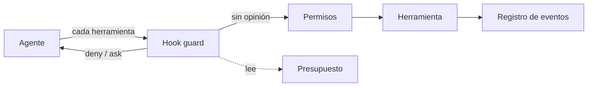

Un agente es un modelo más todo lo que lo rodea: instrucciones, herramientas, permisos, memoria, verificación, puntos de aprobación, registro y límites de gasto. A eso se le llama **[[glosario/harness|harness]]** (arnés), y diseñarlo es la parte del trabajo que más influye en si el agente es fiable. En este nivel aprendes qué piezas tiene un harness, cuáles importan primero y montas uno mínimo que funciona.

## Para quién es

Para quien ya construyó un agente ([[roadmap/40-primer-agente/index]]), sabe empaquetar procedimientos en skills ([[roadmap/50-skills/index]]), trabaja con especificación y aceptación ejecutable ([[roadmap/70-flujos-con-especificacion/index]]) y mide con evals ([[roadmap/80-evals/index]]). Aquí juntas esas piezas en un entorno coherente.

El nivel es genérico. Las ideas valen igual para Claude Code, Codex, OpenCode o un bucle escrito por ti; el proyecto usa Claude Code (o el Claude Agent SDK) porque sus hooks reciben JSON por la entrada estándar y se prueban sin gastar un token. Si quieres ver un harness completo, con cuatro agentes, máquina de estados y una sola puerta humana, el estudio a fondo está en [[cursos/harness-engineering/index]].

## Qué vas a construir

Un harness mínimo para un repositorio tuyo:

Permisos declarativos en `.claude/settings.json`, un hook `PreToolUse` que bloquea comandos destructivos, secretos y git que publica, con sus tests; un registro JSONL de lo que pasa en cada sesión y un presupuesto que para el trabajo nuevo cuando se agota.

## Lecciones

1. [[roadmap/90-harness/01-que-es-un-harness]]. Agente = modelo + harness, de prompt a context a harness engineering con fechas, y ejemplos públicos.
2. [[roadmap/90-harness/02-las-piezas-de-un-harness]]. Las quince piezas y el problema que resuelve cada una.
3. [[roadmap/90-harness/03-permisos-y-hooks]]. Permisos frente a hooks, fallo en cerrado, instrucciones frente a datos y un hook `PreToolUse` probado.
4. [[roadmap/90-harness/04-estado-coste-y-contexto]]. Estado en disco, reanudar, medir coste por transcript, contexto mínimo y traspaso de sesión.
5. [[roadmap/90-harness/05-un-harness-minimo]]. El proyecto, paso a paso y comprobado.

> [!consejo] Mide antes de añadir piezas
> Un harness cuesta tokens, tiempo y mantenimiento. Con un modelo que ya acierta de forma consistente, a veces basta con una puerta de aceptación final. Añade cada pieza para un fallo que hayas visto.

## Después de este nivel

Con el harness mínimo funcionando, [[roadmap/100-produccion/index]] te lleva a desplegar agentes con observabilidad y control de costes. Para crecer hacia un harness completo, sigue [[cursos/harness-engineering/index]] o estudia [[sistemas/harness-sdd-claude-code]] y su variante en paralelo, [[sistemas/harness-sdd-olas]].
