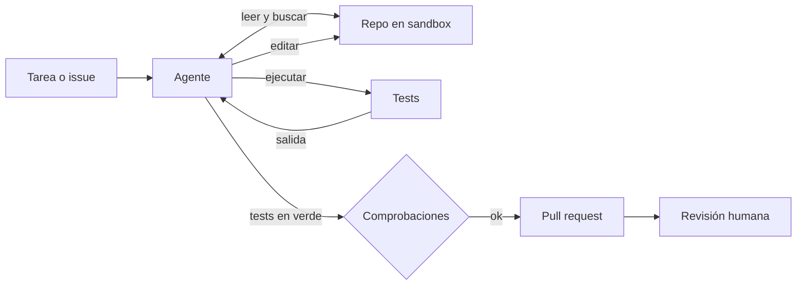

## Qué problema resuelve

Hay mucho trabajo de programación que está bien definido pero consume tiempo: corregir un fallo con un test que lo reproduce, actualizar una dependencia y ajustar las llamadas que cambian, añadir una validación que falta. Un modelo puede proponer el *diff* si le pegas el archivo, pero no sabe si compila, si rompe otra cosa ni dónde están las piezas relacionadas.

Este sistema da al modelo un repositorio en un entorno aislado y herramientas para explorarlo, editarlo y ejecutar los tests. El agente itera hasta que los tests pasan y entonces el sistema abre una **propuesta revisable** (una *pull request*) con el cambio y su explicación. Nada llega a la rama principal sin una persona. *Building effective agents* ([Anthropic, 2024](https://www.anthropic.com/engineering/building-effective-agents)) cita el código como uno de los dominios donde mejor funcionan los agentes porque las soluciones **se verifican con tests** y ese *feedback* guía cada paso.

## Arquitectura



## Componentes

| Componente | Responsabilidad | Implementación típica |
|---|---|---|
| Entrada de la tarea | Describir qué hay que conseguir y cómo se sabe que está hecho | Issue con criterio de aceptación; idealmente un test que falla |
| Sandbox con el repositorio | Aislar la ejecución: sin secretos, red limitada, recursos acotados | Contenedor efímero por tarea con el repo clonado en una rama nueva |
| Herramientas de lectura | Explorar sin llenar el contexto | `listar`, `buscar` (tipo grep) y `leer` con rangos de líneas |
| Herramienta de edición | Cambiar código de forma precisa | Reemplazo de un fragmento único, con error si no aparece o aparece varias veces |
| Ejecutor de tests | Dar *feedback* real | Comando fijo del proyecto, con tiempo máximo y salida truncada |
| Apertura de la propuesta | Empaquetar el cambio para revisión | Código determinista: commit, push de la rama, PR con resumen |

## Flujo paso a paso

1. **Preparar**. Se crea el sandbox, se clona el repo y se crea una rama. Se carga un archivo de contexto del proyecto (convenciones, cómo ejecutar tests, qué no tocar) si existe. Ver [[cursos/agentes-de-codigo/02-contexto-del-repositorio]].
2. **Explorar**. El agente busca dónde vive el código relevante y lee solo lo necesario. Explorar antes de editar reduce cambios en el sitio equivocado.
3. **Planificar**. Escribe un plan corto: qué archivos tocará y cómo comprobará el resultado. El plan queda en la traza y en la descripción de la PR.
4. **Implementar**. Edita con reemplazos precisos. Si la tarea trae un test que falla, primero lo ejecuta para ver el fallo.
5. **Verificar**. Ejecuta los tests. Si fallan, lee la salida y corrige. Este ciclo es un [[patrones/07-evaluador-optimizador|evaluador-optimizador]] donde el evaluador son los tests.
6. **Comprobar en código**. Cuando el agente da la tarea por terminada, el sistema vuelve a ejecutar los tests, comprueba el tamaño del *diff* y que no se han modificado archivos protegidos.
7. **Proponer**. Se hace commit, se sube la rama y se abre la PR con el plan, el resumen del cambio y la salida de los tests.
8. **Revisar**. Una persona revisa como revisaría a un compañero. Los comentarios pueden volver al agente como una nueva tarea.

Es el ciclo de [[disciplinas/explorar-planificar-implementar-verificar]], automatizado.

## Decisiones de diseño

**Herramientas específicas frente a una *shell* libre.** Una herramienta `bash` sin restricciones es flexible, pero el agente puede hacer cualquier cosa y las trazas son difíciles de auditar. Herramientas específicas (leer, buscar, editar, ejecutar tests) acotan lo posible y dan errores claros. Un término medio común es dar *shell* dentro de un sandbox estricto y herramientas específicas para editar. Decide según cuánto confíes en el aislamiento.

**Edición por reemplazo frente a reescribir archivos.** Reescribir un archivo entero gasta tokens y arriesga borrar código que el modelo no miró. El reemplazo de un fragmento exacto y único obliga a leer antes y falla de forma clara si el fragmento no coincide. Es un ejemplo de lo que el artículo llama diseñar herramientas a prueba de errores: el propio artículo cuenta que exigir **rutas absolutas** eliminó errores con rutas relativas en su agente. Ver [[disciplinas/diseno-de-herramientas]].

**La PR la abre el código.** El agente no tiene credenciales de git remoto. Cuando dice que ha terminado, tu código comprueba y publica. Así controlas qué sale del sandbox y con qué mensaje.

**Archivos protegidos.** Un agente que no consigue pasar un test puede "arreglarlo" editando el test o desactivándolo. Marca como protegidos los tests existentes, la configuración de CI y los archivos de dependencias (salvo que la tarea sea justo esa), y rechaza la propuesta si los toca.

**Un agente frente a varios.** Para cambios que tocan muchas zonas independientes, un orquestador puede repartir subtareas por módulo ([[patrones/06-orquestador-trabajadores]]). El código suele tener mucha dependencia entre partes, así que empieza con un solo agente y divide solo cuando las trazas lo pidan.

## Código esencial

Las herramientas que más importan: edición segura y ejecución de tests con límites. El bucle es el de [[patrones/08-agente-autonomo]].

```python title="herramientas_codigo.py"
import subprocess
from pathlib import Path

RAIZ = Path("/workspace/repo").resolve()
PROTEGIDOS = ("tests/", ".github/", "pyproject.toml")
MAX_SALIDA = 8000

class ErrorHerramienta(Exception):
    pass

def ruta_segura(ruta: str) -> Path:
    p = Path(ruta)
    if not p.is_absolute():
        raise ErrorHerramienta(f"Usa rutas absolutas dentro de {RAIZ}")
    p = p.resolve()
    if not p.is_relative_to(RAIZ):
        raise ErrorHerramienta("Ruta fuera del repositorio")
    return p

def leer(ruta: str, desde: int = 1, hasta: int = 200) -> str:
    lineas = ruta_segura(ruta).read_text(encoding="utf-8").splitlines()
    tramo = lineas[desde - 1:hasta]
    return "\n".join(f"{i}\t{l}" for i, l in enumerate(tramo, start=desde)) + \
           f"\n[{len(lineas)} líneas en total]"

def editar(ruta: str, buscar: str, reemplazo: str) -> str:
    p = ruta_segura(ruta)
    if str(p.relative_to(RAIZ)).startswith(PROTEGIDOS):
        raise ErrorHerramienta("Archivo protegido: no se puede modificar en esta tarea")
    texto = p.read_text(encoding="utf-8")
    apariciones = texto.count(buscar)
    if apariciones == 0:
        raise ErrorHerramienta("El fragmento no aparece. Lee el archivo y copia el texto exacto.")
    if apariciones > 1:
        raise ErrorHerramienta(f"El fragmento aparece {apariciones} veces. Incluye más contexto.")
    p.write_text(texto.replace(buscar, reemplazo, 1), encoding="utf-8")
    return f"Editado {p.relative_to(RAIZ)}"

def ejecutar_tests(filtro: str = "") -> str:
    comando = ["python", "-m", "pytest", "-x", "-q"] + (["-k", filtro] if filtro else [])
    try:
        r = subprocess.run(comando, cwd=RAIZ, capture_output=True, text=True, timeout=300)
    except subprocess.TimeoutExpired:
        raise ErrorHerramienta("Los tests superaron 300 s. Acota con un filtro.")
    salida = (r.stdout + r.stderr)[-MAX_SALIDA:]              # el final es lo que importa
    estado = "PASAN" if r.returncode == 0 else f"FALLAN (código {r.returncode})"
    return f"Tests: {estado}\n{salida}"

def comprobar_antes_de_proponer() -> list[str]:
    problemas = []
    subprocess.run(["git", "add", "-A"], cwd=RAIZ, check=True)       # incluye archivos nuevos
    cambiados = subprocess.run(["git", "diff", "--cached", "--name-only", "main"], cwd=RAIZ,
                               capture_output=True, text=True).stdout.split()
    problemas += [f"Toca archivo protegido: {f}" for f in cambiados if f.startswith(PROTEGIDOS)]
    if len(cambiados) > 10:
        problemas.append(f"Demasiados archivos cambiados ({len(cambiados)})")
    if "PASAN" not in ejecutar_tests():
        problemas.append("Los tests no pasan en la comprobación final")
    return problemas
```

Cada `ErrorHerramienta` vuelve al modelo como `tool_result` con `is_error: true` y un mensaje que le dice cómo corregir. Los mensajes de error son parte de la interfaz: escríbelos para el modelo. Lo practicas en [[roadmap/20-herramientas/03-errores-e-is-error]].

> [!peligro] El sandbox es parte del diseño
> El agente ejecuta código que él mismo escribe y código del repositorio, que puede incluir instrucciones maliciosas en comentarios o issues. Contenedor efímero, sin credenciales de producción, red restringida a lo necesario y límites de CPU y memoria. Ver [[cursos/seguridad-y-prompt-injection/04-permisos-y-sandbox]].

## Cómo evaluarlo

- **Tareas de tu propio historial**: toma fallos ya resueltos, vuelve el repo al commit anterior y pide al agente que los resuelva. El test que añadió el humano es el criterio de aceptación oculto.
- **Tasa de resolución**: proporción de tareas donde los tests ocultos pasan. Es la métrica principal.
- **Calidad de la propuesta**: tamaño del *diff*, archivos tocados fuera de lo necesario, estilo. Un [[glosario/modelo-juez|modelo juez]] con rúbrica o revisión humana por muestreo.
- **Trayectoria**: pasos, veces que ejecutó tests, ediciones fallidas. Una tasa alta de ediciones fallidas suele indicar herramientas mal descritas. Ver [[roadmap/80-evals/04-evals-de-trayectoria]].
- **Carga de revisión**: cuántos comentarios necesita cada PR antes de fusionarse. Si revisar cuesta más que escribir, el sistema no ayuda todavía. Lo discute [[cursos/agentes-de-codigo/04-revisar-y-confiar]].

## Costes y riesgos

**Costes.** Cada tarea es un bucle largo con historial creciente: lecturas de archivos y salidas de tests ocupan mucho contexto. Truncar salidas, leer por rangos y cachear el prefijo (sistema, herramientas, contexto del repo) es lo que más recorta. Las tareas mal definidas son las más caras: el agente explora sin saber cuándo parar.

**Riesgos.**

- ***Reward hacking***: hacer pasar los tests sin resolver el problema (tests modificados, casos especiales en el código). Archivos protegidos y revisión humana.
- **Cambios demasiado grandes**: difíciles de revisar y fáciles de aprobar sin leer. Limita el tamaño y pide [[disciplinas/cambios-pequenos-y-revisables|cambios pequeños]].
- **Tests insuficientes**: si el repo tiene poca cobertura, "los tests pasan" dice poco. El sistema hereda la calidad de tu suite.
- **Inyección por el repositorio**: comentarios, documentación o issues con instrucciones. El agente sin credenciales ni red abierta limita el daño.
- **Exceso de confianza**: el código generado parece correcto aunque no lo sea. Revisa cada propuesta con la atención que dedicarías a la de un compañero.

## Variantes

- **Agente local en pareja**: en lugar de abrir PR, trabaja en tu máquina contigo al lado. Ver [[disciplinas/pair-programming-con-agentes]].
- **Revisor automático**: el mismo esqueleto con herramientas de solo lectura comenta PR humanas.
- **Disparado por CI**: cuando un test falla en la rama principal, el agente intenta un arreglo y abre una PR.
- **Herramientas por MCP**: expón el acceso al repo, al gestor de issues o a la documentación como servidores MCP. Ver [[cursos/mcp-de-cero-a-servidor/index]].

## Por dónde empezar

1. Lee cómo trabaja un agente de código en [[cursos/agentes-de-codigo/01-como-trabaja-un-agente-de-codigo]].
2. Construye el bucle con [[roadmap/40-primer-agente/05-agente-con-varias-herramientas]] usando las herramientas de arriba.
3. Empieza con tareas que traen un test que falla: el criterio de éxito es inequívoco.
4. Monta el conjunto de evaluación con diez fallos ya resueltos de tu repo.
5. Sigue con [[cursos/agentes-de-codigo/03-explorar-planificar-implementar-verificar]].
