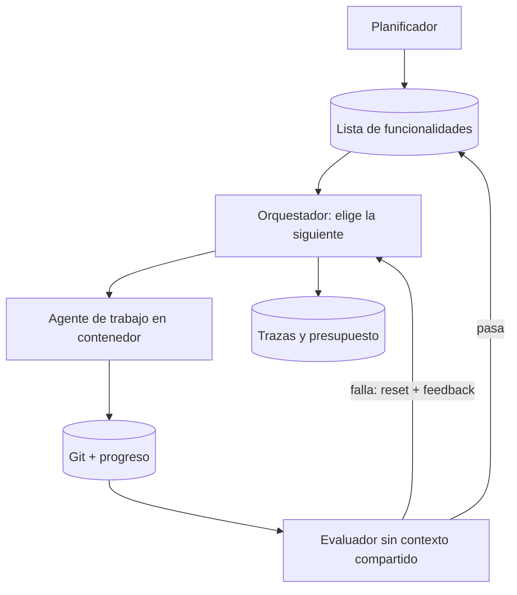

## Qué problema resuelve

Un [[sistemas/agente-de-codigo|agente de código]] resuelve bien una tarea de una sesión: un bug, un endpoint, un refactor acotado. Pídele una aplicación entera y aparecen otros fallos. Declara el trabajo terminado a medias. Rompe algo y no se entera. Llena la [[glosario/ventana-de-contexto|ventana]], la compacta y pierde decisiones. O pasa la mitad de la sesión averiguando cómo se arranca el proyecto.

Este sistema hace que un agente avance durante horas o días sobre un repositorio sin depender de su memoria. El estado vive fuera del modelo (plan, lista de funcionalidades, progreso, git), cada sesión empieza limpia y sabe por dónde seguir, y un evaluador independiente decide qué está hecho. Une dos patrones de Anthropic: el [[patrones/10-inicializador-y-agente-de-trabajo|inicializador y agente de trabajo]] (noviembre de 2025) y el [[patrones/11-planificador-generador-evaluador|planificador, generador y evaluador]] (marzo de 2026).

## Arquitectura



## Componentes

| Componente | Responsabilidad | Implementación típica |
|---|---|---|
| Planificador | Convertir la petición en spec y lista de funcionalidades verificables | Una sesión al principio, con salida estructurada; revisión humana de la lista |
| Lista de funcionalidades | Estado del trabajo: qué falta, qué pasa | `feature_list.json` con `id`, `description`, `steps`, `priority` y `passes`; solo la escribe el orquestador |
| Git y archivo de progreso | Memoria entre sesiones y forma de deshacer | Commit por funcionalidad; `claude-progress.txt` con qué se hizo y qué queda |
| Script de arranque | Que cada sesión levante la app igual | `init.sh` (dependencias, servidor, prueba básica) |
| Agente de trabajo | Implementar **una** funcionalidad por sesión | Claude Agent SDK o `claude -p`, con `max_turns` y `max_budget_usd` |
| Sandbox | Limitar lo que puede romper | Contenedor por ejecución, sin secretos, red restringida, repositorio clonado |
| Evaluador | Decidir si la funcionalidad pasa, sin fiarse del agente | Otra sesión, de solo lectura, sin `CLAUDE.md` ni historial; navegador o tests de extremo a extremo |
| Orquestador | Elegir trabajo, aplicar veredictos, parar a tiempo | Script determinista: el modelo no decide cuándo se acaba |
| Trazas y presupuesto | Saber qué pasó y cuánto costó | Una línea JSONL por sesión: funcionalidad, veredicto, turnos, coste |

## Flujo paso a paso

1. **Planificar.** El planificador lee la petición y escribe la spec y la lista de funcionalidades, todas con `passes: false`. Una persona la revisa: es el punto donde más barato sale corregir el alcance.
2. **Preparar el entorno.** La primera sesión escribe `init.sh`, el archivo de progreso y el primer commit, sin implementar nada.
3. **Elegir.** El orquestador toma la funcionalidad pendiente de más prioridad y guarda el commit de partida.
4. **Trabajar.** Una sesión nueva del agente de trabajo lee progreso y git log, ejecuta `init.sh` y una prueba básica (si algo está roto, lo arregla primero), implementa la funcionalidad, hace commit y anota el progreso. Si la vez anterior suspendió, recibe el *feedback* del evaluador.
5. **Evaluar.** Una sesión independiente revisa `git diff` desde el commit de partida y prueba la aplicación en marcha: la funcionalidad nueva y lo que ya pasaba.
6. **Aplicar el veredicto.** Si pasa, el orquestador marca `passes: true` y hace commit. Si no, vuelve al commit de partida (`git reset --hard`) y guarda los fallos para el siguiente intento.
7. **Registrar y decidir.** Escribe la traza, suma el coste y comprueba los topes: presupuesto, sesiones, fallos seguidos. Vuelve al paso 3 hasta que todo pase o salte un tope.

## Decisiones de diseño

**Quién marca `passes`.** En el artículo de Anthropic lo marca el propio agente tras probar, con la regla de no tocar nada más de la lista. Aquí lo marca el orquestador tras el veredicto del evaluador, y un hook impide al agente escribir el archivo. Es más caro (una sesión de evaluación por intento) y elimina el fallo más repetido de los agentes largos: dar por hecho lo que no está probado.

**Context reset frente a compactación.** Una sesión por funcionalidad es un *reset* sistemático: ventana limpia y traspaso por archivos. La [[glosario/compactacion|compactación]] conserva el hilo dentro de una sesión larga, pero arrastra lo acumulado. El artículo de marzo de 2026 necesitó *resets* con Sonnet 4.5, que cerraba el trabajo antes de tiempo al acercarse al límite, y pudo quitarlos con Opus 4.5. Con modelos actuales puedes combinar: sesiones de una funcionalidad y compactación dentro de cada una si se alarga ([[docs/contexto/05-compactacion-y-limpieza-en-el-servidor]]). Decide con tus trazas.

**Un agente o varios.** Planificador, trabajador y evaluador son tres sesiones con papeles distintos, pero **solo una escribe código**. Es el consenso de 2026 que recoge Cognition en [*Multi-Agents: What's Actually Working*](https://cognition.com/blog/multi-agents-working): las escrituras en un solo hilo, y los demás agentes aportan inteligencia (revisión, planificación), no acciones. El revisor funciona mejor sin contexto compartido con quien escribe.

**Paralelo, solo con aislamiento y un verificador que reparta fallos.** Nicholas Carlini ([*Building a C compiler with a team of parallel Claudes*](https://www.anthropic.com/engineering/building-c-compiler), febrero de 2026) lanzó 16 agentes sin orquestador. Cada uno, en un bucle que relanzaba Claude Code en un contenedor, clonaba un repositorio *bare* y reclamaba una tarea creando un archivo de bloqueo en `current_tasks/`. Sus lecciones: el verificador tiene que ser casi perfecto; si todos los agentes se atascan en el mismo bug, 16 no ayudan, así que usó GCC como oráculo para que cada uno arreglara un fallo distinto; y el modelo «no sabe la hora», así que conviene limitar la salida y muestrear tests (`--fast`). En tu máquina, el equivalente es un [[glosario/worktree|worktree]] por tarea con integración de una en una ([[disciplinas/trabajo-en-paralelo-con-agentes]]).

**Determinismo en el orquestador.** Elegir la siguiente funcionalidad, aplicar el veredicto, deshacer y parar son decisiones de código. El modelo decide dentro de cada sesión; fuera, las reglas no dependen de que obedezca un *prompt*.

## Código esencial

El orquestador con el [[herramientas/claude-agent-sdk|Claude Agent SDK]] (Python, términos comerciales de Anthropic). Las dos sesiones usan `query()`; el evaluador devuelve el veredicto con `output_format` y no carga ajustes del proyecto (`setting_sources=[]`). La lógica se probó sustituyendo `query` por una función falsa que simula tres sesiones (una suspende y la siguiente recibe el *feedback*) y ejecutando el hook directamente; no se ejecutó contra Claude Code.

```python title="orquestador.py"
import asyncio
import json
import subprocess
import time
from pathlib import Path
from typing import Any

from claude_agent_sdk import ClaudeAgentOptions, HookMatcher, ResultMessage, query

MODEL = "claude-sonnet-5-5"
REPO = Path("/workspace/app")              # montado en el contenedor, sin secretos
LISTA = REPO / "feature_list.json"
TRAZAS = Path("/workspace/trazas.jsonl")   # fuera del repo: el agente no las edita
PRESUPUESTO_USD = 150.0

VEREDICTO = {"type": "json_schema", "schema": {
    "type": "object", "additionalProperties": False, "required": ["pasa", "fallos"],
    "properties": {"pasa": {"type": "boolean"}, "fallos": {"type": "array", "items": {"type": "string"}}}}}


async def proteger_lista(entrada: dict[str, Any], tool_use_id: str | None, ctx: Any) -> dict[str, Any]:
    """El agente de trabajo no puede tocar feature_list.json: solo el orquestador marca passes."""
    ruta = str(entrada.get("tool_input", {}).get("file_path", ""))
    comando = str(entrada.get("tool_input", {}).get("command", ""))
    if ruta.endswith("feature_list.json") or ("feature_list.json" in comando and ">" in comando):
        return {"hookSpecificOutput": {"hookEventName": "PreToolUse", "permissionDecision": "deny",
                                       "permissionDecisionReason": "feature_list.json es del orquestador"}}
    return {}


def opciones_trabajo() -> ClaudeAgentOptions:
    return ClaudeAgentOptions(
        model=MODEL, cwd=REPO, setting_sources=["project"],          # carga CLAUDE.md del repo
        tools=["Read", "Edit", "Write", "Bash", "Glob", "Grep"],
        permission_mode="bypassPermissions",                         # solo dentro del contenedor
        hooks={"PreToolUse": [HookMatcher(matcher="Write|Edit|Bash", hooks=[proteger_lista])]},
        max_turns=150, max_budget_usd=8.0)


def opciones_evaluador() -> ClaudeAgentOptions:
    return ClaudeAgentOptions(
        model=MODEL, cwd=REPO, setting_sources=[],                   # sin contexto compartido
        tools=["Read", "Bash", "Glob", "Grep"], disallowed_tools=["Write", "Edit"],
        permission_mode="bypassPermissions", output_format=VEREDICTO, max_turns=60, max_budget_usd=3.0)


async def sesion(prompt: str, opciones: ClaudeAgentOptions) -> ResultMessage | None:
    resultado = None
    async for m in query(prompt=prompt, options=opciones):
        if isinstance(m, ResultMessage):
            resultado = m
    return resultado


def traza(**datos: Any) -> None:
    with TRAZAS.open("a", encoding="utf-8") as f:
        f.write(json.dumps({"ts": time.time(), **datos}, ensure_ascii=False) + "\n")


def git(*args: str) -> str:
    return subprocess.run(["git", *args], cwd=REPO, capture_output=True, text=True).stdout.strip()


async def trabajar(max_sesiones: int = 60, max_fallos_seguidos: int = 3) -> None:
    gastado, fallos_seguidos, notas = 0.0, 0, {}
    for n in range(1, max_sesiones + 1):
        lista = json.loads(LISTA.read_text(encoding="utf-8"))
        pendientes = sorted((f for f in lista if not f["passes"]), key=lambda f: f.get("priority", 99))
        if not pendientes:
            return traza(evento="fin", motivo="todas pasan", coste=gastado)
        f, base = pendientes[0], git("rev-parse", "HEAD")
        r = await sesion(f"Sesión nueva. Lee claude-progress.txt y git log. Ejecuta ./init.sh y la prueba "
                         f"básica. Implementa SOLO {f['id']}: {f['description']}. Pasos: {f['steps']}. "
                         "Haz commit y actualiza claude-progress.txt. "
                         f"QA del intento anterior: {notas.get(f['id'], 'ninguno')}", opciones_trabajo())
        v = await sesion(f"Revisa `git diff {base}` y prueba la app en marcha como un usuario. "
                         f"¿Cumple {f['id']}: {f['steps']}? ¿Sigue funcionando lo que ya pasaba?",
                         opciones_evaluador())
        veredicto = (v.structured_output if v else None) or {"pasa": False, "fallos": ["sin veredicto"]}
        gastado += sum(x.total_cost_usd or 0 for x in (r, v) if x)
        if veredicto["pasa"]:
            f["passes"], fallos_seguidos = True, 0
            LISTA.write_text(json.dumps(lista, ensure_ascii=False, indent=2), encoding="utf-8")
            git("commit", "-am", f"harness: {f['id']} pasa")
        else:
            fallos_seguidos, notas[f["id"]] = fallos_seguidos + 1, veredicto["fallos"]
            git("reset", "--hard", base)              # descarta la sesión fallida; git es la memoria
        traza(evento="sesion", n=n, funcionalidad=f["id"], pasa=veredicto["pasa"],
              fallos=veredicto["fallos"], coste=gastado, turnos=r.num_turns if r else None,
              motivo=r.subtype if r else "sin_resultado")
        if gastado > PRESUPUESTO_USD or fallos_seguidos >= max_fallos_seguidos:
            return traza(evento="parada", motivo="presupuesto o fallos seguidos", coste=gastado)
    traza(evento="parada", motivo="límite de sesiones", coste=gastado)


if __name__ == "__main__":
    asyncio.run(trabajar())
```

Para Claude Code en modo *headless* el esquema es el mismo con `claude -p` en lugar de `query()` y `--max-budget-usd` por sesión ([[docs/claude-code/08-modo-headless-y-ci]]). Si prefieres no construir el bucle ni el sandbox, Anthropic ofrece un harness alojado: [[docs/agentes/04-managed-agents]].

> [!peligro] El contenedor es la frontera, no el prompt
> `bypassPermissions` sin un contenedor desechable equivale a dar tu máquina al agente. Monta solo el repositorio, sin claves ni `~/.ssh`, con la red cerrada salvo lo justo para instalar dependencias, y recuerda que una lista blanca de dominios también es una capacidad que se puede abusar. Ver [[cursos/seguridad-y-prompt-injection/04-permisos-y-sandbox]].

## Cómo evaluarlo

- **Tasa de falso «hecho».** Ten una batería de tests de aceptación **oculta** al agente y al evaluador. Al final, ¿cuántas funcionalidades con `passes: true` la pasan? Es la métrica que más dice de un agente largo.
- **[[glosario/pass-k|pass^k]], no solo pass@k.** Ejecuta el sistema k veces sobre el mismo conjunto de proyectos pequeños. pass^k mide si acierta **siempre**: con un 75 % de acierto por ensayo, pass^3 baja a un 42 % ([Anthropic, *Demystifying evals for AI agents*](https://www.anthropic.com/engineering/demystifying-evals-for-ai-agents), enero de 2026). Es lo que importa si va a trabajar sin supervisión.
- **Calidad del evaluador.** Etiqueta a mano una muestra de veredictos y mide cuántos fallos reales detecta y cuántas funcionalidades buenas deja pasar, como en [[recetas/validar-un-modelo-juez]].
- **Lee las trazas.** Sesiones por funcionalidad, fallos más repetidos, sesiones que acaban por límite de turnos. Agrúpalos con [[recetas/analisis-de-errores-de-trazas]] y convierte cada fallo repetido en una mejora del harness.
- **Desconfía de diferencias pequeñas.** En evals agénticas, el ruido de infraestructura mueve los resultados varios puntos; Anthropic recomienda escepticismo ante ventajas de menos de 3 puntos ([*Quantifying infrastructure noise in agentic coding evals*](https://www.anthropic.com/engineering/infrastructure-noise), febrero de 2026). Repite en días distintos.

## Costes y riesgos

**Costes.** Este sistema gasta mucho más que una sesión. En el artículo de marzo de 2026, la misma petición costó 9 dólares y 20 minutos con el modelo en solitario y 200 dólares y 6 horas con el harness completo, con un resultado mucho más funcional. Carlini cuenta unas 2.000 sesiones en dos semanas, unos 2.000 millones de tokens de entrada y 140 millones de salida, por menos de 20.000 dólares. Y Naresh Jain ([*Are Harnesses Worth the Cost?*](https://martinfowler.com/articles/are-harnesses-worth-the-cost.html), octubre de 2026) midió que con un modelo frontera el harness multiplicó el coste por 7 sin ganar fiabilidad, mientras que con un modelo barato pasó de 3/10 a 10/10 y salió más barato que el frontera sin harness. Conclusión práctica: **mide primero sin harness**; si el modelo ya acierta siempre, basta una puerta de aceptación final.

Palancas: presupuesto por sesión (`max_budget_usd`) y total, tope de fallos seguidos, un modelo más barato para el trabajador si las evals lo permiten, [[glosario/prompt-caching|caché]] del prefijo estable y evaluación barata primero (tests) y cara después (navegador).

**Riesgos.**

- **Victoria prematura y tests debilitados.** El agente borra o relaja una prueba para que pase. Prohíbelo, vigílalo con hooks y verifica con una batería que no pueda tocar.
- **Verificador equivocado.** Si los tests no reflejan la spec, el sistema converge a otra cosa. Revisa la lista y la aceptación antes de lanzar horas de trabajo.
- **Entorno roto que se arrastra.** La prueba básica al empezar cada sesión lo detecta pronto.
- **Gasto descontrolado.** Sin topes, un bucle que no avanza sigue facturando.
- **Inyección y exfiltración.** Dependencias, issues o páginas que el agente lee son entrada no fiable. Sin secretos en el contenedor y sin salida libre a red, el daño queda acotado ([[glosario/trifecta-letal]]).
- **Conflictos en paralelo.** Dos agentes que tocan el mismo módulo se pisan. Una tarea por módulo y por worktree, e integración de una en una.

## Variantes

- **El harness SDD del autor.** El [[sistemas/harness-sdd-claude-code|harness SDD para Claude Code]] lleva este sistema a un flujo con fases y gates: un orquestador que no implementa, cuatro subagentes (explorer, designer, builder, reviewer), spec congelada con aceptación ejecutable y aprobación humana antes de construir, una sola reparación automática, coste por funcionalidad con un hook `SubagentStop` y presupuesto que bloquea al superarse. `feature_list.json` y el estado de cada funcionalidad los escribe solo una herramienta, y la skill `feature-resume` reconcilia el estado antes de relanzar una sesión interrumpida. Lo explica el curso [[cursos/harness-engineering/index]], en especial [[cursos/harness-engineering/06-el-flujo-como-maquina-de-estados]], [[cursos/harness-engineering/10-coste-y-presupuesto]] y [[cursos/harness-engineering/11-sesiones-largas]].
- **Con olas.** La [[sistemas/harness-sdd-olas|variante con olas]] abre varias funcionalidades independientes a la vez, cada una en su worktree con su sesión, y el árbol principal solo integra con *squash* y regresión completa ([[cursos/harness-engineering/13-features-en-paralelo-con-olas]]).
- **Mínima.** Un [[patrones/12-bucle-ralph|bucle Ralph]]: un *prompt* fijo y un plan, sin evaluador separado. Sirve si el verificador es fuerte.
- **Con planificador y contratos.** Añade sprints con contrato entre generador y evaluador cuando las funcionalidades son grandes ([[patrones/11-planificador-generador-evaluador]]).

## Por dónde empezar

1. Domina el bucle de un agente con [[roadmap/40-primer-agente/index]] y el contexto largo con [[cursos/context-engineering/04-contexto-para-agentes-largos]].
2. Empieza con un proyecto pequeño (10–15 funcionalidades) y el patrón 10 tal cual: lista, progreso, `init.sh`, una funcionalidad por sesión.
3. Añade el evaluador separado y compara la tasa de falso «hecho» con y sin él.
4. Mete el contenedor, los topes y las trazas antes de dejarlo trabajar de noche.
5. Solo entonces prueba el paralelo, con worktrees y un verificador que reparta fallos.
