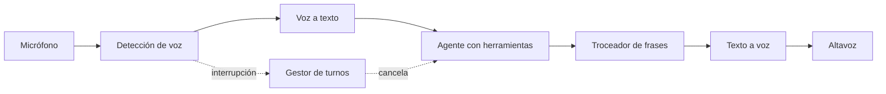

## Qué problema resuelve

Hay situaciones donde escribir no es práctico: una línea de atención telefónica, un asistente para técnicos con las manos ocupadas, una reserva por teléfono. Un agente de voz escucha a la persona, decide qué hacer con herramientas (consultar una cita, comprobar disponibilidad) y responde hablando.

Lo difícil está en el **ritmo de la conversación**. Las personas notan enseguida un silencio largo antes de cada respuesta, hablan encima cuando el agente se enrolla y esperan que se le pueda cortar. Además, en voz no hay botón de «confirmar»: un número mal entendido puede acabar en una reserva para otro día. Este sistema encadena tres etapas en *streaming* (voz a texto, modelo, texto a voz), gestiona las interrupciones y exige **confirmación hablada** antes de cualquier acción.

## Arquitectura



## Componentes

| Componente | Responsabilidad | Implementación típica |
|---|---|---|
| Transporte de audio | Llevar audio en tiempo real en ambos sentidos | WebRTC en navegador, pasarela telefónica o WebSocket |
| Detección de actividad de voz y de fin de turno | Saber cuándo empieza a hablar la persona y cuándo ha terminado de verdad | Modelo de VAD ligero para la voz; pausa mínima o un modelo de [[glosario/deteccion-de-turno|detección de fin de turno]] para cerrar el turno |
| Voz a texto | Transcribir mientras se habla | Servicio de transcripción en *streaming* con resultados parciales |
| Agente con herramientas | Entender, decidir, llamar herramientas y redactar para el oído | Bucle de [[patrones/08-agente-autonomo]] con *streaming* de la respuesta |
| Troceador de frases | Enviar al TTS frases completas en cuanto existen | Corte por puntuación sobre el flujo de texto |
| Texto a voz | Sintetizar con poca espera | Servicio de TTS en *streaming* |
| Gestor de turnos e interrupciones | Coordinar quién habla, cancelar y recortar historial | Tareas `asyncio` y eventos del VAD |

## Flujo paso a paso

1. **Escuchar**. El audio llega por el transporte. El VAD detecta que la persona habla y el transcriptor emite texto parcial.
2. **Cerrar el turno**. Tras una pausa corta, el VAD da el turno por terminado y se toma la transcripción final. Ese umbral de pausa es un compromiso: corto responde antes pero corta a quien piensa en voz alta. Un detector de fin de turno semántico mira además el texto («quería reservar para el…» no está acabado) y reduce ese dilema.
3. **Pensar y llamar herramientas**. El agente recibe el texto. Si necesita una herramienta, el sistema dice una frase breve de espera («Lo miro») mientras se ejecuta.
4. **Responder en *streaming***. En cuanto el modelo genera la primera frase completa, el troceador la envía al TTS. El audio empieza a sonar mientras el modelo sigue escribiendo las siguientes.
5. **Interrupción**. Si el VAD detecta voz mientras el agente habla, el gestor detiene el audio, cancela la generación y guarda en el historial **solo lo que llegó a sonar**.
6. **Confirmar antes de actuar**. Para acciones con efectos, el agente repite los datos clave («El martes 14 a las 10:30, ¿lo confirmo?») y solo llama a la herramienta tras un sí explícito en el turno siguiente.
7. **Cerrar**. Al terminar la llamada se guardan transcripción, trazas y acciones para auditoría y evaluación.

## Decisiones de diseño

**Cascada frente a modelos de voz nativa.** La cascada (voz a texto, LLM, texto a voz) te deja elegir cada pieza, ver el texto en cada etapa, reutilizar herramientas y *prompts* de tus agentes de texto y evaluar con las mismas técnicas. Los modelos que procesan y generan audio directamente reducen etapas y pueden sonar más naturales, a cambio de menos control y depuración más difícil. Las capacidades y nombres cambian rápido: consulta la documentación de cada proveedor. Esta ficha describe la cascada porque es la más fácil de razonar.

**Presupuesto de latencia.** Fija un objetivo antes de elegir piezas. Una referencia práctica muy citada entre quienes construyen agentes de voz (Kwindla Kramer, *Advice on Voice Agents*, junio de 2025) es una **mediana de unos 800 ms de voz a voz**, desde que la persona deja de hablar hasta que oye la primera palabra, con 1,5 s como aceptable en un prototipo. Ese tiempo se reparte entre red, detección de fin de turno, transcripción final, primer *token* del modelo y primer audio del TTS, y una llamada a herramienta casi duplica la parte del modelo. Por eso el código de abajo dice una frase de espera mientras corre la herramienta, y pide al modelo poco esfuerzo y nada de razonamiento antes de la primera frase. Ajustar el VAD y los turnos rinde más al final, cuando el resto ya está medido.

**Fin de turno por silencio o por significado.** Un VAD solo oye silencio. Un modelo de detección de fin de turno basado en texto decide si la frase está completa: LiveKit publicó en diciembre de 2025 una versión multilingüe (con español) que, según sus mediciones, reduce las interrupciones falsas sin añadir latencia. Úsalo cuando las personas hagan pausas largas a mitad de frase, como al dictar un número o una dirección.

**Todo en *streaming*.** La espera percibida es la suma de lo que tarda cada etapa en producir su primer resultado: fin de turno, transcripción final, primer *token* del modelo, primera frase completa, primer audio. Por eso cada etapa trabaja en *streaming* y el troceador no espera a la respuesta completa. Ver [[glosario/streaming]] y [[recetas/streaming-de-respuestas]].

**Respuestas escritas para el oído.** El *prompt* de sistema pide frases cortas, nada de listas, tablas ni Markdown, números y fechas dichos como se pronuncian, y como mucho una pregunta por turno. Un `max_tokens` bajo es una red de seguridad: en voz, una respuesta larga casi siempre es mala respuesta. Ten en cuenta que el razonamiento también consume `max_tokens`; con `thinking={"type": "between_tools"}` (Sonnet 5.5) el modelo no razona antes de la primera frase y sí entre herramientas, y `effort: "low"` acorta el resto.

**Interrupción con historial recortado.** Si la persona corta al agente a mitad de frase, el historial debe reflejar que solo dijo esa mitad. Si guardas la respuesta completa, el modelo creerá que la persona oyó cosas que no oyó.

**Confirmaciones como norma de la herramienta.** La confirmación no puede depender solo del *prompt*. Las herramientas con efectos exigen un argumento `confirmado_por_usuario` y tu código comprueba que el turno anterior del usuario contiene una afirmación clara. Para datos críticos (importes, números de cuenta), pide que la persona los repita o los deletree. Ver [[recetas/aprobacion-humana-antes-de-actuar]].

**Elegir el modelo por latencia.** En voz, el tiempo hasta el primer *token* pesa tanto como la calidad. Un modelo más rápido con buenas herramientas suele dar mejor experiencia que uno más capaz pero lento. Mide ambos en tus conversaciones; ver [[modelos/05-elegir-modelo-por-tarea]].

## Código esencial

El núcleo: generar en *streaming*, trocear en frases, hablar y cancelar al detectar una interrupción. Transporte, VAD, transcripción y TTS se abstraen como objetos con métodos asíncronos, porque dependen del proveedor que elijas.

```python title="voz.py"
import asyncio
import re
import anthropic

MODEL = "claude-sonnet-5-5"
client = anthropic.AsyncAnthropic()

SYSTEM = """Eres el asistente telefónico de una clínica. Hablas, no escribes:
frases cortas, sin listas ni símbolos, fechas y horas como se dicen en voz alta.
Una sola pregunta por turno. Antes de reservar o cancelar, repite los datos y pide un sí."""

FIN_DE_FRASE = re.compile(r"(?<=[.!?…])\s+")

async def frases(flujo_texto):
    """Agrupa el texto que llega en trozos en frases completas."""
    pendiente = ""
    async for trozo in flujo_texto:
        pendiente += trozo
        partes = FIN_DE_FRASE.split(pendiente)
        for frase in partes[:-1]:
            yield frase
        pendiente = partes[-1]
    if pendiente.strip():
        yield pendiente

async def hablar_respuesta(mensajes: list, altavoz, dicho: list[str]):
    """Genera y reproduce una respuesta. Devuelve el mensaje final del modelo."""
    async with client.messages.stream(
            model=MODEL, max_tokens=300, system=SYSTEM, tools=HERRAMIENTAS, messages=mensajes,
            thinking={"type": "between_tools"},      # Sonnet 5.5: sin razonar antes de la primera frase
            output_config={"effort": "low"},         # en voz manda el tiempo hasta el primer audio
    ) as stream:
        async for frase in frases(stream.text_stream):
            await altavoz.decir(frase)          # vuelve cuando la frase ha sonado
            dicho.append(frase)
        return await stream.get_final_message()

async def turno_del_agente(mensajes: list, altavoz, vad) -> None:
    while True:
        dicho: list[str] = []
        generar = asyncio.create_task(hablar_respuesta(mensajes, altavoz, dicho))
        interrumpir = asyncio.create_task(vad.esperar_voz_del_usuario())
        hecho, _ = await asyncio.wait({generar, interrumpir},
                                      return_when=asyncio.FIRST_COMPLETED)
        if interrumpir in hecho:                 # la persona habla encima
            generar.cancel()
            await altavoz.parar()
            if dicho:                            # guarda solo lo que llegó a sonar
                mensajes.append({"role": "assistant",
                                 "content": " ".join(dicho) + " [interrumpido]"})
            return                               # el bucle principal escucha el nuevo turno
        interrumpir.cancel()
        final = generar.result()
        if final.stop_reason != "tool_use":      # end_turn, max_tokens o refusal: guarda lo que sonó
            mensajes.append({"role": "assistant", "content": " ".join(dicho) or "…"})
            return
        mensajes.append({"role": "assistant", "content": final.content})
        await altavoz.decir("Un momento, lo compruebo.")
        resultados = []
        for b in final.content:
            if b.type == "tool_use":
                contenido, error = await ejecutar_herramienta(b.name, b.input, mensajes)
                resultados.append({"type": "tool_result", "tool_use_id": b.id,
                                   "content": contenido, "is_error": error})
        mensajes.append({"role": "user", "content": resultados})

def anadir_turno_usuario(mensajes: list, texto: str) -> None:
    """Si el agente fue interrumpido sin llegar a hablar, el último mensaje ya es del usuario."""
    ultimo = mensajes[-1] if mensajes else None
    if ultimo and ultimo["role"] == "user" and isinstance(ultimo["content"], str):
        ultimo["content"] += " " + texto
    else:
        mensajes.append({"role": "user", "content": texto})

async def conversacion(microfono, transcriptor, altavoz, vad) -> None:
    mensajes: list = []
    while True:
        texto = await transcriptor.siguiente_turno(microfono)   # espera el fin de turno
        if texto is None:                                       # la llamada terminó
            return
        anadir_turno_usuario(mensajes, texto)
        await turno_del_agente(mensajes, altavoz, vad)
```

Tres detalles importan. `between_tools` es propio de Sonnet 5.5: con otro modelo, quita `thinking` y regula solo con `effort`. Si la interrupción llega mientras se ejecuta una herramienta, la herramienta termina igualmente y su resultado entra en el historial: no dejes un `tool_use` sin su `tool_result`. Y `ejecutar_herramienta` recibe el historial para comprobar que las acciones con efectos tienen una confirmación explícita en el último turno del usuario.

> [!aviso] El primer audio es lo que se percibe
> Mide por separado el tiempo hasta el fin de turno, hasta la transcripción, hasta el primer *token*, hasta la primera frase y hasta el primer audio. Optimizar la etapa equivocada es el error más común. Ver [[docs/produccion/03-latencia]].

## Cómo evaluarlo

- **Latencia por etapa y de voz a voz**, en P50 y P95 y en conversaciones reales, no en pruebas aisladas. Compárala con tu presupuesto.
- **Interrupciones falsas**: veces que el agente corta a la persona cuando no había terminado. Es la métrica que mueve el detector de fin de turno.
- **Transcripción**: tasa de errores en las palabras que importan (nombres, fechas, números). Un error ahí es peor que diez en palabras de relleno.
- **Tarea completada**: guiones de conversación con objetivo («reservar el jueves por la tarde») ejecutados con voz sintética o con personas. ¿Se logró? ¿Con cuántos turnos?
- **Confirmaciones**: ninguna acción con efectos sin un sí explícito en el turno anterior. Se comprueba con código sobre las trazas. Ver [[roadmap/80-evals/04-evals-de-trayectoria]].
- **Interrupciones**: casos donde la persona corta al agente. El historial debe contener solo lo dicho y la respuesta siguiente debe tener en cuenta la corrección.
- **Escucha humana por muestreo**: hay problemas de tono y ritmo que solo se oyen.

## Costes y riesgos

**Costes.** Pagas tres servicios por minuto de conversación: transcripción, modelo y síntesis. El modelo recibe el historial completo en cada turno, así que las llamadas largas cuestan cada vez más; cachea el prefijo fijo ([[glosario/prompt-caching]]) y compacta conversaciones muy largas. Las respuestas cortas ahorran en modelo y en síntesis a la vez.

**Riesgos.**

- **Errores de transcripción que se convierten en acciones**: la confirmación hablada es la defensa principal. Para datos críticos, pide repetición.
- **Suplantación**: la voz no autentica. Si hay datos personales o acciones sensibles, verifica identidad por otro canal o con datos que solo la persona conoce.
- **Grabación y privacidad**: informa de que la llamada se procesa y graba, y define cuánto tiempo guardas audio y transcripciones.
- **Silencios y bucles**: si el transcriptor no entiende varias veces seguidas, ofrece pasar con una persona. Un agente que repite «no te he entendido» es peor que ninguno.
- **Inyección por voz**: también se puede dictar «ignora tus instrucciones». Las mismas defensas que en texto: [[docs/seguridad/01-prompt-injection]].

## Variantes

- **Copiloto para agentes humanos**: el sistema escucha la llamada y sugiere respuestas o rellena la ficha en pantalla, sin hablar. Menos exigente en latencia y en riesgo.
- **Voz nativa**: un modelo que procesa audio directamente ([[glosario/voz-a-voz|voz a voz]]) sustituye la cascada; mantén el gestor de turnos y las confirmaciones. Pierdes el texto intermedio sobre el que aplicar políticas y evals antes de hablar.
- **Dúplex completo**: el siguiente paso quita el detector de turnos: el modelo escucha y habla a la vez, como en una llamada entre personas. OpenAI describió un sistema así, que además delega el trabajo difícil en otros modelos de forma asíncrona y separa el audio de la lógica para que una herramienta lenta no congele la voz (*How we built a realtime system for responsive voice AI in six months*, 3 ago. 2026). Las confirmaciones antes de actuar siguen siendo tuyas.
- **Voz sobre un agente existente**: el mismo núcleo con las herramientas del [[sistemas/soporte-con-aprobacion-humana|agente de soporte]], que ya tiene aprobación humana para las acciones caras.
- **Pulsar para hablar**: en entornos ruidosos, un botón sustituye al VAD y elimina casi todos los problemas de turnos.
- **Modelo local en el centro**: [[herramientas/ollama|Ollama]] expone una API compatible con la de Mensajes, así que el mismo `voz.py` funciona con `anthropic.AsyncAnthropic(base_url="http://localhost:11434", api_key="ollama")` y un modelo abierto en `MODEL`, quitando `thinking` (es de Sonnet 5.5) y sin *prompt caching*, que Ollama no implementa. La latencia pasa a depender de tu GPU: mide el primer *token* antes de decidir ([[recetas/agente-local-con-ollama]]).

## Por dónde empezar

1. Domina el *streaming* de texto con [[recetas/streaming-de-respuestas]] y [[docs/fundamentos/04-streaming]].
2. Construye el agente en texto primero, con sus herramientas y evals: [[roadmap/40-primer-agente/05-agente-con-varias-herramientas]].
3. Añade voz con «pulsar para hablar» antes que con VAD: separa los problemas de turnos de los de contenido.
4. Mide la latencia por etapa desde el primer prototipo con [[roadmap/100-produccion/03-latencia]].
5. Diseña confirmaciones y errores pensando en el oído; [[disciplinas/ux-de-agentes]] te da criterios.
