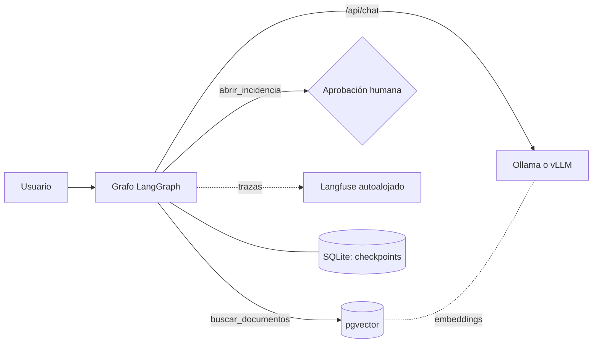

## Qué problema resuelve

Tu equipo quiere un asistente que conteste sobre documentación interna y haga pequeñas acciones (abrir una incidencia, consultar un estado), pero los documentos no pueden salir de la red: contratos, historiales, código propietario o datos de clientes con requisitos de residencia. Una API externa queda descartada por contrato, no por calidad.

Este sistema es la respuesta completa con piezas abiertas. Un modelo de [[glosario/pesos-abiertos|pesos abiertos]] servido por [[herramientas/ollama|Ollama]] (o [[herramientas/vllm|vLLM]] cuando hay varios usuarios), un agente en [[herramientas/langgraph|LangGraph]] con dos herramientas, un índice híbrido en [[herramientas/pgvector|pgvector]] y trazas en un [[herramientas/langfuse|Langfuse]] autoalojado. **Ninguna petición sale de tu máquina o de tu servidor**: ni las preguntas, ni los fragmentos, ni los *embeddings*, ni las trazas.

Es el proyecto del curso [[cursos/agentes-con-modelos-abiertos/index]]: cada lección construye una pieza.

## Arquitectura



## Componentes

| Componente | Responsabilidad | Implementación | Licencia |
|---|---|---|---|
| Modelo local | Generar respuestas y decidir llamadas a herramientas | Ollama v0.40.12 con `qwen3.6:27b` (o vLLM 0.32 en GPU) | Ollama MIT · Qwen 3.6 Apache 2.0 |
| Modelo de embeddings | Vectorizar fragmentos y preguntas | `qwen3-embedding:0.6b` en el mismo Ollama | Revisa la *model card* (sin confirmar en nuestra revisión) |
| Grafo del agente | Bucle modelo → herramientas → modelo, límites, pausa para aprobar | LangGraph 1.2 con `ChatOllama` (langchain-ollama 1.1) | MIT |
| Índice vectorial | Búsqueda híbrida vectorial + léxica en español con RRF | pgvector 0.8.7 sobre Postgres | Cliente `pgvector` MIT; extensión, revisa su `LICENSE` |
| Persistencia del agente | Guardar el estado de cada conversación para reanudar tras una aprobación | `SqliteSaver` (langgraph-checkpoint-sqlite) | MIT |
| Trazas | Una traza por turno con llamadas al modelo y a herramientas | SDK Langfuse v5 (`@observe`) contra tu servidor | SDK MIT; revisa la licencia del servidor |

## Flujo paso a paso

1. **Ingesta (fuera de línea).** Los documentos se trocean por párrafos con ids estables (`manual#3`), se vectorizan con el modelo de embeddings local y se guardan en pgvector con una columna `tsvector('spanish')` generada. Es el módulo `rag_local.py` de [[cursos/agentes-con-modelos-abiertos/05-rag-cien-por-cien-local]].
2. **Pregunta.** El usuario escribe; el grafo añade el mensaje al estado del hilo (`thread_id`) y llama al modelo con el *prompt* de sistema y la lista de herramientas.
3. **Decisión del modelo.** Si necesita datos, pide `buscar_documentos`. `tools_condition` enruta al nodo de herramientas si hay `tool_calls` y, si no, termina.
4. **Búsqueda.** La herramienta ejecuta la consulta híbrida (vectorial + léxica fusionadas con RRF en SQL) y devuelve los fragmentos dentro de etiquetas con su id.
5. **Respuesta con citas.** El modelo responde citando ids. Si no hay evidencia, lo dice.
6. **Acción con aprobación.** Si el usuario pide abrir una incidencia, la herramienta llama a `interrupt()`: el grafo se pausa, el estado se guarda en SQLite y la aplicación muestra la propuesta a un humano. Al reanudar con `Command(resume="aprobar")`, la herramienta se ejecuta de nuevo desde el principio y esta vez crea la incidencia.
7. **Trazas.** Cada turno queda en Langfuse como una observación de tipo `agent`, en tu propio servidor.

## Decisiones de diseño

**Ollama primero, vLLM cuando haga falta.** Para un equipo pequeño, Ollama en una máquina con GPU basta y no necesita configuración de *parsers*. Cuando hay muchos usuarios a la vez, vLLM con *continuous batching* reparte mejor la GPU ([[cursos/agentes-con-modelos-abiertos/03-servir-modelos-en-produccion]]). El grafo no cambia: `ChatOllama` se sustituye por un cliente compatible con OpenAI apuntando a vLLM.

**Un grafo explícito en lugar de `create_agent`.** Con [[cursos/agentes-con-modelos-abiertos/04-herramientas-con-modelos-abiertos|`create_agent`]] el bucle sale en diez líneas. Aquí se usa `StateGraph` porque el sistema crecerá con nodos propios (un clasificador previo, una verificación de citas) y porque deja ver cada paso en las trazas.

**pgvector frente a Qdrant.** Si ya operas Postgres, pgvector es un sistema menos, con transacciones, copias y permisos que ya conoces, y la híbrida cabe en una consulta. [[herramientas/qdrant|Qdrant]] (Apache 2.0) compensa con filtros ricos, multitenencia y colecciones muy grandes. El grafo solo ve la función `buscar`.

**La aprobación vive dentro de la herramienta.** Poner `interrupt()` en `abrir_incidencia` hace que la regla «nada se escribe sin humano» no dependa del modelo. Como el nodo se repite al reanudar, todo lo que haya antes del `interrupt()` debe poder ejecutarse dos veces sin efectos secundarios.

**Límites explícitos.** `recursion_limit` por defecto en LangGraph es tan alto que no sirve de tope: aquí se fija en 12 pasos por turno. `num_predict` limita la salida (en Ollama el defecto es ilimitado) y `num_ctx` se fija a 65 536, el mínimo que Ollama recomienda para agentes.

**Alternativas abiertas.** LlamaIndex o Pydantic AI en lugar de LangGraph; Qdrant o LanceDB en lugar de pgvector; Phoenix en lugar de Langfuse (ojo: el servidor de Phoenix usa Elastic 2.0, que no es una licencia OSI); [[herramientas/open-webui|Open WebUI]] como interfaz de chat (licencia BSD-3 con una cláusula de marca por encima de 50 usuarios).

## Código esencial

El grafo completo. `rag_local` es el módulo de la lección 5 (conexión a pgvector, embeddings con Ollama y búsqueda híbrida).

```python title="asistente.py"
import json
from langchain.messages import SystemMessage
from langchain.tools import tool
from langchain_ollama import ChatOllama
from langfuse import get_client, observe
from langgraph.checkpoint.sqlite import SqliteSaver
from langgraph.graph import START, MessagesState, StateGraph
from langgraph.prebuilt import ToolNode, tools_condition
from langgraph.types import interrupt

import rag_local                                   # la lección 5: pgvector + embeddings locales

MODEL = "qwen3.6:27b"
SYSTEM = SystemMessage(
    "Eres el asistente interno de soporte. Para cualquier dato de la empresa usa buscar_documentos "
    "y cita los ids entre corchetes. Si no hay evidencia, dilo. Abre incidencias solo si el usuario lo pide.")

@tool(parse_docstring=True)
def buscar_documentos(consulta: str) -> str:
    """Busca en la documentación interna y devuelve los fragmentos más relevantes con su id.

    Args:
        consulta: Pregunta o palabras clave, en español.
    """
    with rag_local.conectar() as conn:
        fragmentos = rag_local.buscar(conn, consulta, k=4)
    return "\n".join(f'<fragmento id="{i}">{c}</fragmento>' for i, c in fragmentos) or "Sin resultados."

@tool(parse_docstring=True)
def abrir_incidencia(titulo: str, descripcion: str) -> str:
    """Abre una incidencia en el gestor interno. Pide aprobación humana antes de crearla.

    Args:
        titulo: Resumen de una línea.
        descripcion: Qué pasa y qué ha intentado el usuario.
    """
    decision = interrupt({"accion": "abrir_incidencia", "titulo": titulo})   # pausa hasta que un humano responda
    if decision != "aprobar":
        return "Incidencia NO creada: un humano la ha rechazado."
    return json.dumps({"id": "INC-0042", "titulo": titulo})          # aquí iría tu gestor real

TOOLS = [buscar_documentos, abrir_incidencia]

def construir(checkpointer, llm=None):
    llm = (llm or ChatOllama(model=MODEL, num_ctx=65536, num_predict=2048, reasoning=False)).bind_tools(TOOLS)

    def modelo(state: MessagesState):
        return {"messages": [llm.invoke([SYSTEM, *state["messages"]])]}

    g = StateGraph(MessagesState)
    g.add_node("modelo", modelo)
    g.add_node("tools", ToolNode(TOOLS))
    g.add_edge(START, "modelo")
    g.add_conditional_edges("modelo", tools_condition)   # → "tools" si hay tool_calls; si no, END
    g.add_edge("tools", "modelo")
    return g.compile(checkpointer=checkpointer)

@observe(as_type="agent")                              # una traza por turno en tu Langfuse autoalojado
def preguntar(grafo, hilo: str, entrada):
    config = {"configurable": {"thread_id": hilo}, "recursion_limit": 12}   # tope de pasos real
    return grafo.invoke(entrada, config, version="v2")

if __name__ == "__main__":
    from langgraph.types import Command
    with SqliteSaver.from_conn_string("asistente.db") as cp:
        grafo = construir(cp)
        out = preguntar(grafo, "u7-1", {"messages": [("user", "¿Cuántos días hay para devolver un producto?")]})
        print(out.value["messages"][-1].content)
        out = preguntar(grafo, "u7-1", {"messages": [("user", "Abre una incidencia: el formulario de devoluciones da error 500.")]})
        while out.interrupts:
            print("Pendiente:", out.interrupts[0].value)
            out = preguntar(grafo, "u7-1", Command(resume="aprobar"))
        print(out.value["messages"][-1].content)
    get_client().flush()
```

Ejecutado en el entorno de prueba de MoreContext con pgvector 0.8.7 real (PGlite con PostgreSQL 18.6), un servidor que imita las rutas `/api/chat` y `/api/embed` de Ollama con un guion de cuatro turnos y las trazas desactivadas (`LANGFUSE_TRACING_ENABLED=false`):

```text
Tienes 30 días naturales desde la entrega [dev-1].
Pendiente: {'accion': 'abrir_incidencia', 'titulo': 'Error 500 en devoluciones'}
He abierto la incidencia INC-0042.
['/api/chat', '/api/embed', '/api/chat', '/api/chat', '/api/chat']
mensajes en la 2ª llamada: ['system', 'user', 'assistant', 'tool']
herramientas ofrecidas: ['buscar_documentos', 'abrir_incidencia'] · num_ctx: 65536
```

Las dos últimas líneas son lo que vio el servidor: la búsqueda generó una llamada a `/api/embed` (el *embedding* de la consulta), el segundo turno del modelo recibió el resultado de la herramienta y `ChatOllama` mandó `num_ctx` en cada petición. Para ponerlo en marcha de verdad:

```bash
docker run -d --name rag-db -e POSTGRES_PASSWORD=local -p 5432:5432 pgvector/pgvector:pg18
ollama pull qwen3.6:27b && ollama pull qwen3-embedding:0.6b
pip install langgraph langgraph-checkpoint-sqlite langchain langchain-ollama langfuse psycopg pgvector numpy ollama
export LANGFUSE_BASE_URL=http://localhost:3000 LANGFUSE_PUBLIC_KEY=pk-… LANGFUSE_SECRET_KEY=sk-…
python indexar.py && python asistente.py
```

Estos comandos siguen la documentación de cada proyecto y no se han ejecutado aquí. Langfuse autoalojado necesita varios servicios además de la aplicación; sigue su guía de autoalojamiento vigente y comprueba que las trazas no se envían a la nube de Langfuse (la variable `LANGFUSE_BASE_URL` debe apuntar a tu servidor). Más detalle en [[docs/modelos-abiertos/07-observabilidad-abierta]] y [[recetas/trazas-con-langfuse]].

## Cómo evaluarlo

Evalúa por capas, con las mismas preguntas cada vez que cambies modelo, cuantización o motor:

| Capa | Métrica | Cómo |
|---|---|---|
| Recuperación | recall@4 | Preguntas con el id del fragmento correcto; `evaluar_rag.py` de la lección 5 |
| Selección de herramienta | Acierto de herramienta y argumentos | Casos «debería buscar», «debería abrir incidencia», «no debería llamar nada»; compara `tool_calls` del primer turno |
| Respuesta | Fidelidad y citas válidas | Citas comprobadas en código; un juez para la fidelidad |
| Abstención | Tasa de «no lo sé» correcto | Preguntas sobre temas que tus documentos no cubren |
| Seguridad de acciones | Escrituras sin aprobación = 0 | Casos que intentan forzar `abrir_incidencia` desde un documento |

Para la capa de herramientas, promptfoo (MIT) tiene aserciones `is-valid-openai-tools-call` y `tool-call-f1` y un proveedor `ollama:chat:<modelo>` ([[docs/modelos-abiertos/08-evals-abiertas]]). Si usas un juez local, que sea igual o mejor que el modelo evaluado: un juez más débil infla las notas. Las evals de trayectoria completas están en [[roadmap/80-evals/04-evals-de-trayectoria]].

## Costes y riesgos

- **Hardware.** Un 27B denso en Q4_K_M necesita unos 16,5 GB solo de pesos, más la KV cache de 64k de contexto y el modelo de embeddings. Calcúlalo con la fórmula de [[modelos/12-inferencia-local]] antes de comprar nada. El coste por token es casi nulo; el coste real es el equipo y su mantenimiento.
- **Calidad.** Los modelos locales pequeños fallan más en bucles largos de herramientas. Mantén el número de herramientas bajo y mide antes de añadir más.
- **Contexto truncado.** Si `num_ctx` se queda corto, Ollama descarta el principio de la conversación sin error, incluido el sistema. Vigílalo en las trazas (tokens de entrada cerca del límite).
- **Exposición.** `OLLAMA_HOST=0.0.0.0` expone el modelo a toda la red sin autenticación. Ponlo detrás de un *proxy* con autenticación y no uses etiquetas `:cloud`.
- **Inyección.** Los documentos indexados pueden contener instrucciones. La aprobación humana en `abrir_incidencia` limita el daño; no añadas herramientas que escriban sin ella ([[docs/seguridad/01-prompt-injection]]).
- **Licencias.** Revisa la del modelo generador, la del modelo de embeddings y la de cada servicio autoalojado (Langfuse, Open WebUI) antes de ofrecer el sistema a terceros.

## Variantes

- **Multiusuario en GPU.** vLLM con `--enable-auto-tool-choice --tool-call-parser qwen3_coder` y `--enable-prefix-caching` (el sistema y las herramientas se repiten en cada petición). El grafo usa un cliente compatible con OpenAI.
- **Híbrido.** Las preguntas sobre documentos sensibles se quedan en local; el resto puede ir a una API mediante el enrutador de [[cursos/agentes-con-modelos-abiertos/06-local-o-api]] o una pasarela [[herramientas/litellm|LiteLLM]].
- **Solo RAG, sin agente.** Si no hay acciones, una llamada aumentada con recuperación y citas es más simple y más fácil de evaluar ([[patrones/02-llamada-aumentada]], [[sistemas/rag-con-citas]]).
- **Interfaz de chat.** Open WebUI sobre Ollama para usuarios no técnicos, manteniendo el grafo como backend.

## Por dónde empezar

1. Sigue [[cursos/agentes-con-modelos-abiertos/02-tu-primer-modelo-en-local]] y calcula qué modelo cabe en tu máquina.
2. Monta el RAG de [[cursos/agentes-con-modelos-abiertos/05-rag-cien-por-cien-local]] con tus documentos y mide recall@4.
3. Añade el grafo de esta página con solo `buscar_documentos`; cuando las respuestas pasen tus evals, añade `abrir_incidencia` con aprobación.
4. Despliega Langfuse en tu red y revisa las trazas de una semana de uso real antes de ampliar el número de usuarios.
