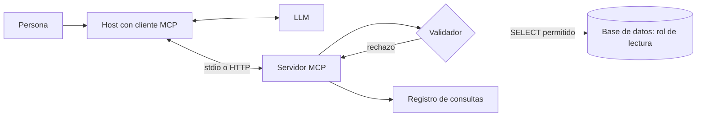

## Qué problema resuelve

Las personas de negocio tienen preguntas que la base de datos sabe responder: cuántos pedidos hubo la semana pasada por región, qué clientes no compran desde junio. Para obtenerlas piden un informe a alguien que sabe SQL y esperan. Dar acceso directo no es opción: no saben SQL, y una consulta mal escrita puede tumbar la base o exponer datos que no deberían ver.

Este sistema pone un modelo entre la pregunta y la base. El modelo explora el esquema, escribe la consulta, la ejecuta y explica el resultado, a través de un **[[glosario/servidor-mcp|servidor MCP]] de solo lectura** que impone los límites. El [[glosario/mcp|Model Context Protocol]] es un estándar abierto ([especificación](https://modelcontextprotocol.io)), hoy en la Agentic AI Foundation de la Linux Foundation, para conectar aplicaciones de IA con herramientas y datos. Escribes el servidor una vez y lo usa cualquier *host* compatible: una aplicación de escritorio, tu propio agente o un IDE.

## Arquitectura



## Componentes

| Componente | Responsabilidad | Implementación típica |
|---|---|---|
| Cliente MCP | Conectar el *host* con el servidor y pasar las herramientas al modelo | Lo trae el *host*; o el SDK de MCP si escribes tu propio agente |
| Servidor MCP de datos | Exponer `listar_tablas`, `describir_tabla` y `consultar` | Python con `MCPServer` |
| Capa de permisos de la base | Garantizar que solo se puede leer lo permitido, pase lo que pase arriba | Rol con `SELECT` sobre vistas concretas; conexión de solo lectura |
| Validador de consultas | Rechazar lo que no sea una única consulta de lectura sobre tablas permitidas | Comprobaciones en el servidor antes de ejecutar |
| Límites de ejecución | Evitar consultas que tarden o devuelvan demasiado | Tiempo máximo por consulta y máximo de filas devueltas |
| Registro de consultas | Auditar quién preguntó qué y qué SQL se ejecutó | Log estructurado con usuario, SQL, filas y duración |

## Flujo paso a paso

1. **Arranque**. El *host* lanza el servidor (por `stdio` en local) o se conecta a él (por *Streamable HTTP* en remoto) y obtiene la lista de herramientas. Desde la revisión `2026-07-28` el protocolo no tiene estado: no hay saludo `initialize` ni sesión, y cada petición lleva su versión ([[docs/estandares/01-mcp-2026-07-28]]).
2. **Pregunta**. La persona escribe «¿Qué tres productos vendieron más en septiembre?».
3. **Exploración**. El modelo llama a `listar_tablas` y `describir_tabla` para conocer columnas y tipos. Las descripciones de columnas ayudan mucho: `fecha_pedido` es obvia, `est_2` no.
4. **Consulta**. El modelo escribe el SQL y llama a `consultar`.
5. **Validación**. El servidor comprueba que es una sola sentencia de lectura y que solo toca vistas permitidas. Si no, devuelve un error claro.
6. **Ejecución con límites**. La consulta corre con el rol de lectura, un tiempo máximo y un tope de filas.
7. **Corrección**. Si la base devuelve un error (columna mal escrita, sintaxis), el modelo lo lee y reintenta. Es un [[glosario/bucle-agentico|bucle agéntico]] corto.
8. **Respuesta**. El modelo responde en lenguaje natural **y muestra el SQL** que usó, para que la persona o un analista puedan comprobarlo.

## Decisiones de diseño

**Defensa en la base, no solo en el servidor.** El validador del servidor es una capa útil, pero puede tener fallos. La garantía real está en la base: un usuario que solo tiene `SELECT` sobre vistas concretas no puede borrar nada aunque el validador falle. En PostgreSQL, eso es un rol propio con permisos sobre un esquema de vistas, transacciones de solo lectura por defecto y un `statement_timeout`. Es [[glosario/minimo-privilegio|mínimo privilegio]] aplicado a datos. Lo desarrolla [[docs/seguridad/02-permisos-y-minimo-privilegio]].

**Vistas en lugar de tablas.** Expón vistas pensadas para preguntar: con nombres claros, columnas sensibles eliminadas o enmascaradas y *joins* habituales ya hechos. El modelo acierta más con un esquema pequeño y legible, y tú controlas qué se ve.

**SQL libre frente a herramientas parametrizadas.** Una herramienta `consultar(sql)` cubre cualquier pregunta. Herramientas como `ventas_por_periodo(desde, hasta, agrupacion)` son más seguras y predecibles, pero solo responden lo previsto. Muchos equipos combinan ambas: herramientas fijas para las preguntas frecuentes y SQL libre con límites para el resto.

**Mostrar el SQL siempre.** Una respuesta numérica equivocada parece igual de seria que una correcta. Enseñar la consulta permite detectar un filtro de fechas mal puesto. Para decisiones importantes, que alguien con criterio revise.

**Local frente a remoto.** Por `stdio`, el servidor corre en la máquina del usuario con credenciales que esa persona ya tiene. Por HTTP, corre en tu infraestructura y necesita autenticación y autorización por usuario. Empieza en local; pasa a remoto cuando varias personas necesiten el mismo acceso. Ver [[cursos/mcp-de-cero-a-servidor/04-seguridad-y-despliegue]].

## Código esencial

Servidor completo sobre SQLite, que puedes probar en local. Para PostgreSQL cambia la conexión y delega los límites en el rol y en `statement_timeout`.

```python title="servidor_datos.py"
import re
import sqlite3
import time
import logging
from contextlib import closing
from mcp.server.mcpserver import MCPServer
from mcp.server.mcpserver.exceptions import ToolError

mcp = MCPServer("datos-ventas")
log = logging.getLogger("consultas")                            # stderr: stdout es del protocolo

RUTA_BD = "ventas.db"
PERMITIDAS = {"v_pedidos", "v_productos", "v_clientes_anonimos"}   # solo vistas
MAX_FILAS = 200
MAX_SEGUNDOS = 5

def conectar() -> sqlite3.Connection:
    con = sqlite3.connect(f"file:{RUTA_BD}?mode=ro", uri=True)   # solo lectura en el SO
    con.execute("PRAGMA query_only = ON")                         # y en el motor
    return con

def registrar(sql: str, filas: int) -> None:
    log.info("sql=%r filas=%d", sql, filas)

@mcp.tool()
def listar_tablas() -> list[str]:
    """Lista las vistas que puedes consultar."""
    return sorted(PERMITIDAS)

@mcp.tool()
def describir_tabla(nombre: str) -> list[dict]:
    """Devuelve columnas y tipos de una vista permitida."""
    if nombre not in PERMITIDAS:
        raise ToolError(f"Vista no permitida. Usa una de: {sorted(PERMITIDAS)}")
    with closing(conectar()) as con:
        filas = con.execute(f"PRAGMA table_info({nombre})").fetchall()
    return [{"columna": f[1], "tipo": f[2]} for f in filas]

def validar(sql: str) -> None:
    limpio = sql.strip().rstrip(";")
    if ";" in limpio:
        raise ToolError("Solo se admite una sentencia por consulta.")
    if not re.match(r"(?is)^\s*(select|with)\b", limpio):
        raise ToolError("Solo se admiten consultas SELECT.")
    usadas = {t.lower() for t in re.findall(r"(?i)\b(?:from|join)\s+([a-z_][a-z0-9_]*)", limpio)}
    ctes = {c.lower() for c in
            re.findall(r"(?i)\b([a-z_][a-z0-9_]*)\s*(?:\([^)]*\))?\s+as\s*\(", limpio)}
    prohibidas = usadas - PERMITIDAS - ctes
    if prohibidas:
        raise ToolError(f"Vistas no permitidas: {sorted(prohibidas)}")

@mcp.tool()
def consultar(sql: str) -> dict:
    """Ejecuta una consulta SELECT de solo lectura sobre las vistas permitidas.
    Devuelve como mucho 200 filas; agrega en SQL en lugar de traer datos en bruto."""
    validar(sql)
    limite = time.monotonic() + MAX_SEGUNDOS
    with closing(conectar()) as con:
        con.set_progress_handler(lambda: 1 if time.monotonic() > limite else 0, 10_000)
        try:
            cur = con.execute(sql)
        except sqlite3.OperationalError as e:
            if "interrupted" in str(e):
                raise ToolError(f"La consulta superó {MAX_SEGUNDOS} s. Simplifícala.")
            raise ToolError(f"Error de SQL: {e}")
        columnas = [d[0] for d in cur.description]
        filas = cur.fetchmany(MAX_FILAS + 1)
    registrar(sql, len(filas))                                   # auditoría
    return {"columnas": columnas, "filas": filas[:MAX_FILAS],
            "truncado": len(filas) > MAX_FILAS}

if __name__ == "__main__":
    mcp.run()
```

El validador por expresiones regulares es deliberadamente simple y **no es la barrera de seguridad**: la conexión en modo lectura y `query_only` lo son. Su papel es devolver errores útiles al modelo antes de llegar a la base; por eso lanza `ToolError`, la excepción cuyo mensaje llega al cliente con el prefijo `Error executing tool consultar: ` (con cualquier otra, el cliente solo recibe «Error executing tool consultar», sin el motivo). Lo comprobé llamando al servidor en proceso con `mcp.Client`: un `SELECT` agregado devuelve filas, y una tabla fuera de la lista, un `DELETE` o dos sentencias vuelven como error con su motivo. Si necesitas un análisis más fino, usa un *parser* de SQL. La receta [[recetas/servidor-mcp-de-solo-lectura]] lo monta desde cero y la lección [[cursos/mcp-de-cero-a-servidor/03-tu-primer-servidor]] explica cada pieza del SDK.

> [!peligro] Los datos también pueden atacar
> Si una columna contiene texto libre (comentarios de clientes, descripciones), puede incluir instrucciones dirigidas al modelo. Con solo lectura el daño se limita a respuestas engañosas, pero si el mismo *host* tiene otras herramientas con efectos, una inyección podría encadenarse. Separa los asistentes de datos de los que actúan: datos privados, texto no confiable y una vía de salida juntos son la [[glosario/trifecta-letal|trifecta letal]]. Lee [[radar/2026-10-20-inyeccion-por-herramientas]] y [[docs/seguridad/03-patrones-contra-inyeccion]].

## Cómo evaluarlo

- **Preguntas con resultado conocido**: escribe unas decenas de preguntas reales con el SQL de referencia que haría un analista. Compara el **resultado** de la consulta del modelo con el de referencia, no el texto del SQL: dos consultas distintas pueden ser equivalentes.
- **Respuesta en lenguaje natural**: un [[glosario/modelo-juez|modelo juez]] comprueba que la explicación coincide con los datos devueltos y no añade conclusiones sin respaldo.
- **Rechazos correctos**: preguntas que piden datos fuera de las vistas, borrados o consultas enormes. Todas deben fallar de forma limpia.
- **Trayectoria**: cuántas llamadas a `describir_tabla` y reintentos necesita. Muchos reintentos indican vistas o descripciones poco claras. Ver [[roadmap/80-evals/04-evals-de-trayectoria]].
- **Ambigüedad**: preguntas como «ventas del último trimestre» (¿natural o fiscal?). Lo correcto suele ser preguntar o declarar la interpretación.

## Costes y riesgos

**Costes.** Cada pregunta son varias llamadas (explorar, consultar, quizá reintentar, responder). Las descripciones de herramientas y del esquema son un prefijo estable que puedes cachear. El coste en la base es el de las consultas: el tope de tiempo protege también la factura y el rendimiento de otros usuarios. Si puedes, apunta el servidor a una réplica de lectura.

**Riesgos.**

- **Respuestas incorrectas con apariencia de exactitud**: el mayor riesgo. Mostrar el SQL y evaluar con resultados conocidos son las defensas.
- **Exposición de datos personales**: controla en las vistas qué columnas se ven. El modelo puede citar en su respuesta cualquier dato que reciba.
- **Consultas costosas**: tiempo máximo, tope de filas y réplica de lectura.
- **Permisos por usuario**: en un servidor remoto compartido, cada persona debe ver solo lo suyo. Eso exige autenticación en el transporte y filtros por usuario en las vistas.
- **Esquemas que cambian**: una columna renombrada rompe consultas que funcionaban. Versiona las vistas y repasa las evals tras cada migración.

## Variantes

- **Herramientas semánticas**: además del SQL libre, herramientas de alto nivel para las métricas clave, con definiciones acordadas («cliente activo» significa lo mismo para todos).
- **Con *resources***: expón el diccionario de datos como *resource* MCP para que el *host* lo cargue como contexto.
- **Con gráficos**: el *host* convierte el resultado en una gráfica; el servidor solo devuelve datos.
- **Dentro de un agente mayor**: el mismo servidor sirve como herramienta de un agente de informes o del [[sistemas/investigacion-multiagente|sistema de investigación]] sobre datos internos.

### Con open source: el mismo servidor desde LangChain y un modelo local

El servidor no cambia: MCP es justo eso. Lo que cambia es el cliente. Con `langchain.mcp.MCPAdapter` (beta, compatible con el SDK `mcp` 2.x) las tres herramientas se convierten en herramientas de LangChain y un `create_agent` con un modelo local las usa sin que los datos salgan de tu máquina.

```python title="asistente_datos_langchain.py"
import asyncio
import warnings
from pathlib import Path

from langchain.agents import create_agent
from langchain.agents.middleware import ModelCallLimitMiddleware
from langchain_core._api import LangChainBetaWarning
from langchain_ollama import ChatOllama

warnings.filterwarnings("ignore", category=LangChainBetaWarning)   # langchain.mcp está en beta
from langchain.mcp import MCPAdapter  # noqa: E402

SERVIDOR = Path("servidor_datos.py")      # Path => stdio; un str solo se acepta si es una URL http(s)
llm = ChatOllama(model="qwen3.6:27b", num_ctx=32768, reasoning=False)   # o init_chat_model("anthropic:…", max_tokens=…)

SYSTEM = ("Respondes preguntas sobre ventas consultando la base de datos con las herramientas. "
          "Explora las vistas antes de escribir SQL, agrega en la consulta y muestra siempre el SQL usado.")

async def preguntar(pregunta: str, modelo=llm) -> str:
    async with MCPAdapter(SERVIDOR) as mcp:
        tools = await mcp.list_tools()                     # listar_tablas, describir_tabla, consultar
        agente = create_agent(modelo, tools, system_prompt=SYSTEM,
                              middleware=[ModelCallLimitMiddleware(run_limit=8, exit_behavior="end")])
        out = await agente.ainvoke({"messages": [("user", pregunta)]})   # herramientas async: ainvoke
        return out["messages"][-1].text

if __name__ == "__main__":
    print(asyncio.run(preguntar("¿Qué región vendió más?")))
```

Lo probé con un modelo simulado y el servidor real lanzado por `stdio` sobre una base SQLite de prueba: el `ToolError` llega al modelo como `ToolMessage` con `status="error"` y el motivo, y el agente reintenta con una vista permitida.

| Qué | Con un *host* o el SDK de Claude | Con LangChain y Ollama |
|---|---|---|
| Cliente MCP | El del *host*, o el SDK `mcp` y tu bucle | `MCPAdapter(Path(...))` para `stdio` o `MCPAdapter("https://…")` para remoto |
| Errores del servidor | `tool_result` con `is_error` | `ToolMessage(status="error")`, sin middleware extra |
| Llamadas por pregunta | Tu `max_pasos` | `ModelCallLimitMiddleware(run_limit=…)` |
| Calidad del SQL | La del modelo de Claude que elijas | Muy dependiente del modelo local: tu batería de preguntas con resultado conocido decide |
| Contexto | 1M de tokens | `num_ctx`: si es pequeño, Ollama recorta en silencio las descripciones y el esquema |

No mezcles en el mismo entorno `langchain-mcp-adapters` con el SDK `mcp` 2.x: el primero exige `mcp<2`. Los detalles están en [[recetas/herramientas-mcp-en-un-agente-langchain]] y [[cursos/langchain-y-langgraph/10-mcp-en-langchain]]; si el servidor no aparece en el cliente, [[problemas/servidor-mcp-no-aparece]].

## Por dónde empezar

1. Entiende qué resuelve MCP en [[cursos/mcp-de-cero-a-servidor/01-que-resuelve-mcp]] y conecta un servidor existente con [[roadmap/20-herramientas/05-mcp-conectar-un-servidor]].
2. Crea dos o tres vistas limpias sobre tu base y un usuario de solo lectura.
3. Copia el servidor de arriba, apúntalo a una copia de tus datos y pruébalo desde un *host* compatible.
4. Escribe veinte preguntas reales con su resultado esperado y mide antes de abrirlo a nadie.
5. Lee [[cursos/mcp-de-cero-a-servidor/04-seguridad-y-despliegue]] y [[docs/seguridad/04-mcp-y-skills-de-terceros]] antes de pasarlo a remoto.
