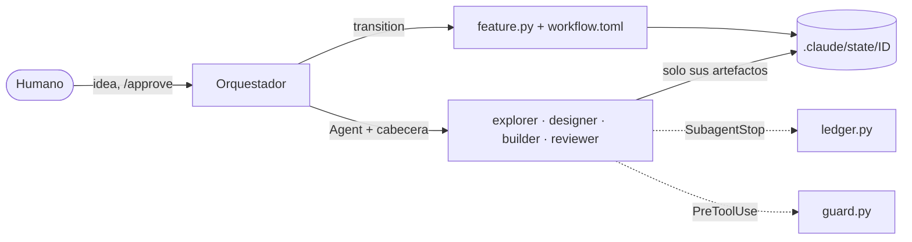

## Qué problema resuelve

Un agente de código como Claude Code ya sabe leer un repositorio, editar y ejecutar tests. Lo que no trae de serie es un método: en una feature de cierto tamaño, la sesión se alarga y se degrada, el agente declara «hecho» sin evidencia, amplía el alcance a mitad de camino, entra en bucles de autocorrección, gasta sin que nadie lo mida y obedece instrucciones que lee en el propio repositorio. Si la sesión se corta, hay que reconstruir la conversación.

Este sistema es el [[glosario/harness|harness]] que el autor usa a diario, en la versión 0.8.0 de su bundle. Convierte la sesión principal en **orquestador**, reparte el trabajo de cada feature entre **cuatro subagentes con contexto limpio** (explorer, designer, builder, reviewer) y pone entre el diseño y la construcción **una sola [[glosario/puerta-humana|puerta humana]]**, GATE#1. Herramientas deterministas en Python, solo biblioteca estándar, deciden qué transiciones son legales, congelan la especificación aprobada, ejecutan la aceptación, miden el coste de cada subagente y hacen cumplir las fronteras de seguridad. Es [[glosario/sdd|desarrollo guiado por especificación]] con el modelo en lo semántico y el código en los bordes.

## Arquitectura



## Componentes

| Componente | Responsabilidad | Implementación |
|---|---|---|
| Orquestador | Coordinar el flujo; no implementa producto | Sesión principal de Claude Code; `CLAUDE.md` importa `HARNESS.md` (contrato) y `AGENTS.md` (reglas del proyecto) |
| 4 subagentes | Una fase cada uno, con contexto limpio y herramientas mínimas | `.claude/agents/*.md` con `model`, `effort`, `maxTurns`, `omitClaudeMd: true` y skills precargadas; profundidad 1 |
| Máquina de estados | Qué transiciones existen y qué condiciones exigen | `contracts/workflow.toml` (9 fases, 15 eventos); `feature.py` es el único escritor del estado; 24 guards en `validate_harness.py` |
| Hooks de seguridad y coste | Fronteras deterministas y medición real | `guard.py` en `PreToolUse` (falla en cerrado); `ledger.py` en `SubagentStop` (nunca rompe la sesión) |
| Runner de aceptación | Evidencia con comandos, no con opiniones | `run_acceptance.py`: solo spec congelada, entorno sin secretos, salida redactada |
| Estado por feature | Memoria persistente y auditable | `.claude/state/<ID>/`: `state.yaml`, `event.log`, `SDD/`, informes, veredicto, `cost.json` |
| Skills y comandos | Procedimientos bajo demanda y decisiones humanas | 16 skills; `/approve` y `/reject` con `disable-model-invocation: true` |

## Flujo paso a paso

1. **Registrar y arrancar.** El humano describe la idea; el orquestador la registra (`feature.py add`, o la skill `feature-kickoff`), la inicia y aplica `start_exploration`.
2. **Explorar.** Lanza el explorer con la herramienta `Agent` y una cabecera en las primeras líneas del prompt (`FEATURE_ID`, `PHASE`). El explorer solo lee y escribe `SDD/context.md`: archivos relevantes con `ruta:línea`, convenciones con ejemplo, comandos de verificación, riesgos y preguntas.
3. **Diseñar.** El designer (en Opus: es la fase donde un error es más caro) escribe `proposal.md`, `requirements.md` (FR-NN, NFR-NN), `design.md`, `tasks.md` y `acceptance.yaml`, y los valida hasta que pasan el pre-gate. `design_complete` exige trazabilidad completa requisito → check → tarea, guarda la huella de la spec e imprime los comandos de aceptación literales.
4. **GATE#1.** El orquestador presenta recomendación, decisiones, riesgos, tareas, coste y comandos, y **para**. El humano decide con `/approve` o `/reject`; el guard pide confirmar el comando `--by human`, que es su firma. Al aprobar, el motor crea `spec.lock.json` con los hashes y guarda `base_commit`.
5. **Construir.** El builder implementa `tasks.md` con el diff mínimo, ensaya la aceptación y añade `## Build 1` a `implementation.md`. No puede tocar la spec: está congelada y el guard se lo impide.
6. **Verificar.** El reviewer revisa el diff contra `base_commit`, ejecuta él mismo la aceptación y emite un [[glosario/veredicto|veredicto]] estructurado: `PASS`, `FAIL_REPAIRABLE`, `FAIL_NONREPAIRABLE` o `BLOCKED_TOOLING`.
7. **Un repair, como mucho.** Con `FAIL_REPAIRABLE`, el builder recibe `repair-request.yaml` con el alcance permitido y hace el build 2. Cualquier otro fallo, o un segundo fallo, va a `blocked`, donde todas las salidas son humanas.
8. **Archivar.** Con `PASS`, `pass` exige checks obligatorios en verde generados en esta verificación, `archive.md`, spec intacta y runtimes reales de los cuatro agentes. Congela el coste en `cost.json`.
9. **Cerrar.** El orquestador resume `archive.md`, ofrece los follow-ups como features nuevas y muestra el coste. El humano hace el commit con el mensaje que propone el reviewer.

Cada transición pasa por `feature.py transition`, y una que no cumple sus guards no escribe nada.

## Decisiones de diseño y alternativas

**Subagentes reales frente a una sola sesión.** Una sola sesión acumula exploración, diseño y código en el mismo contexto. Aquí cada fase arranca limpia, lee su contrato, `AGENTS.md` y los artefactos de la fase anterior, y devuelve un informe corto. El orquestador conoce el contrato pero no el código; los subagentes conocen el código pero no el contrato, y por eso no pueden orquestar. La alternativa con contexto compartido es más barata en features mínimas; para eso existe trabajar fuera del flujo cuando el humano lo pide para un cambio concreto.

**Máquina de estados en TOML y un motor determinista, frente a dejar decidir al modelo o a un motor de grafos.** El modelo elige qué evento aplicar; el código decide si es legal. Quince transiciones en TOML y un motor de unas 560 líneas cubren el flujo sin dependencias; `docs/architecture.md` deja el motor de grafos externo como límite deliberado hasta que haya una necesidad medida. Si ya trabajas con LangGraph, el concepto equivalente es un [[glosario/grafo-de-estado|grafo de estado]] con condiciones en las aristas.

**Una puerta humana, no dos.** La versión 0.4 tenía un GATE#2 que aprobaba código antes de saber si pasaba la aceptación. Se quitó: el humano aprueba la spec (lo caro de equivocar) y revisa el diff al hacer commit. El razonamiento completo está en [[blog/2026-10-23-una-sola-puerta-humana]].

**Spec congelada por hash, no por promesa.** `spec_as_presented` garantiza que lo aprobado es lo que se presentó; `spec.lock.json` hace verificable que el builder no rediseña y que la aceptación no cambió.

**Un repair, no un bucle.** El [[patrones/07-evaluador-optimizador|evaluador-optimizador]] se acota a una vuelta; el validador exige `max_repair_attempts = 1`. Más vueltas solo con métricas que lo justifiquen.

**Runtimes medidos, no declarados.** El hook escribe un `subagent_stop` desde el transcript real, y las guards lo releen: una línea falsificada en `event.log` no basta para avanzar.

**Fallo en cerrado donde protege, fallo en abierto donde mide.** El guard bloquea si falla; el ledger registra el error y deja seguir. Cada hook falla del lado seguro para su función.

**Solo biblioteca estándar y YAML propio.** Mismo comportamiento en cualquier máquina, sin instalar nada; el subconjunto YAML rechaza construcciones ambiguas y comprueba que puede releer lo que escribe.

## Código esencial

La cabecera que el orquestador pone a cada subagente es lo que ata el trabajo a la feature. El hook solo mira las 12 primeras líneas:

```text title="HARNESS.md §4 (cabecera del prompt de un subagente)"
FEATURE_ID: <ID>
PHASE: <exploration | design | implementation | verification>
ATTEMPT: <n>
MODE: <build | repair>
<petición del humano o instrucción concreta, contexto mínimo>
```

Cada transición del contrato declara actor y guards. La de GATE#1:

```toml title=".claude/contracts/workflow.toml"
[[transitions]]
from = "gate1_pending"
event = "approved"
to = "implementation"
actor = "human"
guards = ["decision_recorded", "approver_authorized", "sdd_valid", "spec_as_presented", "within_budget"]
```

El motor ejecuta todas las guards y acumula los problemas; con uno solo, rechaza la transición. Una guard desconocida es un problema más, y el validador ya la habría señalado:

```python title=".claude/tools/validate_harness.py"
def run_guards(ctx: Context, names: list[str]) -> list[str]:
    problems = []
    for name in names:
        guard = GUARDS.get(name)
        if guard is None:
            problems.append(f"guard desconocida en el contrato: {name}")
            continue
        problems += [f"[{name}] {item}" for item in guard(ctx)]
    return problems
```

Y las guards de runtime no confían en el registro: lo comprueban contra el transcript del subagente.

```python title=".claude/tools/validate_harness.py"
def verified_run(event: dict, feature_id: str) -> dict | None:
    """Relee el transcript del subagente que cita el evento: una linea de event.log no basta."""
    import ledger  # import local: ledger no depende del validador

    transcript = event.get("transcript")
    if not isinstance(transcript, str):
        return None
    payload = {"agent_id": event.get("agent_id"), "session_id": event.get("session_id"),
               "transcript_path": str(Path(transcript).expanduser())}
    located = ledger.locate_subagent_transcript(payload)
    if located is None:
        return None
    run = ledger.parse_subagent_transcript(located)
    return run if run["header"].get("feature_id") == feature_id else None
```

El resto del código se recorre pieza a pieza en el curso [[cursos/harness-engineering/index]]: agentes en la lección 5, contrato y guards en la 6, spec y aceptación en la 7, veredictos en la 8, guard en la 9 y coste en la 10.

## Cómo evaluarlo

**El propio harness.** `validate_harness.py` comprueba estructura y coherencia (archivos obligatorios, contrato atado al código, agentes sin `Agent`, hooks presentes, versión, invariantes de cada feature) y 95 tests con `unittest` comprueban comportamiento simulando subagentes con transcripts como los de Claude Code. Recién instalado, en una copia:

```text
$ python3 .claude/tools/validate_harness.py
WARNING verify_placeholder .claude/bootstrap/verify.sh: verify.sh sin configurar: añade lint/tests del proyecto (skill project-bootstrap)
Harness validation passed (0 errores, 1 avisos)

$ python3 -m unittest discover -s .claude/tests
Ran 95 tests in 1.332s

OK
```

La skill `/harness-doctor` junta validador, tests y `hook-errors.log` y comprueba que los hooks registran ejecuciones con tokens mayores que cero.

**Lo que produce.** `feature.py metrics` agrega todas las features: tasa de `PASS` a la primera, repairs, cambios pedidos en GATE#1, intervenciones humanas, ejecuciones por agente, coste (media, mediana, percentil 90) y tiempo de ciclo. Una tasa baja de `PASS` a la primera suele señalar aceptaciones vagas; muchos cambios en GATE#1, un `AGENTS.md` o un `context.md` pobres.

**Tras cada actualización de Claude Code.** El harness depende de campos como `omitClaudeMd`, `effort`, `skills:` en los agentes y la variable que limita la profundidad. Comprueba con una feature de prueba que un subagente no recibe `CLAUDE.md` y que no puede lanzar otro subagente.

## Costes y riesgos

**Costes.** Cada feature cuesta cuatro subagentes como mínimo, más un build y una verificación por repair. El designer usa Opus y el resto Sonnet, con el ID completo para que un alias no cambie de modelo ni de precio sin aviso. El presupuesto por feature (aviso y límite en `harness.toml`, `budget_usd` por feature) se evalúa solo con los subagentes; la parte del orquestador se estima aparte y conviene revisarla en GATE#1 y al cerrar. Todo se calcula a precios de API con una tabla fechada que debes mantener desde la página oficial ([[cursos/harness-engineering/10-coste-y-presupuesto]]).

**Riesgos.**

- **Las defensas no son absolutas.** El builder ejecuta código y podría escribir un programa que eluda el guard; con `bypassPermissions` o el hook desactivado desaparecen las confirmaciones. La última barrera es la revisión humana de GATE#1 y del diff.
- **Un `verify.sh` sin configurar** hace que la regresión no demuestre nada. El validador avisa y `sdd_valid` rechaza aceptaciones que lo usen mientras siga el marcador.
- **Sin primer commit**, el reviewer no tiene `base_commit` útil.
- **Ceremonia en cambios pequeños.** Un cambio de una línea no necesita explorer, designer y GATE#1; trabájalo fuera del flujo, a petición explícita.
- **Sesiones largas del orquestador.** El canario de `CLAUDE.md` y `/new-session` lo vigilan ([[cursos/harness-engineering/11-sesiones-largas]]).

## Variantes

- **Olas**: varias features a la vez, cada una en su worktree y con su sesión, integradas de una en una con *squash* y `verify.sh`. Ver [[sistemas/harness-sdd-olas]].
- **Especialistas**: agentes opcionales en `pre-gate1`, `post-implementation` o `post-verification`, activados por tags o por rutas cambiadas, que escriben su informe y, solo si se declara en `product_writes`, rutas del producto.
- **Modos**: `manual` para empezar, `auto` para encadenar fases parando en GATE#1, `yolo` para delegar GATE#1 en condiciones estrictas y nunca con tags protegidos.
- **Regresión obligatoria**: `[verification].required_regression` y `required_by_tag` exigen checks concretos en toda aceptación.
- **Harness especializado por proyecto**: desde un diseño técnico, con el prompt de plan de implementación del autor ([[cursos/harness-engineering/14-especializa-el-harness]]).

## Por dónde empezar

1. Copia el contenido de `HARNESS/` del repositorio del harness a la raíz de tu proyecto (fusiona `CLAUDE.md`, `AGENTS.md` o `.gitignore` si ya existen) y ejecuta `bash .claude/bootstrap/init.sh`.
2. En Claude Code: *«usa project-bootstrap para adaptar el harness a este repositorio»*. Completa `AGENTS.md` y `verify.sh`.
3. Haz un primer commit.
4. Pide tu primera feature con el prompt de `FAST-USAGE.md`: *«Conviértela en una feature del harness (feature-kickoff) y, cuando la confirme, planifícala hasta GATE#1 (sdd-feature-planning)»*.
5. Sigue el curso [[cursos/harness-engineering/index]] con el código abierto al lado.
