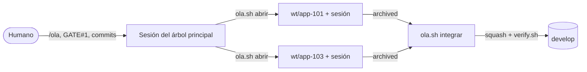

## Qué problema resuelve

El [[sistemas/harness-sdd-claude-code|harness base]] lleva una feature cada vez. Es lo más simple y basta en la mayoría de repositorios. Pero con un backlog de decenas de features y dependencias conocidas, muchas podrían construirse a la vez, y en serie el tiempo de ciclo del proyecto lo marca la suma de todas.

Paralelizar en el mismo árbol de trabajo rompe el harness en tres sitios. El reviewer revisa `git diff <base_commit>` y vería el código de la otra feature como propio. `verify.sh` fallaría por el código a medias de la otra. Y `feature.py` reescribe `feature_list.json` sin bloqueo entre procesos, así que dos transiciones simultáneas pueden perder una.

La variante con olas lo resuelve con una regla física: **cada feature en su propio [[glosario/worktree|worktree]]** de git (carpeta y rama temporal `wt/<id>`), **con su propia sesión de Claude Code**, que aplica el contrato del harness sin cambios a una sola feature. El árbol principal se queda en la rama de integración y **solo integra**, de una en una, con *squash* y regresión. El núcleo (motor, contratos, agentes, validador, guard y ledger) es idéntico al de la base; lo que se añade es una capa de coordinación.

## Arquitectura



## Componentes

| Componente | Responsabilidad | Implementación |
|---|---|---|
| `ola.sh` | Abrir, vigilar, integrar y cerrar | `scripts/ola.sh` (Bash 4+, unas 500 líneas), con un bloque de configuración del proyecto en la cabecera |
| Worktree por feature | Aislar diff, regresión y estado de cada feature | `git worktree add ~/<repo>-wt/<id> -b wt/<id> develop`; una ventana de tmux por feature con `claude` y su prompt |
| Integración con squash | Un commit por feature en la rama de integración | `git merge --squash`, resolución automática de lo mecánico, `TRAS_INTEGRAR`, `verify.sh`, mensaje de `## Commit sugerido` de `archive.md` |
| Skill `olas` y `/ola` | Que la sesión del árbol principal lleve la mecánica | `.claude/skills/olas/SKILL.md`, `.claude/commands/ola.md` |
| Plan de olas | Qué va junto y cómo | `docs/planes/olas.md` (reglas, conflictos, olas, dependencias implícitas) y `guia-olas.md` |
| Reglas en el contrato | Que todos los agentes las conozcan | `HARNESS.md` §15, apartado «Paralelo» y convención `depende de:` en `AGENTS.md` |
| Barreras del guard | Que nadie salvo el humano confirme commits | `guard.py`: ningún subagente ejecuta `ola.sh`; la sesión principal no usa `--si` ni toca `CLAUDECODE` |

Claude Code ya sabe crear worktrees (`--worktree`, `isolation: worktree` en un subagente). `ola.sh` no los sustituye: añade lo que el harness necesita alrededor, que es comprobar dependencias antes de abrir, arrancar cada sesión con el prompt correcto, integrar en orden con regresión y dejar los commits al humano.

## Flujo paso a paso

1. **Preparar una vez.** Copiar el harness con olas, adaptar la cabecera de `ola.sh`, rellenar las olas (§6) y las dependencias implícitas (§8) de `olas.md`, y commitear todo en la rama de integración para que cada worktree lo tenga. Recomendado: `mode = "auto"`.
2. **Decidir qué abrir.** `/ola siguiente` en la sesión del árbol principal: lee `feature_list.json` de la rama de integración y propone features `proposed` con sus dependencias `archived`, como mucho `MAX_ABIERTAS` (4), una por módulo, sin mezclar versiones. Espera tu confirmación.
3. **Abrir.** `ola.sh abrir APP-101 APP-103` comprueba de nuevo estado y dependencias (declaradas e implícitas), crea los worktrees, copia `settings.local.json`, instala si se configuró y abre una ventana de tmux por feature con `claude` y un prompt que autoriza el paralelo, limita la sesión a esa feature y le pide parar al archivar sin hacer commits.
4. **Trabajar.** Cada ventana recorre explorer, designer, GATE#1, builder y reviewer. Tú apruebas cada GATE#1 en su ventana.
5. **Vigilar.** `ola.sh estado`: fase de cada feature, commits sin integrar, cambios sin commit, ventana viva.
6. **Integrar.** Con una feature `archived`: árbol principal limpio y en la rama de integración, commit del trabajo del worktree (lo lanzas tú), *squash*, resolución automática de `feature_list.json` (unión por ID) y de lo que liste `AUTO_RAMA`, pasos de `TRAS_INTEGRAR`, comprobación de marcas de conflicto, `verify.sh` y el commit con el mensaje de `archive.md`, que también lanzas tú.
7. **Resolver lo que quede.** Si hay conflictos no mecánicos, el script para con la lista; la sesión del árbol principal los resuelve según la tabla de §5 y sigue con `integrar --continuar`. Si `verify.sh` falla con las dos features juntas, `integrar --abortar` y un bug.
8. **Cerrar.** `ola.sh cerrar APP-101`: solo si ya está integrada; borra ventana, worktree y rama. Con el hueco libre, vuelta al paso 2.

## Decisiones de diseño y alternativas

**Worktrees frente a ramas en un solo árbol, clones o contenedores.** Cambiar de rama en un árbol obliga a parar todas las sesiones. Un clone por feature funciona pero duplica el historial y complica integrar. Un contenedor aísla también el sistema y es más caro de montar. El worktree comparte el repositorio y da a cada sesión una carpeta propia, que es exactamente lo que necesitan `base_commit`, `verify.sh` y `feature_list.json`.

**Squash frente a merge.** Un commit por feature con el mensaje del reviewer en Conventional Commits deja la rama de integración legible y facilita revertir una feature entera. Los commits intermedios del worktree son temporales y la rama `wt/<id>` no se publica.

**Integrar de una en una, con verify en cada paso.** Cada feature pasó su verificación sola; juntas pueden fallar. Integrar en serie, con la regresión en verde antes de la siguiente, hace que un fallo tenga siempre un único sospechoso.

**Dependencias en las notas de la feature.** El formato literal `depende de: ID, ID` en `feature_list.json` evita otro archivo que mantener; el script lo lee de la rama de integración. Las implícitas (código que una feature usa de otra sin declararlo) van en `IMPLICITAS` hasta que se pasan a las notas.

**El script nunca confirma desde Claude Code.** Detecta la variable `CLAUDECODE` y responde «no» a toda pregunta, imprimiendo el comando para que lo lances tú con `!`. El guard añade la barrera determinista.

**El árbol principal no construye.** Mientras haya worktrees abiertos, solo integra. Es la regla que evita volver al problema de partida.

## Código esencial

La parte del proyecto vive en la cabecera del script:

```bash title="scripts/ola.sh (configuración del proyecto, extracto)"
RAMA="${OLA_RAMA:-develop}"          # rama de integración (el árbol principal vive en ella)
MAX_ABIERTAS="${OLA_MAX:-4}"         # features abiertas a la vez antes de pedir confirmación
INSTALAR=""                          # p. ej. "pnpm install --frozen-lockfile --prefer-offline || pnpm install --prefer-offline"
AUTO_RAMA=(
  # "pnpm-lock.yaml" "*/pnpm-lock.yaml" "src/bindings.ts"
)
TRAS_INTEGRAR=(
  # '(^|/)(package\.json|pnpm-lock\.yaml)$ :: pnpm install --prefer-offline'
)
declare -A IMPLICITAS=(
  # [APP-109]="APP-105"
)
```

La confirmación que nunca dice «sí» desde Claude Code:

```bash title="scripts/ola.sh"
confirm() {   # confirm "pregunta" → 0 si sí
  if [ -n "${CLAUDECODE:-}" ]; then echo "$1 → no (lanzado desde Claude Code: esto lo decide y lo hace el humano)"; return 1; fi
  [ "$YES" = 1 ] && { echo "$1 [s/N] s (--si)"; return 0; }
  [ -t 0 ] || { warn "$1 → sin terminal interactiva: lo tomo como «no» (usa --si si lo quieres)"; return 1; }
  local a; read -r -p "$1 [s/N] " a || return 1
  [[ "${a,,}" == s || "${a,,}" == si || "${a,,}" == sí || "${a,,}" == y ]]
}
```

Y las reglas del guard, en el núcleo compartido con la base:

```python title=".claude/tools/guard.py"
WAVES_SCRIPT = re.compile(r"(^|[\s/;&|(=])ola\.sh\b", I)
WAVES_SELF_CONFIRM = re.compile(r"(^|\s)--si(?=\s|$)|\bCLAUDECODE\b", I)
```

En la sesión principal, `ola.sh` con `--si` o tocando `CLAUDECODE` se deniega; a cualquier subagente, `ola.sh` se le deniega siempre. Sin el script, la regla no tiene efecto.

## Cómo evaluarlo

`test_ola.py` ejecuta el script de punta a punta en un repositorio temporal con worktrees reales: ayuda y versión; ciclo completo con una dependencia que impide abrir, commit del worktree, *squash* y cierre; conflicto en `feature_list.json` resuelto solo mientras el de un README espera a mano; configuración del proyecto con una dependencia implícita, un paso tras integrar y `verify.sh` en rojo; y que desde Claude Code nunca se confirma. Con ellos la suite pasa de 95 a 100 tests:

```text
$ python3 -m unittest discover -s .claude/tests
Ran 100 tests in 5.768s

OK
```

En uso real, mide lo que te importa: tiempo de ciclo por versión frente a la serie (`feature.py metrics` en cada worktree o sobre el estado integrado), integraciones abortadas, conflictos resueltos a mano y `BLOCKED_TOOLING` por tiempo, que delata una máquina saturada. `olas.md` pide además comparar el número de olas de cada versión con su mínimo teórico, la ruta más larga del grafo de dependencias.

## Costes y riesgos

**Costes.** Más atención humana: varios GATE#1 abiertos a la vez, y cada uno merece la misma revisión. Más máquina: cada worktree lleva sus dependencias y compilados; con 16 GB de RAM, el autor recomienda dos o tres builds a la vez como mucho, y en WSL los worktrees en el disco de Linux. Más gasto simultáneo, aunque el de cada feature no cambia.

**Riesgos.**

- **Dependencias implícitas no declaradas**: el script no las ve y abre una feature antes de tiempo.
- **Incompatibilidades entre features** que solo aparecen al integrar; por eso `verify.sh` en cada integración y `--abortar` ante la duda.
- **Un `verify.sh` sin configurar** hace que «integrada y en verde» no signifique nada.
- **Cruzar versiones**: integrar durante una release arrastra código de la siguiente.
- **Conflictos de comportamiento**: dos features que cambian la misma lógica de forma incompatible no se resuelven automáticamente; decide el humano.

## Variantes

- **Sin tmux**: `--sin-tmux` imprime el comando de cada sesión para abrirla a mano.
- **Ritmo continuo**: las olas son lotes de referencia; una feature con dependencias integradas y módulo libre puede adelantarse.
- **Dependencias de la ola instaladas antes**: un cambio fuera del flujo, en la rama de integración, evita casi todos los conflictos de lockfiles.
- **Arranque propio**: un harness especializado puede cambiar `ARRANQUE` por su skill (`/siguiente {ID}`), como genera el prompt de plan de implementación ([[cursos/harness-engineering/14-especializa-el-harness]]).

## Por dónde empezar

1. Ten el [[sistemas/harness-sdd-claude-code|harness base]] funcionando con al menos una feature archivada y `verify.sh` configurado.
2. Copia `HARNESS/` de la variante con olas, adapta la cabecera de `ola.sh` y comprueba con `bash -n scripts/ola.sh && bash scripts/ola.sh ayuda`.
3. Registra las dependencias con `depende de:` en las notas y rellena §6 y §8 de `olas.md` ([[plantillas/plan-de-olas]]).
4. Empieza con dos features independientes y `/ola siguiente`.
5. Sigue la lección [[cursos/harness-engineering/13-features-en-paralelo-con-olas]] y, para los conflictos, [[recetas/integrar-features-en-paralelo]].
