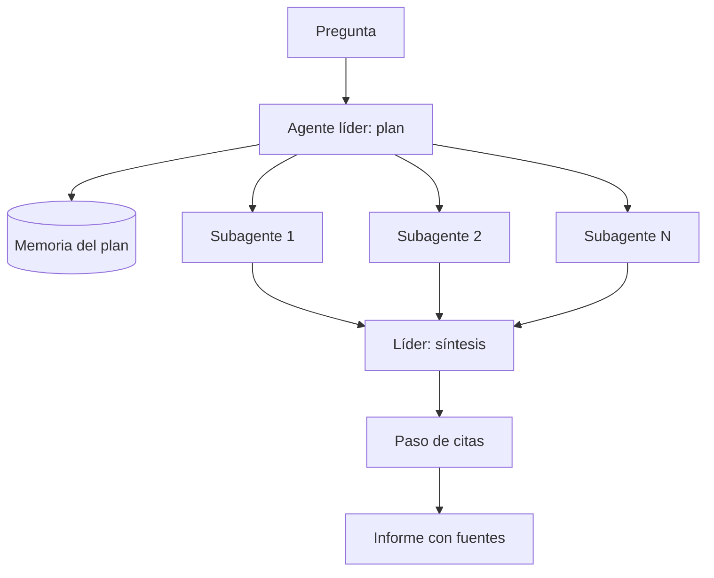

## Qué problema resuelve

Algunas preguntas no se responden con una búsqueda: «¿Qué opciones hay para almacenar energía en redes eléctricas pequeñas y en qué punto está cada una?». Hay que explorar varias líneas a la vez, seguir pistas, descartar fuentes flojas y juntarlo todo. Un único agente lo hace en serie, y su [[glosario/ventana-de-contexto|ventana de contexto]] se llena de páginas leídas antes de llegar a la mitad.

Este sistema reparte el trabajo. Un **agente líder** planifica, lanza varios [[glosario/subagente|subagentes]] que investigan en paralelo cada uno con su propio contexto, y recibe de ellos solo los hallazgos condensados con sus fuentes. Después sintetiza el informe y un paso final asegura que cada afirmación está atribuida. Es la arquitectura que Anthropic describe en [*How we built our multi-agent research system*](https://www.anthropic.com/engineering/multi-agent-research-system) (13 jun. 2025), una aplicación del patrón [[patrones/06-orquestador-trabajadores|orquestador y trabajadores]] donde los trabajadores son agentes.

## Arquitectura



## Componentes

| Componente | Responsabilidad | Implementación típica |
|---|---|---|
| Agente líder | Entender la pregunta, decidir cuántos subagentes y con qué encargo, sintetizar | Llamada con salida estructurada para el plan; llamada larga para la síntesis |
| Subagentes de búsqueda | Investigar una línea concreta y devolver hallazgos condensados con URL | Bucle agéntico con herramientas de búsqueda y lectura, límite de pasos propio |
| Herramientas | `buscar_web` y `leer_pagina` | Tu proveedor de búsqueda; extracción de texto limpia y truncada |
| Memoria del plan | Guardar el plan y los hallazgos fuera del contexto | Archivo o tabla por investigación |
| Síntesis | Integrar hallazgos, resolver contradicciones, señalar huecos | El líder, con todos los hallazgos como entrada |
| Paso de citas | Asociar cada afirmación del informe a la fuente que la respalda | Llamada específica, más verificación en código de que la URL fue consultada |

## Flujo paso a paso

1. **Aclarar y dimensionar**. El líder decide el tamaño del esfuerzo. Una pregunta factual sencilla no necesita subagentes; una comparativa amplia, varios. El artículo de Anthropic cuenta que tuvieron que enseñar explícitamente al líder a escalar el esfuerzo a la complejidad, porque tendía a lanzar demasiados agentes para preguntas simples.
2. **Planificar**. El líder escribe el plan: una lista de encargos, cada uno con objetivo, formato de respuesta, fuentes sugeridas y límites (qué no cubrir porque lo cubre otro). Lo guarda en memoria.
3. **Investigar en paralelo**. Cada subagente ejecuta su bucle: busca, lee, evalúa la calidad de lo encontrado, decide si sigue. Empieza con consultas amplias y las estrecha según lo que encuentra.
4. **Condensar**. Cada subagente devuelve un resumen de hallazgos con las URL consultadas, no las páginas completas. Esa compresión es lo que permite al líder ver todo el trabajo sin desbordar su contexto.
5. **Sintetizar**. El líder integra, detecta contradicciones y huecos. Si un hueco es importante, puede lanzar otra ronda.
6. **Citar**. Un paso específico recorre el informe y asocia cada afirmación a una fuente. El código comprueba que cada URL citada aparece en las que algún subagente leyó de verdad.
7. **Entregar**. Informe, lista de fuentes y, si procede, lo que no se pudo confirmar.

## Decisiones de diseño

**Multiagente frente a un solo agente.** Compensa cuando la pregunta es **amplia y se puede paralelizar**: líneas independientes que exploran fuentes distintas. No compensa cuando las partes dependen mucho entre sí o todos necesitan el mismo contexto. El artículo de Anthropic pone la programación como ejemplo de tarea con menos paralelismo real. Cognition llega a la misma frontera desde el lado contrario: en [*Multi-Agents: What's Actually Working*](https://cognition.com/blog/multi-agents-working) (abril de 2026) lo que funciona son agentes que aportan lectura y criterio mientras las escrituras siguen en un solo hilo. Aquí los subagentes solo buscan y leen, así que encaja. El argumento completo está en [[roadmap/60-multiagente/01-cuando-no-usar-multiagente]] y en [[radar/2026-10-28-multiagente-un-solo-escritor]].

**Contexto separado como ventaja.** Cada subagente empieza con un contexto limpio y solo ve su encargo. Explora a fondo sin contaminar al líder, que recibe un resumen. Es [[cursos/context-engineering/01-el-contexto-como-presupuesto|context engineering]] aplicado a la arquitectura.

**Instrucciones de delegación detalladas.** Un encargo vago («investiga la escasez de chips») produce subagentes que duplican trabajo o se quedan cortos. Cada encargo lleva objetivo, formato de salida, herramientas o fuentes recomendadas y límites claros. Esta es la lección más repetida del artículo de Anthropic y la más barata de aplicar. Ver [[cursos/sistemas-multiagente/02-disenar-subagentes]].

**Ejecución síncrona frente a asíncrona.** El diseño más simple espera a que terminen todos los subagentes antes de sintetizar. Es más lento si uno se alarga, pero mucho más fácil de razonar y depurar. Los subagentes que lanzan más subagentes o un líder que reacciona a resultados parciales añaden coordinación que solo merece la pena con mediciones en la mano.

**Memoria del plan fuera del contexto.** En investigaciones largas, el contexto del líder puede acercarse al límite. Guardar el plan y los hallazgos en memoria externa permite compactar o reiniciar sin perder el hilo. Ver [[cursos/context-engineering/04-contexto-para-agentes-largos]].

**Paso de citas separado.** Pedir al líder que sintetice y cite a la vez sobrecarga una sola llamada. Separarlo en un paso posterior, como hace Anthropic con un agente de citas, mejora la atribución y permite verificarla con código.

## Código esencial

Plan, subagente con límite de pasos y ejecución en paralelo. La síntesis y el paso de citas siguen el esquema de [[patrones/06-orquestador-trabajadores]].

```python title="investigacion.py"
import asyncio
import json
import anthropic

MODEL = "claude-sonnet-5-5"
client = anthropic.AsyncAnthropic()

HERRAMIENTAS = [
    {"name": "buscar_web",
     "description": "Busca en la web. Devuelve hasta 8 resultados con título, URL y extracto. "
                    "Empieza con consultas cortas y amplias; estréchalas después.",
     "input_schema": {"type": "object", "properties": {"consulta": {"type": "string"}},
                      "required": ["consulta"]}},
    {"name": "leer_pagina",
     "description": "Devuelve el texto principal de una URL, truncado. Úsala solo con URL "
                    "obtenidas de buscar_web.",
     "input_schema": {"type": "object", "properties": {"url": {"type": "string"}},
                      "required": ["url"]}},
]

PLAN = {
    "type": "object",
    "properties": {"encargos": {"type": "array", "items": {
        "type": "object",
        "properties": {"objetivo": {"type": "string"}, "fuentes_sugeridas": {"type": "string"},
                       "fuera_de_alcance": {"type": "string"}, "formato": {"type": "string"}},
        "required": ["objetivo", "fuentes_sugeridas", "fuera_de_alcance", "formato"],
        "additionalProperties": False}}},
    "required": ["encargos"],
    "additionalProperties": False,
}

async def planificar(pregunta: str, max_encargos: int = 5) -> list[dict]:
    resp = await client.messages.create(
        model=MODEL, max_tokens=2048,
        system=("Eres el investigador líder. Divide la pregunta en líneas de investigación "
                "independientes. Una pregunta simple necesita 1 encargo; una comparativa amplia, "
                f"varios, como mucho {max_encargos}. Cada encargo debe decir qué NO cubrir."),
        messages=[{"role": "user", "content": pregunta}],
        output_config={"format": {"type": "json_schema", "schema": PLAN}},
    )
    if resp.stop_reason != "end_turn":                        # max_tokens o refusal: sin plan válido
        raise RuntimeError(f"Plan incompleto: {resp.stop_reason}")
    texto = next(b.text for b in resp.content if b.type == "text")
    return json.loads(texto)["encargos"][:max_encargos]

async def subagente(encargo: dict, max_pasos: int = 12) -> dict:
    urls_leidas: set[str] = set()
    mensajes = [{"role": "user", "content": json.dumps(encargo, ensure_ascii=False)}]
    system = ("Eres un subagente de investigación. Cumple solo tu encargo. Prefiere fuentes "
              "primarias. Al terminar, devuelve los hallazgos en el formato pedido con la URL "
              "de cada uno. Si algo no se puede confirmar, dilo.")
    for _ in range(max_pasos):
        resp = await client.messages.create(model=MODEL, max_tokens=4096, system=system,
                                            tools=HERRAMIENTAS, messages=mensajes)
        mensajes.append({"role": "assistant", "content": resp.content})
        if resp.stop_reason != "tool_use":
            texto = "".join(b.text for b in resp.content if b.type == "text")
            if resp.stop_reason != "end_turn":                # max_tokens, refusal: que el líder lo sepa
                texto = f"[Incompleto: {resp.stop_reason}] {texto}"
            return {"encargo": encargo["objetivo"], "hallazgos": texto, "urls": urls_leidas}
        resultados = []
        for b in resp.content:
            if b.type != "tool_use":
                continue
            try:
                if b.name == "leer_pagina":
                    contenido = await leer_pagina(b.input["url"])      # tu implementación
                    urls_leidas.add(b.input["url"])
                else:
                    contenido = await buscar_web(b.input["consulta"])  # tu proveedor
                error = False
            except Exception as e:
                contenido, error = f"Error: {e}", True
            resultados.append({"type": "tool_result", "tool_use_id": b.id,
                               "content": contenido, "is_error": error})
        mensajes.append({"role": "user", "content": resultados})
    return {"encargo": encargo["objetivo"], "hallazgos": "Sin terminar: límite de pasos.",
            "urls": urls_leidas}

async def investigar(pregunta: str) -> dict:
    encargos = await planificar(pregunta)
    guardar_plan(pregunta, encargos)                          # memoria fuera del contexto
    informes = await asyncio.gather(*[subagente(e) for e in encargos], return_exceptions=True)
    validos = [i for i in informes if not isinstance(i, Exception)]
    fuentes = set().union(*(i["urls"] for i in validos)) if validos else set()
    borrador = await sintetizar(pregunta, validos)             # llamada del líder
    citado = await citar(borrador, validos)                   # paso de citas
    no_consultadas = [u for u in urls_citadas(citado) if u not in fuentes]
    return {"informe": citado, "fuentes": sorted(fuentes), "citas_dudosas": no_consultadas}
```

La comprobación final es sencilla y valiosa: una URL citada que ningún subagente leyó es, casi siempre, una fuente inventada.

> [!aviso] Multiplicar agentes multiplica tokens
> Cada subagente lee páginas completas y razona en varias vueltas. Según el artículo de Anthropic, un agente gasta unas 4 veces los tokens de un chat y su sistema multiagente unas 15 veces; en su eval interna, un líder Opus 4 con subagentes Sonnet 4 superó en un 90,2 % a un Opus 4 solo. Compensa solo en tareas cuyo valor justifica el gasto. Pon límites de pasos por subagente, de encargos por investigación y de presupuesto total. Ver [[roadmap/60-multiagente/05-coste-de-multiplicar-agentes]].

## Cómo evaluarlo

- **Empieza pronto con pocos casos**. El artículo de Anthropic recomienda no esperar a tener un gran conjunto: con una veintena de consultas representativas ya se ven los cambios grandes.
- **[[glosario/modelo-juez|Modelo juez]] con rúbrica**: exactitud de los hechos, exactitud de las citas, completitud, calidad de las fuentes y eficiencia en el uso de herramientas. Una sola llamada con la rúbrica completa da resultados más estables que muchas pequeñas. Ver [[docs/evals/02-modelo-como-juez]].
- **Evaluación del estado final, no del camino exacto**: dos ejecuciones pueden llegar al mismo informe correcto por rutas distintas. Juzga el resultado y, por separado, límites de la trayectoria (pasos, duplicaciones).
- **Revisión humana**: las personas detectan fallos que la rúbrica no cubre, como preferir granjas de contenido optimizado frente a fuentes primarias.
- **Métricas de operación**: tokens y tiempo por investigación, subagentes por pregunta, proporción de citas dudosas. Para el coste por rol, [[recetas/coste-por-subagente]].

## Costes y riesgos

**Costes.** Es el sistema más caro de esta sección por consulta. El gasto crece con el número de subagentes, las páginas que lee cada uno y la longitud de la síntesis. Recórtalo con encargos bien acotados, extracción de texto que descarte navegación y anuncios, truncado de páginas y modelos más ligeros para los subagentes si tus evals lo permiten ([[modelos/05-elegir-modelo-por-tarea]]).

**Riesgos.**

- **Errores que se acumulan**: un fallo del líder al planificar se propaga a todos los subagentes. Revisa planes en las trazas antes que informes.
- **No determinismo**: la misma pregunta produce caminos distintos. Depurar exige [[glosario/observabilidad|observabilidad]] completa de cada agente; ver [[cursos/sistemas-multiagente/04-depurar-sistemas-multiagente]].
- **Inyección desde la web**: las páginas leídas son entrada no confiable. Los subagentes no deben tener herramientas con efectos, solo búsqueda y lectura.
- **Fuentes de baja calidad**: los buscadores premian el contenido optimizado. Indica en el *prompt* qué tipo de fuentes preferir y evalúalo.
- **Fallos parciales**: si un subagente cae, el informe debe decir qué línea quedó sin cubrir en lugar de disimularlo.

## Variantes

- **Un solo agente con búsqueda**: para preguntas estrechas, más barato y suficiente. Empieza aquí y mide si el multiagente mejora.
- **Corpus interno**: los subagentes buscan en tus documentos en vez de en la web, con las herramientas de [[sistemas/rag-con-citas]].
- **Con evaluador**: un paso de [[patrones/07-evaluador-optimizador]] revisa el informe contra la pregunta y pide otra ronda si hay huecos.
- **Ejecución larga con estado**: investigaciones de horas con *checkpoints* y reanudación; ver [[radar/2026-07-28-agentes-de-larga-duracion]] y [[sistemas/agente-de-larga-duracion]].

### Con LangGraph: `Send` para repartir

En [[herramientas/langgraph|LangGraph]] (MIT) el reparto en paralelo es `Send`: el planificador devuelve un `Send` por encargo, cada uno ejecuta el nodo `investigar` con su propio estado, y un reductor (`Annotated[list, operator.add]`) junta los informes sin que se pisen. Cada subagente es un `create_agent` de LangChain con su propio límite de llamadas.

```python title="investigacion_langgraph.py"
import operator
from typing import Annotated, TypedDict

from langchain.agents import create_agent
from langchain.agents.middleware import ModelCallLimitMiddleware, ToolErrorMiddleware
from langchain.chat_models import init_chat_model
from langchain.tools import tool
from langgraph.graph import END, START, StateGraph
from langgraph.types import Send
from pydantic import BaseModel

MODEL = "anthropic:claude-sonnet-5-5"
MAX_ENCARGOS = 5

class Encargo(BaseModel):
    objetivo: str
    fuentes_sugeridas: str
    fuera_de_alcance: str
    formato: str

class Plan(BaseModel):
    encargos: list[Encargo]

class Estado(TypedDict):
    pregunta: str
    encargos: list[Encargo]
    informes: Annotated[list[dict], operator.add]   # cada subagente añade el suyo; no se pisan
    informe: str

@tool
def buscar_web(consulta: str) -> str:
    """Busca en la web. Devuelve hasta 8 resultados con título, URL y extracto."""
    return proveedor_busqueda(consulta)               # tu proveedor

@tool
def leer_pagina(url: str) -> str:
    """Devuelve el texto principal de una URL, truncado. Úsala solo con URL de buscar_web."""
    return extraer_texto(url)                         # tu implementación

def construir(modelo=None):
    llm = modelo or init_chat_model(MODEL, max_tokens=4096)
    subagente = create_agent(llm, [buscar_web, leer_pagina],
        system_prompt="Eres un subagente de investigación. Cumple solo tu encargo y devuelve "
                      "los hallazgos en el formato pedido, con la URL de cada uno.",
        middleware=[ToolErrorMiddleware(on_error=lambda exc, req: f"Error: {exc}"),
                    ModelCallLimitMiddleware(run_limit=12, exit_behavior="end")])   # límite por subagente

    def planificar(state: Estado):
        plan = llm.with_structured_output(Plan, method="json_schema").invoke(   # sin method fuerza una herramienta: falla en Sonnet 5.5
            f"Divide la pregunta en como mucho {MAX_ENCARGOS} líneas independientes; "
            f"cada encargo dice qué NO cubrir.\n<pregunta>{state['pregunta']}</pregunta>")
        return {"encargos": plan.encargos[:MAX_ENCARGOS]}

    def repartir(state: Estado):
        return [Send("investigar", {"encargo": e}) for e in state["encargos"]]

    def investigar(state: dict):
        e = state["encargo"]
        out = subagente.invoke({"messages": [("user", e.model_dump_json())]})
        urls = {c["args"]["url"] for m in out["messages"] for c in getattr(m, "tool_calls", [])
                if c["name"] == "leer_pagina"}
        return {"informes": [{"encargo": e.objetivo, "hallazgos": out["messages"][-1].text, "urls": sorted(urls)}]}

    def sintetizar(state: Estado):
        hallazgos = "\n\n".join(f"<hallazgos encargo='{i['encargo']}'>\n{i['hallazgos']}\n</hallazgos>"
                                for i in state["informes"])
        r = llm.invoke(f"<pregunta>{state['pregunta']}</pregunta>\n{hallazgos}\n"
                       "Escribe el informe; cita la URL de cada afirmación.")
        return {"informe": r.text}

    g = StateGraph(Estado)
    g.add_node("planificar", planificar)
    g.add_node("investigar", investigar)
    g.add_node("sintetizar", sintetizar)
    g.add_edge(START, "planificar")
    g.add_conditional_edges("planificar", repartir, ["investigar"])
    g.add_edge("investigar", "sintetizar")            # espera a todos los subagentes
    g.add_edge("sintetizar", END)
    return g.compile()

# grafo.invoke({"pregunta": "…", "informes": []}, {"max_concurrency": 3, "recursion_limit": 50})
```

Lo probé con un modelo simulado: dos encargos, dos subagentes que leen una página cada uno y una síntesis que espera a ambos. Las URL leídas salen de las `tool_calls` de la traza de cada subagente, así que la comprobación de citas dudosas de la versión con el SDK sigue valiendo sin cambios.

| Qué | Con el SDK | Con LangGraph |
|---|---|---|
| Paralelismo | `asyncio.gather` | `Send` por encargo; `max_concurrency` limita cuántos a la vez |
| Bucle del subagente | Tu `for` con `max_pasos` | `create_agent` con `ModelCallLimitMiddleware` |
| Errores de herramienta | `tool_result` con `is_error` | `ToolErrorMiddleware`; sin él, una excepción tumba ese subagente |
| Fallo de un subagente | `return_exceptions=True` y sigues | Un nodo que lanza para el grafo: captura dentro de `investigar` si quieres informes parciales |
| Memoria del plan | `guardar_plan` en tu almacén | El estado del grafo; con *checkpointer*, persistente |

Otra opción abierta es [[herramientas/deepagents|Deep Agents]] (MIT, beta): `create_deep_agent(..., subagents=[…])` da al líder una herramienta `task` para delegar y un sistema de archivos virtual donde escribe el informe. Desde la 0.7 la lista de tareas (`write_todos`) no viene por defecto y se añade con `TodoListMiddleware()`. Lo cuenta [[docs/frameworks/10-deep-agents]]; el patrón con `Send` paso a paso está en [[recetas/map-reduce-con-send]] y [[cursos/langchain-y-langgraph/08-multiagente-con-langgraph]].

## Por dónde empezar

1. Asegura el bucle de un solo agente con [[roadmap/40-primer-agente/index]].
2. Recorre el [[roadmap/60-multiagente/index|nivel de multiagente]], en especial [[roadmap/60-multiagente/03-pasar-contexto-entre-agentes]] y [[roadmap/60-multiagente/04-paralelismo]].
3. Construye primero el subagente solo y evalúalo con diez preguntas estrechas.
4. Añade el líder con dos o tres encargos máximo y compara con la versión de un solo agente.
5. Profundiza en [[cursos/sistemas-multiagente/index]] y en el artículo original de Anthropic.
