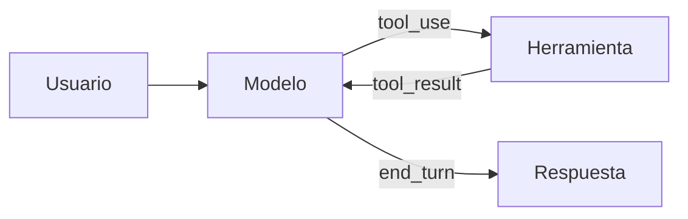

# MoreContext · Guía de contenido

> Cómo se escribe, se organiza y se enlaza todo lo que vive en `contenido/`.
> Esta carpeta es a la vez **tu segundo cerebro** (ábrela como bóveda de Obsidian) y **la fuente de la web** (Astro la lee y genera una página por archivo).

---

## 1. La regla de oro

**Un archivo `.md` = una página de la web.** La ruta del archivo decide la URL; el frontmatter decide cómo se muestra; el cuerpo es el contenido. No hay HTML que tocar para publicar.

```
contenido/glosario/rag.md                              → /glosario/rag/
contenido/docs/herramientas/01-uso-de-herramientas.md  → /docs/herramientas/uso-de-herramientas/
contenido/roadmap/40-primer-agente/02-el-bucle-agentico.md → /roadmap/40-primer-agente/el-bucle-agentico/
contenido/roadmap/40-primer-agente/index.md            → /roadmap/40-primer-agente/
contenido/paginas/manifiesto.md                        → /manifiesto/
```

- El prefijo numérico del **archivo** (`01-`, `02-`) solo ordena en el explorador: desaparece de la URL.
- Las **carpetas** conservan su nombre completo (`40-primer-agente`), porque el número del nivel es información.
- `index.md` dentro de una carpeta es la portada de esa carpeta (sección, nivel, curso o grupo de docs).
- Carpetas y archivos que empiezan por `_` o `.` **no se publican**: `_plantillas/`, `_borradores/`, `_adjuntos/`, `.obsidian/`.

## 2. Estructura

```
contenido/
├── .obsidian/            # configuración de la bóveda (no se publica)
├── _plantillas/          # plantillas para crear notas nuevas (no se publica)
├── _borradores/          # ideas sin forma (no se publica)
├── _adjuntos/            # imágenes; se enlazan con ![[archivo.png]]
├── paginas/              # páginas sueltas: /empieza-aqui/, /manifiesto/, /contribuir/, /sobre/, /licencia/
├── roadmap/              # Roadmap 0→100
│   ├── index.md          #   portadilla de la sección
│   └── 00-fundamentos/   #   un nivel = una carpeta
│       ├── index.md      #     ficha del nivel
│       └── 01-que-es-un-llm.md   # lecciones
├── cursos/               # Cursos específicos (misma estructura que roadmap)
├── docs/                 # Documentación: carpeta = grupo, archivo = artículo
├── modelos/              # Guía de modelos
├── sistemas/             # Sistemas a construir
├── patrones/             # Patrones de agentes
├── disciplinas/          # Disciplinas y formas de trabajar
├── recetas/
├── glosario/             # un término por archivo
├── radar/                # AAAA-MM-DD-titulo.md
├── blog/                 # AAAA-MM-DD-titulo.md
└── boletin/              # 001.md, 002.md…
```

Nombres de archivo y carpeta: **minúsculas, sin tildes ni ñ, palabras con guiones**: `diseno-de-herramientas.md`, `pequenos-cambios.md`. El título bonito va en el frontmatter.

## 3. Frontmatter

### 3.1 Campos comunes (todas las colecciones)

```yaml
---
titulo: Uso de herramientas                 # obligatorio · tal cual se mostrará
descripcion: Cómo el modelo pide a tu aplicación que ejecute funciones y cómo devolverle el resultado.
                                            # obligatorio · 20–220 caracteres · una frase que diga qué aprendes
creado: 2026-10-20                          # obligatorio · AAAA-MM-DD
actualizado: 2026-10-24                     # opcional
estado: publicado                           # borrador | revision | publicado (por defecto: publicado)
tags: [herramientas, api]                   # opcional · minúsculas, sin tildes
aliases: [Tool use, Function calling]       # opcional · otros nombres con los que enlazar la nota
relacionados: ["[[glosario/tool-use]]", "[[roadmap/20-herramientas/01-ciclo-tool-use]]"]
                                            # opcional · SIEMPRE wikilinks entre comillas
---
```

- `borrador`: no se publica en la web (sí se ve en `pnpm dev`).
- `revision`: se publica con la marca «En revisión».
- Nunca pongas un `# Título` en el cuerpo: el título sale de `titulo`.

### 3.2 Campos por colección

| Carpeta | Campos extra |
|---|---|
| `*/index.md` de sección (`roadmap/index.md`, `docs/index.md`…) | `orden` (posición en el menú) |
| `roadmap/NN-nivel/index.md` | `nivel` (0–100), `horas`, `objetivo`, `prerrequisitos` (wikilinks), `proyecto: {titulo, descripcion, entregable}` |
| `roadmap/*/NN-leccion.md` y `cursos/*/NN-leccion.md` | `orden`, `minutos`, `tipo` (teoria · practica · proyecto), `objetivos` (lista), `requiere` (wikilinks) |
| `cursos/nombre/index.md` | `orden`, `nivel` (inicial · intermedio · avanzado), `horas`, `objetivo`, `requiere` (wikilinks) |
| `docs/grupo/index.md` | `orden` |
| `docs/grupo/NN-articulo.md` | `orden`, `nivel` (inicial · intermedio · avanzado) |
| `modelos/` | `orden` |
| `sistemas/` | `orden`, `complejidad` (1–3), `tiempo` ("1–2 días"), `stack` (lista), `componentes` (lista), `patrones` (wikilinks) |
| `patrones/` | `orden`, `tipo` (fundamento · workflow · agente), `coste` (1–3), `latencia` (1–3), `cuandoUsar`, `cuandoNo` |
| `disciplinas/` | `orden`, `tipo` (disciplina · forma-de-trabajar) |
| `recetas/` | `nivel`, `minutos`, `tema` (prompting · herramientas · rag · agentes · evals · produccion), `stack` (lista) |
| `glosario/` | `categoria` (fundamentos · prompting · herramientas · contexto · agentes · evals · produccion · seguridad), `ingles` (opcional: término original) |
| `radar/` | `categoria` (modelos · herramientas · practicas · seguridad · evals), `fuente: {titulo, url}` (opcional) |
| `blog/` | `tipo` (ensayo · analisis · nota-de-campo · tutorial), `destacado` (true/false), `autor` (opcional) |
| `boletin/` | `numero` |
| `paginas/` | solo los comunes |

Las plantillas de `_plantillas/` traen cada tipo listo para rellenar.

## 4. Enlaces

### 4.1 Wikilinks (la forma preferida)

```markdown
[[glosario/rag]]                                → enlace con el título de la nota («RAG»)
[[glosario/rag|recuperación aumentada]]         → enlace con tu texto
[[docs/herramientas/01-uso-de-herramientas#Errores de herramienta|errores]]  → a una sección
![[diagrama-rag.png]]                           → imagen de contenido/_adjuntos/
```

- Escribe **siempre la ruta completa desde `contenido/`**, sin `.md`. Con o sin el prefijo de orden funciona igual (`docs/herramientas/uso-de-herramientas` también vale).
- `[[rag]]` funciona si el nombre es único o es un alias, pero puede volverse ambiguo cuando crezca el contenido: evítalo en contenido publicado.
- Un wikilink a algo que no existe se ve en gris («aún no existe») y **hace fallar** `pnpm validar`. Así el segundo cerebro puede tener huecos, pero la web no publica enlaces rotos.
- Los enlaces markdown relativos también funcionan: `[RAG](../glosario/rag.md)`.

### 4.2 Enlaces externos

Markdown normal `[texto](https://…)`. Se abren en pestaña nueva y llevan el icono ↗ automáticamente.

## 5. Bloques especiales

### 5.1 Avisos (callouts, compatibles con Obsidian y GitHub)

```markdown
> [!consejo] Empieza simple
> Una llamada bien hecha con buenos ejemplos gana a un agente mal diseñado.

> [!aviso]
> Si no pones límite de pasos, un agente puede gastar sin parar.

> [!peligro] Acciones irreversibles
> Pide aprobación humana antes de borrar, pagar o enviar.

> [!nota] Para saber más
> …

> [!ejemplo] …
> [!pregunta] …
> [!cita] …

> [!ejercicio]- Pistas (plegado por defecto)
> Contenido oculto hasta que se pulsa.
```

| Tipo | Color | Úsalo para |
|---|---|---|
| `nota` / `info` | cian | contexto adicional |
| `consejo` / `tip` | verde | una buena práctica |
| `aviso` / `warning` | amarillo | un error frecuente o un coste |
| `peligro` / `danger` | rojo | seguridad, pérdida de datos, dinero |
| `ejemplo` | neutro | un caso concreto |
| `ejercicio` | amarillo | un ejercicio; con `-` se pliega |
| `pregunta` | cian | preguntas frecuentes |
| `cita` | neutro | citas textuales con fuente |

Máximo **2–3 avisos por página**. Si todo es importante, nada lo es.

### 5.2 Código

````markdown
```python title="agente.py"
print("hola")
```
````

Pestañas sincronizadas (todos los bloques consecutivos con `tab=` se agrupan; la elección Python/TypeScript se recuerda en toda la web):

````markdown
```python tab="Python" title="agente.py"
...
```
```ts tab="TypeScript" title="agente.ts"
...
```
````

- Lenguajes habituales: `python`, `ts`, `js`, `bash`, `json`, `yaml`, `text`, `diff`.
- Los comentarios se muestran en letra manuscrita: úsalos para anotar, no para repetir el código.
- Salidas que no sean reales: bloque `text` con la primera línea `# salida de ejemplo`.

### 5.3 Diagramas (Mermaid)

````markdown

````

Se dibujan con los colores de la marca. Mantén los diagramas pequeños: 4–8 nodos, etiquetas cortas.

### 5.4 Tablas

Markdown normal. Pon la columna más importante a la izquierda. Si una tabla supera 5 columnas, piensa si es una lista.

## 6. Estructura de cada tipo de página

**Lección** (roadmap y cursos)
1. Párrafo inicial: qué vas a poder hacer al terminar (2–3 frases).
2. `## La idea` · el concepto explicado desde la base.
3. Secciones `##` con el desarrollo, con código cuando aplique.
4. `## Errores frecuentes` (opcional).
5. `## Ejercicio` con un callout `[!ejercicio]` y criterio de aceptación («Está bien si…»); pistas en `[!ejercicio]- Pistas`.
6. `## Resumen` · 3–5 viñetas.
7. `## Para seguir` · 2–4 wikilinks.

**Artículo de documentación**: definición en el primer párrafo · secciones de referencia · ejemplo completo · tabla de parámetros o casos · errores · «Ver también».

**Guía de modelos**: principio en una frase · por qué funciona · ejemplo antes/después (dos bloques `text` titulados «Antes» y «Después» o un `diff`) · cuándo no aplica.

**Sistema**: qué problema resuelve · diagrama Mermaid · componentes (tabla) · flujo paso a paso · decisiones de diseño y alternativas · código esencial · cómo evaluarlo · costes y riesgos · variantes · por dónde empezar.

**Patrón**: qué es · diagrama · cuándo usarlo · cuándo no · ejemplo concreto · esqueleto de código · coste y latencia · patrones relacionados.

**Disciplina / forma de trabajar**: qué es · por qué importa · prácticas concretas (lista) · señales de que lo haces mal · cómo empezar mañana.

**Receta**: «Problema» · «Ingredientes» (requisitos) · «Pasos» (lista numerada con código) · «Cómo comprobar que funciona» · «Variaciones» · «Errores típicos».

**Glosario**: definición en 1–3 frases (primer párrafo) · «En la práctica» (2–4 frases o un ejemplo mínimo) · «No confundir con» (si aplica) · «Ver también» (wikilinks). Corto: 80–250 palabras.

**Radar**: `## Qué es` · `## Qué cambia en la práctica` · `## Qué hacer` · fuente si existe. 150–350 palabras.

**Blog**: libre, en primera persona del autor. Los textos iniciales están en `estado: revision` para que el autor los reescriba con su voz.

## 7. Voz y estilo

- Español de España, tuteo, voz activa, frases cortas. Párrafos de 2–4 frases.
- **Sin humo**: nada de «revolucionario», «potente», «el futuro», «10x», «imprescindible», «en el mundo actual». Nada de cifras sin fuente, testimonios ni promesas.
- Si algo depende, di **de qué depende**. Si algo no se sabe o cambia rápido, dilo.
- Explica cada término técnico la primera vez o enlázalo al glosario.
- Términos en inglés cuando así se usan en código o en la industria (`tool_use`, *prompt caching*, *embeddings*); en cursiva la primera vez si no es código.
- Evita: guiones largos como incisos, «no es X, es Y», «cabe destacar», «en este sentido», «sin más dilación», listas de una sola palabra por viñeta.
- Negrita solo para la idea clave de una sección, no para decorar.

## 8. Datos técnicos de referencia (verificados en octubre de 2026)

El código de ejemplo usa la API de Mensajes de Anthropic como implementación de referencia. Los conceptos se explican de forma que sirvan con cualquier proveedor.

```python
import anthropic
MODEL = "claude-sonnet-5-5"          # una constante arriba; nunca nombres de modelo repartidos
client = anthropic.Anthropic()        # lee ANTHROPIC_API_KEY del entorno

resp = client.messages.create(
    model=MODEL, max_tokens=1024,
    system="Eres un asistente…",
    tools=[{"name": "buscar_docs", "description": "…", "input_schema": {"type": "object", "properties": {...}, "required": [...]}}],
    messages=[{"role": "user", "content": "…"}],
)
resp.stop_reason      # "end_turn" | "tool_use" | "max_tokens" | "stop_sequence" | "pause_turn" | "refusal"
resp.content          # lista de bloques: {"type": "text"}, {"type": "tool_use", "id", "name", "input"}, {"type": "thinking"}
resp.usage            # input_tokens, output_tokens, cache_creation_input_tokens, cache_read_input_tokens
```

- **Resultado de herramienta**: mensaje `user` con bloques `{"type": "tool_result", "tool_use_id": …, "content": "…", "is_error": False}`. Un `tool_result` por cada `tool_use`, todos en el mismo mensaje y antes de cualquier texto.
- **`tool_choice`**: `{"type": "auto"}` (por defecto), `{"type": "any"}`, `{"type": "tool", "name": "…"}`, `{"type": "none"}`. Opción `disable_parallel_tool_use`.
- **TypeScript**: `import Anthropic from "@anthropic-ai/sdk"; const client = new Anthropic(); await client.messages.create({...})`.
- **Streaming (Python)**: `with client.messages.stream(model=MODEL, max_tokens=…, messages=…) as stream: for texto in stream.text_stream: …`.
- **Contar tokens**: `client.messages.count_tokens(model=MODEL, messages=…)` → `.input_tokens`.
- **Prompt caching**: `"cache_control": {"type": "ephemeral"}` en un bloque (hasta 4 puntos de corte) o en el nivel superior de la petición para caché automática. TTL por defecto 5 min (se renueva al usarse); opción `{"type": "ephemeral", "ttl": "1h"}`. El prefijo se cachea en orden `tools` → `system` → `messages`; cambiar algo invalida eso y lo posterior. Hay un mínimo de tokens para cachear que depende del modelo. Escribir en caché cuesta algo más que la entrada normal y leer de caché cuesta mucho menos (consulta los multiplicadores actuales en la documentación oficial; no los copies como cifras fijas).
- **Razonamiento**: en los modelos actuales se activa con `thinking={"type": "adaptive"}` y se regula con `output_config={"effort": "low" | "medium" | "high" | "xhigh" | "max"}` (no todos los modelos aceptan todos los niveles). El presupuesto manual `budget_tokens` es el modo antiguo. El coste se controla con `max_tokens` (límite duro) y `effort` (orientativo).
- **Salidas estructuradas**: `output_config={"format": {"type": "json_schema", "schema": {...}}}` devuelve JSON válido según el esquema en el bloque de texto; `strict: True` en una herramienta garantiza que sus argumentos cumplen el `input_schema`. Limitaciones: sin esquemas recursivos ni restricciones numéricas o de longitud; `additionalProperties` debe ser `false`. Con Pydantic: `client.messages.parse(..., output_format=MiModelo)` → `.parsed_output`. Sigue validando en tu código.
- **Embeddings**: Anthropic no ofrece modelo de embeddings propio. En el código, usa una función `embed(textos) -> list[list[float]]` abstracta con el comentario «usa el proveedor de embeddings que prefieras».
- **MCP** (Model Context Protocol): estándar abierto para conectar aplicaciones de IA con herramientas y datos; especificación en https://modelcontextprotocol.io. Arquitectura *host* → *cliente* → *servidor*. Los servidores exponen *tools*, *resources* y *prompts*. Transportes: `stdio` (local) y *Streamable HTTP* (remoto). SDK de Python: paquete `mcp`, serie 2.x (`pip install "mcp[cli]"`): `from mcp.server.mcpserver import MCPServer`, `mcp = MCPServer("nombre")`, `@mcp.tool()`, `mcp.run()` (stdio por defecto; `transport="streamable-http"` para remoto). Los errores que el modelo debe leer se lanzan con `ToolError` (`from mcp.server.mcpserver.exceptions import ToolError`); cualquier otra excepción llega con un mensaje genérico. En el cliente Python los atributos son snake_case (`tool.input_schema`, `resultado.is_error`, `resultado.structured_content`); el JSON del protocolo y el SDK de TypeScript siguen en camelCase (`inputSchema`, `isError`). En la serie 1.x la clase se llamaba `FastMCP` (no confundir con el proyecto independiente FastMCP). SDK de TypeScript: `@modelcontextprotocol/sdk`.
- **Uso del ordenador**: herramienta versionada que permite al modelo ver capturas y mover ratón/teclado. No copies el nombre exacto de la versión de la herramienta: remite a la documentación oficial. Siempre en máquina virtual o contenedor aislado.
- Para todo lo que cambia rápido (nombres de modelo, precios, límites, versiones de herramientas): explica el concepto y remite a la documentación oficial del proveedor.

### Referencias que puedes citar (reales)

| Referencia | Enlace |
|---|---|
| Vaswani et al., 2017 · *Attention Is All You Need* | https://arxiv.org/abs/1706.03762 |
| Brown et al., 2020 · *Language Models are Few-Shot Learners* | https://arxiv.org/abs/2005.14165 |
| Lewis et al., 2020 · *Retrieval-Augmented Generation for Knowledge-Intensive NLP Tasks* | https://arxiv.org/abs/2005.11401 |
| Wei et al., 2022 · *Chain-of-Thought Prompting Elicits Reasoning in LLMs* | https://arxiv.org/abs/2201.11903 |
| Kojima et al., 2022 · *Large Language Models are Zero-Shot Reasoners* | https://arxiv.org/abs/2205.11916 |
| Wang et al., 2022 · *Self-Consistency Improves Chain of Thought Reasoning* | https://arxiv.org/abs/2203.11171 |
| Yao et al., 2022 · *ReAct: Synergizing Reasoning and Acting in Language Models* | https://arxiv.org/abs/2210.03629 |
| Schick et al., 2023 · *Toolformer* | https://arxiv.org/abs/2302.04761 |
| Shinn et al., 2023 · *Reflexion* | https://arxiv.org/abs/2303.11366 |
| Yao et al., 2023 · *Tree of Thoughts* | https://arxiv.org/abs/2305.10601 |
| Liu et al., 2023 · *Lost in the Middle: How Language Models Use Long Contexts* | https://arxiv.org/abs/2307.03172 |
| Zheng et al., 2023 · *Judging LLM-as-a-Judge with MT-Bench and Chatbot Arena* | https://arxiv.org/abs/2306.05685 |
| Greshake et al., 2023 · *Not what you've signed up for* (inyección indirecta) | https://arxiv.org/abs/2302.12173 |
| Robertson y Zaragoza, 2009 · *The Probabilistic Relevance Framework: BM25 and Beyond* | (sin enlace) |
| Anthropic, dic. 2024 · *Building effective agents* | https://www.anthropic.com/engineering/building-effective-agents |
| Anthropic, sept. 2024 · *Introducing Contextual Retrieval* | https://www.anthropic.com/news/contextual-retrieval |
| Anthropic, jun. 2025 · *How we built our multi-agent research system* | https://www.anthropic.com/engineering/multi-agent-research-system |
| Anthropic, 2025 · *Writing effective tools for agents* | https://www.anthropic.com/engineering/writing-tools-for-agents |
| Anthropic, 2025 · *Effective context engineering for AI agents* | https://www.anthropic.com/engineering/effective-context-engineering-for-ai-agents |
| Model Context Protocol · especificación | https://modelcontextprotocol.io |
| OWASP · *Top 10 for LLM Applications* | https://genai.owasp.org |
| Documentación de la API de Claude | https://platform.claude.com/docs |

No inventes otras referencias, cifras de benchmarks ni anuncios de empresas.

## 9. Flujo de trabajo

1. Crea la nota desde una plantilla de `_plantillas/` (en Obsidian: *Insertar plantilla*).
2. Escribe con `estado: borrador` mientras la piensas.
3. `pnpm dev` y mírala en `http://localhost:4321`.
4. `pnpm validar` para comprobar frontmatter y enlaces.
5. Cambia a `publicado`, haz commit y push: GitHub Actions publica la web.
