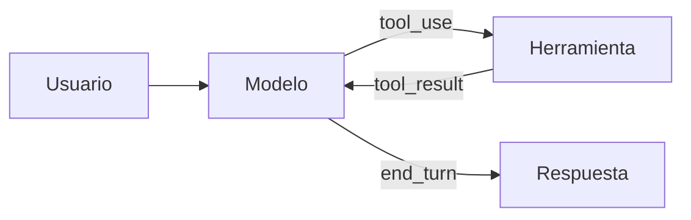

# MoreContext · Guía de contenido

> Cómo se escribe, se organiza y se enlaza todo lo que vive en `contenido/`.
> Esta carpeta es a la vez **tu segundo cerebro** (ábrela como bóveda de Obsidian) y **la fuente de la web** (Astro la lee y genera una página por archivo).

---

## 1. La regla de oro

**Un archivo `.md` = una página de la web.** La ruta del archivo decide la URL; el frontmatter decide cómo se muestra; el cuerpo es el contenido. No hay HTML que tocar para publicar.

```
contenido/glosario/rag.md                              → /glosario/rag/
contenido/docs/herramientas/01-uso-de-herramientas.md  → /docs/herramientas/uso-de-herramientas/
contenido/roadmap/40-primer-agente/02-el-bucle-agentico.md → /roadmap/40-primer-agente/el-bucle-agentico/
contenido/roadmap/40-primer-agente/index.md            → /roadmap/40-primer-agente/
contenido/paginas/manifiesto.md                        → /manifiesto/
```

- El prefijo numérico del **archivo** (`01-`, `02-`) solo ordena en el explorador: desaparece de la URL.
- Las **carpetas** conservan su nombre completo (`40-primer-agente`), porque el número del nivel es información.
- `index.md` dentro de una carpeta es la portada de esa carpeta (sección, nivel, curso o grupo de docs).
- Carpetas y archivos que empiezan por `_` o `.` **no se publican**: `_plantillas/`, `_borradores/`, `_adjuntos/`, `.obsidian/`.

## 2. Estructura

```
contenido/
├── .obsidian/            # configuración de la bóveda (no se publica)
├── _plantillas/          # plantillas para crear notas nuevas (no se publica)
├── _borradores/          # ideas sin forma (no se publica)
├── _adjuntos/            # imágenes; se enlazan con ![[archivo.png]]
├── paginas/              # páginas sueltas: /empieza-aqui/, /manifiesto/, /contribuir/, /sobre/, /licencia/
├── roadmap/              # Roadmap 0→100
│   ├── index.md          #   portadilla de la sección
│   └── 00-fundamentos/   #   un nivel = una carpeta
│       ├── index.md      #     ficha del nivel
│       └── 01-que-es-un-llm.md   # lecciones
├── cursos/               # Cursos específicos (misma estructura que roadmap)
├── docs/                 # Documentación: carpeta = grupo, archivo = artículo
├── modelos/              # Guía de modelos
├── sistemas/             # Sistemas a construir
├── patrones/             # Patrones de agentes
├── disciplinas/          # Disciplinas y formas de trabajar
├── recetas/
├── plantillas/           # plantillas listas para copiar (prompts, specs, checklists, configuración)
├── herramientas/         # directorio curado del ecosistema, sin afiliados
├── biblioteca/           # papers y textos comentados
├── problemas/            # problemas frecuentes: síntoma → causa → arreglo
├── glosario/             # un término por archivo
├── radar/                # AAAA-MM-DD-titulo.md
├── blog/                 # AAAA-MM-DD-titulo.md
└── boletin/              # 001.md, 002.md…
```

Nombres de archivo y carpeta: **minúsculas, sin tildes ni ñ, palabras con guiones**: `diseno-de-herramientas.md`, `pequenos-cambios.md`. El título bonito va en el frontmatter.

## 3. Frontmatter

### 3.1 Campos comunes (todas las colecciones)

```yaml
---
titulo: Uso de herramientas                 # obligatorio · tal cual se mostrará
descripcion: Cómo el modelo pide a tu aplicación que ejecute funciones y cómo devolverle el resultado.
                                            # obligatorio · 20–220 caracteres · una frase que diga qué aprendes
creado: 2026-10-20                          # obligatorio · AAAA-MM-DD
actualizado: 2026-10-24                     # opcional
estado: publicado                           # borrador | revision | publicado (por defecto: publicado)
tags: [herramientas, api]                   # opcional · minúsculas, sin tildes
aliases: [Tool use, Function calling]       # opcional · otros nombres con los que enlazar la nota
relacionados: ["[[glosario/tool-use]]", "[[roadmap/20-herramientas/01-ciclo-tool-use]]"]
                                            # opcional · SIEMPRE wikilinks entre comillas
---
```

- `borrador`: no se publica en la web (sí se ve en `pnpm dev`).
- `revision`: se publica con la marca «En revisión».
- Nunca pongas un `# Título` en el cuerpo: el título sale de `titulo`.

### 3.2 Campos por colección

| Carpeta | Campos extra |
|---|---|
| `*/index.md` de sección (`roadmap/index.md`, `docs/index.md`…) | `orden` (posición en el menú) |
| `roadmap/NN-nivel/index.md` | `nivel` (0–100), `horas`, `objetivo`, `prerrequisitos` (wikilinks), `proyecto: {titulo, descripcion, entregable}` |
| `roadmap/*/NN-leccion.md` y `cursos/*/NN-leccion.md` | `orden`, `minutos`, `tipo` (teoria · practica · proyecto), `objetivos` (lista), `requiere` (wikilinks). Opcionales: `profundidad` (imprescindible · por-encima · extra) y `revisado` (fecha de la última comprobación de enlaces externos), usados en `cursos/ruta-en-video/` |
| `cursos/nombre/index.md` | `orden`, `nivel` (inicial · intermedio · avanzado), `horas`, `objetivo`, `requiere` (wikilinks) |
| `docs/grupo/index.md` | `orden` |
| `docs/grupo/NN-articulo.md` | `orden`, `nivel` (inicial · intermedio · avanzado) |
| `modelos/` | `orden` |
| `sistemas/` | `orden`, `complejidad` (1–3), `tiempo` ("1–2 días"), `stack` (lista), `componentes` (lista), `patrones` (wikilinks) |
| `patrones/` | `orden`, `tipo` (fundamento · workflow · agente), `coste` (1–3), `latencia` (1–3), `cuandoUsar`, `cuandoNo` |
| `disciplinas/` | `orden`, `tipo` (disciplina · forma-de-trabajar) |
| `recetas/` | `nivel`, `minutos`, `tema` (prompting · herramientas · rag · agentes · evals · produccion · seguridad), `stack` (lista) |
| `plantillas/` | `tipo` (prompt · spec · checklist · configuracion · agente · skill), `formato` (md · txt · json · jsonl · yaml), `archivo` (nombre sugerido al guardarla) |
| `herramientas/` | `categoria` (framework · sdk · inferencia · base-vectorial · ingesta · observabilidad · evals · guardrails · agente-de-codigo · interfaz · protocolo · pasarela), `licencia` (SPDX o «propietaria»), `open_source` (true/false), `lenguajes` (lista), `url` (web oficial), `repositorio` (opcional), `version` (revisada), `revisado` (fecha) |
| `biblioteca/` | `autores`, `anio`, `url`, `tipo` (paper · ensayo · especificacion · libro), `tema` (categorías del glosario), `nivel` |
| `problemas/` | `sintoma` (frase corta o mensaje de error), `tema` (los de recetas), `nivel` |
| `comunidad/` | `autor`, `url` (proyecto de la comunidad) |
| `glosario/` | `categoria` (fundamentos · prompting · herramientas · contexto · agentes · evals · produccion · seguridad), `ingles` (opcional: término original) |
| `radar/` | `categoria` (modelos · herramientas · practicas · seguridad · evals), `fuente: {titulo, url}` (opcional) |
| `blog/` | `tipo` (ensayo · analisis · nota-de-campo · tutorial), `destacado` (true/false), `autor` (opcional) |
| `boletin/` | `numero` |
| `paginas/` | solo los comunes |

Las plantillas de `_plantillas/` traen cada tipo listo para rellenar.

## 4. Enlaces

### 4.1 Wikilinks (la forma preferida)

```markdown
[[glosario/rag]]                                → enlace con el título de la nota («RAG»)
[[glosario/rag|recuperación aumentada]]         → enlace con tu texto
[[docs/herramientas/01-uso-de-herramientas#Errores de herramienta|errores]]  → a una sección
![[diagrama-rag.png]]                           → imagen de contenido/_adjuntos/
```

- Escribe **siempre la ruta completa desde `contenido/`**, sin `.md`. Con o sin el prefijo de orden funciona igual (`docs/herramientas/uso-de-herramientas` también vale).
- `[[rag]]` funciona si el nombre es único o es un alias, pero puede volverse ambiguo cuando crezca el contenido: evítalo en contenido publicado.
- Un wikilink a algo que no existe se ve en gris («aún no existe») y **hace fallar** `pnpm validar`. Así el segundo cerebro puede tener huecos, pero la web no publica enlaces rotos.
- Los enlaces markdown relativos también funcionan: `[RAG](../glosario/rag.md)`.

### 4.2 Enlaces externos

Markdown normal `[texto](https://…)`. Se abren en pestaña nueva y llevan el icono ↗ automáticamente.

## 5. Bloques especiales

### 5.1 Avisos (callouts, compatibles con Obsidian y GitHub)

```markdown
> [!consejo] Empieza simple
> Una llamada bien hecha con buenos ejemplos gana a un agente mal diseñado.

> [!aviso]
> Si no pones límite de pasos, un agente puede gastar sin parar.

> [!peligro] Acciones irreversibles
> Pide aprobación humana antes de borrar, pagar o enviar.

> [!nota] Para saber más
> …

> [!ejemplo] …
> [!pregunta] …
> [!cita] …

> [!ejercicio]- Pistas (plegado por defecto)
> Contenido oculto hasta que se pulsa.
```

| Tipo | Color | Úsalo para |
|---|---|---|
| `nota` / `info` | cian | contexto adicional |
| `consejo` / `tip` | verde | una buena práctica |
| `aviso` / `warning` | amarillo | un error frecuente o un coste |
| `peligro` / `danger` | rojo | seguridad, pérdida de datos, dinero |
| `ejemplo` | neutro | un caso concreto |
| `ejercicio` | amarillo | un ejercicio; con `-` se pliega |
| `pregunta` | cian | preguntas frecuentes |
| `cita` | neutro | citas textuales con fuente |

Máximo **2–3 avisos por página**. Si todo es importante, nada lo es.

### 5.2 Código

````markdown
```python title="agente.py"
print("hola")
```
````

Pestañas sincronizadas (todos los bloques consecutivos con `tab=` se agrupan; la elección Python/TypeScript se recuerda en toda la web):

````markdown
```python tab="Python" title="agente.py"
...
```
```ts tab="TypeScript" title="agente.ts"
...
```
````

- Etiquetas de pestaña: `Python` y `TypeScript` para el SDK del proveedor; para frameworks, su nombre (`LangChain`, `LangGraph`, `LlamaIndex`, `Pydantic AI`, `OpenAI Agents SDK`); para modelos locales, `Ollama`. La elección se recuerda por etiqueta en toda la web.
- Primero el mecanismo, luego el framework: en lecciones y patrones, el código a mano con el SDK va antes; la versión con un framework abierto va después (pestaña o sección «Con LangGraph»), explicando qué esconde.
- Lenguajes habituales: `python`, `ts`, `js`, `bash`, `json`, `yaml`, `toml`, `text`, `diff`.
- Un fragmento incompleto a propósito (con «…») lleva `nocheck` en la meta (```` ```python nocheck ````): así el comprobador de código no lo compila.
- Los comentarios se muestran en letra manuscrita: úsalos para anotar, no para repetir el código.
- Salidas que no sean reales: bloque `text` con la primera línea `# salida de ejemplo`.

### 5.3 Diagramas (Mermaid)

````markdown

````

Se dibujan con los colores de la marca. Mantén los diagramas pequeños: 4–8 nodos, etiquetas cortas.

### 5.4 Tablas

Markdown normal. Pon la columna más importante a la izquierda. Si una tabla supera 5 columnas, piensa si es una lista.

## 6. Estructura de cada tipo de página

**Lección** (roadmap y cursos)
1. Párrafo inicial: qué vas a poder hacer al terminar (2–3 frases).
2. `## La idea` · el concepto explicado desde la base.
3. Secciones `##` con el desarrollo, con código cuando aplique.
4. `## Errores frecuentes` (opcional).
5. `## Ejercicio` con un callout `[!ejercicio]` y criterio de aceptación («Está bien si…»); pistas en `[!ejercicio]- Pistas`.
6. `## Resumen` · 3–5 viñetas.
7. `## Para seguir` · 2–4 wikilinks.

**Artículo de documentación**: definición en el primer párrafo · secciones de referencia · ejemplo completo · tabla de parámetros o casos · errores · «Ver también».

**Guía de modelos**: principio en una frase · por qué funciona · ejemplo antes/después (dos bloques `text` titulados «Antes» y «Después» o un `diff`) · cuándo no aplica.

**Sistema**: qué problema resuelve · diagrama Mermaid · componentes (tabla) · flujo paso a paso · decisiones de diseño y alternativas · código esencial · cómo evaluarlo · costes y riesgos · variantes · por dónde empezar.

**Patrón**: qué es · diagrama · cuándo usarlo · cuándo no · ejemplo concreto · esqueleto de código · coste y latencia · patrones relacionados.

**Disciplina / forma de trabajar**: qué es · por qué importa · prácticas concretas (lista) · señales de que lo haces mal · cómo empezar mañana.

**Receta**: «Problema» · «Ingredientes» (requisitos) · «Pasos» (lista numerada con código) · «Cómo comprobar que funciona» · «Variaciones» · «Errores típicos».

**Glosario**: definición en 1–3 frases (primer párrafo) · «En la práctica» (2–4 frases o un ejemplo mínimo) · «No confundir con» (si aplica) · «Ver también» (wikilinks). Corto: 80–250 palabras.

**Plantilla**: para qué sirve · `## Cuándo usarla` · `## La plantilla` (un bloque completo listo para copiar) · `## Cómo rellenarla` · `## Ejemplo` · `## Errores típicos` · `## Relacionadas`.

**Herramienta** (ficha del directorio): qué es · `## Para qué sirve` · `## Cuándo usarla` · `## Cuándo no` · `## Ejemplo mínimo` · `## Alternativas` · `## Enlaces`. 250–600 palabras. Sin afiliados; licencia y estado (open source, pesos abiertos, comercial) siempre explícitos.

**Biblioteca** (paper comentado): de qué va · `## La idea clave` · `## Por qué importa hoy` · `## Qué leer primero` · `## Qué ha envejecido` · `## Dónde lo ves en MoreContext`. 400–800 palabras.

**Problema frecuente**: el síntoma literal en el primer párrafo · `## Causas` · `## Cómo confirmarlo` · `## Arreglo` · `## Cómo evitarlo` · `## Ver también`. 300–700 palabras.

**Lección de la ruta en vídeo**: párrafo inicial · `## Qué vas a ver` (tabla vídeo · canal · duración · idioma · profundidad) · `## Lo que importa` · `## Cómo verlo` · `## Practícalo en MoreContext` · `## Ejercicio` · `## Resumen` · `## Para seguir`.

**Radar**: `## Qué es` · `## Qué cambia en la práctica` · `## Qué hacer` · fuente si existe. 150–350 palabras.

**Blog**: libre, en primera persona del autor. Los textos iniciales están en `estado: revision` para que el autor los reescriba con su voz.

## 7. Voz y estilo

- Español de España, tuteo, voz activa, frases cortas. Párrafos de 2–4 frases.
- **Sin humo**: nada de «revolucionario», «potente», «el futuro», «10x», «imprescindible», «en el mundo actual». Nada de cifras sin fuente, testimonios ni promesas.
- Si algo depende, di **de qué depende**. Si algo no se sabe o cambia rápido, dilo.
- Explica cada término técnico la primera vez o enlázalo al glosario.
- Términos en inglés cuando así se usan en código o en la industria (`tool_use`, *prompt caching*, *embeddings*); en cursiva la primera vez si no es código.
- Evita: guiones largos como incisos, «no es X, es Y», «cabe destacar», «en este sentido», «sin más dilación», listas de una sola palabra por viñeta.
- Negrita solo para la idea clave de una sección, no para decorar.

## 8. Datos técnicos de referencia (verificados el 29 de octubre de 2026)

El código de ejemplo usa la API de Mensajes de Anthropic como implementación de referencia y, donde aporta, el mismo caso con frameworks abiertos (LangChain, LangGraph…) y modelos de pesos abiertos. Los conceptos se explican de forma que sirvan con cualquier proveedor. Fuente de estos datos: los informes de `docs/investigacion/` (verificados contra la documentación oficial y con los paquetes instalados).

### 8.1 API de Claude (versión `2026-10-21`, SDK `anthropic` ≥ 2 y `@anthropic-ai/sdk` ≥ 1)

```python
import anthropic
MODEL = "claude-sonnet-5-5"          # una constante arriba; nunca nombres de modelo repartidos
client = anthropic.Anthropic()        # lee ANTHROPIC_API_KEY; envía Authorization: Bearer y anthropic-version: 2026-10-21

resp = client.messages.create(
    model=MODEL, max_tokens=4096,
    system="Eres un asistente…",
    tools=[{"name": "buscar_docs", "description": "…", "input_schema": {"type": "object", "properties": {...}, "required": [...]}}],
    messages=[{"role": "user", "content": "…"}],
)
resp.stop_reason      # "end_turn" | "tool_use" | "max_tokens" | "stop_sequence" | "pause_turn" | "refusal" | "model_context_window_exceeded"
resp.content          # bloques: text, tool_use (id, name, input), thinking / redacted_thinking, server_tool_use, *_tool_result…
resp.usage            # input_tokens, output_tokens, cache_creation_input_tokens, cache_read_input_tokens (+ detalles)
```

- **Modelos actuales** (oct. 2026): `claude-opus-5-5`, `claude-sonnet-5-5`, `claude-haiku-5-5` y `claude-fable-5-1`, todos con 1M de contexto y hasta 128k de salida. La documentación recomienda empezar por Opus 5.5 y subir a Fable 5.1 si las evals no llegan; Sonnet 5.5 es el equilibrio velocidad/capacidad (el que usa la web en los ejemplos) y Haiku 5.5, el de volumen y latencia. No copies precios: remite a la página oficial.
- **Muestreo eliminado**: desde la versión `2026-10-21`, `temperature`, `top_p` y `top_k` **no existen** en la API de Claude (400 en cualquier modelo; en el SDK 2.x, `TypeError`). La consistencia se busca con salidas estructuradas, rúbricas cerradas, varias muestras y evals. Esos parámetros siguen existiendo en otros proveedores y en modelos abiertos.
- **SDK 2.x**: Python ≥ 3.10; usa `httpx2` (si pasas `http_client`, es de `httpx2`); un cliente admite una sola credencial; los mensajes se escriben como dict (`MessageParam` es una unión por rol). TypeScript: `import Anthropic from "@anthropic-ai/sdk"; const client = new Anthropic(); await client.messages.create({...})`.
- **Resultado de herramienta**: mensaje `user` con bloques `{"type": "tool_result", "tool_use_id": …, "content": "…", "is_error": False}`. Un `tool_result` por cada `tool_use`, todos en el mismo mensaje y antes de cualquier texto.
- **`tool_choice`**: `{"type": "auto"}` (por defecto), `{"type": "none"}`, `{"type": "any"}`, `{"type": "tool", "name": "…"}` y la opción `disable_parallel_tool_use`. **`any` y `tool` devuelven 400 en Opus 5.5, Sonnet 5.5, Fable 5.1 y Mythos 5.1** (y con razonamiento manual). Para «entregar el resultado al final» usa `output_config.format` en la última llamada, deja disponible solo la herramienta de entrega o da la instrucción en un mensaje `system` a mitad de conversación.
- **Razonamiento**: en los modelos 5.x es adaptativo por defecto (`thinking={"type": "adaptive"}`, con `display`: `"omitted"` por defecto o `"summarized"` para leerlo). `budget_tokens` devuelve 400 en los modelos 5.x; en Opus 5.5 y Fable 5.1 no se puede desactivar; Sonnet 5.5 ofrece `{"type": "between_tools"}`. El esfuerzo se regula con `output_config={"effort": "low" | "medium" | "high" | "xhigh" | "max"}` (por defecto `medium` en Opus 5.5 y Haiku 5.5, `high` en Sonnet 5.5 y Fable 5.1). Devuelve los bloques `thinking` sin tocar dentro de un turno con herramientas. El coste se controla con `max_tokens` (tope duro), `effort` y, en beta, `output_config.task_budget` (orientativo).
- **Salidas estructuradas** (GA): `output_config={"format": {"type": "json_schema", "schema": {...}}}`; `"strict": True` en una herramienta garantiza que sus argumentos cumplen el `input_schema`. Sin esquemas recursivos, sin `minimum`/`maximum` ni `minLength`/`maxLength`, `additionalProperties: false`; incompatibles con citas. Con Pydantic: `client.messages.parse(..., output_format=MiModelo)` → `.parsed_output`. Sigue validando en tu código.
- **Streaming (Python)**: `with client.messages.stream(model=MODEL, max_tokens=…, messages=…) as stream: for texto in stream.text_stream: …`. **Contar tokens**: `client.messages.count_tokens(model=MODEL, messages=…)` → `.input_tokens`.
- **Prompt caching**: `"cache_control": {"type": "ephemeral"}` (o `"ttl": "1h"`) en un bloque, o en el nivel superior de la petición para la caché automática (que ocupa uno de los **4** puntos de corte). Prefijo en orden `tools` → `system` → `messages`; cambiar algo invalida eso y lo posterior. Mínimo cacheable: 512 tokens en los modelos actuales. Escribir cuesta algo más que la entrada normal y leer mucho menos (los multiplicadores dependen del modelo: consúltalos). `diagnostics={"previous_message_id": …}` explica por qué falló la caché (GA).
- **Gestión del contexto en el servidor** (beta): compactación `context_management={"edits": [{"type": "compact_20260112", …}]}` (reenvía el bloque `compaction` que devuelve), limpieza `clear_tool_uses_20250919` y `clear_thinking_20251015`, y mensajes `{"role": "system", …}` a mitad de conversación (GA en los modelos 5.x salvo Sonnet 5) para cambiar instrucciones sin romper la caché.
- **Herramientas que pone Anthropic** (no copies el sufijo de versión en el texto; en el código usa el vigente): búsqueda web, *web fetch*, ejecución de código, búsqueda de herramientas (`defer_loading: true`), llamada programática (`allowed_callers`), memoria (`memory_20250818`, en cliente), bash y editor (cliente), y los *toolsets* de cliente de uso del ordenador y del navegador. `pause_turn`: reenvía el turno con las mismas `tools`.
- **Rechazos**: `stop_reason: "refusal"` llega con HTTP 200 y `stop_details.category`; trátalo en el bucle como un final más. En beta hay `fallbacks` en servidor.
- **Trazas**: el SDK `anthropic` 2.3 emite su propio span `anthropic.messages.create` cuando hay un proveedor de OpenTelemetry registrado (se apaga con `open_telemetry=False` o `ANTHROPIC_OPEN_TELEMETRY=false`). Si además creas tu span `chat`, no sumes los tokens dos veces.
- **Embeddings**: Anthropic no ofrece modelo de embeddings. En el código, usa una función `embed(textos) -> list[list[float]]` abstracta o un modelo abierto con su nombre real (ver `cursos/agentes-con-modelos-abiertos`).
- **Uso del ordenador**: *toolset* versionado que permite al modelo ver capturas y mover ratón/teclado. Siempre en máquina virtual o contenedor aislado; una lista blanca de dominios es una capacidad que se puede abusar.

### 8.2 Claude Code y Claude Agent SDK

- **Claude Agent SDK** (Python `claude-agent-sdk` 0.2.x, TypeScript `@anthropic-ai/claude-agent-sdk` 0.3.x): Claude Code como biblioteca. `query(prompt=…, options=ClaudeAgentOptions(...))` o `ClaudeSDKClient`; herramientas propias con `@tool` + `create_sdk_mcp_server` (se llaman `mcp__<servidor>__<herramienta>`); `hooks`, `can_use_tool` (solo se invoca cuando las reglas dicen «ask»; para vigilarlo todo, hook `PreToolUse`), `agents`, `setting_sources` (hace falta `"project"` para cargar `CLAUDE.md`), `allowed_tools` (aprueba, no limita), `permission_mode`, `max_turns`, `max_budget_usd`. Licencia: términos comerciales de Anthropic.
- **Claude Code**: `CLAUDE.md` (gestionado → usuario → proyecto → local; se concatenan; imports `@ruta` hasta 4 saltos); lee **`AGENTS.md`** de forma nativa cuando no hay `CLAUDE.md` (o impórtalo con `@AGENTS.md`). Subagentes en `.claude/agents/*.md` (`name` y `description` obligatorios; `tools`, `model`, `skills`, `maxTurns`, `isolation: worktree`…). Skills en `.claude/skills/<nombre>/SKILL.md` (`description` decide cuándo se activan; `disable-model-invocation` para que solo las lance el humano). Hooks en `settings.json`: entrada JSON por stdin (`tool_name`, `tool_input`…); **código de salida 2 = bloquear** (stderr llega como motivo); salida JSON con `hookSpecificOutput.permissionDecision` (`allow` · `deny` · `ask`). Un hook que dice `allow` no salta las reglas `deny`. Permisos: `permissions.allow/ask/deny` con `Herramienta(patrón)`, evaluación deny → ask → allow. Sandbox de Bash (Seatbelt/bubblewrap) que no cubre herramientas de archivos, MCP ni hooks. Modo *headless*: `claude -p`, `--output-format json`, `--bare` para CI.

### 8.3 MCP (especificación `2026-07-28`)

- Estándar abierto, hoy en la Agentic AI Foundation (Linux Foundation), para conectar aplicaciones de IA con herramientas y datos: https://modelcontextprotocol.io. Arquitectura *host* → *cliente* → *servidor*; los servidores exponen *tools*, *resources* y *prompts*. Transportes: `stdio` (local) y *Streamable HTTP* (remoto); HTTP+SSE está deprecado.
- La revisión `2026-07-28` es **sin estado**: no hay saludo `initialize` ni sesiones de protocolo; cada petición lleva versión y capacidades en `_meta`; `server/discover`; las peticiones que necesitan datos del usuario devuelven `input_required` (MRTR). Roots, Sampling y Logging quedan deprecados. Extensiones: MCP Apps (UI), Tasks, Server Cards.
- **SDK de Python** (`mcp` 2.x, `pip install "mcp[cli]"`): `from mcp.server.mcpserver import MCPServer`, `mcp = MCPServer("nombre")`, `@mcp.tool()`, `mcp.run()` (stdio) o `mcp.run(transport="streamable-http")`. Los errores que el modelo debe leer se lanzan con `ToolError` (`from mcp.server.mcpserver.exceptions import ToolError`; llega con el prefijo `Error executing tool <nombre>: `). Cliente: `from mcp import Client` (`async with Client(...) as c: await c.call_tool(...)`; atributos snake_case: `is_error`, `structured_content`). En la serie 1.x la clase se llamaba `FastMCP`.
- **SDK de TypeScript v2**: `@modelcontextprotocol/server` y `@modelcontextprotocol/client` (sustituyen al paquete único `@modelcontextprotocol/sdk`, que queda como línea v1): `new McpServer({ name, version })`, `server.registerTool(nombre, { description, inputSchema: z.object(...) }, handler)`, `StdioServerTransport` de `@modelcontextprotocol/server/stdio`. El JSON del protocolo va en camelCase (`inputSchema`, `isError`).
- **Conector MCP de la API de Claude** (beta): `mcp_servers=[{"type": "url", …}]` + herramienta `mcp_toolset`; solo herramientas y solo servidores remotos.

### 8.4 Frameworks open source (verificado el 29 oct. 2026)

Detalle, licencias y ejemplos ejecutados en `docs/investigacion/2A-frameworks-open-source.md`. Reglas: distingue siempre **open source** (código con licencia OSI), **pesos abiertos** (se descargan los pesos, con la licencia que sea) y **comercial** (LangSmith, el Agent Server de LangGraph con licencia Elastic-2.0, CrewAI AMP, Logfire…). Muestra primero el mecanismo con el SDK y después el framework, diciendo qué esconde.

- **LangChain 1.4** (MIT): `from langchain.agents import create_agent`; `create_agent(model, tools, system_prompt=…, middleware=[…], response_format=…, checkpointer=…)`. Modelo como `"anthropic:claude-sonnet-5-5"` o `init_chat_model("anthropic:claude-sonnet-5-5", max_tokens=…)` (**pasa siempre `max_tokens`**: sin él, `ChatAnthropic` usa el máximo del modelo). Local: `"ollama:<modelo>"` o `ChatOllama(model=…, num_ctx=…)`. Herramientas con `@tool(parse_docstring=True)` (`from langchain.tools import tool`). **Una excepción dentro de una herramienta rompe el agente**: para devolverla al modelo como error (el equivalente a `is_error`), añade `ToolErrorMiddleware(on_error=…)` o lanza `ToolException`. Middleware incluido (`langchain.agents.middleware`): `HumanInTheLoopMiddleware`, `SummarizationMiddleware`, `PIIMiddleware`, `ModelCallLimitMiddleware`, `ToolCallLimitMiddleware`, `ToolErrorMiddleware`, `TodoListMiddleware`…; de Anthropic, `AnthropicPromptCachingMiddleware`. En `claude-sonnet-5-5` no pases `temperature`. **Salida estructurada**: `llm.with_structured_output(Modelo)` sin más usa una herramienta forzada, que los modelos 5.5 no admiten (`langchain-anthropic` 1.7 avisa y lanza `OutputParserException`): pasa siempre `method="json_schema"` (envía `output_config.format`). `create_agent(..., response_format=Modelo)` ya elige `output_config.format` solo (comprobado). No uses `ToolStrategy(Modelo)` con los 5.5: fuerza `tool_choice="any"` (400). `create_react_agent` de LangGraph está deprecado en favor de `create_agent`.
- **LangGraph 1.2** (MIT): `StateGraph`, `START`/`END`, `MessagesState`, `add_messages`, `ToolNode`/`tools_condition` (`langgraph.prebuilt`), `Command`, `Send`, `interrupt()` + `Command(resume=…)` (necesita *checkpointer* y `thread_id`), `InMemorySaver`, `SqliteSaver` (`langgraph-checkpoint-sqlite`), `PostgresSaver`, `stream_mode="updates" | "messages" | "values" | "custom"`, `get_state_history`, Functional API (`@entrypoint`, `@task`). El `recursion_limit` por defecto es muy alto (no es un tope útil): fija tú el límite de pasos (`config={"recursion_limit": N}` o `ModelCallLimitMiddleware`). `langgraph-supervisor` recomienda ya el patrón supervisor con herramientas.
- **Deep Agents 0.7** (MIT, beta): `create_deep_agent(...)` con sistema de archivos virtual, subagentes (`task`) y resumen; desde la 0.7 la herramienta de tareas (`write_todos`) no viene por defecto: añade `TodoListMiddleware()`.
- **MCP en LangChain**: `pip install "langchain[mcp]"` y `from langchain.mcp import MCPAdapter` (beta, compatible con `mcp` 2.x): `async with MCPAdapter(Path("servidor.py")) as mcp: tools = await mcp.list_tools()`. `langchain-mcp-adapters` (`MultiServerMCPClient`) exige `mcp<2`: no lo mezcles en el mismo entorno que el SDK `mcp` 2.x.
- **OpenAI Agents SDK 0.24** (MIT): `Agent`, `Runner.run`/`run_sync`, `function_tool`, handoffs, guardrails, `needs_approval=True`; Claude vía `LitellmModel("anthropic/claude-sonnet-5-5")` (extra `[litellm]`). Por defecto **envía las trazas a la plataforma de OpenAI**: desactívalo (`set_tracing_disabled(True)`) o configura tu exportador.
- **Pydantic AI 2.63** (MIT): `Agent("anthropic:claude-sonnet-5-5", output_type=…, deps_type=…)`, `@agent.tool`, `requires_approval=True` + `DeferredToolRequests`; pruebas sin API con `TestModel`/`FunctionModel`.
- **Vercel AI SDK 7** (Apache-2.0): `generateText` hace un solo paso por defecto: para un bucle con herramientas, `stopWhen`; `ToolLoopAgent`. Un modelo pasado como string va por el AI Gateway de Vercel.
- **Probar sin API**: todos los frameworks principales admiten modelos simulados (`GenericFakeChatModel` en LangChain, `TestModel` en Pydantic AI, un `Model` propio en el Agents SDK, `MockLanguageModelV4` en el AI SDK). Úsalos en los ejemplos y en CI.
- Modelos abiertos e infraestructura (Ollama, vLLM, llama.cpp, bases vectoriales, observabilidad y evals abiertas): `docs/investigacion/2B-infraestructura-open-source.md`.

### 8.5 Modelos abiertos e infraestructura (verificado el 29 oct. 2026)

Detalle en `docs/investigacion/2B-infraestructura-open-source.md`.

- **Licencias**: «pesos abiertos» no es «open source AI» (definición de la OSI: datos, código y parámetros). Conviven licencias permisivas (Apache 2.0, MIT), MIT modificadas con umbrales o restricciones a ofrecer el modelo como servicio, y comunitarias. Lee siempre el `LICENSE` del repositorio del modelo; no copies la etiqueta de la web del proveedor.
- **Memoria**: pesos ≈ parámetros × bits por peso / 8, más KV cache y margen; en MoE se cargan **todos** los parámetros, no solo los activos.
- **Ollama**: API nativa `/api/chat`, compatible con OpenAI en `/v1` y compatible con Anthropic en `/v1/messages` (el SDK `anthropic` funciona con `base_url` local, sin `tool_choice`, sin caché y sin `count_tokens`). El contexto por defecto (`num_ctx`) es pequeño y trunca en silencio: súbelo (para agentes, al menos 64k si la máquina lo permite).
- **vLLM**: `vllm serve <modelo>` con `--enable-auto-tool-choice --tool-call-parser <parser de la model card>`; CORS cerrado por defecto. **TGI** está archivado. **llama.cpp** usa versiones semánticas y `llama-server` escucha por defecto en el puerto 9931 (las imágenes Docker mantienen 8080).
- **pgvector**: HNSW con `m=16`, `ef_construction=64`, `ef_search=40` por defecto; `halfvec` indexa hasta 4000 dimensiones; híbrida con `tsvector('spanish')` y RRF en SQL. **Qdrant 1.20**: denso + *sparse* con `RrfQuery(rrf=Rrf(k=60))` y BM25 sobre texto del payload. En **Chroma** la híbrida es solo de su nube.
- **Observabilidad y evals**: Langfuse SDK v5 (OpenTelemetry; `get_client`, `@observe`); **Phoenix** tiene licencia Elastic 2.0 (no OSI); promptfoo (MIT), DeepEval, Inspect AI; RAGAS 0.4 choca con `langchain-community` 0.4.
- **Licencias de plataformas «abiertas»**: Open WebUI (BSD-3 con cláusula de marca), n8n (fair-code, no OSI), PyMuPDF (AGPL-3.0), Claude Code (propietario). Antes de recomendar «autoalójalo», revisa la licencia.

- Para todo lo que cambia rápido (nombres de modelo, precios, límites, versiones de herramientas y de paquetes): explica el concepto, da la versión con su fecha si es imprescindible y remite a la documentación oficial.

### Referencias que puedes citar (reales)

Verificadas en octubre de 2026. Para cualquier otra referencia, compruébala antes en la fuente (título, autores, fecha y URL).

**Fundamentos y modelos**

| Referencia | Enlace |
|---|---|
| Rosenblatt, 1958 · *The perceptron: A probabilistic model for information storage and organization in the brain* | https://pubmed.ncbi.nlm.nih.gov/13602029/ |
| Rumelhart, Hinton y Williams, 1986 · *Learning representations by back-propagating errors* (Nature) | https://doi.org/10.1038/323533a0 |
| Hochreiter y Schmidhuber, 1997 · *Long Short-Term Memory* | https://doi.org/10.1162/neco.1997.9.8.1735 |
| Robbins y Monro, 1951 · *A Stochastic Approximation Method* | https://projecteuclid.org/euclid.aoms/1177729586 |
| Srivastava et al., 2014 · *Dropout: A Simple Way to Prevent Neural Networks from Overfitting* | https://jmlr.org/papers/v15/srivastava14a.html |
| Bahdanau, Cho y Bengio, 2014 · *Neural Machine Translation by Jointly Learning to Align and Translate* | https://arxiv.org/abs/1409.0473 |
| Vaswani et al., 2017 · *Attention Is All You Need* | https://arxiv.org/abs/1706.03762 |
| Radford et al., 2018 · *Improving Language Understanding by Generative Pre-Training* | https://cdn.openai.com/research-covers/language-unsupervised/language_understanding_paper.pdf |
| Brown et al., 2020 · *Language Models are Few-Shot Learners* | https://arxiv.org/abs/2005.14165 |
| Kaplan et al., 2020 · *Scaling Laws for Neural Language Models* | https://arxiv.org/abs/2001.08361 |
| Hoffmann et al., 2022 · *Training Compute-Optimal Large Language Models* (Chinchilla) | https://arxiv.org/abs/2203.15556 |
| Ouyang et al., 2022 · *Training language models to follow instructions with human feedback* | https://arxiv.org/abs/2203.02155 |
| Bai et al., 2022 · *Constitutional AI: Harmlessness from AI Feedback* | https://arxiv.org/abs/2212.08073 |
| OpenAI, sept. 2024 · *Learning to reason with LLMs* | https://openai.com/index/learning-to-reason-with-llms/ |
| DeepSeek-AI, ene. 2025 · *DeepSeek-R1: Incentivizing Reasoning Capability in LLMs via Reinforcement Learning* | https://arxiv.org/abs/2501.12948 |
| Lighthill, 1973 · *Artificial Intelligence: A General Survey* | https://www.aiai.ed.ac.uk/events/lighthill1973/lighthill.pdf |

**Prompting, herramientas y agentes**

| Referencia | Enlace |
|---|---|
| Wei et al., 2022 · *Chain-of-Thought Prompting Elicits Reasoning in LLMs* | https://arxiv.org/abs/2201.11903 |
| Kojima et al., 2022 · *Large Language Models are Zero-Shot Reasoners* | https://arxiv.org/abs/2205.11916 |
| Wang et al., 2022 · *Self-Consistency Improves Chain of Thought Reasoning* | https://arxiv.org/abs/2203.11171 |
| Yao et al., 2022 · *ReAct: Synergizing Reasoning and Acting in Language Models* | https://arxiv.org/abs/2210.03629 |
| Schick et al., 2023 · *Toolformer* | https://arxiv.org/abs/2302.04761 |
| Shinn et al., 2023 · *Reflexion* | https://arxiv.org/abs/2303.11366 |
| Yao et al., 2023 · *Tree of Thoughts* | https://arxiv.org/abs/2305.10601 |
| Sumers et al., 2023 · *Cognitive Architectures for Language Agents* (CoALA: tipos de memoria) | https://arxiv.org/abs/2309.02427 |
| Packer et al., 2023 · *MemGPT: Towards LLMs as Operating Systems* | https://arxiv.org/abs/2310.08560 |
| Anthropic (Erik Schluntz y Barry Zhang), 19 dic. 2024 · *Building effective agents* | https://www.anthropic.com/engineering/building-effective-agents |
| Anthropic, 13 jun. 2025 · *How we built our multi-agent research system* | https://www.anthropic.com/engineering/multi-agent-research-system |
| Anthropic, 11 sept. 2025 · *Writing effective tools for agents — with agents* | https://www.anthropic.com/engineering/writing-tools-for-agents |
| Anthropic, 29 sept. 2025 · *Effective context engineering for AI agents* | https://www.anthropic.com/engineering/effective-context-engineering-for-ai-agents |
| Anthropic, 16 oct. 2025 · *Equipping agents for the real world with Agent Skills* | https://www.anthropic.com/engineering/equipping-agents-for-the-real-world-with-agent-skills |
| Anthropic, 4 nov. 2025 · *Code execution with MCP: Building more efficient agents* | https://www.anthropic.com/engineering/code-execution-with-mcp |
| Anthropic, nov. 2025 · *Introducing advanced tool use on the Claude Developer Platform* | https://www.anthropic.com/engineering/advanced-tool-use |
| Anthropic (Justin Young), 26 nov. 2025 · *Effective harnesses for long-running agents* | https://www.anthropic.com/engineering/effective-harnesses-for-long-running-agents |
| Anthropic (Nicholas Carlini), feb. 2026 · *Building a C compiler with a team of parallel Claudes* | https://www.anthropic.com/engineering/building-c-compiler |
| Anthropic (Prithvi Rajasekaran), 24 mar. 2026 · *Harness design for long-running application development* | https://www.anthropic.com/engineering/harness-design-long-running-apps |
| OpenAI (Ryan Lopopolo), 11 feb. 2026 · *Harness engineering: leveraging Codex in an agent-first world* | https://openai.com/index/harness-engineering/ |
| OpenAI, 19 ago. 2026 · *Codex as a platform: build on the open agent harness* | https://developers.openai.com/blog/codex-as-a-platform |
| Birgitta Böckeler (martinfowler.com), 2 abr. 2026 · *Harness engineering for coding agent users* | https://martinfowler.com/articles/harness-engineering.html |
| Naresh Jain (martinfowler.com), 13 oct. 2026 · *Are Harnesses Worth the Cost?* | https://martinfowler.com/articles/are-harnesses-worth-the-cost.html |
| LangChain (Vivek Trivedy), mar. 2026 · *The Anatomy of an Agent Harness* | https://www.langchain.com/blog/the-anatomy-of-an-agent-harness |
| Barbaste et al., jul. 2026 · *Harness Engineering: Anatomy, Architecture, and Evolution of Coding Agents* | https://arxiv.org/abs/2609.00006 |
| Cognition (Walden Yan), 12 jun. 2025 · *Don't Build Multi-Agents* | https://cognition.com/blog/dont-build-multi-agents |
| Cognition (Walden Yan), 22 abr. 2026 · *Multi-Agents: What's Actually Working* | https://cognition.com/blog/multi-agents-working |
| Simon Willison, 5 oct. 2025 · *Embracing the parallel coding agent lifestyle* | https://simonwillison.net/2025/Oct/5/parallel-coding-agents/ |
| Böckeler, oct. 2025 · *Understanding Spec-Driven-Development: Kiro, spec-kit, and Tessl* | https://martinfowler.com/articles/exploring-gen-ai/sdd-3-tools.html |
| GitHub (Den Delimarsky), 2 sept. 2025 · *Spec-driven development with AI: Get started with a new open source toolkit* | https://github.blog/ai-and-ml/generative-ai/spec-driven-development-with-ai-get-started-with-a-new-open-source-toolkit/ |
| Mavin, Wilkinson, Harwood y Novak, 2009 · *Easy Approach to Requirements Syntax (EARS)* (RE'09) | https://research.manchester.ac.uk/en/publications/easy-approach-to-requirements-syntax-ears/ |
| Thoughtworks, abr. 2026 · *Technology Radar vol. 34* (Ralph loop, Assess) | https://www.thoughtworks.com/es-cl/radar/techniques/ralph-loop |

**Contexto y RAG**

| Referencia | Enlace |
|---|---|
| Lewis et al., 2020 · *Retrieval-Augmented Generation for Knowledge-Intensive NLP Tasks* | https://arxiv.org/abs/2005.11401 |
| Liu et al., 2023 · *Lost in the Middle: How Language Models Use Long Contexts* | https://arxiv.org/abs/2307.03172 |
| Gao, Ma, Lin y Callan, 2022 · *Precise Zero-Shot Dense Retrieval without Relevance Labels* (HyDE) | https://arxiv.org/abs/2212.10496 |
| Robertson y Zaragoza, 2009 · *The Probabilistic Relevance Framework: BM25 and Beyond* | https://nowpublishers.com/article/Details/INR-019 |
| Anthropic, 19 sept. 2024 · *Introducing Contextual Retrieval* (hoy *Contextual retrieval in AI systems*) | https://www.anthropic.com/news/contextual-retrieval |
| Chroma (Hong, Troynikov y Huber), 14 jul. 2025 · *Context Rot: How Increasing Input Tokens Impacts LLM Performance* | https://www.trychroma.com/research/context-rot |
| Yichao Ji (Manus), jul. 2025 · *Context Engineering for AI Agents: Lessons from Building Manus* | https://manus.im/blog/Context-Engineering-for-AI-Agents-Lessons-from-Building-Manus |
| Günther et al. (Jina AI), 2024 · *Late Chunking* | https://arxiv.org/abs/2409.04701 |
| Khattab y Zaharia, 2020 · *ColBERT* | https://arxiv.org/abs/2004.12832 |
| Edge et al. (Microsoft), 2024 · *From Local to Global: A Graph RAG Approach to Query-Focused Summarization* | https://arxiv.org/abs/2404.16130 |
| Guo et al., 2024 · *LightRAG* | https://arxiv.org/abs/2410.05779 |
| Singh et al., 2025 · *Agentic Retrieval-Augmented Generation: A Survey on Agentic RAG* | https://arxiv.org/abs/2501.09136 |
| Li et al., 2024 · *Retrieval Augmented Generation or Long-Context LLMs?* | https://arxiv.org/abs/2407.16833 |
| Li et al., ICML 2025 · *LaRA: … No Silver Bullet for LC or RAG Routing* | https://arxiv.org/abs/2502.09977 |
| Saad-Falcon et al., 2023 · *ARES* | https://arxiv.org/abs/2311.09476 |

**Evals**

| Referencia | Enlace |
|---|---|
| Chen et al., 2021 · *Evaluating Large Language Models Trained on Code* (pass@k) | https://arxiv.org/abs/2107.03374 |
| Yao et al., 2024 · *τ-bench* (pass^k) | https://arxiv.org/abs/2406.12045 |
| Zheng et al., 2023 · *Judging LLM-as-a-Judge with MT-Bench and Chatbot Arena* | https://arxiv.org/abs/2306.05685 |
| Shankar et al., 2024 · *Who Validates the Validators?* | https://arxiv.org/abs/2404.12272 |
| Anthropic, 9 ene. 2026 · *Demystifying evals for AI agents* | https://www.anthropic.com/engineering/demystifying-evals-for-ai-agents |
| Anthropic (Gian Segato), 5 feb. 2026 · *Quantifying infrastructure noise in agentic coding evals* | https://www.anthropic.com/engineering/infrastructure-noise |
| OpenAI, 23 feb. 2026 · *Why SWE-bench Verified no longer measures frontier coding capabilities* | https://openai.com/index/why-we-no-longer-evaluate-swe-bench-verified/ |
| Hamel Husain y Shreya Shankar, 2026 · *AI Evals FAQ* | https://hamel.dev/blog/posts/evals-faq/ |
| METR, 10 jul. 2025 · *Measuring the Impact of Early-2025 AI on Experienced Open-Source Developer Productivity* (y su revisión del 24 feb. 2026) | https://metr.org/blog/2025-07-10-early-2025-ai-experienced-os-dev-study/ |

**Seguridad y observabilidad**

| Referencia | Enlace |
|---|---|
| Greshake et al., 2023 · *Not what you've signed up for* (inyección indirecta) | https://arxiv.org/abs/2302.12173 |
| Simon Willison, 16 jun. 2025 · *The lethal trifecta for AI agents* | https://simonwillison.net/2025/Jun/16/the-lethal-trifecta/ |
| Meta AI, 31 oct. 2025 · *Agents Rule of Two* | https://ai.meta.com/blog/practical-ai-agent-security/ |
| Debenedetti et al., 2025 · *Defeating Prompt Injections by Design* (CaMeL) | https://arxiv.org/abs/2503.18813 |
| Beurer-Kellner et al., 2025 · *Design Patterns for Securing LLM Agents against Prompt Injections* | https://arxiv.org/abs/2506.08837 |
| Nasr et al., 2025 · *The Attacker Moves Second* (ataques adaptativos) | https://arxiv.org/abs/2510.09023 |
| Invariant Labs, 1 abr. 2025 · *MCP Security Notification: Tool Poisoning Attacks* | https://invariantlabs.ai/blog/mcp-security-notification |
| Snyk, 5 feb. 2026 · *ToxicSkills* | https://snyk.io/blog/toxicskills-malicious-ai-agent-skills-clawhub/ |
| Anthropic, 20 oct. 2025 · *Beyond permission prompts: making Claude Code more secure and autonomous* | https://www.anthropic.com/engineering/claude-code-sandboxing |
| Anthropic, 25 may. 2026 · *How we contain Claude across products* | https://www.anthropic.com/engineering/how-we-contain-claude |
| OWASP · *Top 10 for LLM Applications 2025* | https://genai.owasp.org |
| OWASP GenAI, 9 dic. 2025 · *Top 10 for Agentic Applications for 2026* | https://genai.owasp.org/resource/owasp-top-10-for-agentic-applications-for-2026/ |
| Model Context Protocol · especificación y *Security Best Practices* | https://modelcontextprotocol.io |
| OpenTelemetry · convenciones semánticas GenAI (repositorio propio desde jun. 2026; estado *Development*) | https://github.com/open-telemetry/semantic-conventions-genai |
| Documentación de la API de Claude | https://platform.claude.com/docs |

No inventes otras referencias, cifras de benchmarks ni anuncios de empresas. Sobre benchmarks: no presentes SWE-bench Verified como medida vigente (OpenAI dejó de reportarlo en feb. 2026), trata las ventajas de menos de 3 puntos en benchmarks agénticos como ruido (Anthropic, feb. 2026) y no copies puntuaciones sin fuente y fecha.

## 9. Flujo de trabajo

1. Crea la nota desde una plantilla de `_plantillas/` (en Obsidian: *Insertar plantilla*).
2. Escribe con `estado: borrador` mientras la piensas.
3. `pnpm dev` y mírala en `http://localhost:4321`.
4. `pnpm validar` para comprobar frontmatter y enlaces.
5. Cambia a `publicado`, haz commit y push: GitHub Actions publica la web.
